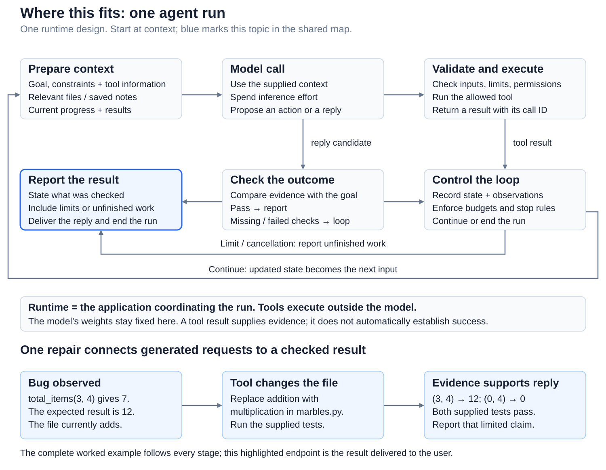
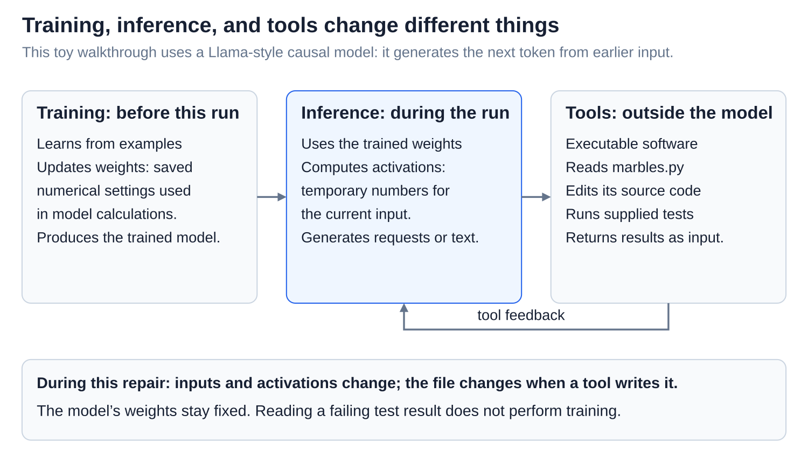
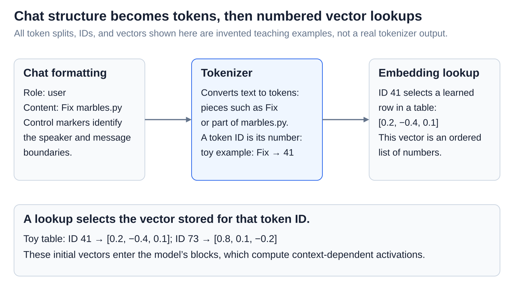
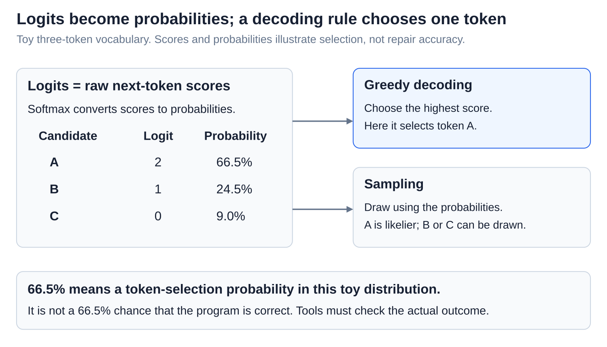
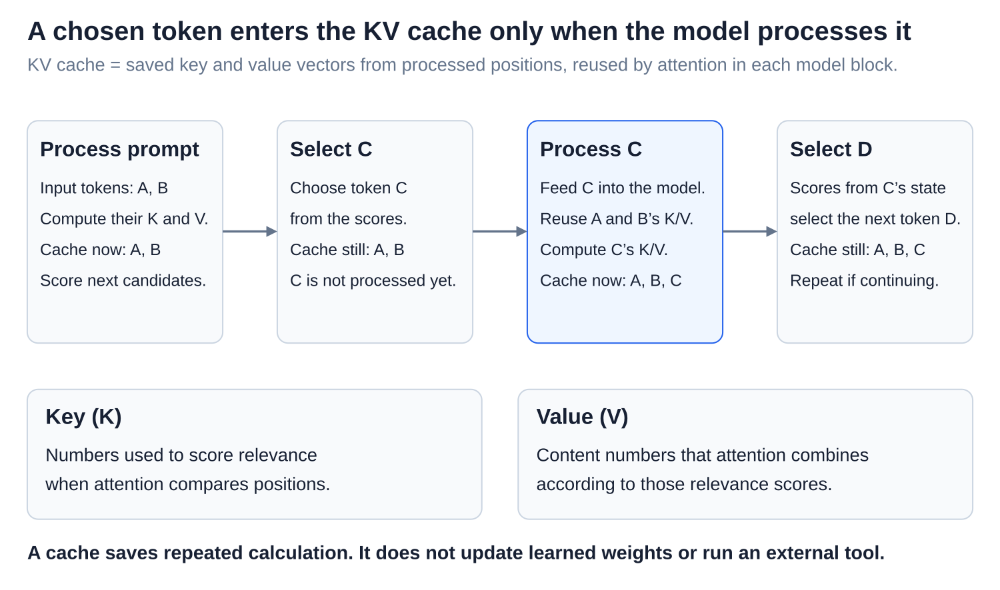

# Agents: A complete request, from input to checked result

<sub>[Back to Artificial Intelligence](../Readme.md#content)</sub>

**An agent alternates model computation with tool execution.** Task: “Fix `total_items` in `marbles.py` to count marbles in equal-sized bags, and run its tests.”

## Where this fits

The shared map highlights **the final report**: the result delivered after a complete run. The worked repair follows every stage, connecting a changed file and test evidence to a limited claim of completion.



## Before the run

```python
def total_items(bags, per_bag):
    return bags + per_bag
```

`bags` counts bags; `per_bag` counts marbles per bag; `return` gives the answer. Adding the inputs is the bug.

**Training** changes **weights**, saved numerical settings. **Inference** uses fixed weights to compute temporary **activations**; **tools** execute outside the model. This toy Llama-style causal model continues a token sequence; it is not a benchmark.



## Step 1 — Assemble the input


The **runtime**, the coordinating application, obtains the file and tests through tools. Follow four inputs into the **context**, input for one model call. Tool definitions describe operations and input rules; they do not execute code ([Tool calls](../Tool%20calls/Readme.md)).

## Step 2 — Compute and generate a request



Follow chat formatting → tokenizer → embedding lookup. **Tokens** are pieces or special markers; **IDs** identify those tokens. A **vector** is a number list. Splits, IDs, and vectors here are invented.


**Attention** mixes information from current and earlier positions. Position information represents token order. Repeated model blocks transform the vectors; the last position produces **logits**, scores for possible next tokens.



**Softmax** converts scores to probabilities. **Greedy decoding** picks the highest score; **sampling** draws using the probabilities. These toy token probabilities are not repair-confidence scores ([Decoding](../Decoding%20and%20sampling/Readme.md)).



A **key-value (KV) cache** stores attention numbers for processed positions. Only processing C adds its keys and values; selecting C does not. Generation repeats until a request is complete; producing `run_tests` has not run Python.

## Step 3 — Execute and observe the failure


The runtime checks **arguments** (inputs) for format (**validation**) and permission (**authorization**), then runs tests. A **call ID** matches result to request before it enters the next context.

Read both rows: three bags of four require **4 + 4 + 4 = 12**, but addition gives **3 + 4 = 7**. Zero bags require zero; addition gives four.

## Step 4 — Revise and retest


Read the upper row, then the lower. The model requests replacing `+` with `*`; the runtime checks and applies the edit:

```python
def total_items(bags, per_bag):
    return bags * per_bag
```

`*` means multiplication. After the edit result, a later call requests fresh tests: `(3, 4)` gives 12 and `(0, 4)` gives zero. Both pass. The file, context, and activations change; **test feedback does not update model weights** ([Agent loop](../The%20agent%20loop/Readme.md)).

## Step 5 — Report the checked result


Follow evidence → reply → scope. With the new test results, the model reports: **“Changed addition to multiplication in `marbles.py`. Both supplied tests pass.”** The runtime delivers it and ends this run. These tests do not prove correctness for every input.

# Sources

- [Ouyang et al.: instruction training](https://arxiv.org/abs/2203.02155)
- [Hugging Face: chat formatting](https://huggingface.co/docs/transformers/chat_templating)
- [Meta: model computation](https://github.com/meta-llama/llama3/blob/main/llama/model.py)
- [Hugging Face: decoding](https://huggingface.co/docs/transformers/en/generation_strategies)
- [Hugging Face: KV caching](https://huggingface.co/docs/transformers/en/cache_explanation)
- [Claude: tool execution](https://platform.claude.com/docs/en/agents-and-tools/tool-use/how-tool-use-works)
- [Anthropic: outcome evidence](https://www.anthropic.com/research/demystifying-evals-for-ai-agents)
- [Anthropic: coding-agent diagram](https://www.anthropic.com/research/building-effective-agents)
