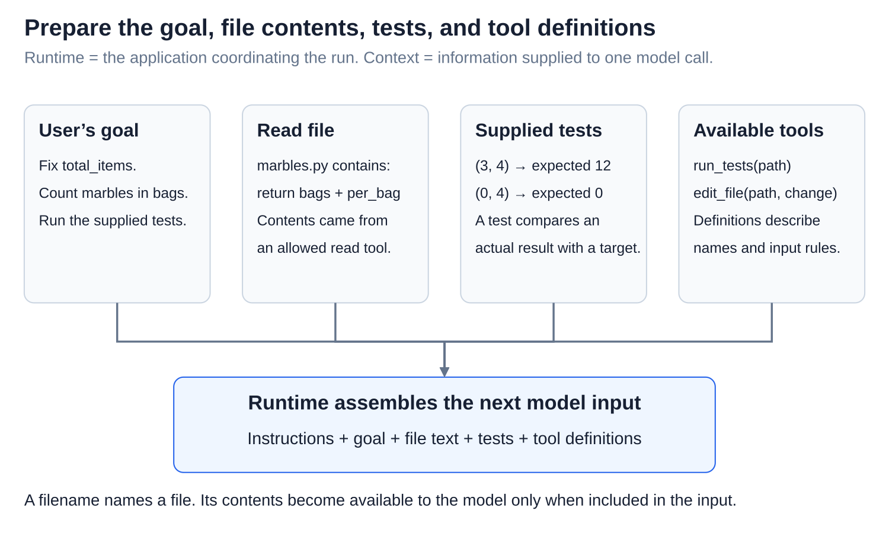
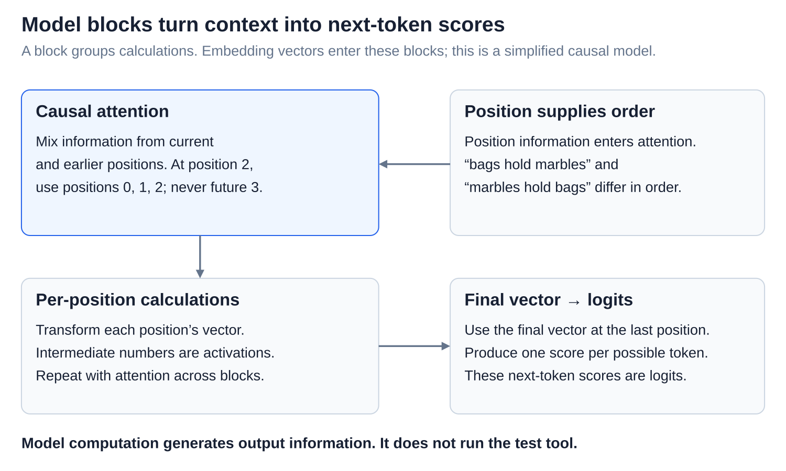
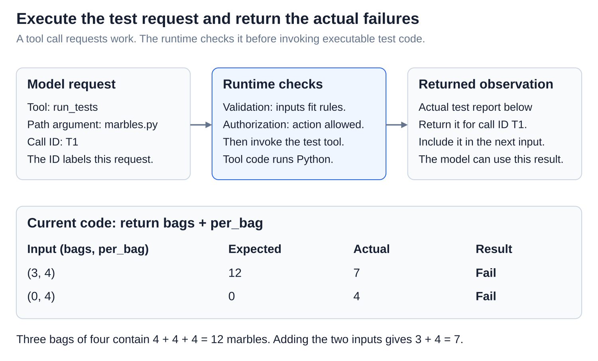
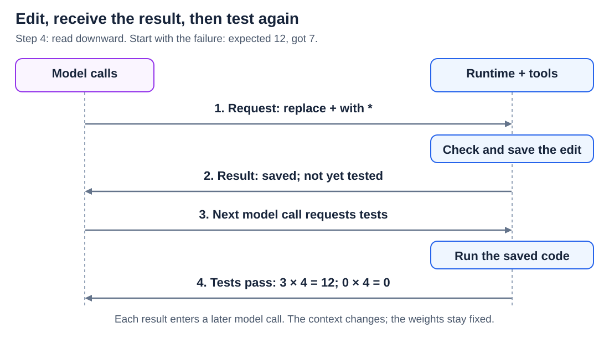
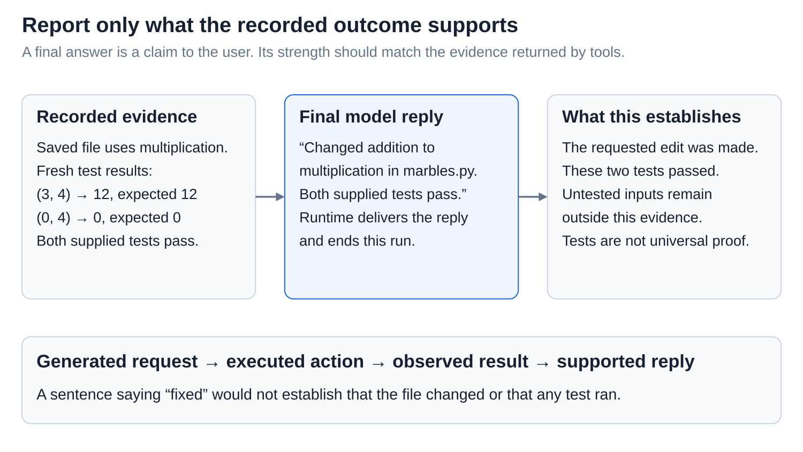

# Agents: A complete agent request, explained at every level

<sub>[Back to Artificial Intelligence](../Readme.md#content)</sub>

**An agent alternates model computation with tool execution.** The model requests actions; software executes them and returns evidence. Follow one repair to a checked file.

Our task: **“Fix `total_items` in `marbles.py` to count marbles in equal-sized bags, and run its tests.”** The file starts with:

```python
def total_items(bags, per_bag):
    return bags + per_bag
```

`bags` counts bags; `per_bag` counts marbles in each. `return` gives back the answer. Adding these numbers is the bug.

**Training** shaped language skills and instruction following by changing **weights**, saved numerical settings. We follow a Llama-style decoder-only transformer, which continues a token sequence. **Inference** uses those weights, which stay fixed here.

## Step 1 — Prepare the model's input



The **runtime**, the coordinating application, reads the file and supplied tests through allowed tools. It assembles the **context**, the model input: the goal, instructions, file contents, and tool descriptions with input rules.

A filename alone would not reveal its contents. Tool descriptions explain how to request actions; executable tools live outside the model.

## Step 2 — Calculate and generate a request



Read the top row, then the lower row. Chat formatting marks who said what. A **tokenizer** turns text into numbered pieces called **tokens**, which need not be whole words.

An embedding lookup turns each token ID into a **vector**, a list of numbers. Transformer blocks update them: **attention** mixes information from current and earlier positions; other learned calculations transform each position's information. Position information supplies order.

The last position's vector produces **logits**, next-token scores. **Softmax** turns them into probabilities. **Greedy decoding** takes the favorite; **sampling** draws randomly, like a raffle giving likely tokens more tickets. These chances concern tokens, not whether the repair is correct.

The chosen token joins the sequence, and generation repeats. A **cache** reuses saved attention calculations. Here, the output becomes a structured request to run tests. Generating it has not executed Python.

## Step 3 — Execute and return the failure



The runtime checks the tool's inputs and permissions, then runs the test tool. One test reports **expected 12, got 7**. Three bags holding four marbles each contain **4 + 4 + 4 = 12**. The buggy function instead calculates **3 + 4 = 7**.

The runtime pairs the result with its tool-call identifier and includes it in the next input. The model observes the failure through this result.

## Step 4 — Revise, then test again



Read downward: requests go right; results return left. With the failure in context, the model requests replacing `+` with `*`. The runtime checks and applies the edit:

```python
def total_items(bags, per_bag):
    return bags * per_bag
```

Python's `*` means multiplication: `3 * 4` counts three groups of four. After the edit result, a later model call requests tests again. The runtime runs them: three bags of four give 12; zero bags of four give zero. Both pass.

Each model call uses the computation from step 2. The context and **activations**, temporary numbers computed for that input, change. The file changes when the editing tool runs. **Test feedback does not update the model's weights.**

## Step 5 — Report the checked result



The next model call receives the passing results and produces a final reply: **“Changed addition to multiplication in `marbles.py`. Both supplied tests pass.”** The runtime delivers it and ends this run.

This reports evidence from those tests, not proof for every possible input. Training shaped the model's behavior; inference generated requests and replies; tools changed and checked the file. Those are three different kinds of work.

# Sources

- [Ouyang et al.: instruction training](https://arxiv.org/abs/2203.02155)
- [Brown et al.: learning from context](https://arxiv.org/abs/2005.14165)
- [Hugging Face: chat tokens](https://huggingface.co/docs/transformers/chat_templating)
- [Meta: transformer and cache](https://github.com/meta-llama/llama3/blob/main/llama/model.py)
- [Hugging Face: decoding](https://huggingface.co/docs/transformers/en/generation_strategies)
- [Claude: tool execution](https://platform.claude.com/docs/en/agents-and-tools/tool-use/how-tool-use-works)
- [Anthropic: outcomes](https://www.anthropic.com/research/demystifying-evals-for-ai-agents)
- [Anthropic: coding-agent sequence (diagram reference)](https://www.anthropic.com/research/building-effective-agents)
