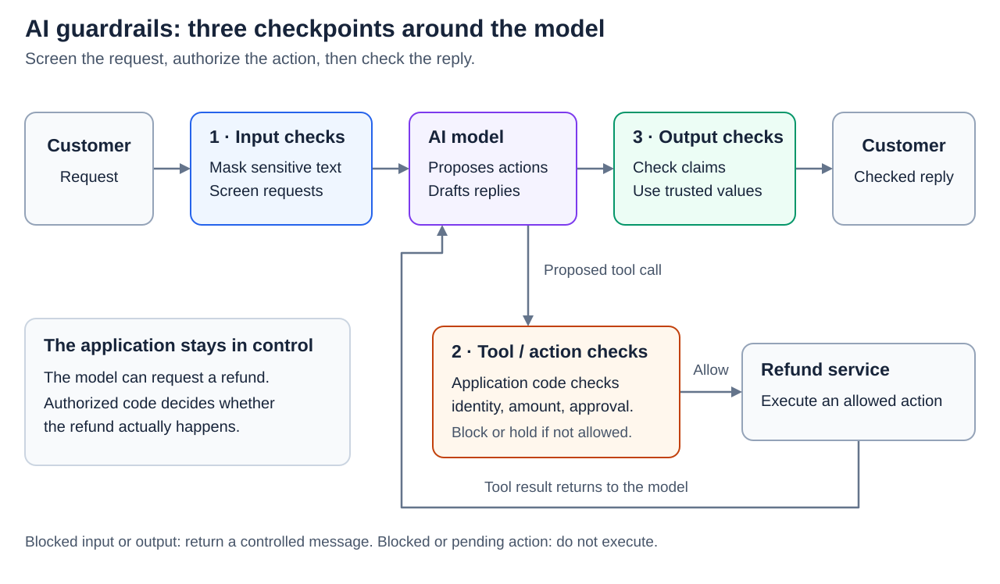
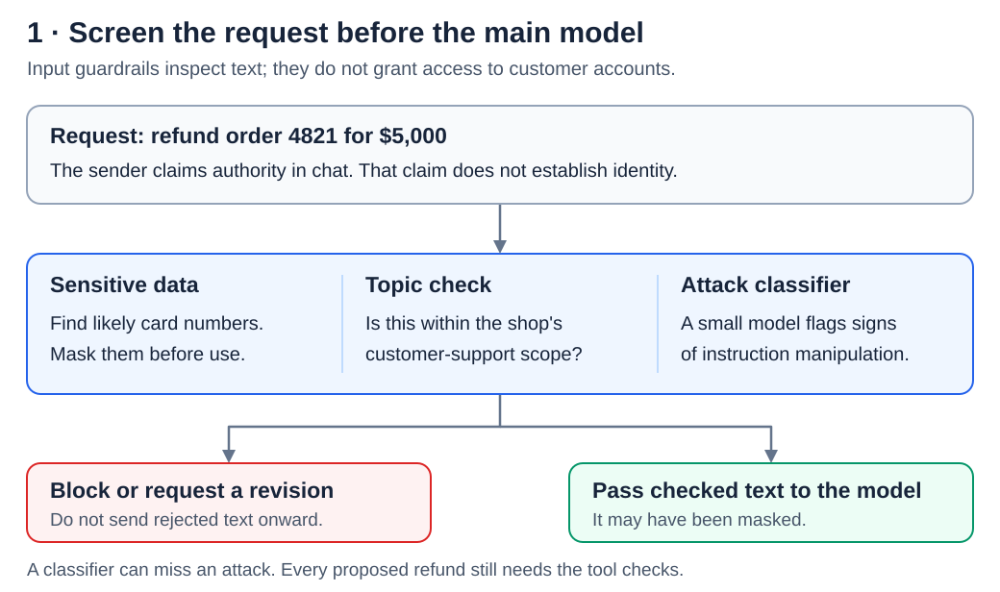
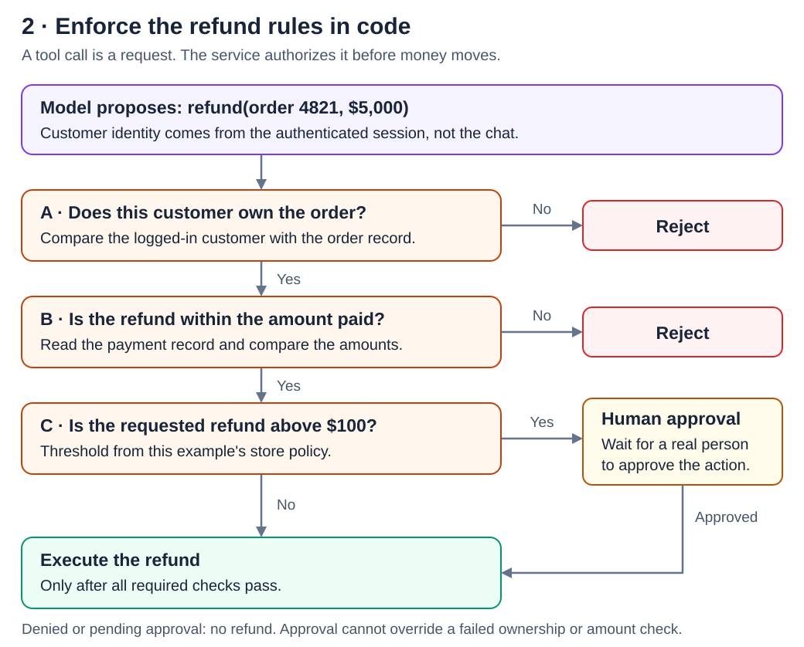
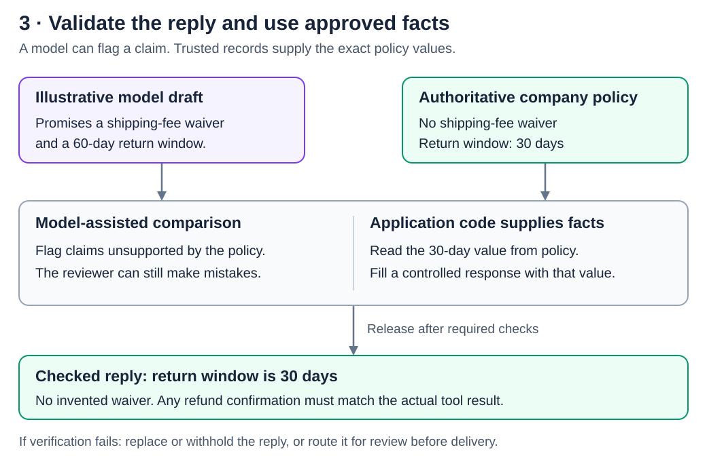

# AI Guardrails

[Back to Artificial Intelligence](../Readme.md#content)

**AI guardrails are application checks around a model: they screen incoming text, control actions, and check replies before delivery.** Model-based checks can recognize suspicious language; application code enforces permissions and business rules using trusted data.

> NOTE: The $100 approval threshold and 30-day return window are example policies, not universal rules.

## How the system is organized

A **large language model (LLM)** generates replies and can propose a **tool call**: a request to run an application function, such as looking up an order or issuing a refund. The surrounding application decides whether that function runs.

A **system prompt** gives the model instructions. Those instructions help guide behavior, but they do not enforce access permissions. For example, an instruction to respect refund limits still needs a corresponding check in the refund service.

Read the main path left to right. A proposed action takes the lower branch through the tool checks; its result returns to the model before the final reply is checked. Requests that need no tool skip that branch.

These are checkpoints in the application, not three extra layers inside the model's neural network. A checkpoint may use ordinary code, a specialized classifier, another LLM, or a combination.

## Step 1 — Screen the incoming request

A message arrives before the main model runs. In the video's example, the sender requests a $5,000 refund for order 4821 and claims to own the store.

The input checks inspect different properties:

- **Sensitive data:** detect and mask information that should not reach the model, such as likely payment-card numbers.
- **Scope:** reject requests outside the application's intended subject.
- **Instruction manipulation:** a **classifier**, a model that assigns categories or scores, can flag a likely **prompt injection**—text attempting to redirect the assistant away from its intended behavior.

The application then blocks the request, asks for a revision, or forwards the permitted, possibly masked text. Detection can miss an attack or reject an innocent message. Passing this checkpoint therefore does not authorize a refund.

## Step 2 — Enforce rules at the tool

Suppose the input check misses the attack and the model proposes a refund. Before money moves, the service checks trusted records:

| Check | Trusted evidence | Effect |
| --- | --- | --- |
| Does the order belong to this customer? | Authenticated login and order ownership | Reject a mismatch. A role claimed in chat grants no authority. |
| Is the refund within the amount paid? | Payment record | Reject an excessive amount. |
| Is the refund above $100? | Requested amount and configured policy | Hold it until a real person approves. |

The result is an executed refund, a rejection, or a pending approval. The model receives that result; a pending request must not become a claim that payment succeeded.

These checks work only if **every execution path goes through them**. Keep authorization in the service that owns the resource, give tools only the permissions they need, and do not expose an alternate unchecked refund operation. Human approval does not override a failed ownership or amount check.

## Step 3 — Check the reply and supply approved facts

A draft exists, but the customer has not received it. Even a harmless request can produce an unsupported promise.

A second model can compare the draft with company policy and flag a claim such as an unauthorized shipping-fee waiver. This is useful screening, but the reviewer can also be wrong.

For exact facts, the video recommends a stronger construction: **read the approved value from the database or policy rules and use it in the response**. The diagram's invented 60-day draft illustrates the mismatch with the video's 30-day policy. Application code can fill a controlled response field with `30 days`; it need not ask another model to guess which number is correct. Refund status should similarly come from the tool's actual result.

Release the reply only after the required checks. If it fails, replace or withhold it, or send it for review. An output check cannot undo a refund that already happened; that is why the tool checkpoint comes before execution.

## What to verify in a real application

The three layers cover different failure points. Input screening reduces risky requests, tool checks constrain effects, and output checks reduce unsupported or sensitive replies.

Test both attacks and ordinary requests: measure missed violations and legitimate messages blocked by mistake. Also test unavailable checkers, malformed results, and approval failures. A required check that cannot reach a trustworthy decision should lead to a controlled response, not silent permission to continue.

If replies are streamed, inspect the content before releasing it when the policy requires that protection. Checking text after the customer has received it cannot prevent its disclosure.

# Sources

- [KodeKloud: What Are AI Guardrails and How Do They Work! — source video](https://www.youtube.com/shorts/ig2JpD_sAHE)

  Transcript checkpoints: input at 1:04, tool rules at 1:36, output at 2:07.

- [NVIDIA NeMo Guardrails: guardrails sequence diagrams](https://docs.nvidia.com/nemo/guardrails/reference/guardrails-sequence-diagrams)

  Input, execution, and output placement.

- [NVIDIA NeMo Guardrails: runtime security FAQ](https://docs.nvidia.com/nemo/guardrails/resources/runtime-security-faq)

  Code and model checks, detector limits, failure behavior, testing, and streaming.

- [OWASP: Excessive Agency](https://genai.owasp.org/llmrisk/llm062025-excessive-agency/)

  Service-side authorization, least privilege, and human approval.

- [OWASP: Prompt Injection](https://genai.owasp.org/llmrisk/llm01-prompt-injection/)

  Instruction manipulation and layered mitigations.

- [AWS: How Amazon Bedrock Guardrails works](https://docs.aws.amazon.com/bedrock/latest/userguide/guardrails-how.html)

  Input/output evaluation, masking, and blocked responses.
