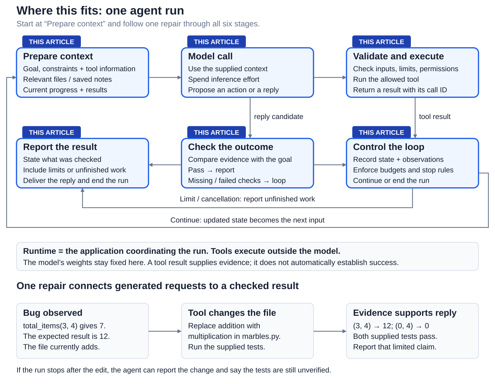
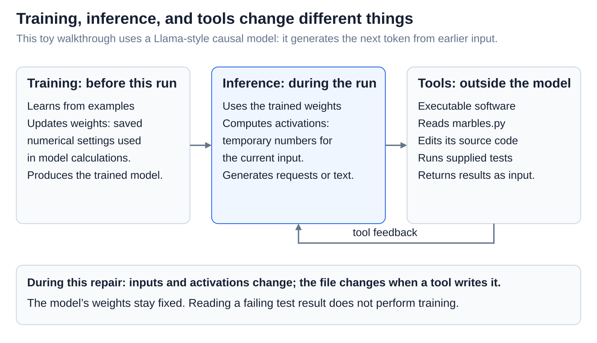
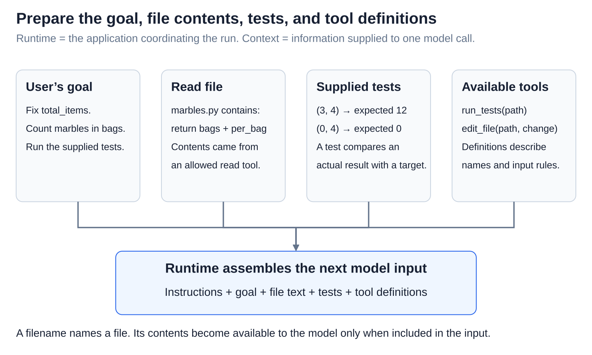
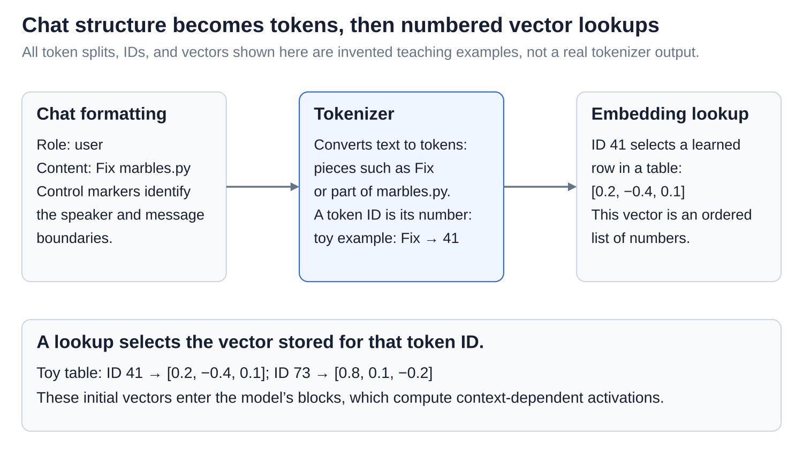
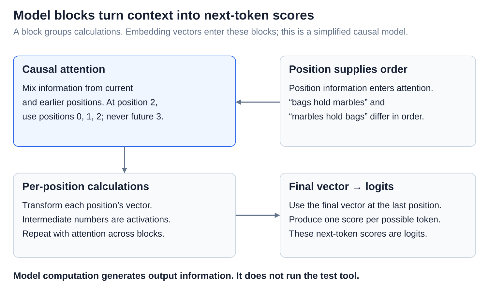
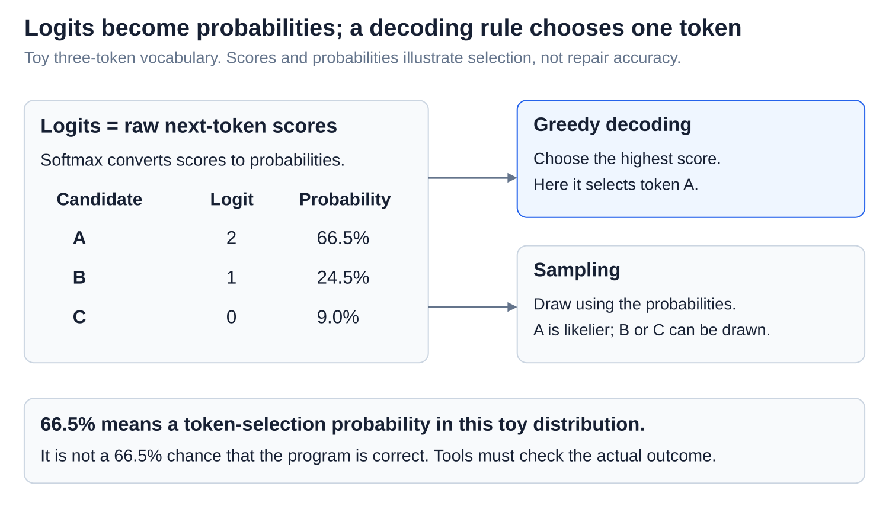
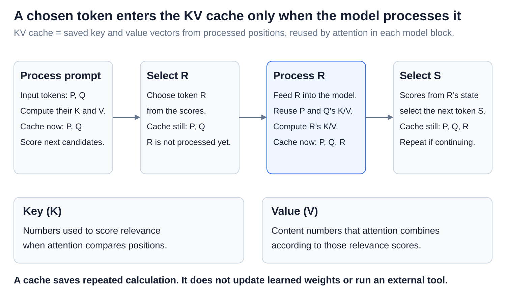
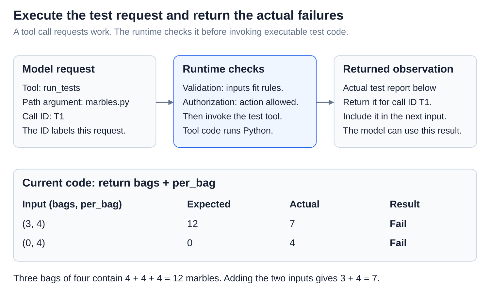
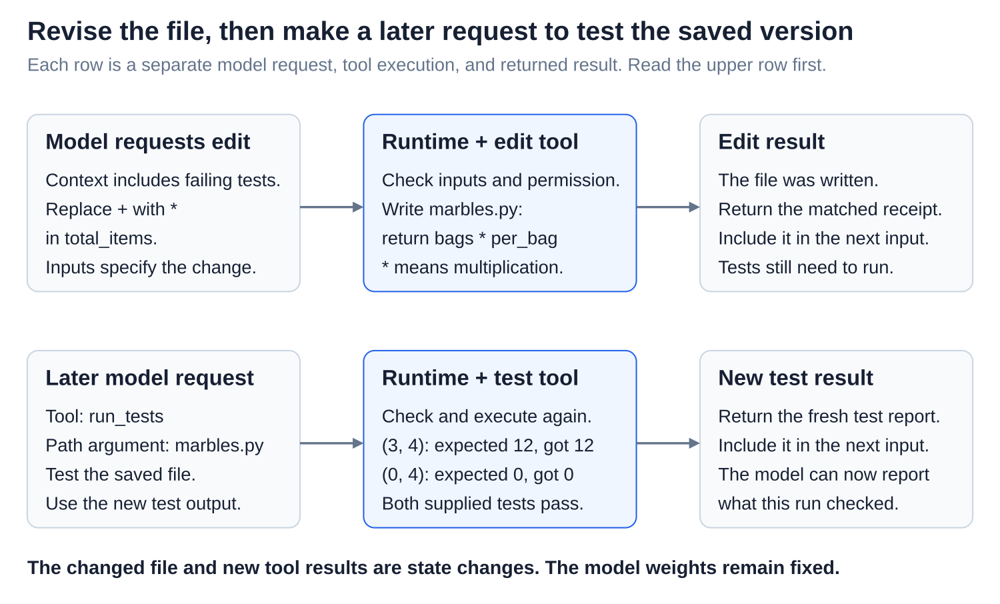
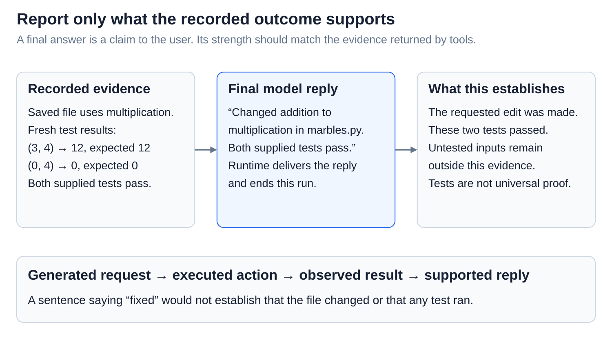

# Agents. A complete agent request, explained at every level

<sub>[Back to Artificial Intelligence](../Readme.md#content)</sub>

**A coding agent joins a language model to tools that can act on a project. The model proposes what to do, the application runs an allowed tool, and the result helps the model decide what to do next.**

Suppose you ask, “Fix `total_items` in `marbles.py` to count marbles in equal-sized bags, and run its tests.” Three bags with four marbles each should give **12**. The current function gives **7**. Follow this one repair from the words you type to the evidence behind the final reply.

1. [Who does what during the repair?](#1-who-does-what-during-the-repair)
2. [What did the model learn before the run?](#2-what-did-the-model-learn-before-the-run)
3. [What goes into the first model call?](#3-what-goes-into-the-first-model-call)
4. [How do the words become numbers?](#4-how-do-the-words-become-numbers)
5. [How does the model use earlier tokens?](#5-how-does-the-model-use-earlier-tokens)
6. [How is the next token chosen?](#6-how-is-the-next-token-chosen)
7. [What can the model reuse as it writes?](#7-what-can-the-model-reuse-as-it-writes)
8. [Who runs the tests and returns the failures?](#8-who-runs-the-tests-and-returns-the-failures)
9. [How does the agent fix and retest the file?](#9-how-does-the-agent-fix-and-retest-the-file)
10. [What can the agent report to the user?](#10-what-can-the-agent-report-to-the-user)
11. [Check your understanding](#11-check-your-understanding)

## 1. Who does what during the repair?



Start at “Prepare context” and follow the arrows around the map. The **model** generates a request such as “run the tests.” The **runtime** is the application coordinating the job. It checks the request and invokes a **tool**, a program that can do the work. The test tool runs Python and returns the results. The runtime can then call the model again with those results.

One user request can take several trips around this loop. The example beneath the map shows what it takes to go from “Check the outcome” to “Report the result.” The file must be saved with the repair, and the tests must run on that saved version. If a limit ends the run earlier, the agent can report how far it got.

## 2. What did the model learn before the run?



Read the three columns as three places to look for a change. **Training** adjusts the model’s **weights**, the stored numbers that shape how it responds. For example, training on demonstrations can help a model follow a request to fix code. **Inference** means using those weights on a particular input. The model computes temporary numbers called **activations**. Those can change when a test result arrives, while the weights stay fixed throughout this run. A lasting edit to the Python file happens through a tool.

## 3. What goes into the first model call?



The **context** is the information supplied to one model call. Read the four boxes across the top. In this example, the runtime gathers the file and supplied tests before asking the model what to do.

1. **Goal.** Fix the count and run the tests.
2. **File contents.** An allowed read tool returns the current source, including `return bags + per_bag`. The filename alone would tell the model where to look.
3. **Tests.** Each test specifies an input and an expected result. Three bags of four should give 12. Zero bags of four should give 0.
4. **Available tools.** The model receives descriptions of `run_tests(path)` and `edit_file(path, change)`. As [Agents. Tool calls](../Agents.%20Tool%20calls/Readme.md) explains, each description names the tool and specifies the inputs it expects.

Here is the starting file returned by the read tool. In Python, `def` defines a function and `return` gives its result to the caller.

```python
def total_items(bags, per_bag):
    return bags + per_bag
```

`bags` counts the bags and `per_bag` counts the marbles in each one. The line adds those two numbers. With three bags of four it calculates `3 + 4`. What we want is one group of four for each bag, or `4 + 4 + 4`.

At this point the model has enough information to predict that the tests will fail. An observed failure comes later, when the test tool actually runs.

## 4. How do the words become numbers?



Follow “Fix marbles.py” from left to right. First, a **chat template** marks where messages start and end and who supplied them. That lets a user’s instruction and a tool’s result carry different roles even when both contain Python text.

A **tokenizer** turns the formatted input into a sequence of **token IDs**. Each ID identifies a piece of text or a special marker. In the diagram’s invented example, `Fix` is one token with ID `41`. The model uses that ID to look up a row in its learned **embedding** table. Row 41 contains `[0.2, −0.4, 0.1]`, a **vector**, or ordered list of numbers. This vector is the starting representation of `Fix` wherever that token occurs. The words around it begin to matter in the next calculation.

## 5. How does the model use earlier tokens?



This example uses a Llama-style **transformer**, a model built from repeated groups of calculations called **blocks**. Inside a block, **causal attention** lets each position mix information from itself and earlier positions. With positions numbered from zero, position 2 can use positions 0, 1, and 2. A later token at position 3 cannot change what position 2 computed. Position information also lets the model distinguish “bags hold marbles” from “marbles hold bags.”

Each block then transforms the vector at each position. Across the blocks, the vector at the end of the input can come to reflect the goal, the code, and the available tools. The model can compute **logits**, one raw score per possible next token, at every input position. **Generation uses the scores at the last position** to choose how to continue.

## 6. How is the next token chosen?



In this tiny example the only candidates are A, B, and C. Their logits are 2, 1, and 0. **Softmax** converts the scores to probabilities that add to one. Here they are about 66.5% for A, 24.5% for B, and 9.0% for C.

**Greedy decoding** chooses A because it has the highest score. **Sampling** draws a token according to the probabilities, so it can also choose B or C. The 66.5% describes the chance of drawing A on this step. [Inference. From logits to text with decoding and sampling](../Inference.%20From%20logits%20to%20text%20with%20decoding%20and%20sampling/Readme.md) shows how changing the sampling settings affects those odds. To find out whether a repair works, the agent needs evidence from the file and tests.

## 7. What can the model reuse as it writes?



Generating a tool request usually takes several tokens. When computing attention, each layer produces **keys** (numbers used to decide how strongly to attend to a position) and **values** (the information mixed in from that position). A **key-value (KV) cache** keeps these numbers for positions already processed. Follow the letters across this separate timing example.

1. **Process P and Q.** These two tokens stand for the input. Processing the input is called **prefill**. Their keys and values enter the cache, and the model now has scores for the next token.
2. **Select R.** R is now part of the generated sequence. The cache still holds entries for P and Q.
3. **Process R.** On the next pass the model reuses the entries for P and Q, computes R’s keys and values, and adds them to the cache. The new scores can now be used to select S.

Repeating this process can produce a complete tool request with the name `run_tests` and the path `marbles.py`. So far the model has generated a request. The test tool still has to execute it.

## 8. Who runs the tests and returns the failures?



The runtime receives the tool name and its **argument**, the input `marbles.py`. It checks whether the argument has the required form (**validation**) and whether this run may test that file (**authorization**). Once both checks pass, the test tool executes the current Python function and compares its output with the expected values.

Read the “Expected” and “Actual” columns together. For `(3, 4)`, the tool gets 7 instead of 12. For `(0, 4)`, it gets 4 instead of 0. The second failure makes the bug especially clear. With zero bags there is nowhere for those four marbles to be.

The runtime copies the test request’s **call ID** `T1` onto the result and includes it in the next model input. The ID tells the model which request produced the two failures. On this next call, higher **reasoning effort** can lead the model to spend more tokens reasoning about the failures, while **prompt caching** can save time by reusing earlier calculations for an identical beginning of the input.

## 9. How does the agent fix and retest the file?



Follow the upper row first. The model requests replacing `+` with `*`, Python’s multiplication operator. The runtime checks the request. The edit tool saves the following function and returns confirmation that the write succeeded.

```python
def total_items(bags, per_bag):
    return bags * per_bag
```

The lower row starts **after the save**. With that confirmation in its input, the model requests another test run, repeating the cycle described in [Agents. Loop - act, observe, continue, stop](../Agents.%20Loop%20-%20act%2C%20observe%2C%20continue%2C%20stop/Readme.md). Now `(3, 4)` returns 12 and `(0, 4)` returns 0. Both match their expected results. The earlier failures describe the old file. This fresh report is evidence about the edited one.

## 10. What can the agent report to the user?



Read the diagram from the recorded evidence to the reply. The successful write supports the first sentence below. The two passing tests on the saved file support the second.

> Changed addition to multiplication in `marbles.py`. Both supplied tests pass.

The runtime delivers that reply and ends the run. If the test tool had stopped before either test ran, the agent could still report the saved edit and say that the tests were unverified. Even in the successful run, the two results establish what happened for those two inputs. A claim about every possible input would need more evidence.

## 11. Check your understanding

1. The model has proposed the right one-line fix. Which part of the agent can actually make that change to the project?

   <details>
   <summary>Answer</summary>

   The edit tool writes the file after the runtime checks and dispatches the request. Until that happens, the proposed fix exists only in the model’s output.

   </details>

2. The model proposes a better fix after seeing a failed test. Did the test train the model during this run?

   <details>
   <summary>Answer</summary>

   No. The test result changed the next call’s input. The model computed new activations with the same learned weights, so it could produce a different response.

   </details>

3. The model receives the filename `marbles.py` and the expected test results. What else does it need to identify the operator the file currently uses?

   <details>
   <summary>Answer</summary>

   It needs the file’s current contents. The runtime can read the file through a tool and include the line defining the calculation in the next model call.

   </details>

4. In the example, the tokenizer produces `41` for `Fix`. How does the model get from that number to the vector it uses as input?

   <details>
   <summary>Answer</summary>

   It looks up row 41 in its learned embedding table. In the example, that row holds the starting vector `[0.2, −0.4, 0.1]`.

   </details>

5. A fourth token is appended at position 3. Can it change the vector at position 2 in this causal model? Which position’s logits does generation use now?

   <details>
   <summary>Answer</summary>

   No. Position 2 can use only itself and positions before it. Position 3 can use all four tokens, and generation uses the logits at position 3 to choose the next token.

   </details>

6. A has probability 66.5% and B has 24.5%. Could decoding choose B? What does the 66.5% measure?

   <details>
   <summary>Answer</summary>

   Yes. Sampling can choose B. Greedy decoding would choose A in this example. The 66.5% measures the chance of drawing token A under this sampling distribution. The code still needs testing.

   </details>

7. The cache contains entries for P and Q, and the decoder just selected R. When does R get its own cache entry?

   <details>
   <summary>Answer</summary>

   When the model processes R on the next pass. Selecting R gives its token ID. Processing that ID computes the keys and values that the attention layers can store.

   </details>

8. Suppose the runtime refuses test request `T1`. How does the model know which call “Access denied” answers? What does that result tell it about `(0, 4)`?

   <details>
   <summary>Answer</summary>

   The runtime attaches `T1` to “Access denied,” so the model can match the result to the test request with that ID. The tool never ran, so the model has no observed value for `(0, 4)` from this call.

   </details>

9. The model is about to propose an edit. How might higher reasoning effort affect that call? In a separate run, what work could a prompt cache hit save?

   <details>
   <summary>Answer</summary>

   With higher effort, the model may spend more tokens reasoning about the failures before proposing a fix. A cache hit lets it skip recomputing the unchanged beginning of the input. It still processes the new test results.

   </details>

10. The edit tool confirms that it saved the multiplication fix. Why run the two tests again if their earlier results are already in the context?

    <details>
    <summary>Answer</summary>

    The earlier tests ran against the version that used addition. Running them after the save checks the multiplication version and gives the agent fresh results for both inputs.

    </details>

11. Only the first test finished after the save. It returned 12 for three bags of four. What can the agent accurately tell the user?

    <details>
    <summary>Answer</summary>

    The change was saved, and the three-bag test passed. The zero-bag test is still unverified. A report that both passed would need a passing result for that second test too.

    </details>

# Sources

- [Ouyang et al., training language models to follow instructions](https://arxiv.org/abs/2203.02155)
- [Hugging Face, chat templates and control tokens](https://huggingface.co/docs/transformers/chat_templating)
- [Meta, Llama 3 reference implementation of embeddings, transformer blocks, and output scores](https://github.com/meta-llama/llama3/blob/main/llama/model.py)
- [Hugging Face, greedy decoding and sampling](https://huggingface.co/docs/transformers/en/generation_strategies)
- [Hugging Face, how key-value caching works](https://huggingface.co/docs/transformers/en/cache_explanation)
- [Claude documentation, how tool execution and results work](https://platform.claude.com/docs/en/agents-and-tools/tool-use/how-tool-use-works)
- [Claude documentation, matching results to client tool calls](https://platform.claude.com/docs/en/agents-and-tools/tool-use/handle-tool-calls)
- [Claude documentation, reasoning effort](https://platform.claude.com/docs/en/build-with-claude/effort)
- [Claude documentation, reusing a cached prompt prefix](https://platform.claude.com/docs/en/build-with-claude/prompt-caching)
- [Anthropic, evaluating an agent’s recorded actions and outcomes](https://www.anthropic.com/research/demystifying-evals-for-ai-agents)
- [Anthropic, the agent loop and coding-agent diagram](https://www.anthropic.com/research/building-effective-agents)
