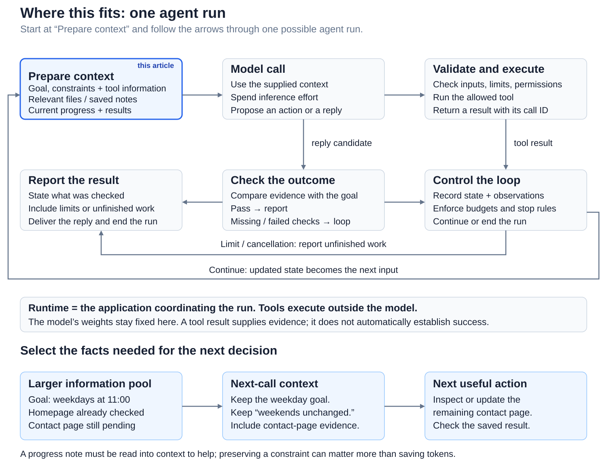
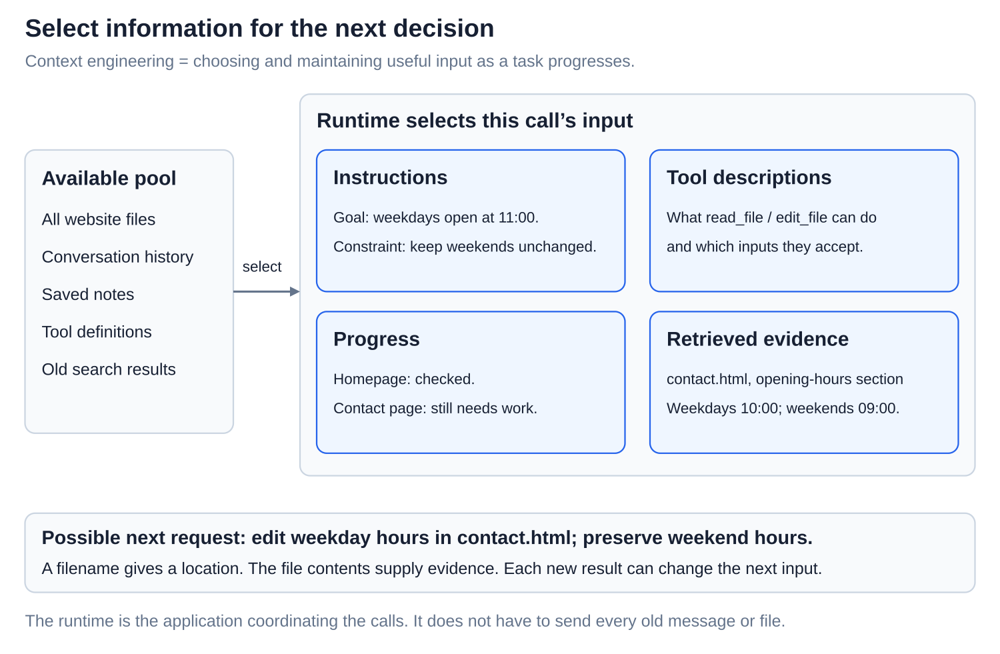
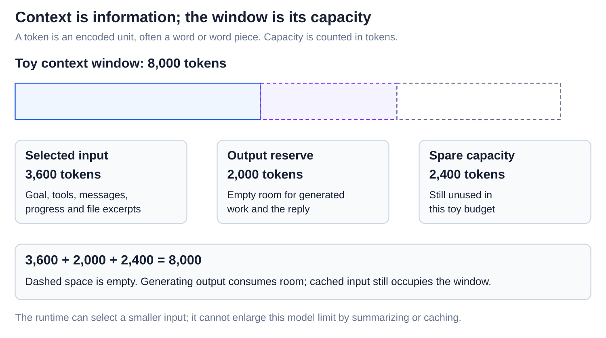
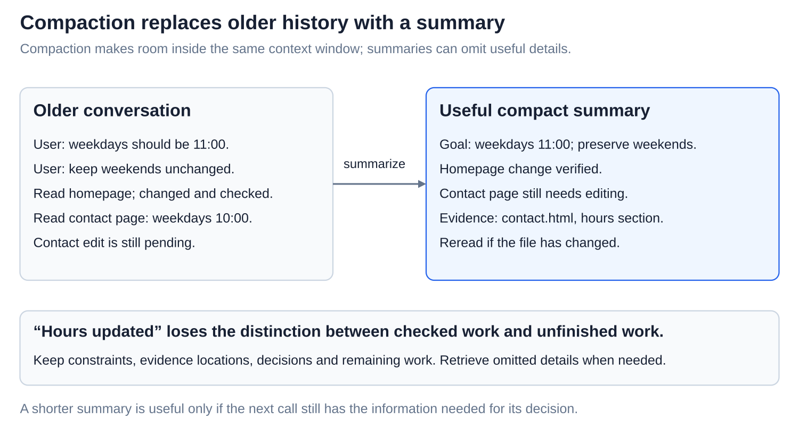
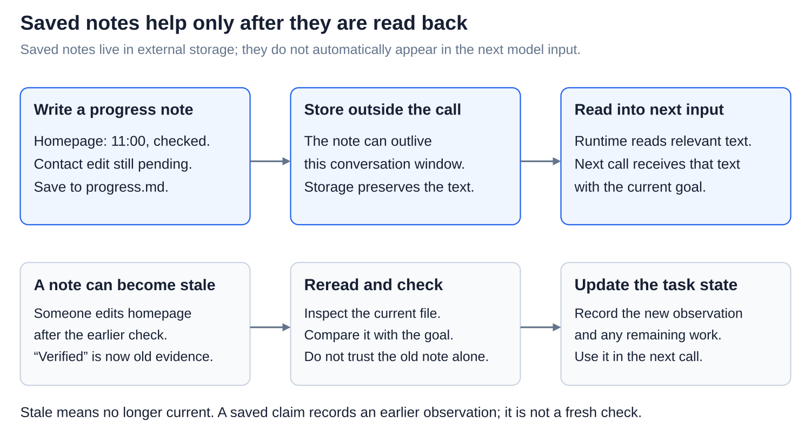
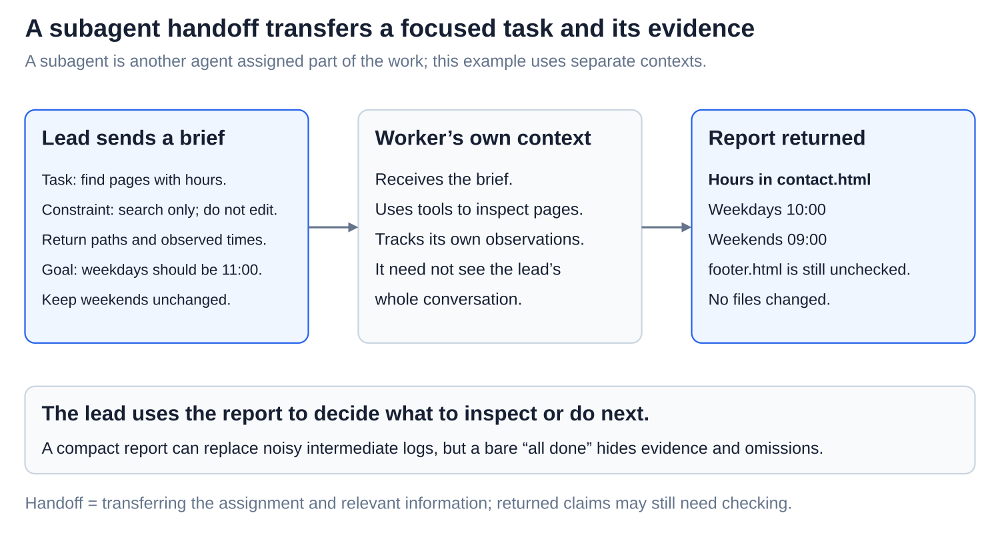
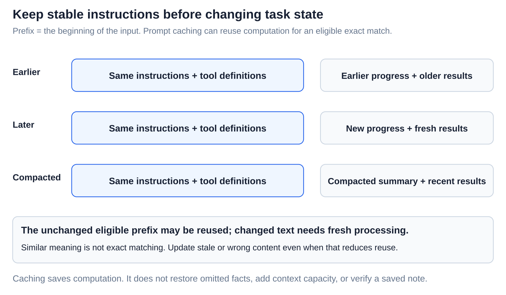

# Agents. Context engineering for long-running agents

[Back to Artificial Intelligence](../Readme.md#content)

**Context engineering means choosing what information the model receives each time it has to decide what to do next.**

Suppose a shop asks an agent to change the weekday opening time to `11:00` everywhere on its website and leave weekend hours alone. Halfway through, the homepage has been checked and the contact page still needs work. What would the next model call need to see to pick up there?

1. [Why prepare context more than once?](#1-why-prepare-context-more-than-once)
2. [What belongs in the next call?](#2-what-belongs-in-the-next-call)
3. [How much room does one call have?](#3-how-much-room-does-one-call-have)
4. [What should survive a shorter history?](#4-what-should-survive-a-shorter-history)
5. [How can a later session use saved notes?](#5-how-can-a-later-session-use-saved-notes)
6. [What does a subagent need in a handoff?](#6-what-does-a-subagent-need-in-a-handoff)
7. [When can two calls reuse computation?](#7-when-can-two-calls-reuse-computation)

## 1. Why prepare context more than once?

An **agent** can make a series of model calls and use tools to carry out a task. Each **model call** is one request for the model to propose an action or give a reply. The **runtime**, the application running the agent, gathers the information for that call. That input is its **context**.

Follow the loop back to “Prepare context.” First the model can ask to read a page. The runtime runs the tool and includes the returned hours in the next call. Now the model can propose a specific edit. To check the result, the agent reads the saved page and compares its hours with the requested weekday time and the weekend time recorded before the edit. A successful edit on one page still leaves the other pages to account for.

## 2. What belongs in the next call?

Imagine the model is about to decide what to change on the contact page. Read the four panels on the right of the diagram as the information it receives together.

1. **Instructions** give the goal and its limits. Set weekdays to `11:00` across the site and preserve each page’s weekend hours.
2. **Tool descriptions** explain the available actions. Here, `read_file` reads a file and `edit_file` changes it. The model needs to know what inputs each accepts.
3. **Progress** identifies what still needs work. The homepage has been changed and checked. The contact page has been read and still needs editing.
4. **Retrieved evidence** gives the relevant contents. The opening-hours section of `contact.html` shows weekdays at `10:00` and weekends at `09:00`. Those two lines tell the model both what to change and what to preserve.

If the call has only the filename, it knows where to look. Reading the hours section supplies the missing evidence without loading the entire website.

## 3. How much room does one call have?

The **context window** is the model’s capacity for the input and the output it generates in one call. It is measured in **tokens**, the units a model uses to represent text. A token can be a word, part of a word, or punctuation.

In the diagram’s example, a model has an 8,000-token window. The selected input already uses 3,600 tokens. If the runtime sets aside 2,000 for the reply or a tool request, it can still add **2,400 tokens** of evidence. The dashed areas are empty room. Setting aside space for output does not mean the model has already generated it.

Even when everything fits, the model can miss a relevant detail as the input grows, an effect called **context rot**. In long-document experiments, models often found the same fact more reliably near the start or end than [in the middle of the input](../Inference.%20In-context%20learning%2C%20context%20windows%2C%20and%20memory/Readme.md#4-how-much-context-can-fit). For the shop, the runtime can send the hours section and the weekend rule and leave out unrelated page content.

If the input alone exceeds a Claude model’s window, the API rejects the request with HTTP `400` and the message “prompt is too long.” On Claude 4.5 and later, if the input fits but the reply reaches the window limit during generation, the response ends with `stop_reason: "model_context_window_exceeded"`.

## 4. What should survive a shorter history?

**Compaction** replaces older conversation history with a shorter summary. Recent messages can stay alongside it. This frees room inside the same context window, but a detail omitted from the summary may need to be retrieved again.

Suppose the summary says only “Hours updated.” A more useful summary would read like this.

> Weekdays must open at 11:00 across the site. Keep weekend hours unchanged. Homepage edited and checked. Contact page still needs its weekday edit. See the opening-hours section of contact.html.

“Hours updated” could make the agent stop early. The longer summary preserves the rule, what was verified, what remains, and where to find the evidence. Dropping the old search results makes the pending contact-page edit easier to find.

## 5. How can a later session use saved notes?

A **saved note** lives outside the active model call. For example, the agent can ask the runtime to write the summary to `progress.md`. When the task resumes, the runtime reads the relevant lines and includes them in the new call. That is how an earlier session’s work becomes available again.

A note can be **stale**. “Homepage checked” records an observation at the time of the check. If someone has since edited the homepage, read its current hours and compare them with the requested weekday time and the previously recorded weekend hours. Then update the note with what was actually found. [Inference. In-context learning, context windows, and memory](../Inference.%20In-context%20learning%2C%20context%20windows%2C%20and%20memory/Readme.md#5-how-does-a-saved-note-help-on-a-later-call) follows a saved note into a later call.

## 6. What does a subagent need in a handoff?

A **subagent** is another agent assigned part of the work. In this example the worker has its own context, so the lead must pass along the parts of the task the worker needs. A **handoff** includes both the assignment and what the lead wants back.

For a search-only assignment, the lead might ask, “Find where the site lists opening hours. We’re moving weekdays to 11:00 and keeping weekends unchanged. Leave the files as they are. Return the paths, the hours you found, and anything you didn’t check.”

A worker can then report, “In `contact.html` I found weekdays 10:00 and weekends 09:00. I haven’t checked `footer.html`. No files changed.” The lead can use those observations to plan the contact edit and keep the footer on the list.

## 7. When can two calls reuse computation?

A **prefix** is the beginning of an input. With **prompt caching**, the service can reuse work it already did to process an eligible, exactly matching prefix. In the diagram, the instructions and tool descriptions stay the same across calls. Putting changing information, such as progress and file excerpts, after them allows the beginning to match even after the task moves on.

A change near the beginning, even a rewording with the same meaning, breaks the match from the first difference onward. [Inference. Prompt caching across requests](../Inference.%20Prompt%20caching%20across%20requests/Readme.md) shows how much of the original prefix can still be reused. If the shop changes its instructions, send the new instructions. Cached input still occupies space in the window, and a cache hit cannot supply a missing weekend rule or tell the agent whether a file has changed.

## Check your understanding

1. An edit tool reports that it wrote the homepage successfully. What does the next call need before the agent can say the whole site is done?

   

   
Answer

   It needs evidence that all pages showing hours meet the request. Check the saved weekday and weekend hours against the goal and the original weekend values, and account for pages still awaiting inspection or editing. The successful write establishes only that the tool wrote the homepage.

   

2. The model has the goal, a file-reading tool, and the name `contact.html`. How can it find exactly which line to change and which one to preserve?

   

   
Answer

   Request the opening-hours section and include the returned text in the next call. In this example it shows weekdays at 10:00 and weekends at 09:00. Change the weekday line to 11:00 and keep the weekend line at 09:00.

   

3. In the 8,000-token example, the input uses 3,600 tokens and 2,000 are reserved for output. Can a further 3,000-token file fit while keeping that reserve?

   

   
Answer

   No. Only 2,400 tokens remain, so the file is 600 tokens too long. Selecting the relevant hours section can preserve both the output reserve and the weekend constraint.

   

4. A summary says, “Homepage and contact page handled.” The homepage was edited and checked, but the contact page was only read. What should the summary say so the next call can resume correctly?

   

   
Answer

   Record the verified homepage change and mark the contact edit as pending. Carry forward the 11:00 weekday goal, the instruction to preserve weekends, and the location of the hours in `contact.html`.

   

5. A new session reads yesterday’s note saying the homepage was checked. Someone edited the homepage this morning. What should the agent do before marking it complete?

   

   
Answer

   Reread the homepage and verify its current hours against the goal and the recorded weekend values. Then refresh the note. Yesterday’s check describes an earlier version of the page.

   

6. A worker asked only to search replies, “All done.” What should the lead ask for before deciding whether any more pages need work?

   

   
Answer

   Ask which pages it inspected, what weekday and weekend times it observed, and which pages remain unchecked. A search result can identify an edit to make. It does not establish that anyone made the edit.

   

7. Two calls start with the same long instructions and tool descriptions. The only new information is a contact-page result. Where should it go to preserve the opportunity for a cache hit, and why?

   

   
Answer

   Put the new result after the unchanged instructions and tool descriptions. That leaves an identical beginning whose processing may be reused. The model still receives the new evidence for this call.

   

# Sources

- [Anthropic: context-curation diagram and context engineering](https://www.anthropic.com/research/effective-context-engineering-for-ai-agents)
- [Liu et al., Lost in the Middle](https://aclanthology.org/2024.tacl-1.9/)
- [Anthropic: tool descriptions and useful results](https://www.anthropic.com/research/writing-tools-for-agents)
- [Claude: context windows](https://platform.claude.com/docs/en/build-with-claude/context-windows)
- [Claude: compaction](https://platform.claude.com/docs/en/build-with-claude/compaction)
- [Claude: external memory](https://platform.claude.com/docs/en/agents-and-tools/tool-use/memory-tool)
- [Anthropic: separate subagent contexts and reports](https://www.anthropic.com/research/multi-agent-research-system)
- [Claude: prefix caching](https://platform.claude.com/docs/en/build-with-claude/prompt-caching)
