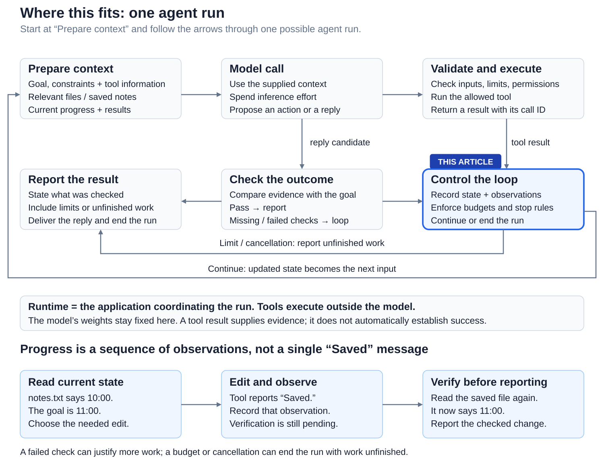
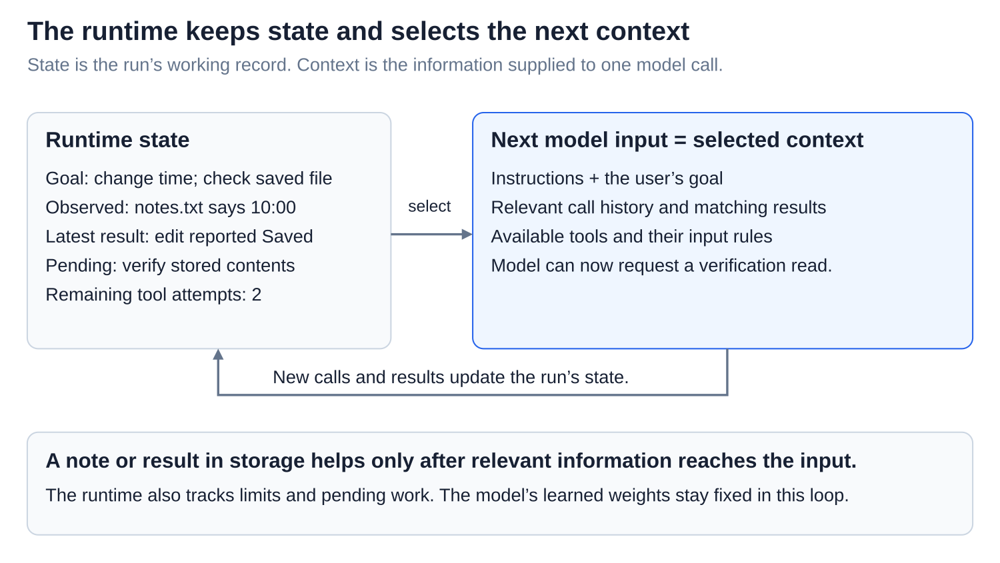
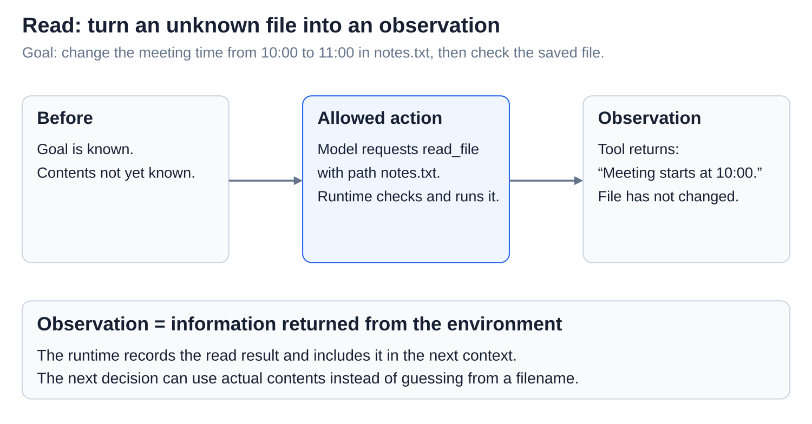
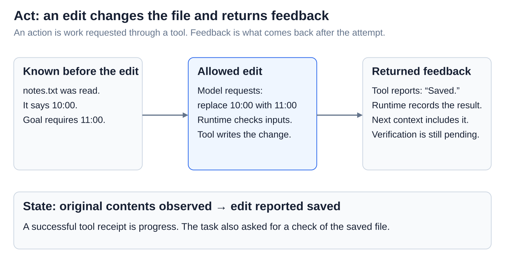
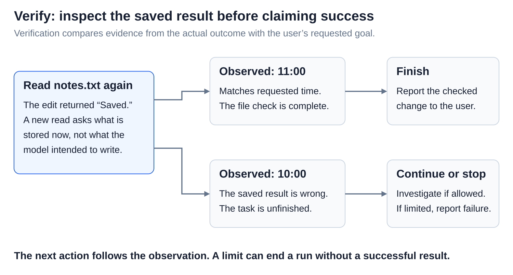
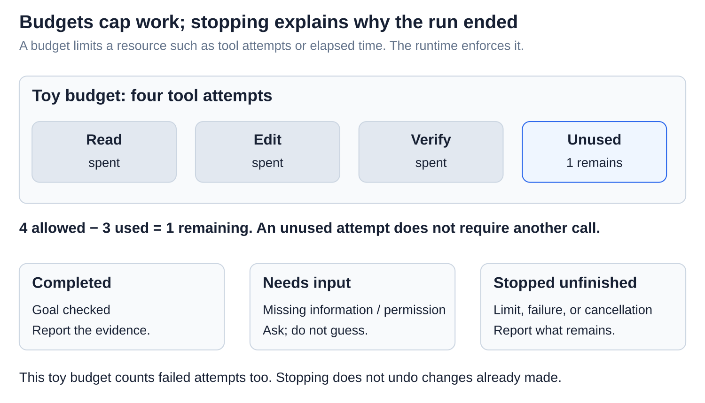
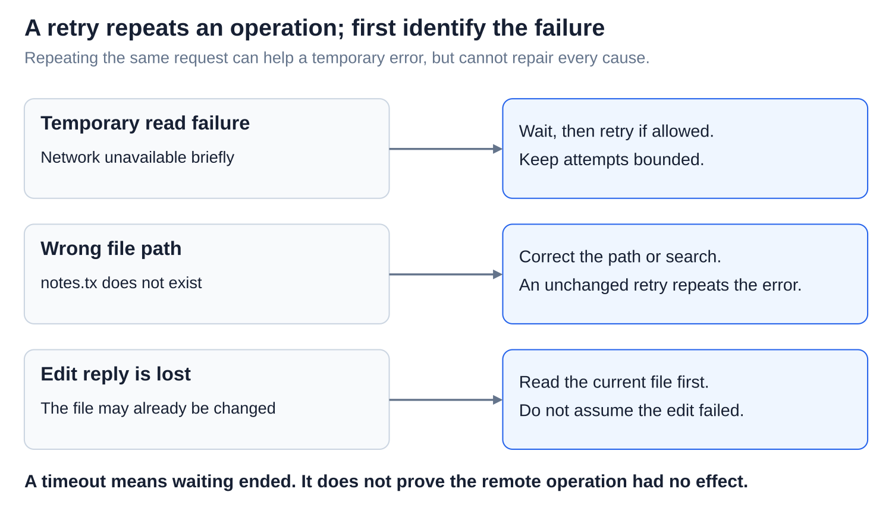
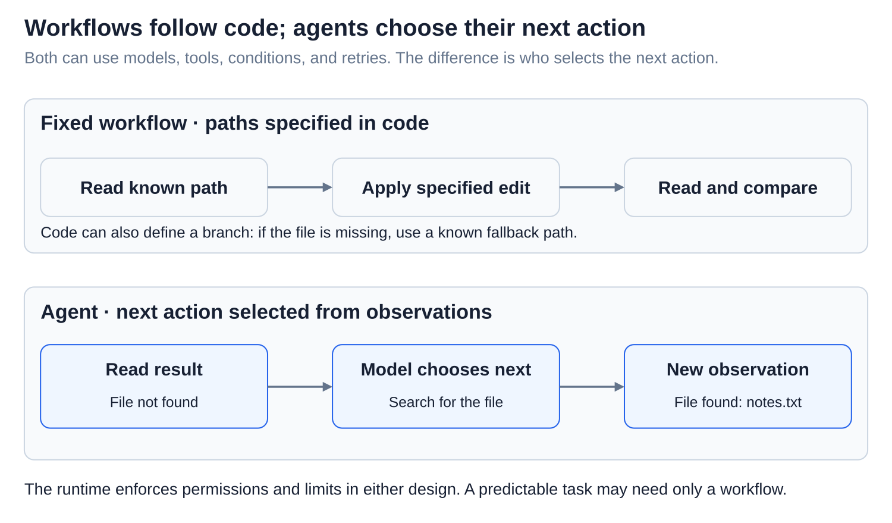

# Agents. Loop - act, observe, continue, stop

[Back to Artificial Intelligence](../Readme.md#content)

**An agent loop lets the result of one action guide the next.**

Imagine asking, “Change the meeting time in `notes.txt` from 10:00 to 11:00, then check the saved file.” A language model can suggest an edit. To carry it out, the application needs a tool that can change the file. To know when to stop, it needs evidence that the saved meeting time is 11:00.

1. [How does an agent loop work?](#1-how-does-an-agent-loop-work)
2. [What does the next model call know?](#2-what-does-the-next-model-call-know)
3. [Read the current meeting time](#3-read-the-current-meeting-time)
4. [Make the edit and interpret the receipt](#4-make-the-edit-and-interpret-the-receipt)
5. [Check the saved meeting time](#5-check-the-saved-meeting-time)
6. [When should the loop stop?](#6-when-should-the-loop-stop)
7. [When is a retry useful?](#7-when-is-a-retry-useful)
8. [How does an agent differ from a fixed workflow?](#8-how-does-an-agent-differ-from-a-fixed-workflow)
9. [Check your understanding](#9-check-your-understanding)

## 1. How does an agent loop work?

The **runtime** is the application coordinating the task. A **model call** asks the model for a response. The model can request an **action**, such as reading a file, by naming a **tool** (a function the runtime can run) and supplying its inputs.

Follow the return arrow from “Control the loop” to “Prepare context.” The runtime checks whether the requested action is allowed and, if so, runs the tool. The result comes back as an **observation**. On the next call, the model can use that observation to request another action or propose a final reply. A missing-file result calls for a different decision from a read that finds the meeting at 10:00.

## 2. What does the next model call know?

**State** is the runtime’s working record for the whole task. It can hold the goal, earlier actions and results, work still to do, and the number of attempts left. **Context** is the information supplied to one particular model call.

The diagram takes a snapshot just after the edit. On the left, the record says the file originally contained 10:00, the edit tool returned “Saved,” and verification is pending. Two of four tool attempts remain. On the right, the runtime selects what the model needs for its next decision, including the goal, the tool result, and the available tools. A result kept only in storage cannot guide that call until the runtime makes it available. [Agents. Context engineering for long-running agents](../Agents.%20Context%20engineering%20for%20long-running%20agents/Readme.md) shows how to select earlier results for the next call.

## 3. Read the current meeting time

Start at the beginning of the example. The user has named the file and requested a new time. To find out what the file actually says, the model requests `read_file` with `notes.txt` as its input. The tool returns the line “Meeting starts at 10:00.”

Reading changes what the agent knows. The file itself still says 10:00. The runtime records that line and includes it in the next model call, so the model can identify the text to edit.

## 4. Make the edit and interpret the receipt

Read the three boxes from left to right. The first shows the observed time and the requested time. In the second, the model asks to replace 10:00 with 11:00 on the meeting line. The runtime checks the request, and the edit tool writes the change. The third box shows the tool’s reply, “Saved.”

That reply is **feedback** about the action. The runtime can now record “edit reported saved.” The user also asked for a check of the saved file, and that check is still pending.

## 5. Check the saved meeting time

**Verification** means comparing the observed result with the user’s goal. Here the relevant evidence is the meeting line in a fresh read of `notes.txt`. Follow the branch that matches what the read returns.

1. **“Meeting starts at 11:00.”** The saved line matches the requested time. The agent can stop and report, “I reread `notes.txt` and confirmed the meeting starts at 11:00.”
2. **“Meeting starts at 10:00.”** The check found the old time. The agent can investigate the edit if another action is allowed. If it must stop, it can report, “The edit tool returned ‘Saved,’ but the file still reads 10:00.”

## 6. When should the loop stop?

In a Claude client-tool loop, the runtime handles tool requests while `stop_reason` is `"tool_use"` and leaves that loop for other reasons, including `"end_turn"` (the model finished its turn) and `"max_tokens"` (its reply was cut short).

A **budget** limits the work a run can use, such as elapsed time or the number of tool attempts. The runtime enforces that limit. In this example the budget is four tool attempts, and a failed attempt counts too.

Read, edit, and verify use three attempts, so `4 − 3 = 1` remains. If the read confirms 11:00, the task is complete and the last attempt can go unused. If two files have the same name and the agent cannot tell which one the user meant, it can pause and ask for the intended file. If time runs out or the user cancels, it must stop and report what it has checked and what is unfinished. An edit already saved can remain on disk even if the run ends before verification.

## 7. When is a retry useful?

A **retry** means trying an operation again. The right response depends on what went wrong and whether the first attempt might already have changed something. Compare the three cases in the diagram.

1. **A read fails during a brief outage.** Waiting and trying the read again may work once the service recovers. That retry uses another attempt.
2. **The requested path is `notes.tx`.** If the intended file is `notes.txt`, correct the path. Repeating the same typo would look for the same missing file.
3. **The edit request times out.** A timeout means the runtime stopped waiting for a reply. The write may already have happened. Read the meeting line first. If it says 11:00, that read can also serve as verification. If the outcome is still uncertain, check the status of the first attempt before issuing another edit.

This matters for actions such as adding a line to a file. Repeating a successful append after its reply was lost could add the line twice. [Agents. Reliability - evaluation and execution boundaries](../Agents.%20Reliability%20-%20evaluation%20and%20execution%20boundaries/Readme.md) shows how to recognize a retry and avoid a duplicate change.

## 8. How does an agent differ from a fixed workflow?

A **fixed workflow** follows paths written in code. In a **model-directed agent loop**, the model chooses the next action using what it has observed. Both can use the same tools and both can have branches, retries, and limits.

Use “file not found” to compare the two rows. If code says “try the backup folder whenever this path is missing,” the fallback is part of a fixed workflow. If the model reads the error, considers the available tools, and chooses to search for the file, that decision is model-directed. In both cases the runtime enforces file permissions, and completing the task still requires checking the saved meeting time.

## 9. Check your understanding

1. A model replies, “I’ll edit `notes.txt`.” Has the file changed yet? Who actually performs the edit?

   

   
Answer

   No. That sentence describes an intention. The model must request the edit tool, and the runtime must allow and run it for the tool to change the file.

   

2. The runtime recorded “Saved,” but the next model call receives only the original user request. Is that call aware of the receipt? What context would help it decide what to do?

   

   
Answer

   No. The receipt is in the run’s state, but this call has not received it. Include the receipt, the filename, and the user’s requirement to check the saved time so the model can request a verification read.

   

3. The first read returns “Meeting starts at 10:00.” What has changed as a result of that read?

   

   
Answer

   The agent now has evidence of the current meeting time and knows which line to edit. The read left the file at 10:00.

   

4. The edit tool returns “Saved.” What can the runtime record now, and what task should it keep open?

   

   
Answer

   Record that the tool reported saving the edit. Keep the check of the saved meeting time open until a fresh read shows what is in the file.

   

5. After “Saved,” a fresh read still shows 10:00. Can the agent report that the meeting moved to 11:00? What should it do with that result?

   

   
Answer

   No. The read shows that the saved meeting line still has the old time. Investigate if further work is allowed. If the run ends here, report the mismatch and the unfinished change.

   

6. With four tool attempts available, the first read fails. A second read succeeds, and the edit returns “Saved.” How many attempts remain, and how should the agent use them?

   

   
Answer

   One attempt remains. Both reads and the edit count, so three attempts are spent. Use the last one to read the saved meeting line. If it shows 11:00, report success. If the read fails, report that the edit was acknowledged and the time could not be verified.

   

7. An edit times out before the runtime receives “Saved.” Should the agent immediately repeat it? What evidence could settle the question?

   

   
Answer

   No. The reply may have been lost after the tool wrote the file. Read `notes.txt` to see whether the meeting already says 11:00. If it does, the requested change is confirmed and another write is unnecessary.

   

8. Two systems both search for a missing file. One always searches a backup folder because its code prescribes that step. The other lets the model choose a search after reading the error. Which decision is model-directed?

   

   
Answer

   The second one. The model chose the search based on the error and its available tools. In the first system, the developer chose that branch in advance.

   

# Sources

- [Anthropic — Building effective agents, with an agent-loop diagram and a comparison of workflows and agents](https://www.anthropic.com/research/building-effective-agents)
- [Anthropic — Selecting context for an agent](https://www.anthropic.com/engineering/effective-context-engineering-for-ai-agents)
- [Strands Agents — The agent loop, conversation history, limits, and stop reasons](https://strandsagents.com/latest/documentation/docs/user-guide/concepts/agents/agent-loop/)
- [Claude — How applications handle tool requests and return results](https://platform.claude.com/docs/en/agents-and-tools/tool-use/handle-tool-calls)
- [Claude — Stop reasons and fallback](https://platform.claude.com/docs/en/build-with-claude/handling-stop-reasons)
- [AWS Builders’ Library — Timeouts, retries, and actions that may already have taken effect](https://aws.amazon.com/builders-library/timeouts-retries-and-backoff-with-jitter/)
