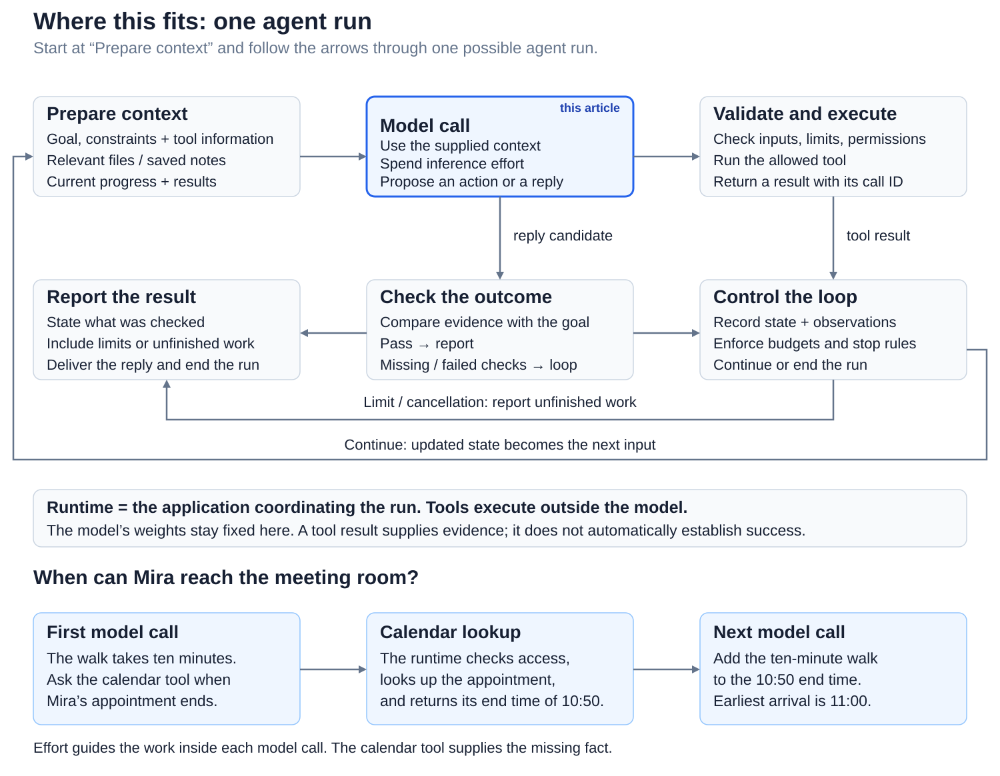
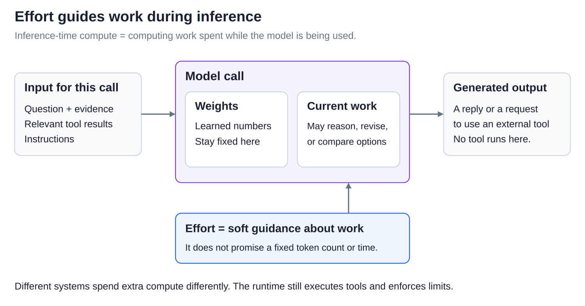
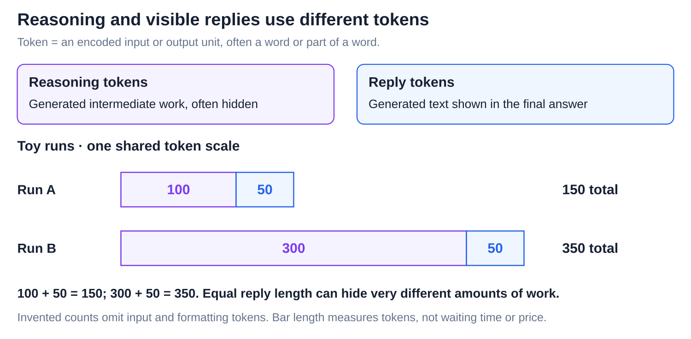
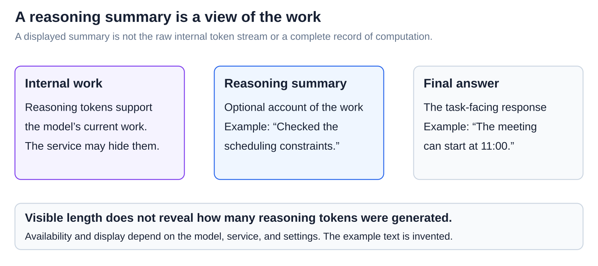
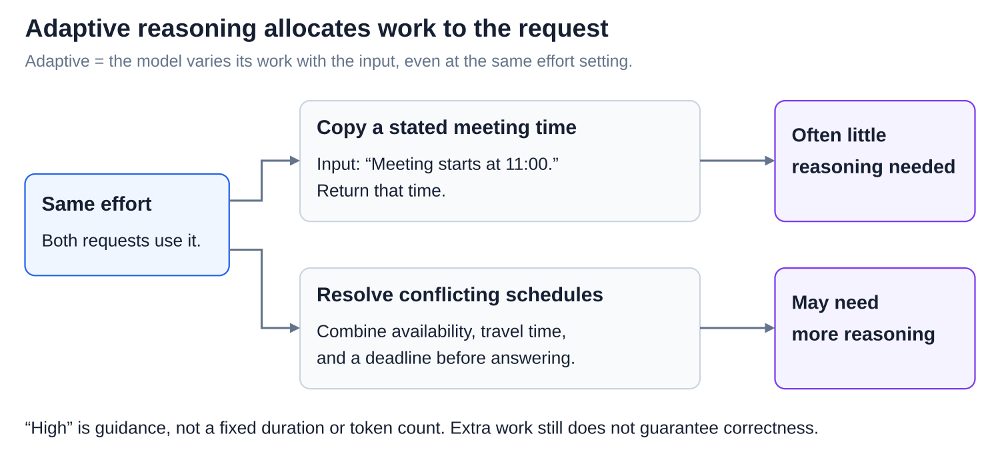
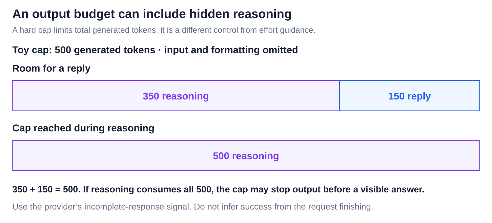
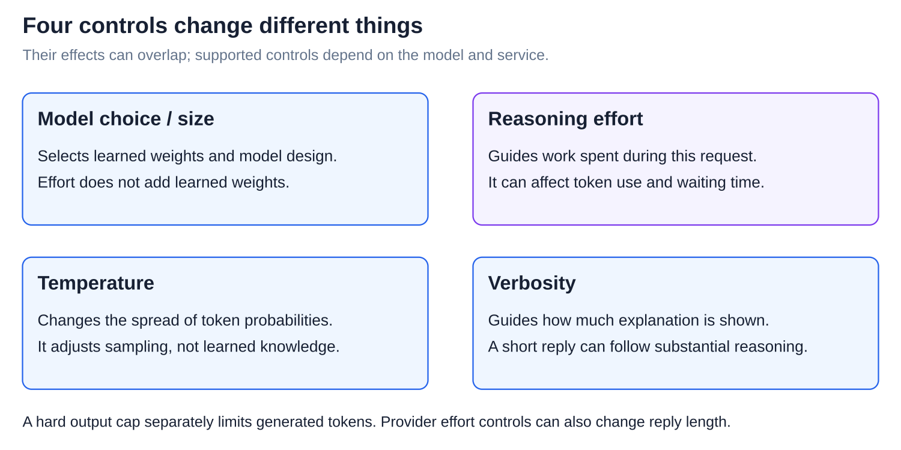
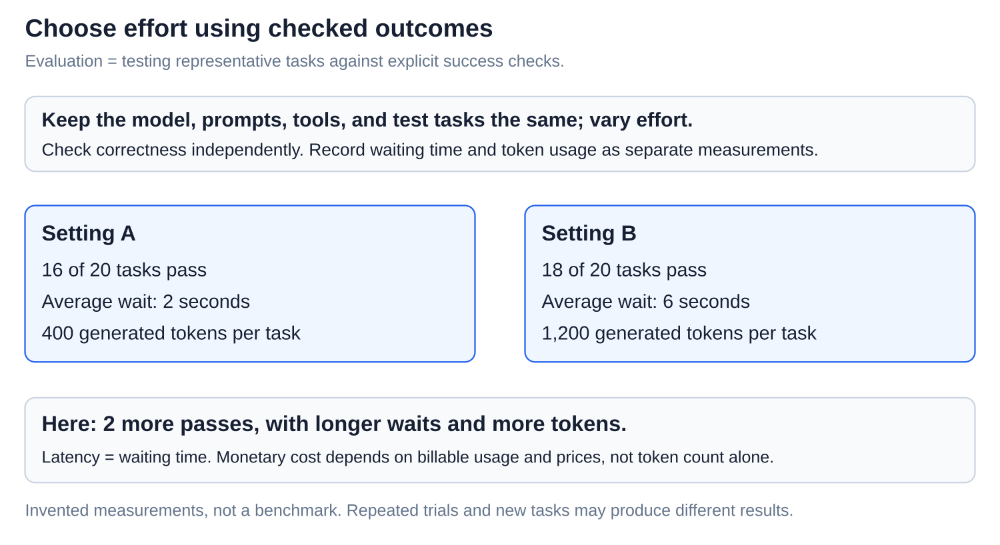

# Agents. Thinking levels

[Back to Artificial Intelligence](../Readme.md#content)

A **thinking level**, also called **reasoning effort**, tells a model how much work to put into a request. A higher setting can help when several facts have to fit together. It can also mean a longer wait and a higher bill, and the answer can still be wrong.

Consider two requests that both end with “11:00.” One asks the model to copy a time from an invitation. The other asks it to find a time that works across two calendars and allows for travel. The reply can be just as short in both cases. What changes is the work needed to reach it.

1. [Where effort fits in an agent run](#1-where-effort-fits-in-an-agent-run)
2. [What changes when you raise effort](#2-what-changes-when-you-raise-effort)
3. [How two short replies can use different token counts](#3-how-two-short-replies-can-use-different-token-counts)
4. [What a reasoning summary tells you](#4-what-a-reasoning-summary-tells-you)
5. [Why the same level can do different amounts of work](#5-why-the-same-level-can-do-different-amounts-of-work)
6. [How an output limit can cut off an answer](#6-how-an-output-limit-can-cut-off-an-answer)
7. [Which setting to change](#7-which-setting-to-change)
8. [How to tell whether more effort is worthwhile](#8-how-to-tell-whether-more-effort-is-worthwhile)

## 1. Where effort fits in an agent run

Suppose you ask a scheduling agent to find a meeting time. The **runtime** is the application coordinating the job. It sends instructions and available information to the model. The map labels that step **Model call**. The lower row follows two model calls on either side of a calendar lookup.

Effort applies when the model works on a call. If the model needs a calendar entry, it can request a lookup. The runtime checks permission, runs the lookup, and supplies the result to the next call. Raising effort cannot grant calendar access or reveal a missing entry. [Agents. Loop - act, observe, continue, stop](../Agents.%20Loop%20-%20act%2C%20observe%2C%20continue%2C%20stop/Readme.md) follows the same cycle through to a final reply.

## 2. What changes when you raise effort

The model’s **weights** are the numbers it learned during training. They stay fixed when it handles an ordinary request. The computation it performs to answer that request is called **inference-time compute**. In the middle box below, the same weights can support different amounts of work.

For the scheduling task, extra work might help the model detect that its first choice leaves too little travel time and consider a later slot. Revising a candidate or comparing several candidates are two ways to spend extra computation. A level such as `high` gives the model guidance. The label alone tells you neither which method it used nor how many seconds it will take.

## 3. How two short replies can use different token counts

A **token** is a unit a model processes, often a word or part of one. Some models generate **reasoning tokens** for intermediate work before producing the **reply tokens** that make up the visible answer. A model can also reason between tool calls. In the diagram, the last part of each bar represents the reply.

In these invented runs, A uses 100 reasoning tokens and 50 reply tokens, for a total of 150. B uses 300 reasoning tokens and the same 50 reply tokens, for a total of 350. All 200 extra tokens in B went into intermediate work. The bars omit input and formatting tokens. To compare usage, read the service’s token counts. To compare waiting time, measure it separately.

## 4. What a reasoning summary tells you

Some services can show a **reasoning summary**, a short account of the work. Read the three panels from left to right. The model does internal work, the service may display a summary, and the user gets a task answer.

“Checked the scheduling constraints” is a possible summary. “The meeting can start at 11:00” is an answer you can act on. The summary gives you a broad description. It leaves out intermediate steps, and its length cannot tell you how many tokens the model used. To verify 11:00, compare it with the calendar entries and the travel time.

## 5. Why the same level can do different amounts of work

With **adaptive reasoning**, the model can vary the work it spends according to the input. Both requests in the diagram use the same effort setting. One supplies the answer in the invitation. The other requires combining several facts.

Suppose Mira’s previous appointment ends at 10:50, and she needs ten minutes to walk to the meeting room. The room and the other attendee are free from 10:30 until 11:30. What is the earliest time for a 30-minute meeting? Mira can arrive at 11:00, and a meeting starting then ends at 11:30. Copying “11:00” from an invitation and finding it from these constraints can use different amounts of reasoning even with the same model and setting.

## 6. How an output limit can cut off an answer

An **output-token limit** sets a ceiling on how many tokens a call can generate. On a reasoning model, that allowance can include both reasoning and the final reply. Read both bars against the same illustrative limit of 500 tokens, ignoring formatting tokens.

If reasoning uses 350 tokens, up to 150 remain for the reply. If reasoning uses all 500, the call may end before the model returns even the meeting time. OpenAI’s Responses API reports `status: "incomplete"` with `incomplete_details.reason` set to `max_output_tokens`. Claude’s Messages API reports `stop_reason: "max_tokens"` when the call reaches its output limit. Turning up effort leaves the configured ceiling in place.

## 7. Which setting to change

Suppose you want the agent to check the calendars carefully and still answer in one sentence. You can request more reasoning effort and ask for a short reply at the same time. Each of the four controls in the diagram answers a different question.

1. **Model choice** selects which trained model handles the task. Choosing another model can change its design, size, and learned capabilities.
2. **Reasoning effort** guides how much work the selected model puts into the request.
3. **Temperature** changes how the model samples its next token. OpenAI’s Responses API offers this setting on supported models. [Inference. From logits to text with decoding and sampling](../Inference.%20From%20logits%20to%20text%20with%20decoding%20and%20sampling/Readme.md) shows how a lower temperature concentrates probability on the more likely choices.
4. **Verbosity** guides how much detail appears in the reply. A request such as “Give only the earliest time” also communicates what the reader wants to see.

Claude’s Messages API returns HTTP 400 if you send a non-default `temperature` to Claude 4.7 or later models under API version `2023-06-01`, or any value to any model from API version `2026-10-21`.

On supported models, OpenAI’s Responses API uses `reasoning.effort`, and Claude’s Messages API uses `output_config.effort`. Claude’s effort setting can also affect reply detail and tool use. Each provider defines its own levels and defaults, so two settings called `high` can produce different token counts and waiting times.

## 8. How to tell whether more effort is worthwhile

An **evaluation** compares settings on tasks like the ones the agent will actually do. Decide what counts as success before running the test. For the meeting request, the proposed time must allow for travel and leave a full 30 minutes before the room becomes unavailable. Check the returned time against those facts, even if the explanation sounds convincing.

In this invented test, both settings get the same model, prompts, tools, and 20 tasks. Setting A passes 16 tasks, averages 2 seconds per task, and generates 400 tokens per task on average. Setting B passes 18, averages 6 seconds, and generates 1,200 tokens per task on average. B gains **two passes** at the cost of **four more seconds and 800 more generated tokens per task** on average.

**Latency** is the time the user waits. **Monetary cost** depends on billable usage and the applicable prices. Both OpenAI and Anthropic count generated reasoning tokens as output usage, including work the user never sees. Repeat the comparison with representative tasks to see whether the extra correct answers are worth the time and cost for your use case.

## Check your understanding

1. The scheduling agent has permission to read Mira’s calendar but has not looked it up yet. What has to happen before the model can use those entries?

   

   
Answer

   **The runtime has to fetch the entries and supply them to the model.** The model can request a calendar lookup. Raising effort alone cannot supply the missing information.

   

2. You send the same prompt to the same model twice, once at low effort and once at high effort. Did the second call add new weights to the model?

   

   
Answer

   **No.** The learned weights stay fixed. The higher setting can give the model more opportunity to compare possible times or revise a choice during that call.

   

3. Two runs each produce 50 reply tokens. A uses 100 reasoning tokens and B uses 300. How many more tokens does B generate in this example, and where do they go?

   

   
Answer

   **B generates 200 more tokens, all for reasoning.** Its total is 350 compared with A’s 150. Counting only the visible reply would miss the difference.

   

4. A summary says “Checked the scheduling constraints.” Is that enough to establish that 11:00 works?

   

   
Answer

   **No.** The summary describes the work in broad terms. Check whether the attendees can arrive by 11:00 and whether the room is free for the whole meeting.

   

5. One request asks the model to copy 11:00 from an invitation. Another asks it to find 11:00 from calendars and travel times. Why might the second use more reasoning at the same effort level?

   

   
Answer

   **An adaptive model can spend more work on the harder input.** It must combine arrival time, room availability, and meeting length to find the slot. The first request already supplies it.

   

6. A call has a 500-token output limit and spends all 500 on reasoning. Can the application count on receiving the meeting time?

   

   
Answer

   **No.** The call can reach the cap before producing any visible reply. Check the service’s completion status and stop reason before treating the task as finished.

   

7. The model handles the calendar constraints well, but its answer is three paragraphs long. Which setting most directly addresses that problem?

   

   
Answer

   **Lower verbosity, if the model supports it, or ask for a one-sentence answer.** That targets the detail the user sees while letting the model keep the effort level that worked on the calendar task.

   

8. In the 20-task trial, the application requires an average wait of at most three seconds. Which setting meets that requirement, and what did the faster setting give up in this trial?

   

   
Answer

   **Setting A meets the requirement.** It averaged two seconds and passed 16 tasks. B passed two more tasks but averaged six seconds. Repeat the trial before assuming the same difference will hold for other schedules.

   

# Sources

- [OpenAI, Reasoning models, token usage, summaries, and output limits](https://developers.openai.com/api/docs/guides/reasoning)
- [OpenAI, Responses API reference for temperature and text verbosity](https://developers.openai.com/api/reference/resources/responses/methods/create)
- [OpenAI, Function calling and tool execution](https://developers.openai.com/api/docs/guides/function-calling)
- [Anthropic, Effort in the Claude Messages API](https://platform.claude.com/docs/en/build-with-claude/effort)
- [Anthropic, Removal of sampling parameters in Messages API version 2026-10-21](https://platform.claude.com/docs/en/api/migration-2026-10-21#sampling-parameters-are-removed)
- [Anthropic, Stop reasons and fallback](https://platform.claude.com/docs/en/build-with-claude/handling-stop-reasons#max_tokens)
- [Anthropic, Steering thinking and measuring cost](https://platform.claude.com/docs/en/build-with-claude/thinking-steering-and-cost)
- [Anthropic, Thinking and summaries](https://platform.claude.com/docs/en/build-with-claude/thinking)
- [Snell et al., Scaling LLM Test-Time Compute Optimally](https://arxiv.org/html/2408.03314v1)
- [Hugging Face, Temperature and generation settings](https://huggingface.co/docs/transformers/en/main_classes/text_generation)
- [OpenAI, Evaluation best practices](https://developers.openai.com/api/docs/guides/evaluation-best-practices)
