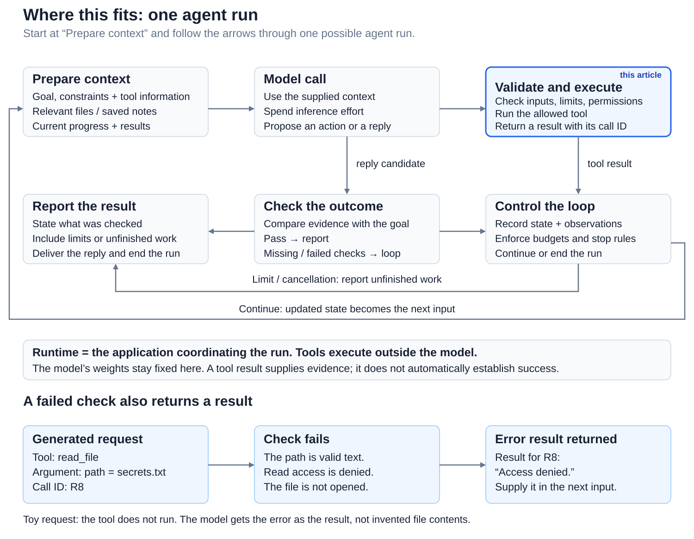
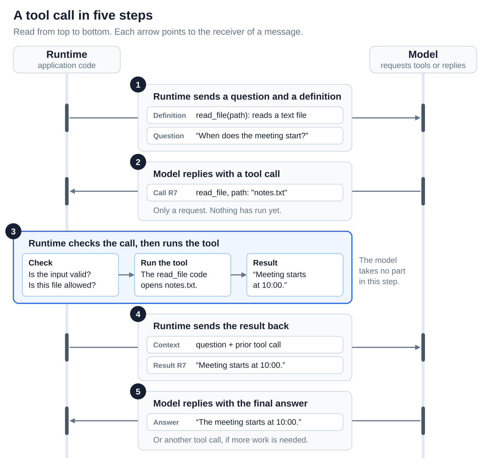
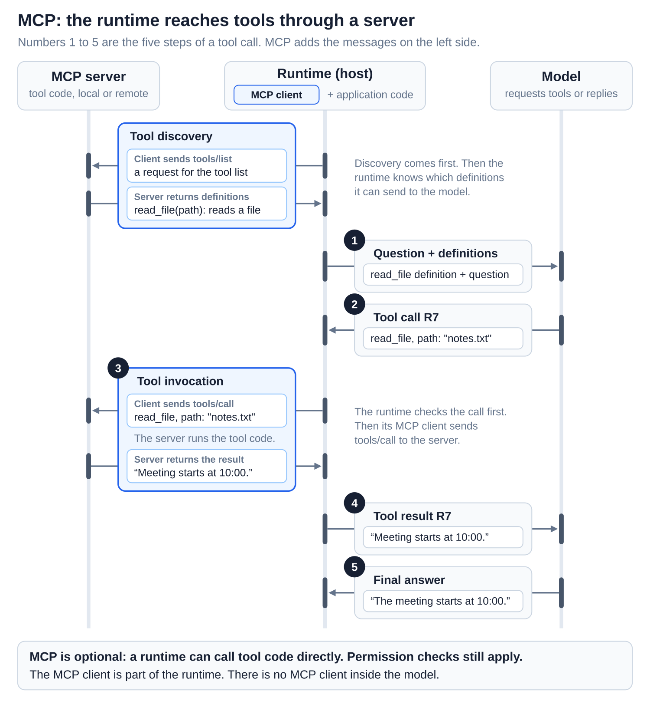

# Agents. Tool calls

[Back to Artificial Intelligence](../Readme.md#content)

**A tool call is a structured request from a model asking software to do something.**

Suppose you ask, “When does the meeting start?” The time is in a file called `notes.txt`. The model can ask to read that file. It learns the time only when the software returns the relevant text.

1. [Who asks for a tool and who runs it](#1-who-asks-for-a-tool-and-who-runs-it)
2. [How a file lookup becomes an answer](#2-how-a-file-lookup-becomes-an-answer)
3. [What the runtime checks before opening a file](#3-what-the-runtime-checks-before-opening-a-file)
4. [How results stay matched to their requests](#4-how-results-stay-matched-to-their-requests)
5. [Where the Model Context Protocol fits](#5-where-the-model-context-protocol-fits)

## 1. Who asks for a tool and who runs it

A **tool** is a function that software makes available to a model. Our example tool, `read_file`, takes a file path and returns text. The **runtime** is the part of the application that talks to the model, receives its requests, and decides which ones may run. Here, the runtime calls the function that opens the file.

Follow the map from “Model call” to “Validate and execute.” If the runtime allows the read, it can return file contents. The lower panel follows call `R8` for `secrets.txt`. The path is valid, but the user lacks permission, so the runtime leaves the file closed and sends the model “Access denied” with the same call ID.

## 2. How a file lookup becomes an answer

Read the diagram from top to bottom. Each arrow shows who receives the next piece of information.

1. **The runtime offers a tool.** It sends the question and a **tool definition**. The definition gives the name `read_file`, explains what it does, and says it requires a text input called `path`.
2. **The model asks to read one file.** Its response names `read_file` and supplies the **arguments**, the values for this particular request. Here they are `{"path":"notes.txt"}`. The call also carries an identifier, `R7`.
3. **The runtime runs the authorized read.** It checks the path and permission, then calls the function. The function opens the file and returns “Meeting starts at 10:00.”
4. **The runtime gives the result to the model.** It includes that text as the result of `R7` in the model’s next **context**, the information available when the model produces its next response.
5. **The model answers the user.** It can now say “The meeting starts at 10:00.” If it still needs information, it can request another tool. [Agents. Loop - act, observe, continue, stop](../Agents.%20Loop%20-%20act%2C%20observe%2C%20continue%2C%20stop/Readme.md) follows a file edit through several such exchanges.

## 3. What the runtime checks before opening a file

**Validation** asks whether the arguments follow the tool’s input rules, also called its **schema**. For example, `{}` leaves out the required `path`. The runtime can report the missing input before it tries to open anything.

**Authorization** asks whether this user is allowed to perform the requested action. Suppose the user may read `notes.txt` but has no access to `secrets.txt`. Both names are valid text. For a request to read `secrets.txt`, the runtime enforces the permission and returns “Access denied” without opening the file.

An allowed read can also fail. If `notes.txt` is missing, the function can return “File not found.” In that case the model can explain why it could not look up the time or ask for the correct file. A guessed time would have no support from the lookup. [Agents. Reliability - evaluation and execution boundaries](../Agents.%20Reliability%20-%20evaluation%20and%20execution%20boundaries/Readme.md) explains how to check what a tool actually accomplished.

## 4. How results stay matched to their requests

The tool name tells the runtime **what operation** was requested. A **call ID** identifies **one individual request**. Consider two requests for the same tool. Call `R7` asks for `notes.txt`, and call `R8` asks for `secrets.txt`.

Suppose the runtime denies `R8` while the read for `R7` is still running. It labels “Access denied” with `R8` and the meeting text with `R7`. On the next model call, those IDs tell the model which result answers each request, regardless of which finished first. Claude uses `tool_use_id` on the result, and OpenAI’s Responses API uses `call_id`.

## 5. Where the Model Context Protocol fits

The runtime can call a function directly. It can also reach a tool through the **Model Context Protocol (MCP)**, a shared set of rules for exchanging messages. The application is the **host**. Inside it, an MCP **client** talks to a **server**, a program that provides tools. The server can run on the same computer or on another machine.

Follow the two exchanges between the host and server on the left of the diagram.

- **Tool discovery.** The client sends `tools/list`. The server returns tool definitions. The host can now show the model that `read_file` is available.
- **Tool invocation.** Once the model asks for `notes.txt` and the host allows the request, the client sends `tools/call` with the tool name and arguments. The server checks access, runs the tool, and returns the text. The host passes the result back to the model as it did in the direct lookup.

## Check your understanding

1. The model has returned a request to read `notes.txt`. Has the file been opened yet? Who can open it in the direct lookup?

   

   
Answer

   **No.** So far the model has only asked for the read. The runtime checks the request and, if allowed, calls the function that opens the file.

   

2. In the meeting example, what new information lets the model answer “10:00”? When does the model receive it?

   

   
Answer

   **The file text says “Meeting starts at 10:00.”** The model receives it when the runtime includes the tool result in the next model input. The earlier definition only described how to request a read.

   

3. A user who may read only `notes.txt` requests `{"path":"secrets.txt"}`. Which check passes, which fails, and what should the runtime return?

   

   
Answer

   **Validation passes and authorization fails.** The path is text, as the schema requires. The runtime returns “Access denied” without opening the restricted file.

   

4. The model requests `notes.txt` in call `R7` and `secrets.txt` in call `R8`. How does it know which call “Access denied” answers?

   

   
Answer

   **The runtime puts `R8` on the error result.** The model can match that ID to its request for `secrets.txt`, even if the read for `notes.txt` finishes later.

   

5. An MCP client receives a definition for `read_file` from `tools/list`. Has the server read `notes.txt`? Which message asks it to do that?

   

   
Answer

   **No.** Listing tools returns their definitions. The client sends `tools/call` with `read_file` and the path `notes.txt` to request the read.

   

# Sources

- [OpenAI’s guide to the function-calling exchange](https://developers.openai.com/api/docs/guides/function-calling)
- [Claude’s guide to tool names, descriptions, and input schemas](https://platform.claude.com/docs/en/agents-and-tools/tool-use/define-tools)
- [Claude’s guide to matching tool results and returning errors](https://platform.claude.com/docs/en/agents-and-tools/tool-use/handle-tool-calls)
- [Model Context Protocol overview of hosts, clients, and servers](https://modelcontextprotocol.io/docs/learn/architecture)
- [Model Context Protocol specification for tool discovery, invocation, and access checks](https://modelcontextprotocol.io/specification/2026-07-28/server/tools)
