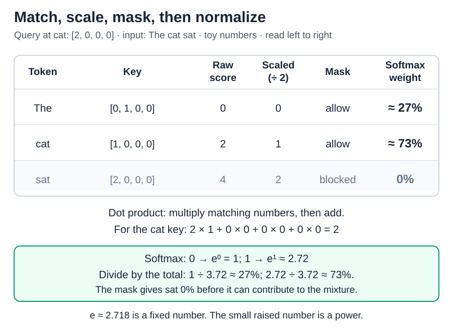
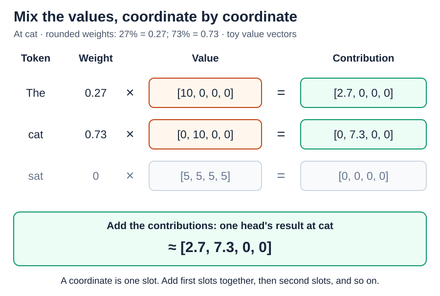

# Attention: queries, keys, values, and heads

[Back to Artificial Intelligence](../Readme.md#content)

**Attention lets each token position read a weighted mixture of information from allowed positions.** Queries and keys determine the mixture; values supply its contents. Several **heads** calculate different mixtures in parallel, then combine their results.

We follow **causal self-attention**: all inputs come from the same sequence, and later positions are blocked. Pretend each word in `The cat sat` is one token. We process the whole sequence but inspect the position at `cat`, which must not use `sat`. All numbers below are invented.

## Step 1 — Make queries, keys, and values

Each position has a current **vector**, an ordered list of numbers. Three learned **projections**—multiply-and-add recipes—turn it into:

- **Query (Q):** what this position uses to match allowed positions.
- **Key (K):** what a position offers for matching.
- **Value (V):** the information that position can contribute.

The same projections run at every position within a head. Their parameters are learned during training; Q, K, and V are working values computed for this input. In models using rotary position embeddings (RoPE), queries and keys are rotated before comparison. Our example starts after any such rotation.

## Step 2 — Calculate mixing weights

Use the query at `cat`: `[2, 0, 0, 0]`. Compare it with every key using a **dot product**: multiply matching numbers, then add. For the key `[1, 0, 0, 0]`, this gives `2 × 1 + 0 × 0 + 0 × 0 + 0 × 0 = 2`.

**Scaling** divides each score by the square root of the query/key length. Four-number vectors use 2, because `2 × 2 = 4`. Our raw scores `[0, 2, 4]` become `[0, 1, 2]`. This helps prevent longer vectors from producing overly extreme mixing weights just because they contain more numbers.

The **causal mask** blocks `sat` before softmax. It forces that position's mixing weight to zero, even though its raw score is largest.

**Softmax** uses powers of a fixed number, `e ≈ 2.718`: score 0 gives `e⁰ = 1`; score 1 gives `e¹ ≈ 2.72`. Divide these amounts by their total, about `3.72`, to get approximately **27% for The and 73% for cat**. With 0% for `sat`, the weights add up to 100%.

These are **mixing weights over input positions**, not probabilities of the next output token. They are calculated during the pass, not stored training parameters.

## Step 3 — Mix the values

Multiply each value vector by its attention weight, then add matching coordinates. A **coordinate** is one slot in the vector.

Using rounded weights, take `27% = 0.27` of `[10, 0, 0, 0]` and `73% = 0.73` of `[0, 10, 0, 0]`:

- First coordinate: `0.27 × 10 + 0.73 × 0 = 2.7`.
- Second coordinate: `0.27 × 0 + 0.73 × 10 = 7.3`.
- The other coordinates stay zero. The result is approximately `[2.7, 7.3, 0, 0]`.

The masked value contributes nothing. Attention mixes the values; it does not randomly pick one token. Each query position gets its own weights and result. We showed only `cat`.

## Step 4 — Combine the heads

In basic **multi-head attention**, heads have different learned Q, K, and V projections. They can use different positions and different information. They are not assigned fixed human labels such as “the grammar head”. Some designs let several query heads share key and value projections.

The head results are **concatenated**: their number lists are placed end to end. A learned **attention output projection** mixes this joined list and returns it to the width of the block's working vector. This update is added to the incoming **residual vector**, the running information carried through the blocks.

This projection combines head information. The vocabulary-scoring projection from article 8 comes later, after the transformer blocks.

# Sources

- [Attention Is All You Need: attention and heads, §3.2](https://arxiv.org/html/1706.03762v7)
- [PyTorch: scaled dot-product attention and masking](https://docs.pytorch.org/docs/2.15/generated/torch.nn.functional.scaled_dot_product_attention.html)
- [PyTorch: softmax](https://docs.pytorch.org/docs/2.15/generated/torch.nn.Softmax.html)
- [Meta: Llama 3 attention and residual updates](https://github.com/meta-llama/llama3/blob/main/llama/model.py)
- [GQA: sharing keys and values between query heads](https://arxiv.org/abs/2305.13245)
