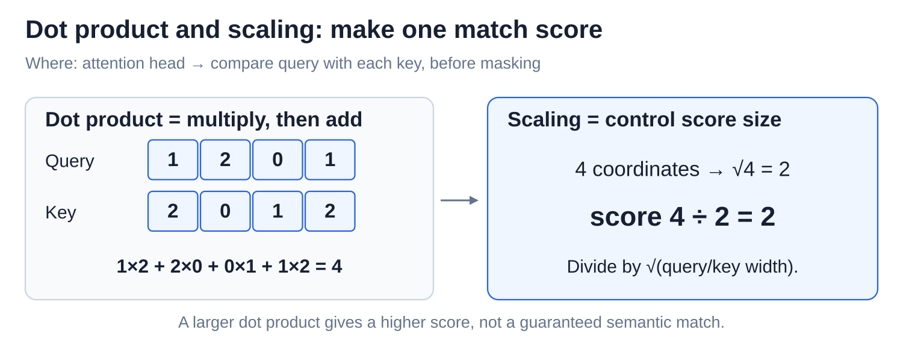
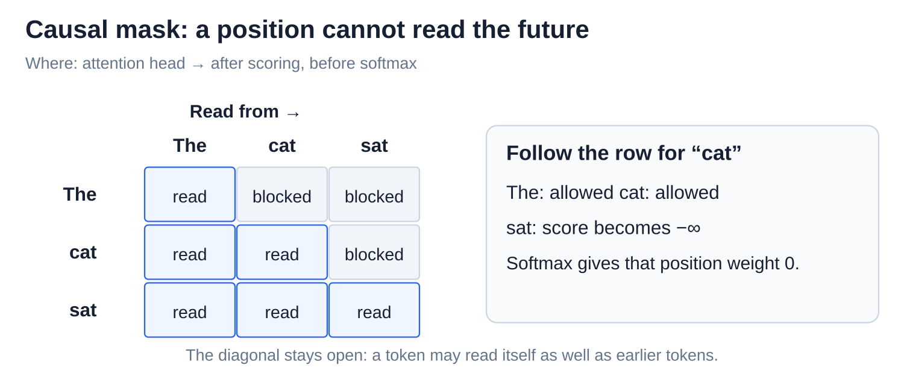
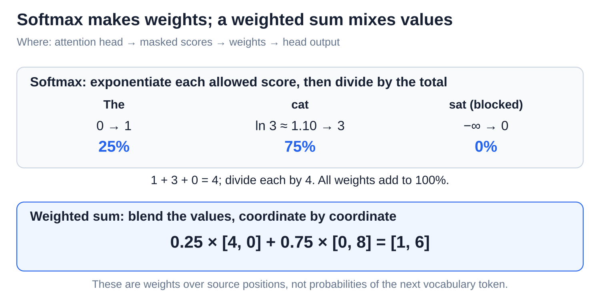

# Internals: Attention - queries, keys, values, and heads

[Back to Artificial Intelligence](../Readme.md#content)

**Attention is how a token gathers information from other tokens. Each position looks back over the text so far and takes a blend of the most relevant information.** Several attention **heads** do this side by side, each free to look for something different.

## Where this fits

A transformer block updates one vector, a list of numbers, per token position. Attention gathers information across allowed positions; the MLP (multilayer perceptron) then processes each position separately.

The upper map highlights attention inside a block. The lower panel calculates one position's mixture of information.

## Queries, keys, and values

A learned **projection** forms new coordinates from weighted sums of the input numbers. Each position uses projections to produce three vectors: **query (Q)** says what to match; **key (K)** says what can be matched; **value (V)** carries information to pass on. The three panels give each role its own example.

Q and K determine the mixing weights; V supplies the contents. The projection weights stay fixed during use, while Q, K, and V depend on the input.

## Match and scale

A **dot product** multiplies matching coordinates and adds the results. **Scaling** divides that score by the square root of the query/key width, keeping long vectors from producing excessively large scores. Follow the arithmetic from the query and key to one score:

In Llama-style models, rotary position embeddings (RoPE) first rotate pairs of Q and K coordinates by position, so the comparison also reflects token spacing. See [Embeddings and position information](../Embeddings%20and%20position%20information/Readme.md) for a geometric example.

## Block future positions

The **causal mask** makes later positions unavailable. Read a row to see which positions that token can use. Even when training processes a whole sequence at once, `cat` cannot read `sat`:

## Make weights and blend values

**Softmax** converts scores into nonnegative weights that sum to 1 (100%). A **weighted sum** multiplies each value by its weight and adds the results. The upper panel calculates the weights; the lower panel uses them:

The diagram uses invented numbers. `ln 3` is the score whose exponential is 3, so the allowed scores produce exact weights of 25% and 75%. A masked score of negative infinity contributes zero. These weights describe source positions, not next-word probabilities.

## Several heads at once

An **attention head** is one learned way of matching and mixing. **Multi-head attention** runs several in parallel. **Concatenation** joins their outputs end to end; an **attention output projection** maps that joined vector back to the width of the token's running vector:

The resulting update is added to the running vector. Heads are not assigned jobs such as “grammar head.” Some architectures share keys and values across heads. This projection combines heads; the later vocabulary projection scores next tokens.

# Sources

- [Google: attention and multi-head diagrams, Figure 2 and §3.2](https://arxiv.org/html/1706.03762v7)
- [PyTorch: scaled dot-product attention and masking](https://docs.pytorch.org/docs/2.15/generated/torch.nn.functional.scaled_dot_product_attention.html)
- [PyTorch: softmax](https://docs.pytorch.org/docs/2.15/generated/torch.nn.Softmax.html)
- [Meta: Llama 3 attention and residual updates](https://github.com/meta-llama/llama3/blob/main/llama/model.py)
- [Anthropic: attention heads move information](https://transformer-circuits.pub/2021/framework/index.html)
- [GQA: sharing keys and values between heads](https://arxiv.org/abs/2305.13245)
