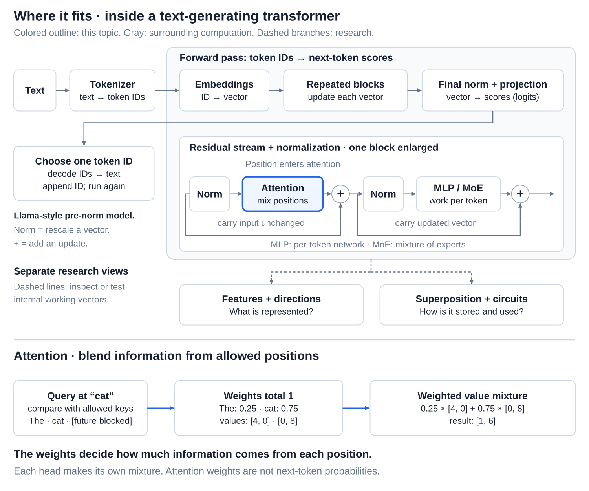
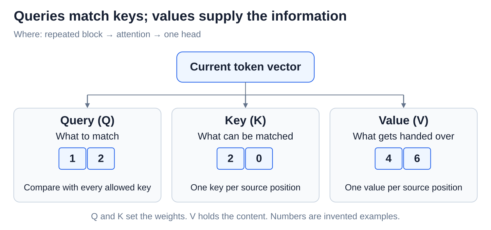
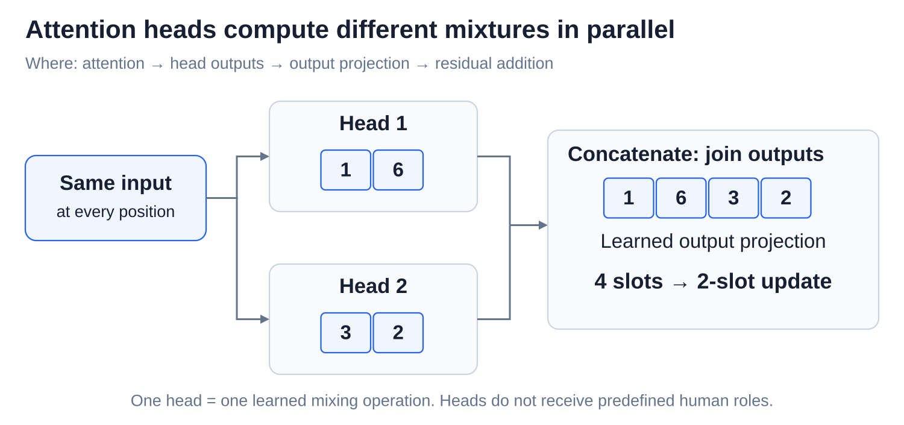

# Internals: Attention - queries, keys, values, and heads

[Back to Artificial Intelligence](../Readme.md#content)

**Attention is how a token gathers information from other tokens. Each position looks back over the text so far and takes a blend of the most relevant information.** Several attention **heads** do this side by side, each free to look for something different.

## Where this fits

Attention is the first of the two jobs inside every transformer block; the MLP is the second ([The transformer forward pass](../The%20transformer%20forward%20pass/Readme.md)):

Read the top row from left to right, then look inside a block: attention gathers context before the MLP processes each position.

It is the only step where information moves between token positions. Without it, each token would be processed on its own, and `bank` could never learn whether `river` or `savings` came before it ([Embeddings and position information](../Embeddings%20and%20position%20information/Readme.md)).

## Queries, keys, and values

A library search is a helpful picture. Every position produces three vectors:

- a **query (Q):** what this position is looking for;
- a **key (K):** a label describing what this position holds, for queries to match;
- a **value (V):** the information this position hands over when it is used.

The diagram shows one position's vector feeding three learned recipes, one for each role. Queries are compared with keys to decide the **mixing weights**, and the values are what gets mixed. The recipes are learned during training, while the queries, keys, and values themselves are calculated fresh for every input. Unlike a library search, attention does not fetch one book: it blends several, in different amounts.

## How one position decides what to read

Take the text `The cat sat`, pretend each word is one token, and follow the position `cat`:

1. **Match.** The query at `cat` is compared with the key of every position. A close match gives a high score. The comparison is a **dot product**: multiply matching numbers and add them up.
2. **Mask.** When the model writes text, later tokens do not exist yet, so a position may only look at itself and earlier positions. The **causal mask** blocks `sat`, leaving `The` and `cat`.
3. **Turn scores into weights.** **Softmax** turns the allowed scores into weights that add up to 100%, for example 30% for `The` and 70% for `cat`. Real attention also scales the scores down first, so that long vectors do not produce extreme weights.
4. **Blend the values.** The result at `cat` is the values mixed by those weights: mostly its own value, plus some of the value at `The`.

Every position does the same with its own query, so each gets its own blend. The weights are not probabilities of the next word: they only say how much each earlier position contributes here, and they are recalculated for every input. In Llama-style models, queries and keys are first turned by position (RoPE), so the match also reflects how far apart two tokens are.

## Several heads at once

One set of weights can express only one way of mixing. **Multi-head attention** runs several heads side by side, each with its own learned recipes, so different heads can follow different relationships. In the diagram, two heads read the same vectors, and each produces its own blend for `cat`. Their outputs are joined end to end, and a learned **attention output projection** turns the joined result back into one update of the original size. That update is added to the running vector of [the residual stream](../The%20residual%20stream%20and%20normalization/Readme.md).

Heads are not given human jobs such as “the grammar head”; whatever they do is learned. Some newer designs let several heads share the same keys and values to make text generation faster.

This output projection only combines the heads. The projection that scores vocabulary tokens, from [The transformer forward pass](../The%20transformer%20forward%20pass/Readme.md), comes later, after all the blocks.

# Sources

- [Attention Is All You Need: attention and heads, §3.2](https://arxiv.org/html/1706.03762v7)
- [PyTorch: scaled dot-product attention and masking](https://docs.pytorch.org/docs/2.15/generated/torch.nn.functional.scaled_dot_product_attention.html)
- [PyTorch: softmax](https://docs.pytorch.org/docs/2.15/generated/torch.nn.Softmax.html)
- [Meta: Llama 3 attention and residual updates](https://github.com/meta-llama/llama3/blob/main/llama/model.py)
- [Transformer Circuits: attention heads move information](https://transformer-circuits.pub/2021/framework/index.html)
- [GQA: sharing keys and values between query heads](https://arxiv.org/abs/2305.13245)
