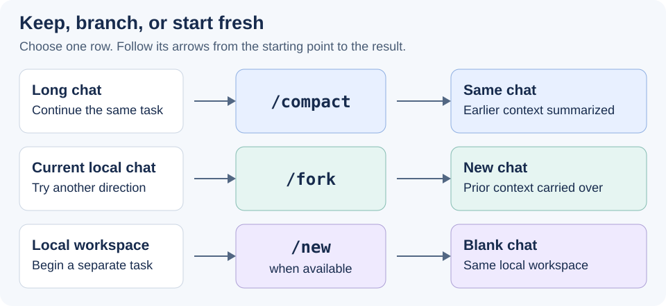

# Codex commands

<sub>[Back to Artificial Intelligence](../Readme.md#content)</sub>

# Front

Which ten built-in Codex slash commands are useful for software engineering, learning, and writing?

# Back

**Use slash commands to plan work, review code, configure a chat, manage its context, and pursue a goal.** Type `/` in the chat composer and select a command. Then describe the actual task when needed.

**Scope:** Codex in the desktop app, checked on 18 October 2026. Availability depends on your environment and access; the command-line interface (CLI) and editor extension can differ. These are ten practical picks, not a measured popularity ranking.

## Ten useful commands

| # | Command | What it does | Example use |
|---|---|---|---|
| 1 | `/plan` | Toggles Plan mode to investigate and propose an approach before editing. | Plan a feature, learning project, or article. |
| 2 | `/review` | Starts code review of uncommitted changes or changes against a base branch. | Find bugs before committing. |
| 3 | `/init` | Generates an `AGENTS.md` starter file with project instructions. | Establish build commands or writing conventions; edit the result. |
| 4 | `/model` | Opens the model choice for the current chat. | Select an available model for the task. |
| 5 | `/reasoning` | Selects the current chat's reasoning effort. | Adjust effort for a difficult debugging or analysis task. |
| 6 | `/status` | Shows chat ID, context usage, and rate limits. | Check the session's usage and limits. |
| 7 | `/compact` | Summarizes earlier context so work can continue in the same chat. | Continue a long debugging or study session. |
| 8 | `/fork` | Copies a local chat into a new local chat or worktree. | Explore another solution or draft direction with prior context. |
| 9 | `/new` | Starts a blank chat in the same local workspace, when available. | Begin a separate topic or document. |
| 10 | `/goal` | Sets a persistent objective; use `/plan` first to shape it. | Work toward a defined feature or finished guide. |

A **worktree** is a separate Git checkout. A fork can use one when you need separate working files. **Context** is the information the model uses while working, including earlier messages.

## Keep, branch, or start fresh

Read each row from left to right: `/compact` keeps the chat, `/fork` carries its context into another chat, and `/new` starts a blank conversation in the same workspace.



## Command first, task second

Select `/plan`, then send a request such as:

```text
Plan a beginner's guide to this repository. Identify the files to explain, propose an outline, and define how to verify the examples before drafting.
```

For `/goal`, specify an observable result. A goal can finish, pause, or need input; steer it with follow-ups and manage it through the progress controls. `/review` is for code review; request prose editing in ordinary language.

# Sources

- [OpenAI: Desktop app slash commands](https://learn.chatgpt.com/docs/reference/slash-commands)

  Command effects, availability, and goal controls.

- [OpenAI: Codex best practices](https://learn.chatgpt.com/guides/best-practices)

  Planning, project instructions, review, and managing long chats.

- [OpenAI: Developer commands](https://learn.chatgpt.com/docs/developer-commands)

  Differences between desktop, CLI, and editor command surfaces.
