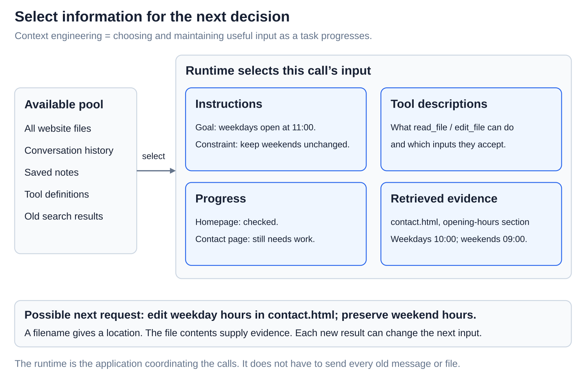
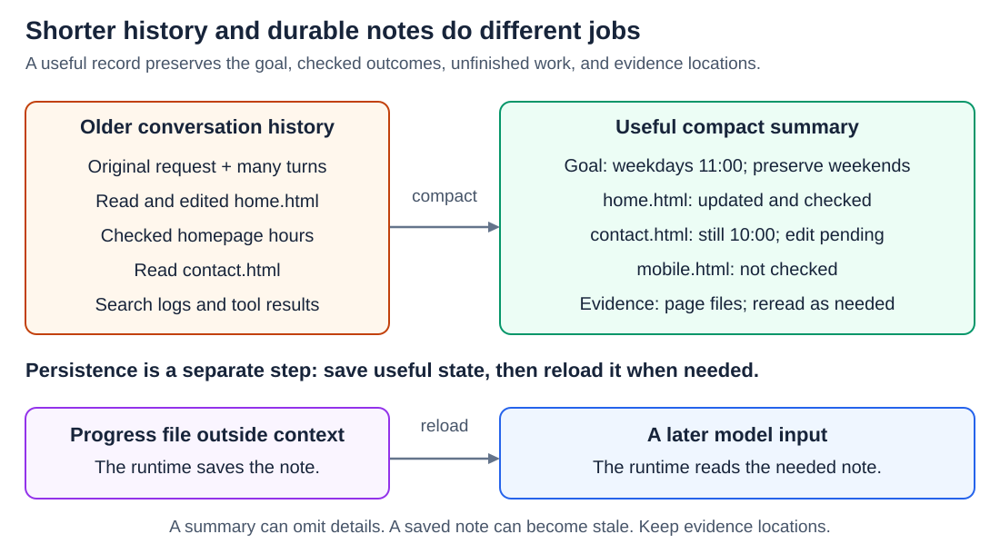
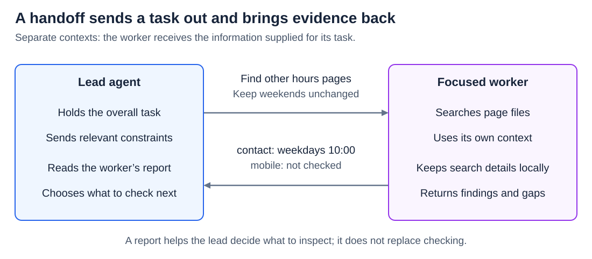
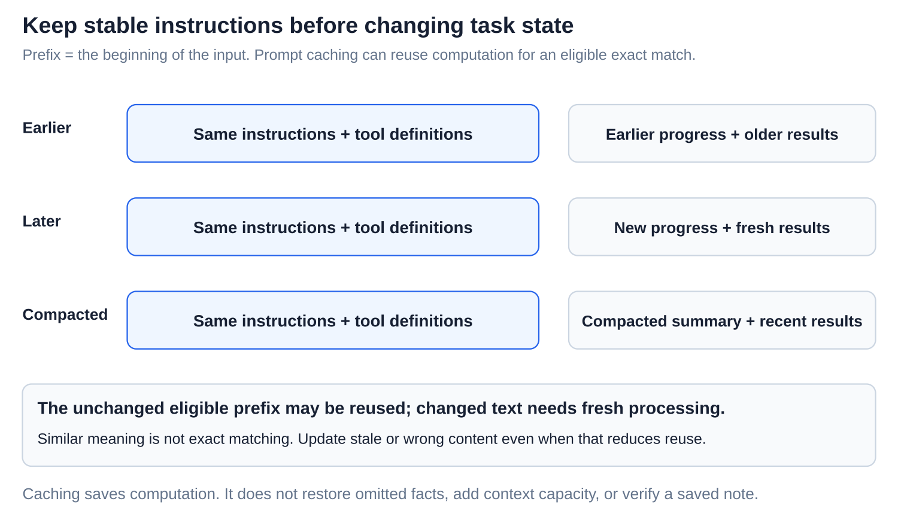

# Agents: Context engineering for long-running agents

[Back to Artificial Intelligence](../Readme.md#content)

**Context engineering means choosing and maintaining the information each model call needs to make its next decision.** A long task needs more than a good opening prompt: goals, useful evidence, and unfinished work must remain available as the run continues.

## Where this fits

In [the agent loop](../The%20agent%20loop/Readme.md), the **runtime**, the application coordinating the work, prepares each model input. That input is the model's **context**. Its size is limited by the **context window**, measured in **tokens**, pieces of text.

Our example: update a website so every weekday opening time is **11:00**, while leaving weekend hours unchanged. The task spans several page files and many tool calls.

## What belongs in the next input?

Read left to right: the runtime selects useful information from a larger pool. The homepage is already checked; the contact page still needs work.

- **Instructions:** the goal, constraints, and what counts as finished.
- **Tool descriptions:** what each available tool does and which inputs it accepts.
- **Progress:** verified changes, remaining work, and unresolved questions.
- **Retrieved evidence:** relevant material read from files or other sources, with locations so it can be checked again.

Useful tool results contain enough detail for the next action. Here, the contact page's weekday and weekend hours matter; a huge unrelated search log does not. A file path tells the agent where to look, but does not supply the file's contents.

The aim is **enough relevant information**, not the shortest possible input. Removing the weekend constraint would save space but damage the task.

## Summaries and saved notes

**Compaction** replaces older conversation history with a shorter account. Keep decisions and constraints, checked outcomes, unfinished work, and pointers to evidence. Summarizing is lossy: details can disappear.

“Hours updated” is a dangerous summary here. It hides which pages were checked and which remain. The better note in the diagram preserves those distinctions.

**Saved notes** live outside the active context, for example in a progress file. The runtime must save them, then read the needed parts into a later model input. A note sitting on disk is not automatically visible to the model.

Notes can become stale. “Homepage checked” records an earlier check; if the file later changes, reread and check it again. Notes help recover the task's state, but do not prove that today's files are correct.

## Subagent handoffs

A **subagent** is another agent given a focused part of the work. In a design with separate contexts, the lead agent sends the goal, constraints, and relevant evidence; the worker returns a compact report.

For this task, a worker can search for other pages containing opening times. Its report should identify the pages, what it found, and what it did not check. “All done” would lose the evidence and uncertainty.

The lead need not receive every intermediate search result. It does need enough information to decide what to inspect or change next. Do not assume the worker automatically sees the lead's whole conversation.

## Keep reusable prompt prefixes

A **prefix** is the beginning of an input. [Prompt caching](../Prompt%20caching%20across%20requests/Readme.md) can reuse computation for an unchanged prefix, subject to the service's cache rules.

Keep reusable instructions and tool definitions stable near the beginning; put changing progress and fresh results later. Replacing old history with a summary changes that later portion. An eligible unchanged prefix may still be reused, while the changed portion needs fresh processing.

“Same meaning” is not an exact match. Rewording early instructions can break reuse from that point onward. Cached input still occupies context space; caching does not restore facts omitted by a summary. Update incorrect or stale information even when doing so reduces cache reuse.

# Sources

- [Anthropic: context selection diagram and context engineering](https://www.anthropic.com/research/effective-context-engineering-for-ai-agents)
- [Anthropic: useful tool descriptions and results](https://www.anthropic.com/research/writing-tools-for-agents)
- [Claude: compaction](https://platform.claude.com/docs/en/build-with-claude/compaction)
- [Claude: external memory](https://platform.claude.com/docs/en/agents-and-tools/tool-use/memory-tool)
- [Anthropic: subagent coordination](https://www.anthropic.com/research/multi-agent-research-system)
- [Claude: prompt caching](https://platform.claude.com/docs/en/build-with-claude/prompt-caching)
