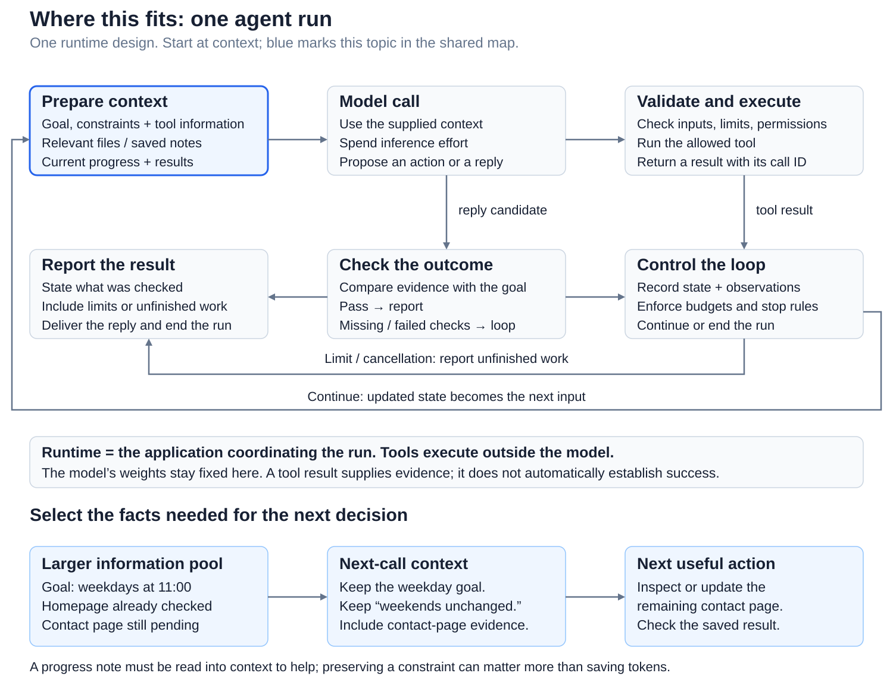
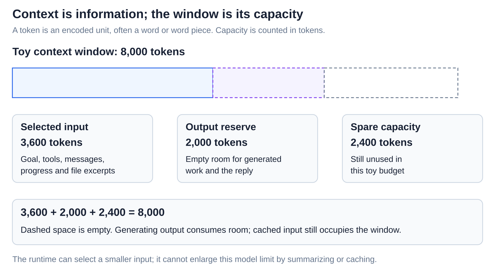
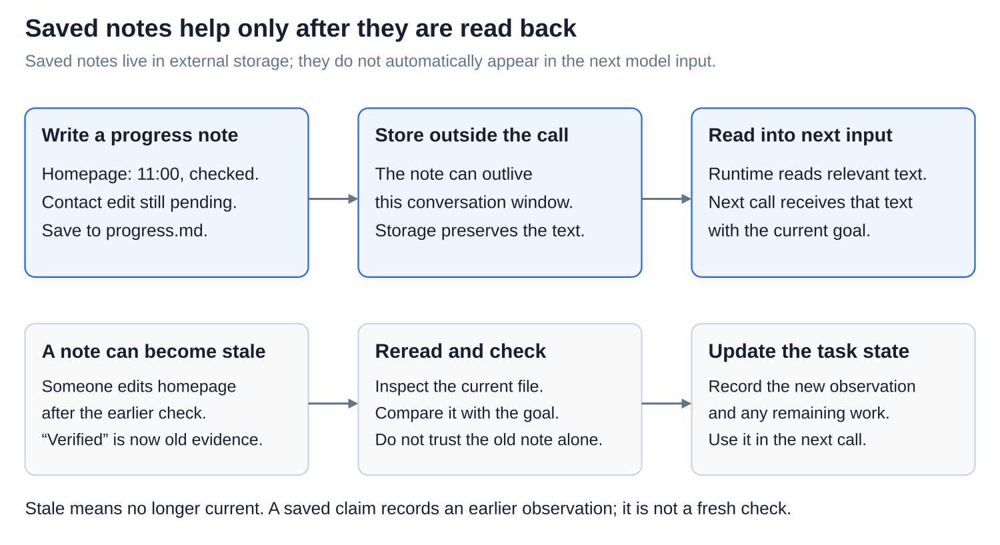

# Agents: Context engineering for long-running agents

[Back to Artificial Intelligence](../Readme.md#content)

**Context engineering means choosing and maintaining the information each model call needs for its next decision.** Goals, evidence, and unfinished work must remain available as a long task progresses.

## Where this fits

The shared map highlights **context preparation**. Follow the arrows from context to a model call, then through tool results or an outcome check. The lower example keeps a website task’s goal, constraints, and remaining work available.

## Select useful information for this call

The **runtime** is the application coordinating calls. It builds the **context**, the model’s input information. Our task is to set every website page’s weekday opening time to **11:00**, keeping weekends unchanged.

Read from the available pool to the four selected panels. **Instructions** state the goal and constraints. **Tool descriptions** explain available operations and inputs. **Progress** records checked work and remaining work. **Retrieved evidence** is relevant material brought back from files or other sources.

A path locates evidence; it does not provide file contents. Select context again after new results.

## Keep within the context window

The **context window** is the model’s capacity for input and generated output. It is measured in **tokens**, encoded units often representing words or word pieces.

The toy budget is 3,600 input + 2,000 output reserve + 2,400 spare = 8,000. Dashed space is empty. Real limits vary by model. Freeing room must not remove the weekend constraint.

## Compact history without losing the task

**Compaction** replaces older history with a shorter summary, often keeping recent messages alongside it. The window stays the same size; omitted details may need retrieval.

The useful summary preserves the goal, weekend constraint, verified homepage, unfinished contact page, and evidence location. “Hours updated” hides the distinction between completed and pending work.

**Saved notes** persist outside the active context. The runtime must write them and later read relevant text into a new input. A note is **stale** when it no longer reflects current state.

Follow save → store → read, then the freshness row. If someone edits the homepage after a check, reread it before relying on “homepage verified.” A saved claim is not a new check ([Context and memory](../In-context%20learning%20and%20memory/Readme.md)).

## Give subagents a clear handoff

A **subagent** is another agent assigned part of the work. A **handoff** transfers an assignment and relevant information. In this design, each worker has a separate context.

The brief asks a worker to find opening hours without editing files. Its report returns paths, observations, and unchecked work. Do not assume it sees the lead’s whole conversation. The lead needs evidence, not just “all done.”

## Preserve useful reusable prefixes

A **prefix** is the beginning of an input. **Prompt caching** can reuse computation for an eligible unchanged prefix across requests.

Read the rows: stable instructions and tool definitions stay first; progress, results, and summaries change later. Similar meaning is not exact matching. An early change breaks reuse from that point, subject to cache rules.

Caching does not enlarge the window or restore omitted facts. Update wrong or stale content even when doing so reduces reuse ([Prompt caching](../Prompt%20caching%20across%20requests/Readme.md)).

# Sources

- [Anthropic: context-curation diagram and context engineering](https://www.anthropic.com/research/effective-context-engineering-for-ai-agents)
- [Anthropic: tool descriptions and useful results](https://www.anthropic.com/research/writing-tools-for-agents)
- [Claude: context windows](https://platform.claude.com/docs/en/build-with-claude/context-windows)
- [Claude: compaction](https://platform.claude.com/docs/en/build-with-claude/compaction)
- [Claude: external memory](https://platform.claude.com/docs/en/agents-and-tools/tool-use/memory-tool)
- [Anthropic: separate subagent contexts and reports](https://www.anthropic.com/research/multi-agent-research-system)
- [Claude: prefix caching](https://platform.claude.com/docs/en/build-with-claude/prompt-caching)
