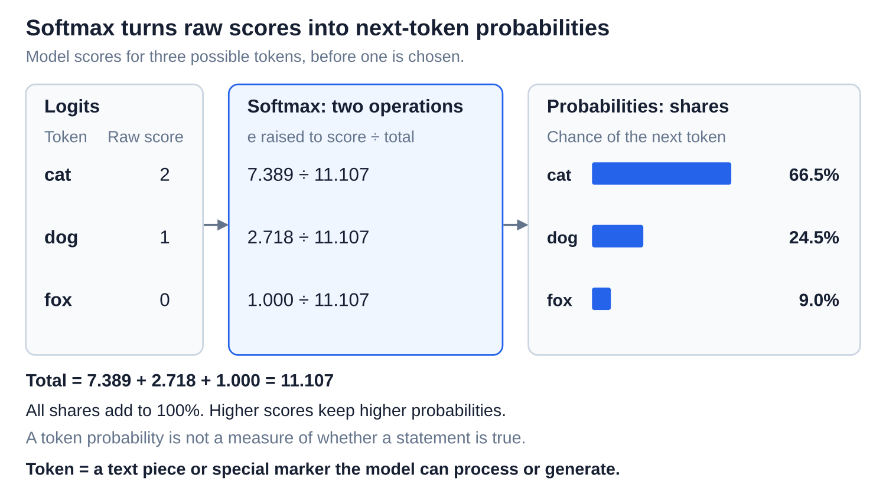
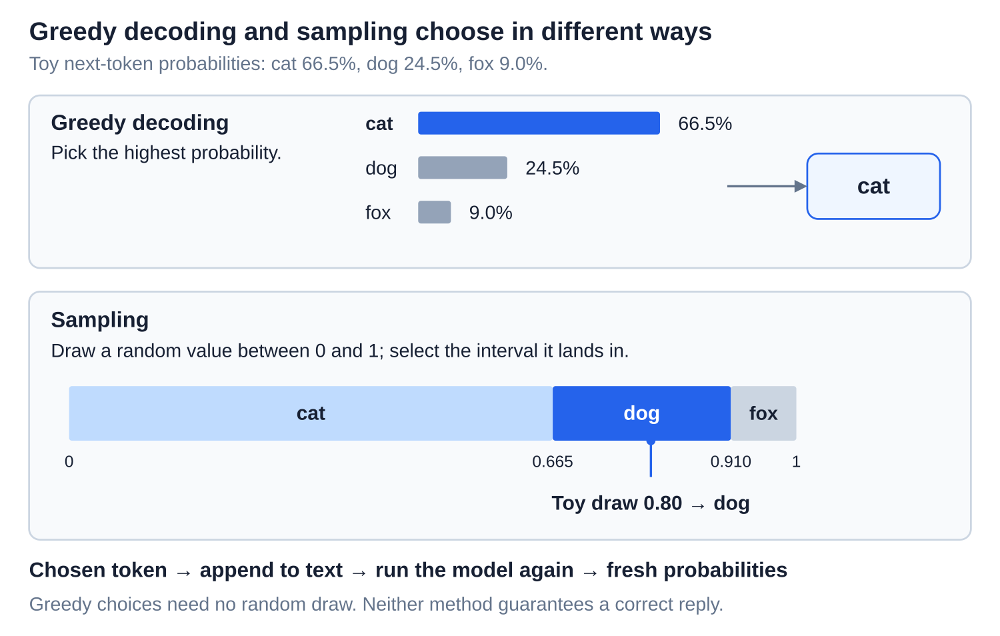
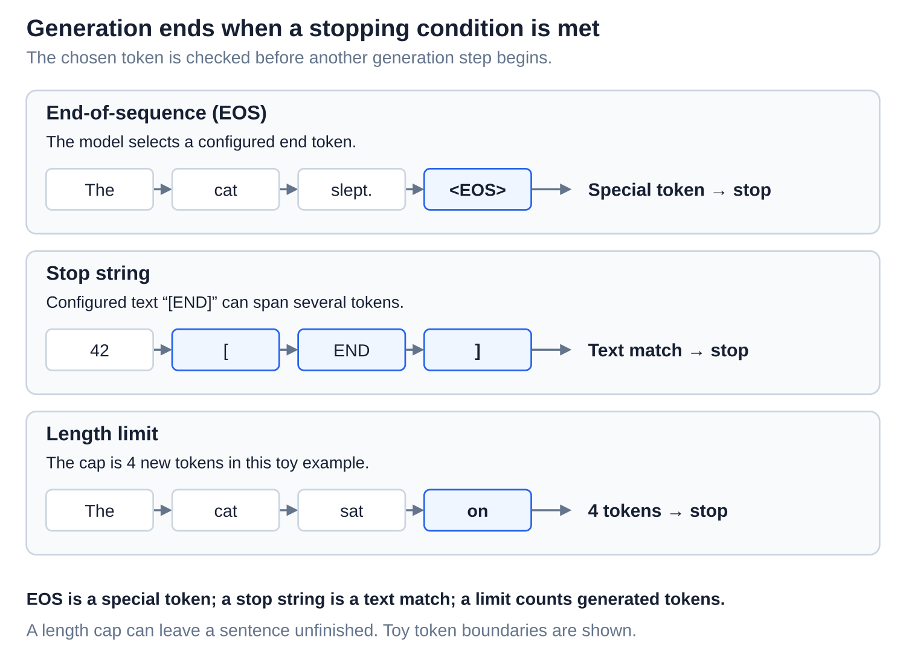
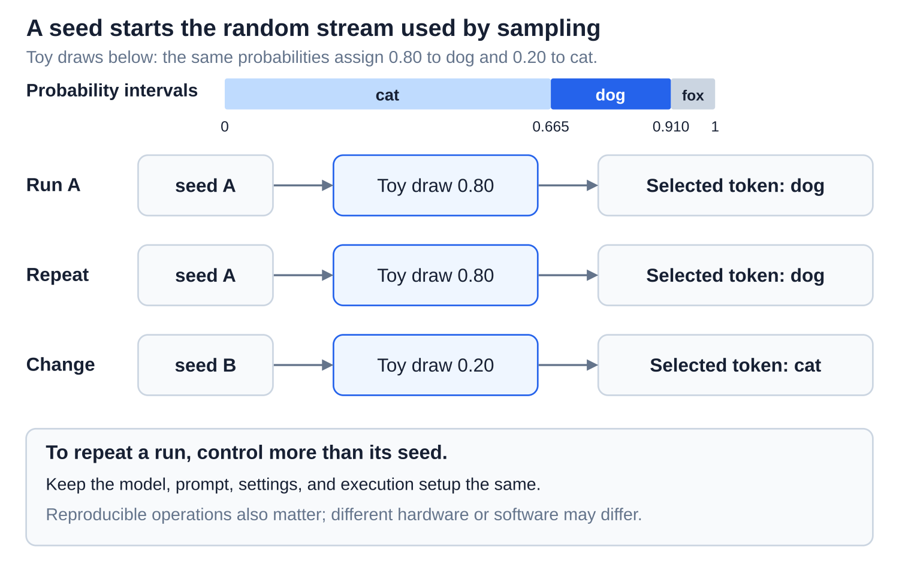

# Inference: From logits to text with decoding and sampling

[Back to Artificial Intelligence](../Readme.md#content)

**Decoding chooses one next token from the model’s scores.** A **token** is a text piece or special marker. Repeating the choice builds a reply. Sampling settings change which continuations are likely; they do not guarantee factual accuracy.

## Where this fits

The shared map highlights **token selection**. Follow the arrows from context assembly through model computation and token selection. The lower example turns model scores into a chosen token, then returns it to the model.

## From scores to probabilities

A **logit** is a raw score for a possible next token. Scores can be negative or positive; a higher score favors that token. **Softmax** converts the scores into **probabilities**, shares that total 100%, by raising *e* (about 2.718) to each score and dividing by the sum.

Follow one row: “cat” has score 2, which becomes 7.389, then about 66.5% of the total. This is its next-token probability, not a confidence score for a statement’s truth. The diagram uses three possible tokens to expose the arithmetic.

## Greedy decoding and sampling

**Greedy decoding** picks the highest-probability token. **Sampling** draws a token randomly, weighted by its probability. A larger share means a greater chance, not a guaranteed selection.

Greedy picks “cat”; the illustrative random draw lands in “dog.” Either choice joins the text, and a fresh model pass produces the next scores. Locally highest probabilities do not guarantee the best whole reply.

## Temperature changes the spread

**Temperature**, written `T`, divides the logits before softmax. A smaller positive value sharpens the distribution; a larger value flattens it.

All three panels start with the same scores. At `T = 0.5`, “cat” gets about 87%; at `T = 2`, about 51%. Positive temperature preserves the ranking, so it changes sampling frequencies without changing the highest-scoring token. It does not add knowledge.

## Top-k and top-p filter candidates

These filters remove unlikely candidates before sampling:

- **Top-k** keeps a fixed number of the most likely tokens. Here `k = 2` keeps A and B.
- **Top-p**, also called **nucleus sampling**, keeps the smallest group of highest-probability tokens whose combined share reaches `p`. Here `p = 0.8` targets 80% of probability, not 80% of tokens. A and B reach only 75%, so C must join them.

The remaining shares are **renormalized**: divided by their total so they sum to 100% again. The lower bars show this rescaling. Then one surviving token is sampled. Top-p’s number of survivors can change at every step.

## Stopping conditions

Generation can stop when the model selects an **end-of-sequence (EOS)** special token, when generated text matches a configured **stop string**, or when a **length limit** is reached.

The three lanes show different triggers. A length cap counts generated tokens and may leave an unfinished sentence; it does not mean the model chose to end its answer.

## Seeds and repeatability

A **seed** initializes the random-number generator used by sampling. In a reproducible setup, the same seed can repeat its stream of draws.

Read the repeated rows: equal draws and probabilities produce equal choices. But the seed alone is insufficient: the model, prompt, settings, and execution must also match. Different hardware, software, or nondeterministic operations can change results, including greedy results.

# Sources

- [Hugging Face: decoding strategies and published diagrams](https://huggingface.co/blog/how-to-generate)
- [PyTorch: softmax](https://docs.pytorch.org/docs/2.15/generated/torch.nn.Softmax.html)
- [Hugging Face: generation settings, filters, and stopping](https://huggingface.co/docs/transformers/en/main_classes/text_generation)
- [PyTorch: reproducibility](https://docs.pytorch.org/docs/2.15/notes/randomness.html)
