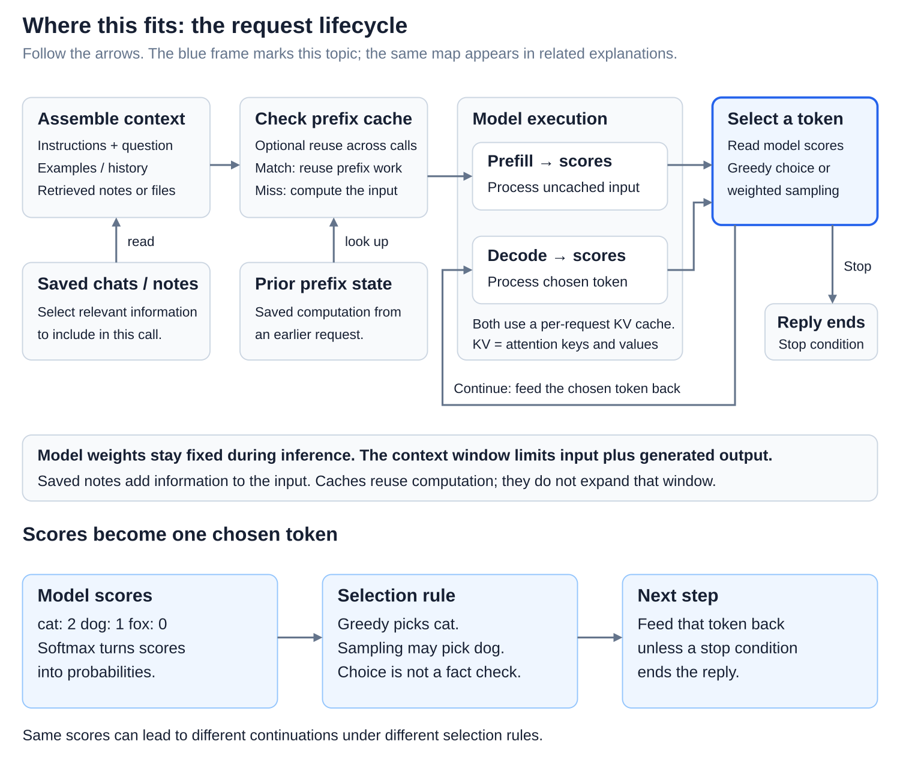
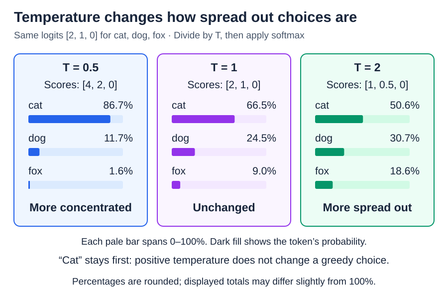
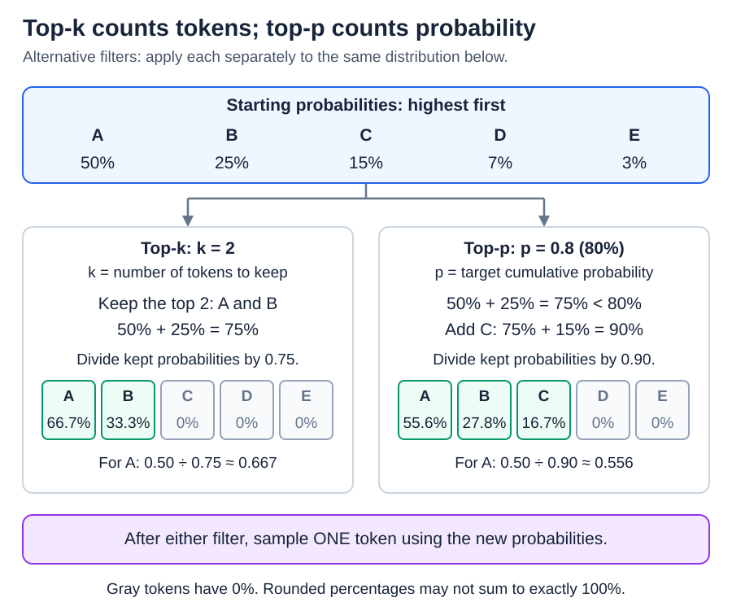

# Inference: From logits to text with decoding and sampling

[Back to Artificial Intelligence](../Readme.md#content)

**After each forward pass, the model has a score for every token in its vocabulary. Decoding is the rule that turns those scores into one chosen token, again and again, until the reply is finished.** This rule decides whether the same model answers in a careful, repeatable way or in a more varied one.

## Where this fits

[The transformer forward pass](../The%20transformer%20forward%20pass/Readme.md) ends with **logits**, raw scores for each possible next token. Decoding is the step that comes after them:

Read the top row from left to right. The last box picks one token. The loop arrow shows what happens next: the token is added to the text, and the model runs again for the token after it. The panel below opens the decoding step: turn the scores into probabilities, optionally reshape them, then pick.

## Scores become probabilities

A logit can be any number, positive or negative; a higher score means the model favors that token more. **Softmax** turns the logits into **probabilities**: positive shares that add up to 100% and keep the same order. For example, if “cat,” “dog,” and “fox” score 2, 1, and 0, softmax gives them about 66.5%, 24.5%, and 9%.

These are chances for the next token only. A 66.5% chance for “cat” says nothing about whether a statement is true.

## Two ways to choose

- **Greedy decoding** always takes the most likely token, here “cat.” It is predictable, but the best choice at each step does not guarantee the best whole reply, or a correct one.
- **Sampling** draws a token at random, weighted by the probabilities, like a raffle in which “cat” holds most of the tickets. “Cat” usually wins, but “dog” or “fox” sometimes do, which makes replies more varied.

Whichever token wins joins the text, and the next pass produces fresh scores. Greedy decoding therefore does not mean repeating “cat” forever.

## Temperature: how adventurous sampling is

**Temperature** reshapes the probabilities before sampling. A low temperature sharpens them, so the favorite wins even more often; a high temperature flattens them, so unlikely tokens get more chances.

The diagram shows the same three scores at three temperatures. Compare the bars: at `T = 0.5`, “cat” takes about 87%; at `T = 1`, nothing changes; at `T = 2`, the shares are more even. “Cat” stays first in every panel, so temperature never changes a greedy choice. It changes how often sampling picks something else, not what the model knows.

## Top-k and top-p: cut off the long tail

A real vocabulary has many thousands of tokens, and most of them are very unlikely at any given step. Two common filters remove the unlikely ones before sampling:

- **Top-k** keeps a fixed number of the most likely tokens. In the diagram, `k = 2` keeps A and B.
- **Top-p**, also called **nucleus sampling**, keeps the smallest group of top tokens whose chances add up to at least `p`. With `p = 0.8`, the target is 80% of the probability, not 80% of the tokens: A and B reach only 75%, so C joins them. How many tokens survive depends on the scores at that step.

After filtering, the survivors' chances are scaled up so that they again add up to 100%, and one token is drawn from them.

## When generation stops, and why runs differ

Generation stops when the model picks a special **end-of-sequence (EOS)** token, when a chosen stop text appears, or when a length limit is reached. A length limit can cut a sentence in half.

Sampling uses a random-number generator. Fixing its starting value, the **seed**, can repeat the same choices in a controlled setup, but not across different software versions or hardware. Even greedy runs can differ there, because tiny numerical differences can change the scores.

# Sources

- [Hugging Face: decoding strategies](https://huggingface.co/docs/transformers/en/generation_strategies)
- [PyTorch: softmax](https://docs.pytorch.org/docs/2.15/generated/torch.nn.Softmax.html)
- [Hugging Face: temperature and sampling filters](https://huggingface.co/docs/transformers/en/internal/generation_utils)
- [Hugging Face: generation settings and stopping](https://huggingface.co/docs/transformers/en/main_classes/text_generation)
- [PyTorch: reproducibility](https://docs.pytorch.org/docs/2.15/notes/randomness.html)
