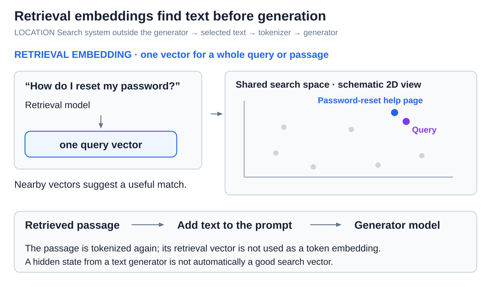

# Internals: Embeddings and position information

[Back to Artificial Intelligence](../Readme.md#content)

**A token embedding supplies a token's starting vector; position information supplies its place in the sequence.** A **vector** is an ordered list of numbers. Transformer blocks turn starting vectors into working representations that depend on surrounding text.

## Where this fits

Tokenization assigns numeric IDs to text pieces; embedding lookup turns those IDs into vectors. Attention later mixes information between positions.

The upper map highlights the embedding entry point. The lower panel distinguishes token identity from two position designs: adding position vectors before the blocks or applying rotations inside attention.

## Token embeddings and contextual representations

A **token embedding table** stores one learned vector per token ID. A **token embedding** is the row selected by an ID. Training adjusts the table; ordinary use leaves it fixed. The first panel shows an ID selecting its row.

A **contextual representation**, also called a **hidden state**, is a later working vector that depends on the input around that token. The second panel shows why it differs from the lookup row.

In this toy, `bank` is one token and always starts with `[2, 1]`. After the blocks process “river bank” or “savings bank,” its vectors differ. These numbers are invented: individual slots are not labeled “water” or “money.” Hidden states are recalculated for each input and change across layers; the embedding-table row stays fixed.

## Retrieval embeddings have a different job

A **retrieval embedding** represents a whole query or passage as one vector for search. A compatible retrieval model places useful matches near one another in its search space.

Read left to right: a password-reset question becomes a query vector, a nearby passage is selected, and that passage's **text** goes into the generator's prompt. It is then tokenized normally. This happens outside the generator's token embedding lookup, as in [retrieval-augmented generation (RAG)](../RAG%20pipeline/Readme.md).

A hidden state from a text generator is not automatically a good search vector. Vectors from unrelated systems are not comparable merely because they have the same length.

## Positional encoding: supplying order

**Positional encoding** supplies numbers that distinguish positions. “Dog bites person” and “person bites dog” use the same words in different orders, so identity alone does not describe the sentence. There are different ways to add order information.

### Adding a position vector

A **position vector** is a list of numbers assigned to a position. In the original Transformer, it is added to the token vector before the first block.

Add matching slots: `[2, 1] + [0, 3] = [2, 4]`. Move the same token to another position and a different position vector changes the sum. These toy values show the arithmetic. Position vectors can be learned or made by a fixed rule; the original Transformer used sine and cosine waves.

### Rotary position embeddings (RoPE)

**Rotary position embeddings (RoPE)** rotate pairs of numbers inside attention. A **query (Q)** represents what a position seeks; a **key (K)** represents what another position offers to match. RoPE rotates Q and K according to their positions before their comparison.

The toy isolates position with identical starting directions and a turn of 10° per position. Key 2 and query 5 differ by 30°; shifting both to 3 and 6 keeps that gap. Real RoPE rotates different pairs at different rates, and the comparison still depends on token content.

Llama-style models use RoPE inside attention, so no position vector is added to the starting embedding. Position information tells attention **where** tokens are; the rule that blocks future positions separately decides **which** positions may be read. See [Attention](../Attention/Readme.md) for the matching and masking calculation.

# Sources

- [PyTorch: embedding-table lookup](https://docs.pytorch.org/docs/2.15/generated/torch.nn.Embedding.html)
- [Meta: Llama 3 embeddings, attention, and RoPE](https://github.com/meta-llama/llama3/blob/main/llama/model.py)
- [Sentence-BERT: embeddings for text comparison](https://arxiv.org/abs/1908.10084)
- [Sentence Transformers: semantic search and published search-space diagram](https://sbert.net/examples/sentence_transformer/applications/semantic-search/README.html)
- [Google: Transformer architecture diagram and positional encoding, §3.5](https://arxiv.org/html/1706.03762v7)
- [RoFormer: rotary position embeddings, §3](https://arxiv.org/html/2104.09864v5)
