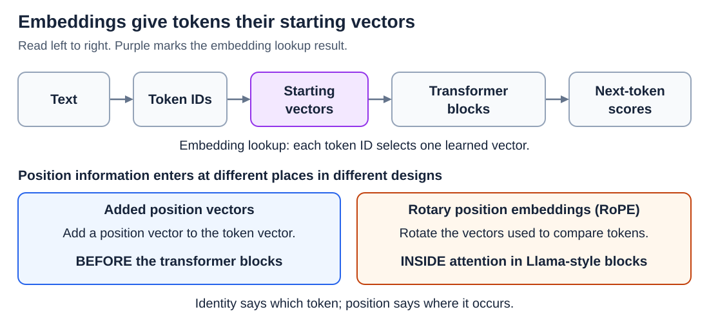
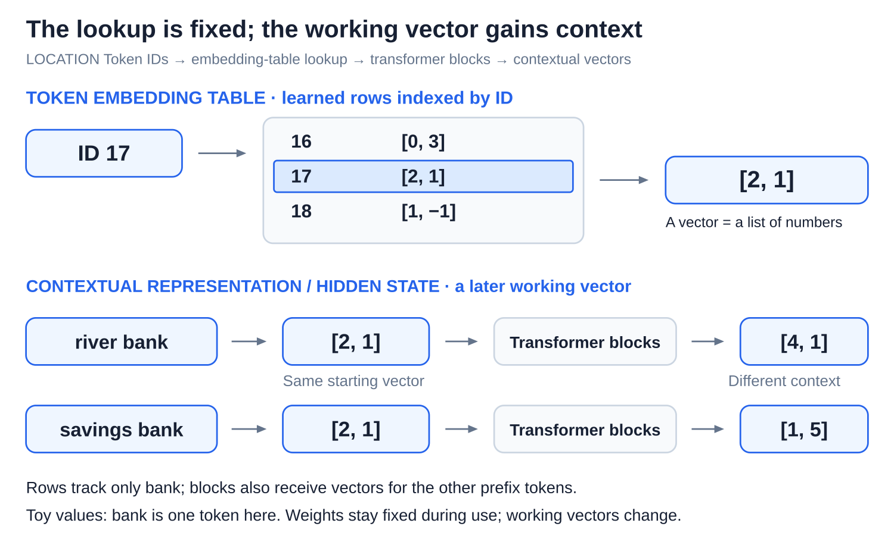
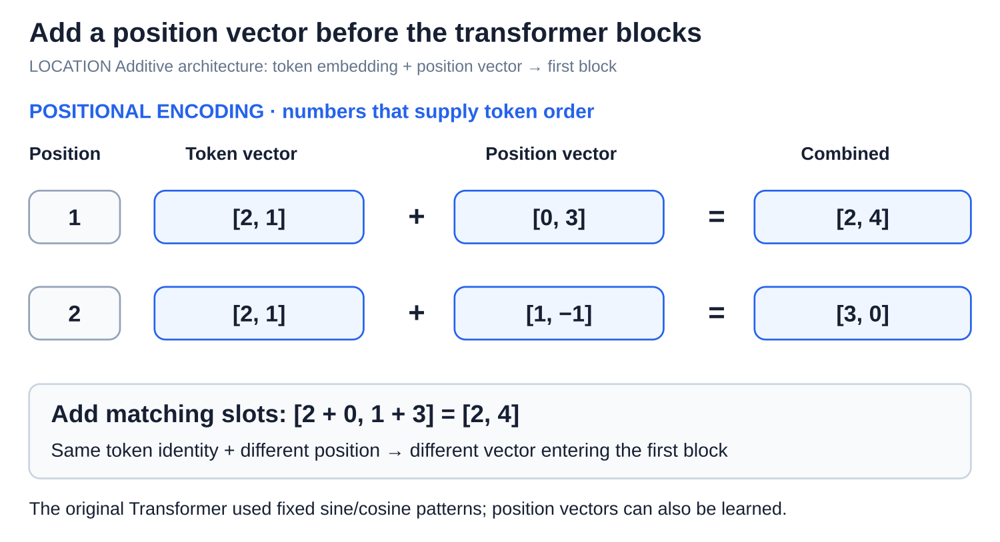
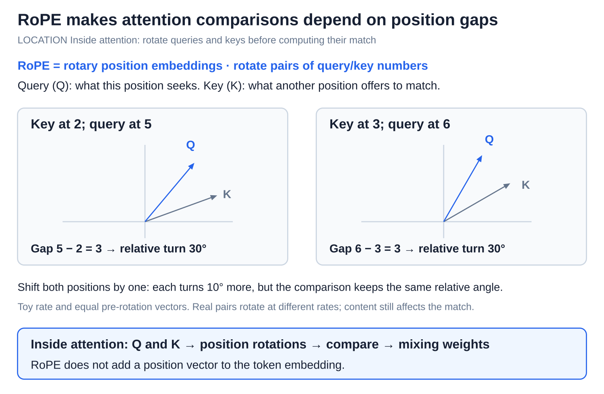

# Embeddings and position information

[Back to Artificial Intelligence](../Readme.md#content)

**An embedding is the learned starting vector that a model gives each token. Position information lets the model also tell where each token sits.** Together they give the transformer blocks what they need: what each token is, and where it is.

## Where this fits

Embeddings are the first step inside the model, right after tokenization:

Read left to right; the panels below show two ways to supply position information.

[The transformer forward pass](../The%20transformer%20forward%20pass/Readme.md) showed the lookup in one step. This article explains what the starting vectors carry, why context changes them, and how word order gets in.

## From token identity to context

A **token embedding table** holds one learned vector for each token ID, and looking up an ID returns its row. Training adjusts the table; using the model does not change it.

A starting vector knows only *which* token this is, not what it means here. In the diagram, `bank` gets the same lookup vector, `[2, 1]`, in “river bank” and in “savings bank,” because the lookup cannot see the neighbors. The transformer blocks then mix in information from earlier tokens, so the later vectors at `bank` differ. A vector that depends on its context like this is a **contextual representation**, also called a **hidden state**.

Two points to keep apart:

- The table row stays fixed; the later vectors are recalculated for every input and differ from layer to layer.
- The individual slots have no assigned meaning. The toy numbers are not labeled “water” or “money.”

## Retrieval embeddings have a different job

The word “embedding” also names a different tool. A **retrieval embedding** represents a whole question or passage as one vector, so that a search system can find text with similar meaning. For example, “How do I reset my password?” should land near a help page about resetting passwords. Retrieval models are trained specially for this matching, which is the search step in a [RAG pipeline](../RAG%20pipeline/Readme.md).

So a token embedding is a per-token starting point inside a language model, while a retrieval embedding summarizes a whole text for search. A hidden state from a text-generating model is not automatically a good search vector, and vectors from different systems cannot be compared just because they have the same length.

## Why the model needs position information

“Dog bites person” and “person bites dog” contain the same tokens but mean different things. A token's table row says nothing about where the token occurs, so the model needs an explicit signal for order. Two common designs supply it.

### Adding a position vector

The original Transformer added a second vector, one per position, to each token's starting vector before the blocks. In the diagram, the same token vector `[2, 1]` becomes `[2, 4]` at position 1 but `[3, 0]` at position 2, because each position adds its own vector. Position vectors can be learned, or produced by a fixed formula; the original Transformer used smooth wave patterns (sines and cosines).

### Rotary position embeddings (RoPE)

Llama-style models use **rotary position embeddings (RoPE)** instead, and nothing is added to the starting vector. Inside attention, each position makes a **query** and a **key**, the vectors that attention compares to decide where to look ([Attention: queries, keys, values, and heads](../Attention/Readme.md)). RoPE turns pairs of numbers in these vectors by an angle that grows with the token's position.

The benefit is that the comparison depends on how far apart two tokens are, not on where they sit in the text. In the diagram's toy example, a key at position 2 and a query at position 5 end up 30° apart. Shift both one place later and they are still 30° apart, because the gap is still three positions. Real RoPE turns different pairs of numbers at different rates.

Position information and the causal mask are separate tools: position information says where tokens are, and the mask decides which tokens a position may look at.

# Sources

- [PyTorch: embedding-table lookup](https://docs.pytorch.org/docs/2.15/generated/torch.nn.Embedding.html)
- [Meta: Llama 3 embeddings, attention, and RoPE](https://github.com/meta-llama/llama3/blob/main/llama/model.py)
- [Sentence-BERT: embeddings for text comparison](https://arxiv.org/abs/1908.10084)
- [Sentence Transformers: semantic search](https://sbert.net/examples/sentence_transformer/applications/semantic-search/README.html)
- [Attention Is All You Need: positional encoding, §3.5](https://arxiv.org/html/1706.03762v7)
- [RoFormer: rotary position embeddings, §3](https://arxiv.org/html/2104.09864v5)
