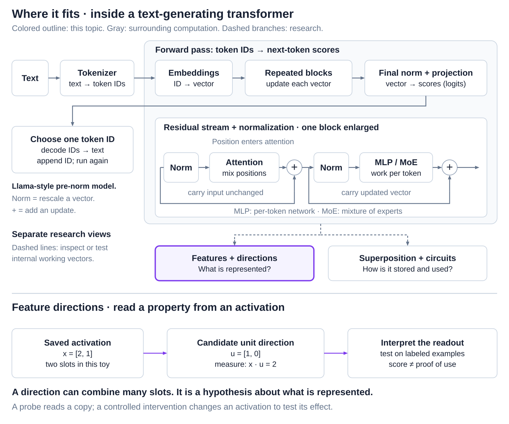
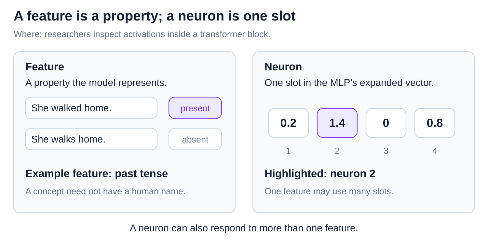
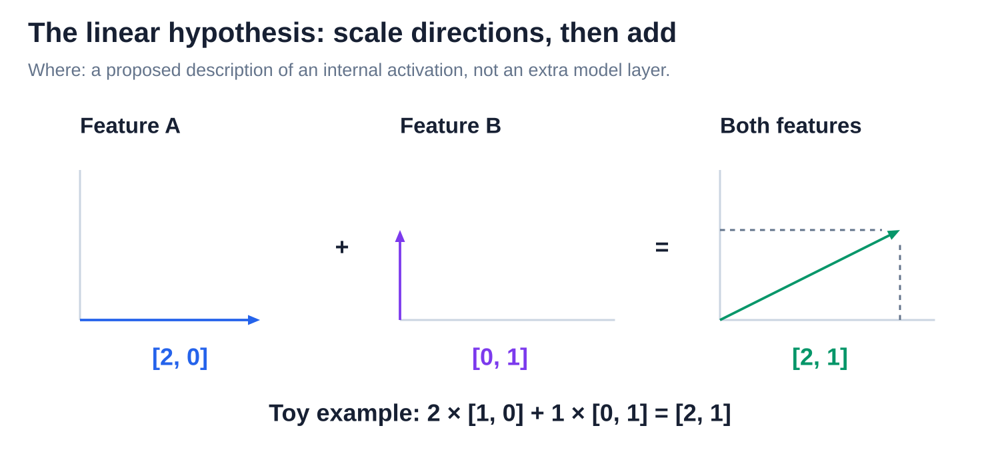
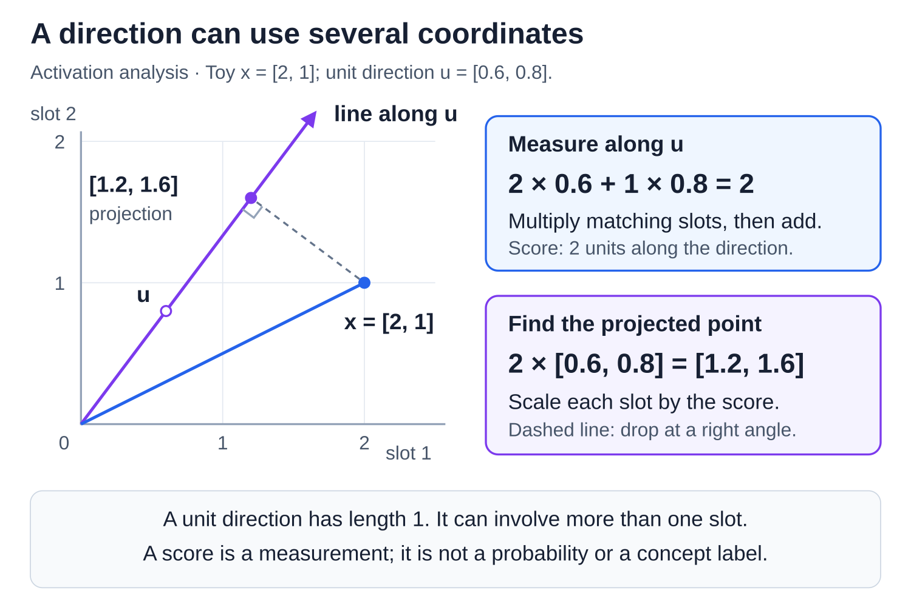
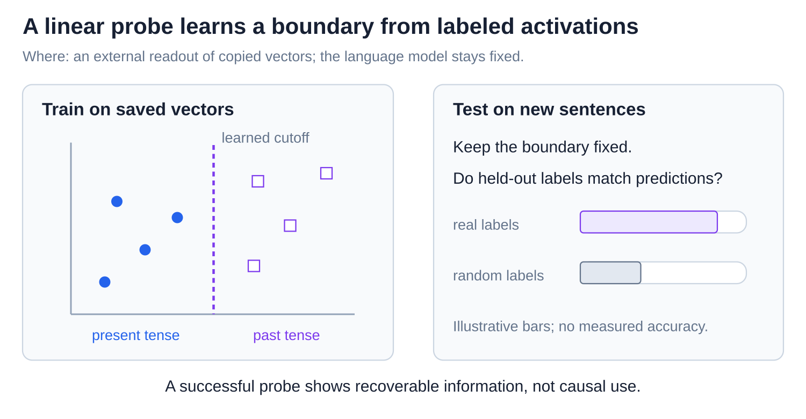
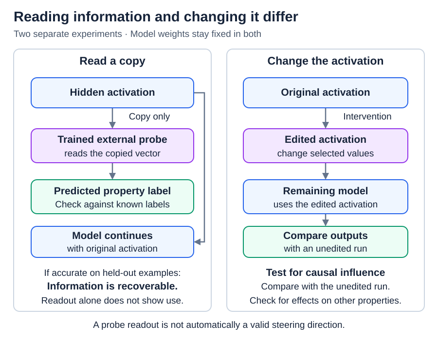

# Internals: Features and the linear representation hypothesis

[Back to Artificial Intelligence](../Readme.md#content)

**The linear representation hypothesis says that many properties a model represents correspond to directions in its internal vectors.** This is a useful research hypothesis, not a rule that every concept must follow. The diagrams move from properties and numerical slots to reading directions and testing their influence.

## Where this fits

**Interpretability** studies what internal computations represent and do. A vector is a list of numbers; **activations** are the working values calculated for an input.

The upper map highlights a research view of these activations, separate from the model's ordinary computation. The lower panel measures a candidate feature direction. [Superposition and mechanistic interpretability](../Superposition%20and%20mechanistic%20interpretability/Readme.md) explores overlapping directions and tests of their use.

## Features and neurons

A **feature** is a property represented by the model, such as past tense or French text. A **neuron** is one numerical slot in an MLP's expanded vector; this multilayer perceptron transforms each token separately. The two panels distinguish the property from the place where a number is stored.

A feature can involve many neurons; one neuron can respond to several features. Neither a slot in the token's running vector nor a neuron comes with a human concept label.

## The hypothesis: directions, strength, and addition

A **direction** describes where a vector points. Under the linear picture, each feature contributes a scaled direction: stronger activity means a larger contribution, and contributions add. Follow the three plots using their common scale.

The model still uses nonlinear computation to decide which features are active. “Linear” here describes a proposed representation, not the entire model.

## Projection: measure along a direction

A **projection** is the part of a vector along a chosen direction. For a **unit direction**, whose length is 1, a **dot product** measures signed distance along that direction: multiply matching coordinates and add. The graph and two arithmetic panels separate the scalar measurement from the projected vector.

Here `x = [2, 1]`, `u = [0.6, 0.8]`, and `x · u = 2`. The projected point is `2u = [1.2, 1.6]`. This measurement is not a probability. Overlapping directions can leak into each other's measurements.

## Linear probes: test what can be read

A **linear probe** is a small external model trained to predict labels from saved activations. A simple binary probe learns a direction and cutoff. The language model stays fixed. Read training examples on the left, then the held-out check on the right.

Check new examples, random-label controls, and an untrained-model baseline. A successful probe shows the property is recoverable; it does not show the language model uses it to answer.

## Interventions and steering: test influence

An **intervention** changes an internal value before the remaining model uses it. **Steering** is an intervention that adds a chosen direction. Compare the unedited top lane with the edited bottom lane.

A predicted output change supports causal influence. Check unrelated effects too: an edit can disturb other information. A direction that reads a property well need not be the best direction for changing it.

## Evidence and limits

Experiments in Llama 2 found approximately linear behavior for many tested concepts. Other work found circular representations for days and months. A readable direction is therefore evidence about one representation, not a complete explanation of the model's computation.

# Sources

- [Meta: Llama architecture](https://github.com/meta-llama/llama3/blob/main/llama/model.py)
- [Anthropic: Toy Models of Superposition — features and directions; visual reference](https://transformer-circuits.pub/2022/toy_model/index.html)
- [The Linear Representation Hypothesis](https://arxiv.org/html/2311.03658v2)
- [Probing Classifiers: baselines and limitations](https://aclanthology.org/2022.cl-1.7/)
- [Designing and Interpreting Probes with Control Tasks](https://arxiv.org/abs/1909.03368)
- [Amnesic Probing: decoding versus causal use](https://arxiv.org/abs/2006.00995)
- [The Geometry of Truth: readout versus steering](https://arxiv.org/abs/2310.06824)
- [Not All Language Model Features Are One-Dimensionally Linear](https://arxiv.org/abs/2405.14860)
