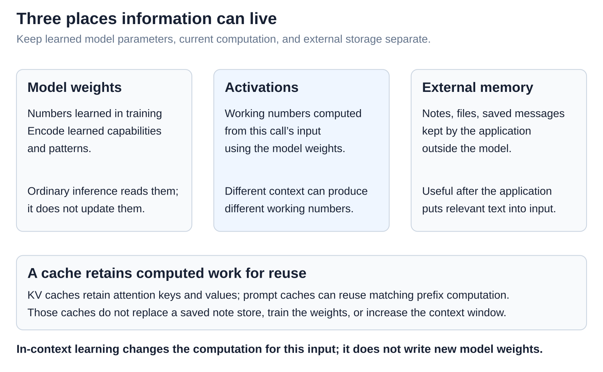
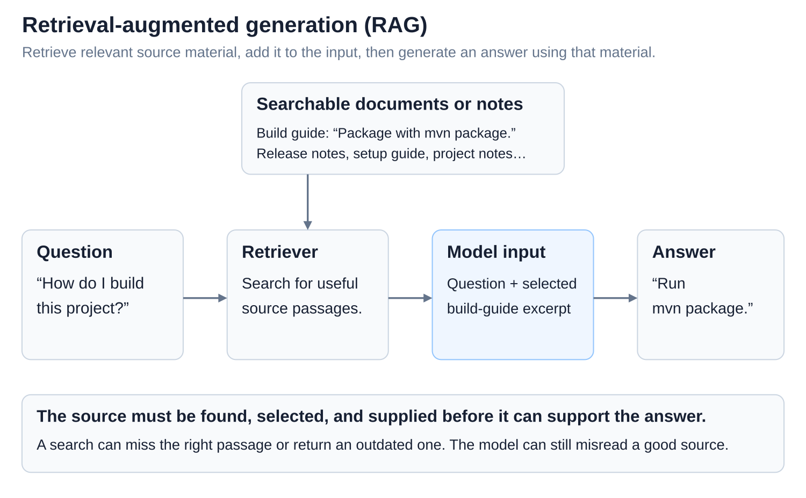
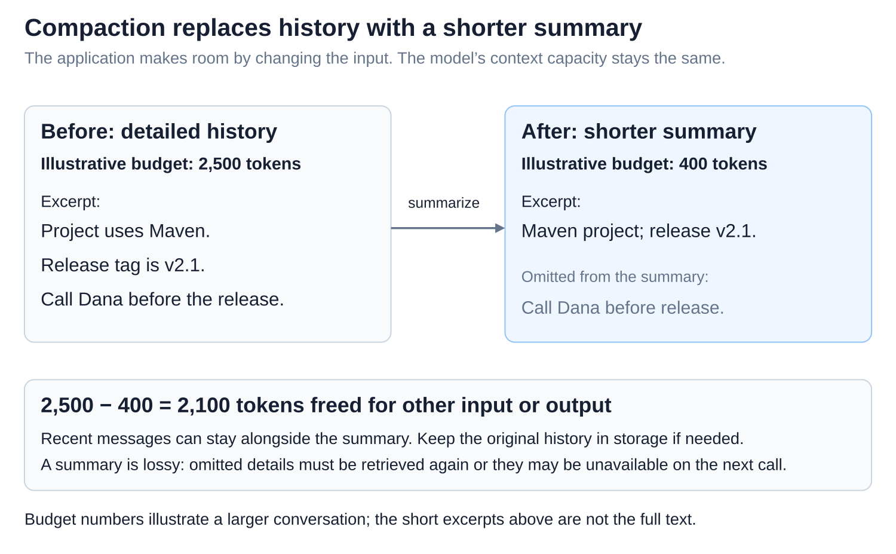

# Inference: In-context learning, context windows, and memory

[Back to Artificial Intelligence](../Readme.md#content)

**Examples in the input can guide an answer without retraining the model. Saved notes can help too, after the application includes them in the input. Neither mechanism enlarges the model’s limited context window.**

## Where this fits

The shared map highlights **context assembly**: choosing this call’s input. Follow the arrows through optional prefix reuse, model computation, and token selection. Below, a saved note becomes useful input.

## Learning from examples without training

**In-context learning** means inferring a task or pattern from the current input. A **demonstration** pairs an example input with its desired output. **Zero-shot** supplies no demonstrations, **one-shot** supplies one, and **few-shot** supplies several.

Here, “red ball → ball, red” and “blue car → car, blue” suggest “green bike → bike, green.” These are invented examples. A few examples can fit several rules; the answer is not guaranteed.

**Weights** are numbers learned during training. **Activations** are working numbers computed from the input using those weights. Examples change the computation; ordinary inference does not update the weights. Learned knowledge can also influence the answer ([Training vs. inference](../Training%20vs.%20inference/Readme.md)).

## Context is content; the window is capacity

**Context** is the supplied input plus output generated so far. The **context window** is its capacity, measured in **tokens**: encoded units that can represent words or word pieces ([Tokens and tokenization](../Tokens%20and%20tokenization/Readme.md)). Instructions, selected messages, documents, and tool results all take space.

The dashed areas are empty capacity. As the reply grows, it consumes room. Cached input still counts. Actual context and output limits depend on the model and service. More capacity does not guarantee better use of the information; long-context experiments have found sensitivity to where relevant facts appear.

## External memory needs saving and selection

The **application** is the program around the model. **External memory** is information it keeps in files, notes, or saved messages beyond one call. Writing a note and later reading it into context are separate actions; merely mentioning a fact in a reply does not persist it.

A chat interface can show messages that the application no longer supplies to the model. Saved history, visible history, and current input can differ.

**Retrieval-augmented generation (RAG)** retrieves source material, adds it to the input, and generates an answer using that material. A **retriever** searches for useful passages; the model then receives the selected text with the question.

Retrieval can miss a note or find an outdated one; the model can misread a good source.

## Compaction makes room by replacing history

**Compaction** replaces a long history with a shorter summary, often keeping recent messages alongside it. The window stays the same size. Summaries can omit details, so an application may retain the original history in storage for later retrieval.

[KV caching](../Prefill%20and%20KV%20cache/Readme.md) and [prompt caching](../Prompt%20caching%20across%20requests/Readme.md) reuse computed work. They do not replace an external note store or increase context capacity.

# Sources

- [OpenAI / Brown et al.: in-context learning and demonstrations](https://arxiv.org/abs/2005.14165)
- [Claude: context windows and token accounting](https://platform.claude.com/docs/en/build-with-claude/context-windows)
- [Anthropic: context selection, notes, and compaction](https://www.anthropic.com/research/effective-context-engineering-for-ai-agents)
- [Claude: application-managed memory](https://platform.claude.com/docs/en/agents-and-tools/tool-use/memory-tool)
- [Lewis et al.: Retrieval-Augmented Generation](https://arxiv.org/abs/2005.11401)
- [Liu et al.: Lost in the Middle](https://arxiv.org/abs/2307.03172)
