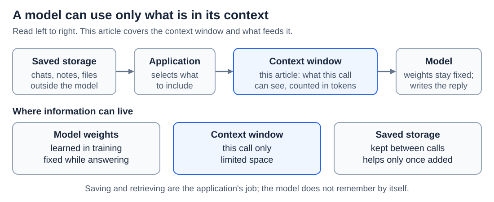
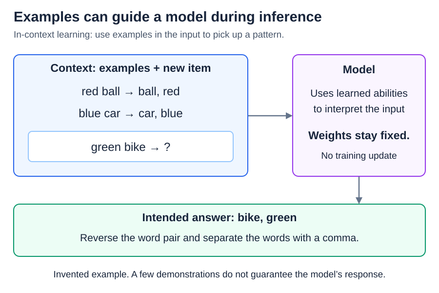
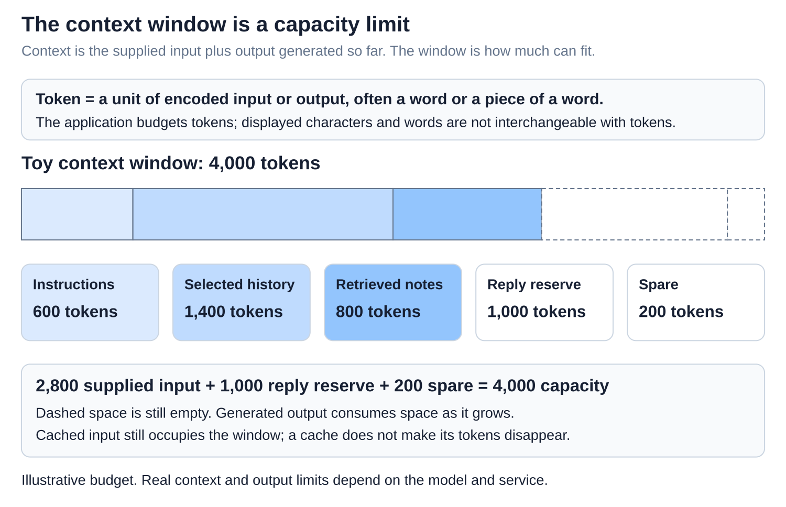
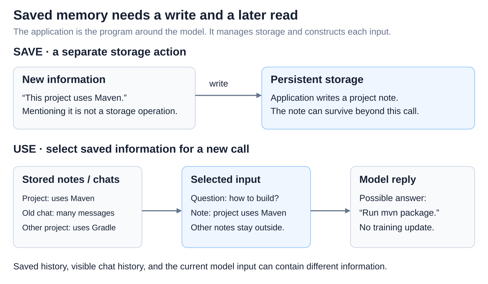

# In-context learning, context windows, and memory

[Back to Artificial Intelligence](../Readme.md#content)

**A model can pick up a task from examples in its prompt without any change to its weights. But it can use only what is in its context right now: anything saved elsewhere helps only after the application puts it back into the context.**

## Where this fits

The earlier articles followed one call to the model. This one asks what that call can see, and where everything else is kept:

Read the top row from left to right. Information can sit outside the model, in saved chats, notes, or files. The **application**, the program around the model, selects what to include and places it in the **context window**: everything the model can see on this call. The model, whose weights stay fixed, reads the context and writes the reply. The row below lists the three places where information can live.

## Learning from examples without training

**In-context learning** means picking up a task or pattern from examples in the current input. The examples change the model's working numbers, its activations, not its learned weights ([Training vs. inference](../Training%20vs.%20inference/Readme.md)).

In the diagram, two examples show a word pair reversed and joined with a comma, so the intended answer for “green bike” is “bike, green.” The model works this out from the context, using abilities it gained in training; nothing is trained now. A few examples can fit more than one rule, so the answer is not guaranteed. Plain instructions can guide the model too, with no examples at all.

## The context window is limited working space

The context window holds instructions, chat messages, tool results, documents, and the reply as it is being written. It is measured in **tokens** ([Tokens and tokenization](../Tokens%20and%20tokenization/Readme.md)), and input and output share the space.

The bar shows a toy window of 4,000 tokens. The solid segments are input: instructions, selected messages, and retrieved notes. The dashed segments are still empty: room kept for the reply, plus some spare. Real limits differ by model, and some models also set a separate limit for output.

More room is not automatically better. As the context grows, models can lose accuracy and miss facts, especially facts in the middle of a long input. Choosing what goes in matters as much as how much fits.

## “Memory” means storage outside the model

A model does not remember earlier chats by itself. What feels like memory is the application saving information and bringing it back. A chat window can even show old messages that are no longer in the model's context.

Read the diagram from top to bottom. A saved conversation and a note, “Project uses Maven,” sit in storage. When you ask “How do I build this project?”, the application selects the note and puts it into the active context with your question, so the model can use it. Searching a store and adding the results to the model's input is called **retrieval-augmented generation (RAG)**.

Retrieval can miss a useful note or bring back an outdated one, and a saved note can be wrong. Saving a new note is a separate step that the application must take; a fact that the model merely writes in a reply is not stored.

## When the context fills up

Long conversations eventually outgrow the window. Applications then keep the recent messages, retrieve older details when needed, or use **compaction**: they replace a long history with a shorter summary, which can lose details. The caches from [Prefill, decoding, and the KV cache](../Prefill%20and%20KV%20cache/Readme.md) and [Prompt caching across requests](../Prompt%20caching%20across%20requests/Readme.md) save computing work. They do not enlarge the window or serve as long-term memory.

# Sources

- [Brown et al.: Language Models are Few-Shot Learners](https://arxiv.org/abs/2005.14165)
- [Claude: context windows and token accounting](https://platform.claude.com/docs/en/build-with-claude/context-windows)
- [Anthropic: context selection, notes, and compaction](https://www.anthropic.com/research/effective-context-engineering-for-ai-agents)
- [Claude: external memory and application-managed storage](https://platform.claude.com/docs/en/agents-and-tools/tool-use/memory-tool)
- [Lewis et al.: Retrieval-Augmented Generation](https://arxiv.org/abs/2005.11401)
- [Liu et al.: Lost in the Middle](https://arxiv.org/abs/2307.03172)
