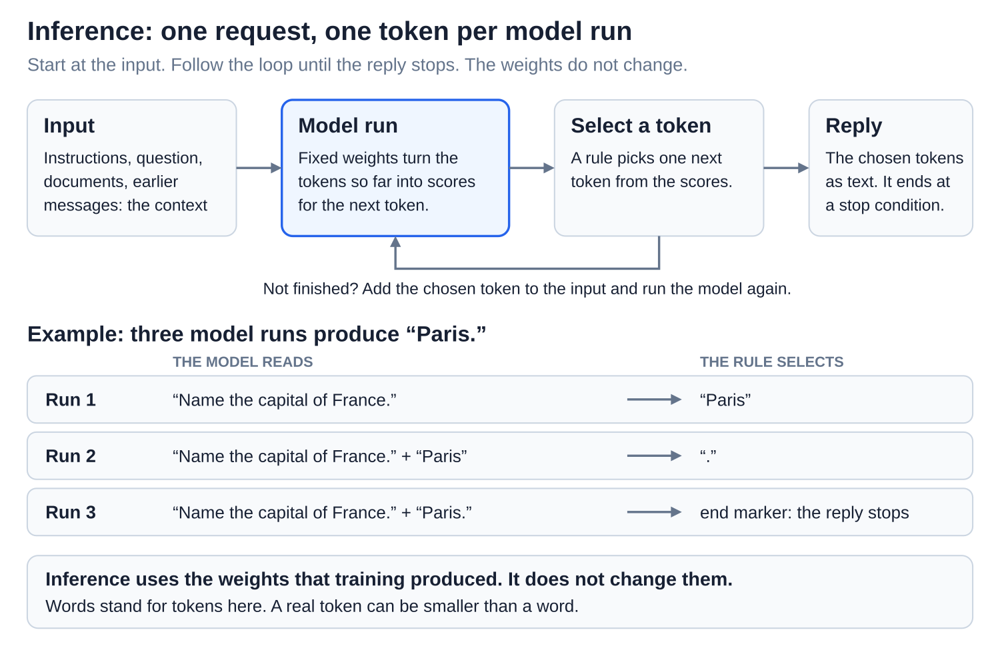
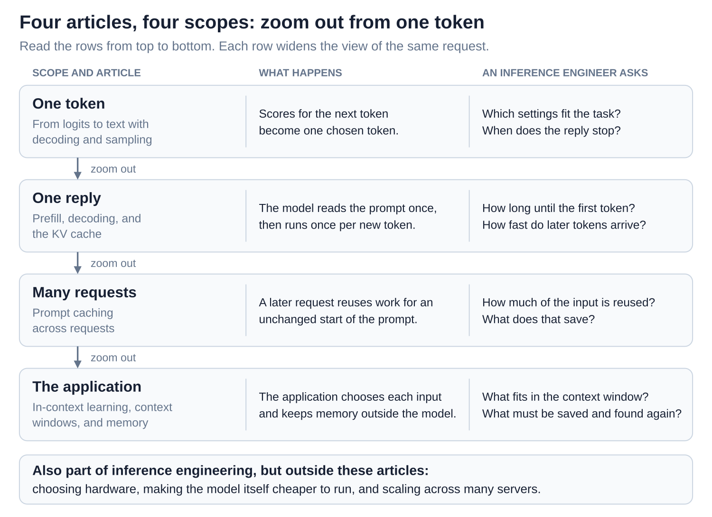

# Inference: What happens when a model answers

[Back to Artificial Intelligence](../Readme.md#content)

**Inference is the use of a trained model: an input goes in, an output comes out, and the model's weights stay fixed. A language model builds its output one token at a time. Inference engineering is the work of making that fast, reliable, and affordable.**

This article is the map for the four that follow. Start with one request, then see how the four topics connect, then meet the engineering questions.

## One request, one token per model run

[Training vs. inference](../Training%20vs.%20inference/Readme.md) showed inference with a single weight: calculate an answer and change nothing. A language model does the same at a larger scale, with one difference. Each run produces only one **token**, a piece of text such as a word or part of a word. A reply needs many runs.

Read the top row from left to right, then follow the loop arrow.

- The **context** is everything the model reads for this request.
- A **model run**, also called a forward pass, turns the tokens so far into scores for the next token.
- A selection rule picks one token from those scores.
- That token joins the input and the model runs again, until a stop condition ends the reply.

The lower rows show three runs that produce “Paris.” Each run depends on everything before it, including the tokens the model chose itself.

Two things do not happen. The weights do not change, so the model learns nothing lasting from the request. And the model itself remembers nothing between requests. Caches can save repeated computation and applications can save notes, but what the model should know next time must be in the next input.

## Four scopes, from one token to the application

The next four articles look at this same request from wider and wider distances.

Read the rows from top to bottom. The middle column says what happens at that scope. The right column gives the questions that the article answers.

1. [From logits to text with decoding and sampling](../Decoding%20and%20sampling/Readme.md): how one token is chosen.
2. [Prefill, decoding, and the KV cache](../Prefill%20and%20KV%20cache/Readme.md): how a whole reply is computed without repeating work.
3. [Prompt caching across requests](../Prompt%20caching%20across%20requests/Readme.md): how a later request reuses earlier work.
4. [In-context learning, context windows, and memory](../In-context%20learning%20and%20memory/Readme.md): what the application puts into each request.

One word changes meaning along the way. In the first article, **decoding** is the rule that selects a token. In the second, the **decoding phase** is the part of a request in which the model runs once per new token. **Prefill** is the part before it: the first run over the whole input.

## What inference engineering adds

Training leaves behind a set of weights. Serving them to users is a separate job, and that job is **inference engineering**. Its questions are practical:

- **Speed:** how long until the first token arrives (**time to first token**), and how quickly do the rest follow?
- **Cost:** how much computation and memory does each request need?
- **Reliability:** does the service stay fast when many requests arrive at once?

The answers come from several levels: making one model run efficiently on one machine, spreading the load across many machines, and giving engineers the tools to control both. This series stays close to the single request. It covers the levers an application developer can see: sampling settings, the cache inside a request, the cache across requests, and the size and layout of the input.

None of these levers changes the weights. They change which likely continuation is chosen, what the model reads, and how quickly and cheaply the reply arrives.

# Sources

- [Baseten: Inference Engineering, Chapter 0 - inference and its layers](https://www.baseten.co/inference-engineering/book/00-inference.md)
- [NVIDIA: time to first token and other latency definitions](https://developer.nvidia.com/blog/llm-benchmarking-fundamental-concepts/)
- [Hugging Face: one token at a time, and how KV caching works](https://huggingface.co/docs/transformers/en/cache_explanation)
