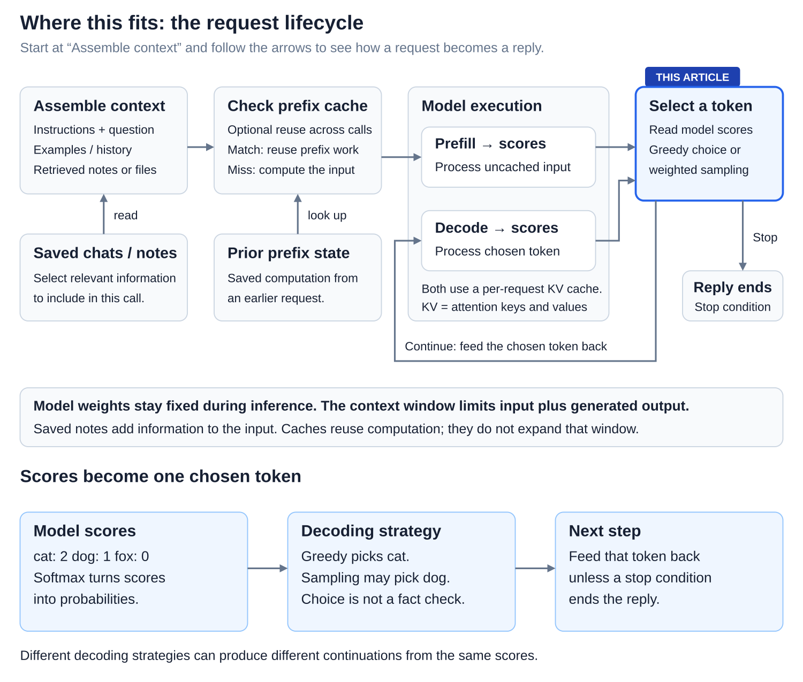
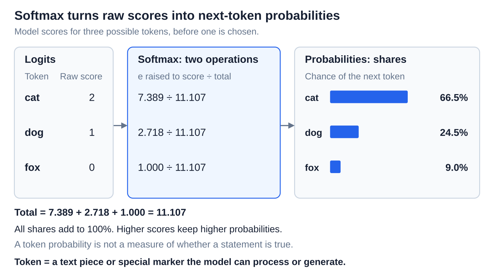
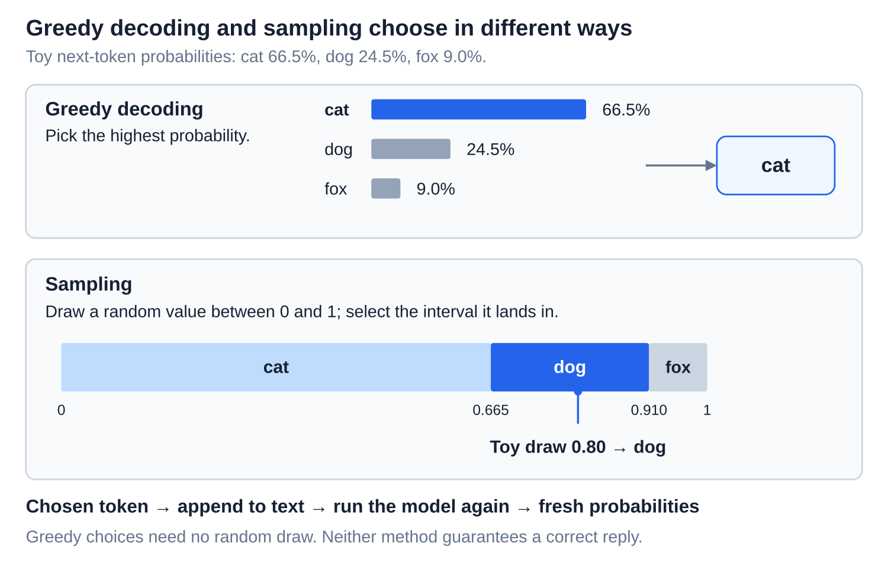
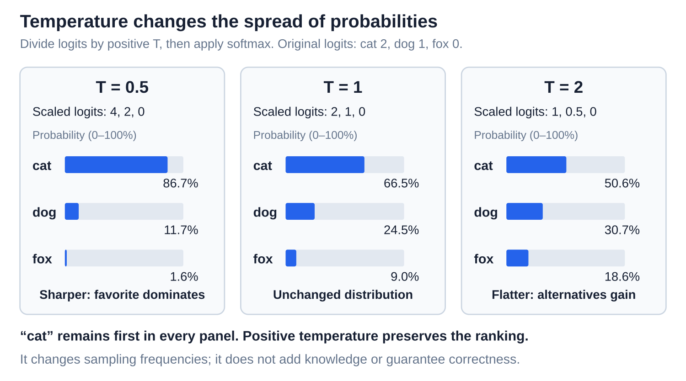
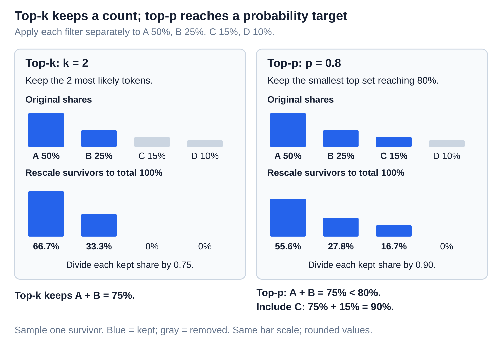
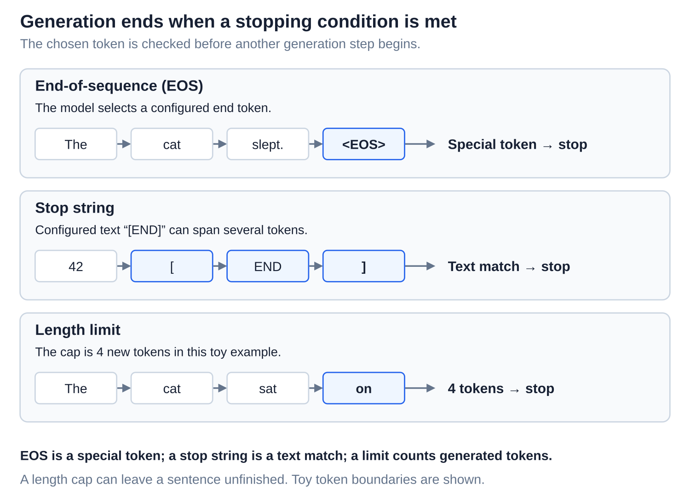
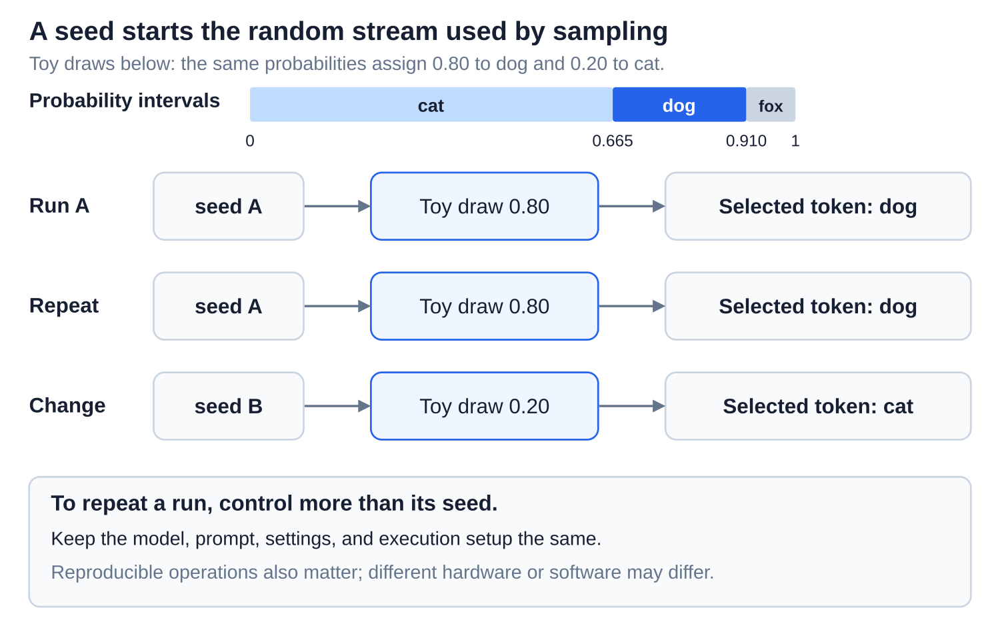

# Inference. From logits to text with decoding and sampling

[Back to Artificial Intelligence](../Readme.md#content)

**The model scores possible next tokens. Decoding uses those scores to choose which token to append.**

A **token** can be a word, part of a word, punctuation, or a special marker. Suppose the text so far is “I saw a” and the three possible next tokens are `cat`, `dog`, and `fox`. The same scores can lead to “I saw a cat” or “I saw a dog,” depending on how the choice is made.

1. [Where does decoding fit?](#1-where-does-decoding-fit)
2. [How do logits become probabilities?](#2-how-do-logits-become-probabilities)
3. [How do greedy decoding and sampling choose?](#3-how-do-greedy-decoding-and-sampling-choose)
4. [What does temperature change?](#4-what-does-temperature-change)
5. [Which tokens survive top-k and top-p?](#5-which-tokens-survive-top-k-and-top-p)
6. [What makes generation stop?](#6-what-makes-generation-stop)
7. [When can a seed repeat a result?](#7-when-can-a-seed-repeat-a-result)

## 1. Where does decoding fit?

In the diagram, follow the arrow from “Model execution” to the highlighted “Select a token” box. The first box calculates scores. The second applies a **decoding strategy**, the rule for choosing a token from those scores.

Suppose the strategy chooses `dog`. The application appends it, so the text now reads “I saw a dog.” If generation continues, the model processes `dog` to score what could follow. These model runs after the prompt make up the **decoding phase**. The decoding strategy uses the scores from each run to choose the next token.

To follow a request from the prompt to the finished reply, see [Inference. What happens when a model answers](../Inference.%20What%20happens%20when%20a%20model%20answers/Readme.md). For the work the model reuses between choices, see [Inference. Prefill and KV cache](../Inference.%20Prefill%20and%20KV%20cache/Readme.md).

## 2. How do logits become probabilities?

A **logit** is the model’s raw score for a candidate token. A higher score means the model favors that continuation. Logits can be negative, and they have no fixed total. Take the entire vocabulary in our small example to be `cat`, `dog`, and `fox`, with logits of 2, 1, and 0.

Read across the rows to see how **softmax** turns the three scores into shares of one total.

1. Raise the number *e* (about 2.718) to the power of each score. For `cat`, `dog`, and `fox`, the results are about 7.389, 2.718, and 1.000.
2. Add those values to get about 11.107. Divide each value by that total. For `cat`, `7.389 ÷ 11.107 ≈ 0.665`, or **66.5%**. The shares for `dog` and `fox` are about 24.5% and 9.0%.

If you sample directly from these probabilities, `cat` has a 66.5% chance of coming next. That number alone cannot tell you how likely the speaker was to have seen a cat. Someone who saw a dog could write the same prompt and get the same three scores.

## 3. How do greedy decoding and sampling choose?

**Greedy decoding** picks the token with the highest score. It chooses `cat` here. It can compare logits directly because softmax preserves their order. **Sampling** makes a random choice in which each token’s chance equals its share. This gives `dog` and `fox` a chance as well.

Read the lower bar as a number line from 0 to 1. The first 66.5% of the line belongs to `cat`, the next 24.5% to `dog`, and the last 9.0% to `fox`. Draw a number uniformly, so that intervals of equal length are equally likely. The illustrated draw of `0.80` falls in the `dog` interval. Once `dog` is appended, the model scores the next token using “I saw a dog.” Greedy decoding considers only the current choice, so its favorite at each step can still lead to a poor reply.

## 4. What does temperature change?

**Temperature** controls how strongly sampling favors the front-runner. Divide every logit by the same positive number, called `T`, before applying softmax. Compare the bar for `cat` in the three panels.

1. At `T = 0.5`, the scores 2, 1, 0 become 4, 2, 0. The gaps widen, and the chance of sampling `cat` rises to about **86.7%**.
2. At `T = 1`, the scores keep their original values. The chance of `cat` is about **66.5%**.
3. At `T = 2`, the scores become 1, 0.5, 0. The gaps shrink, and the chance of `cat` falls to about **50.6%**. Both alternatives become more likely.

Every panel still ranks `cat` first. Changing a positive temperature can change how often you sample a token while leaving the greedy choice the same.

At `T = 0`, division by temperature is undefined. Meta’s Llama 3 reference implementation handles zero by switching to greedy decoding. In this example it would select `cat`.

## 5. Which tokens survive top-k and top-p?

Both filters narrow the choices before sampling. The diagram uses a fresh example with four tokens, A (50%), B (25%), C (15%), and D (10%). Each panel starts with these same percentages and applies one filter.

1. **Top-k keeps a fixed count.** With `k = 2`, the two highest-ranked tokens are A and B. Together they account for 75% of the original probability.
2. **Top-p keeps enough probability.** Start with the most likely token and add tokens in descending order until the running total reaches or exceeds `p`. With `p = 0.80`, A and B reach only 75%. Adding C brings the total to 90%, so A, B, and C survive. This rule is also called **nucleus sampling**.

The sampler then **renormalizes** the surviving shares. It divides each share by the total kept so the new probabilities sum to one. Under top-k, A’s chance becomes `50 ÷ 75 ≈ 66.7%`. Under top-p, it becomes `50 ÷ 90 ≈ 55.6%`. A top-p threshold can keep just one token on one pass and several on the next.

## 6. What makes generation stop?

After each choice, the application checks whether to generate another token. The three rows show different ways a reply can end. Each has a corresponding setting in Hugging Face Transformers.

1. **End-of-sequence (EOS) token.** `eos_token_id` identifies a special token that ends the reply when selected. In the first row it comes after “The cat slept.”
2. **Stop string.** With `stop_strings`, the application watches for a piece of text such as `[END]`. A match can span several tokens. In the second row, `[`, `END`, and `]` together form the string.
3. **Output length limit.** `max_new_tokens` caps the number of tokens the model can generate after the prompt. In the last row, “The cat sat on” uses all four allowed tokens, so the reply ends mid-sentence.

Claude’s Messages API reports why a reply ended in the `stop_reason` field. For example, `end_turn` means Claude finished its turn naturally, and `stop_sequence` means it produced a configured stop string. If `stop_reason` is `"max_tokens"`, the reply reached the output token limit and may end mid-sentence.

## 7. When can a seed repeat a result?

A **seed** sets the starting state of the program that produces random draws. Resetting it can repeat the same sequence of draws. To see how this affects sampling, follow the first two rows and then the third.

In the diagram, seed A gives a first draw of `0.80` both times. With the same probability intervals, both runs select `dog`. Seed B illustrates a different draw, `0.20`, which lands in `cat`. A different seed can also land in the same interval and choose the same token.

To repeat a whole reply reliably, keep the model version, prompt, and decoding settings fixed and use a setup that can repeat the same calculations. Software or hardware differences can change the scores. Even greedy decoding can differ if two scores are close enough to swap order. Once a choice differs, the two runs have different text to continue.

## Check your understanding

1. The model has scored `cat`, `dog`, and `fox` after “I saw a.” What still has to happen before it can score what follows “I saw a dog”?

   

   
Answer

   The decoding strategy must choose `dog`, and the application must append it. The model can then compute fresh scores using “I saw a dog” as its context.

   

2. The logit for `fox` is zero. Can it still be sampled from the three-token softmax distribution? What is its chance?

   

   
Answer

   Yes. Raising *e* to the power zero gives 1. The share for `fox` is therefore about `1 ÷ 11.107 ≈ 9.0%`.

   

3. With the original probabilities, a random draw lands at `0.85`. Which token does sampling select? Which does greedy decoding select?

   

   
Answer

   Sampling selects `dog` because 0.85 falls between 0.665 and 0.910 on the bar. Greedy decoding selects `cat` because it has the highest score.

   

4. You want `fox` to appear more often across repeated draws from the same scores. Would you use `T = 0.5` or `T = 2`? Would the greedy choice change?

   

   
Answer

   Use `T = 2`. It narrows the score gaps and gives `fox` about an 18.6% chance, up from about 1.6% at `T = 0.5`. The greedy choice stays `cat` because the ranking stays the same.

   

5. With shares of 50%, 25%, 15%, and 10%, can C be sampled under top-k with `k = 2`? What about top-p with `p = 0.80`?

   

   
Answer

   No. With top-k, A and B fill both places. With top-p, C can be sampled because A and B together reach only 75%. Adding C brings the total to 90%, giving C a new chance of `15 ÷ 90 ≈ 16.7%`.

   

6. The output cap is four new tokens. The reply ends after “The cat sat on,” one token per word in this example. Did the model have to choose an EOS token?

   

   
Answer

   No. The fourth text token used the remaining allowance. The length limit can end generation even when the model could continue the sentence.

   

7. Two runs use the same seed and both draw `0.80`. Must they select the same token if one uses `T = 1` and the other uses `T = 0.5`?

   

   
Answer

   No. At `T = 1`, the `cat` interval ends near 0.665, so 0.80 selects `dog`. At `T = 0.5`, that interval extends to about 0.867, so the same draw selects `cat`.

   

# Sources

- [Hugging Face — Decoding strategies and published diagrams](https://huggingface.co/blog/how-to-generate)
- [PyTorch — The softmax formula](https://docs.pytorch.org/docs/2.15/generated/torch.nn.Softmax.html)
- [Meta — Temperature and greedy selection in the Llama 3 reference implementation](https://github.com/meta-llama/llama3/blob/a0940f9cf7065d45bb6675660f80d305c041a754/llama/generation.py#L181-L185)
- [Hugging Face — Generation settings, filters, and stopping conditions](https://huggingface.co/docs/transformers/en/main_classes/text_generation)
- [Anthropic — Stop reasons in the Claude Messages API](https://platform.claude.com/docs/en/build-with-claude/handling-stop-reasons)
- [PyTorch — Seeds and the limits of reproducibility](https://docs.pytorch.org/docs/2.15/notes/randomness.html)
