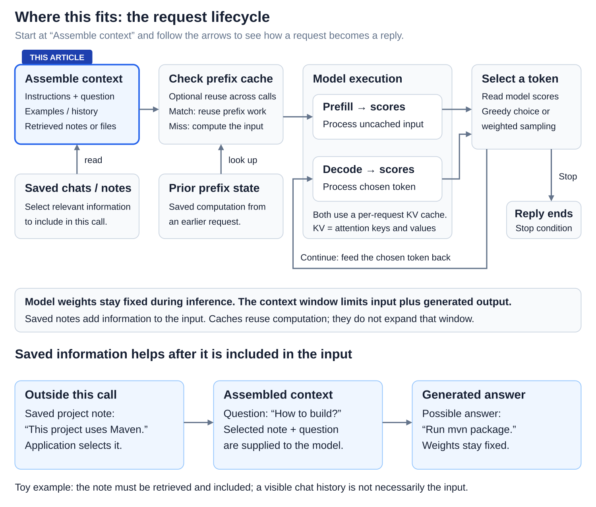
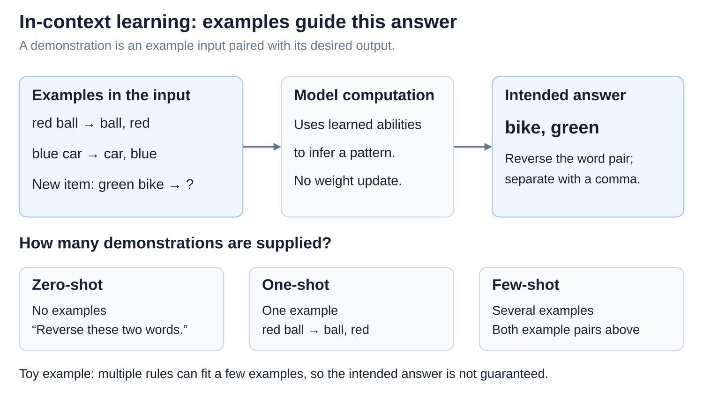
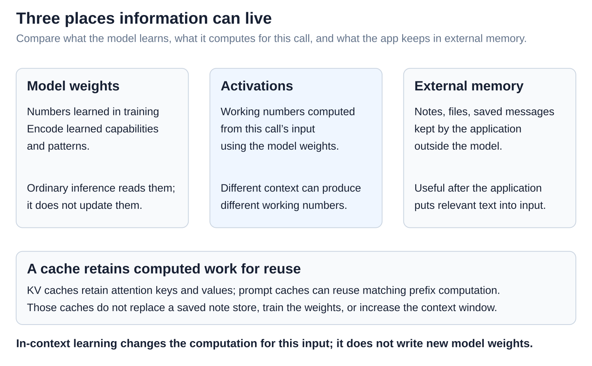
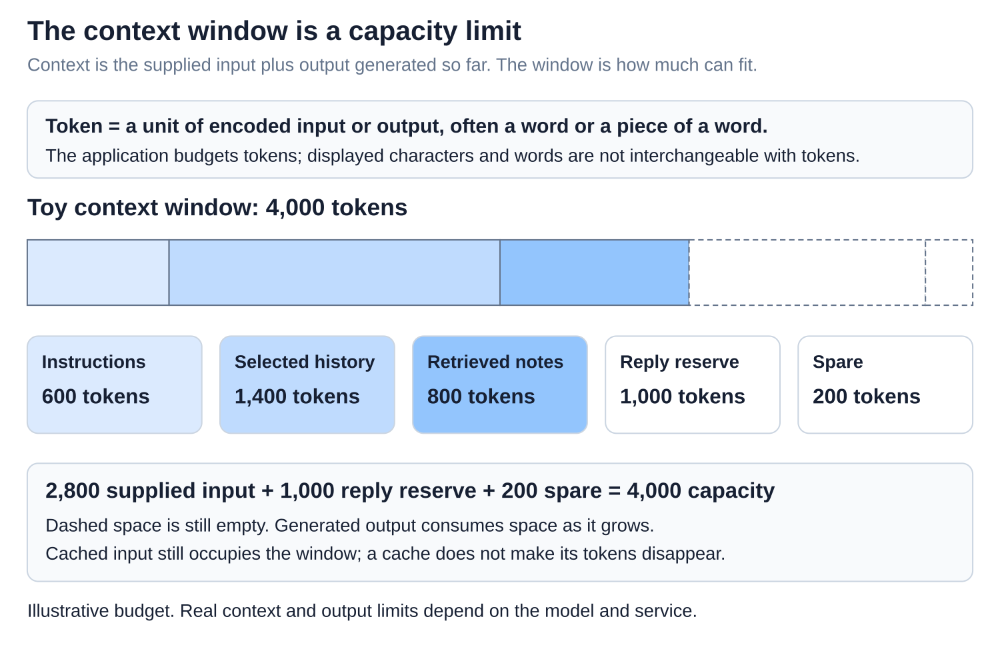
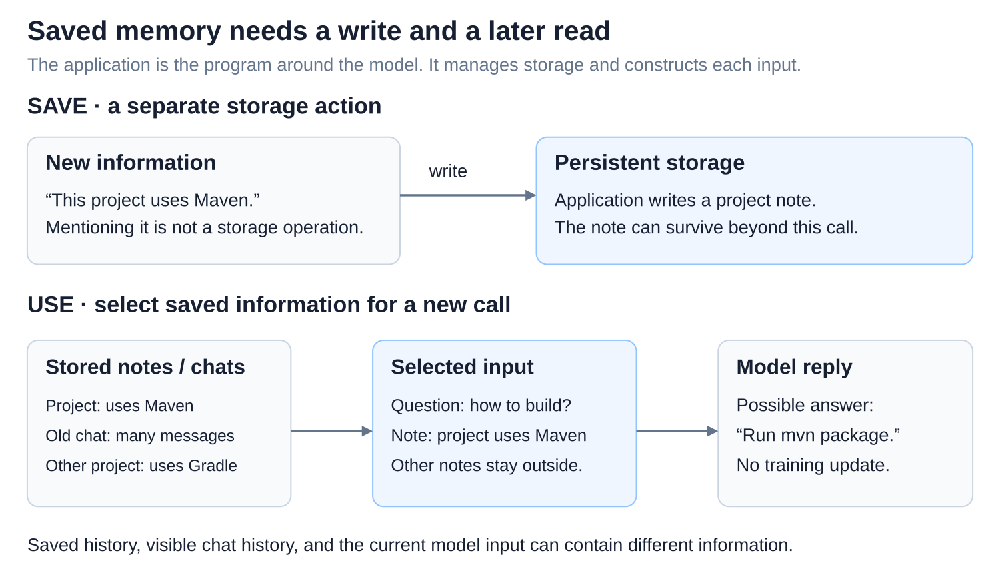
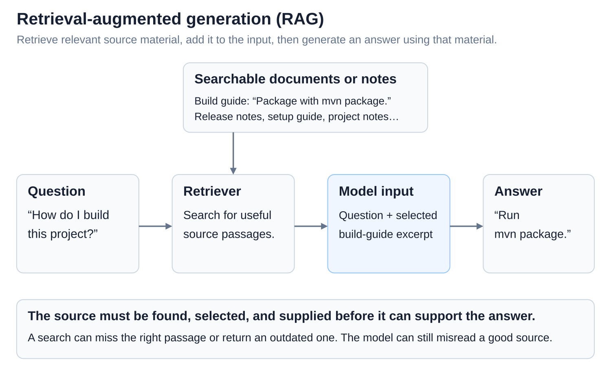
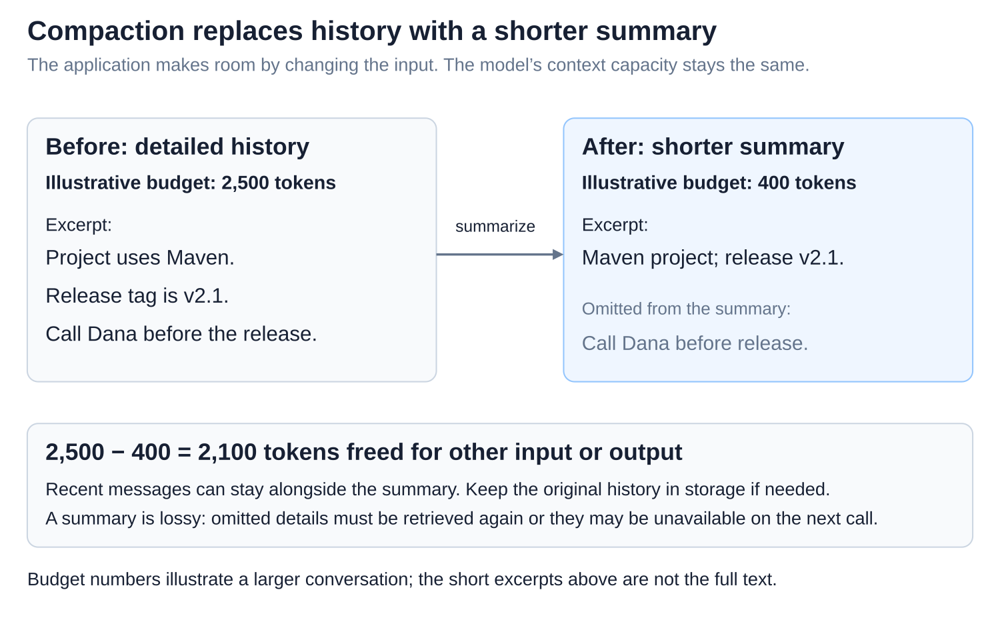

# Inference. In-context learning, context windows, and memory

[Back to Artificial Intelligence](../Readme.md#content)

**A model can use an example or a project note in its current input without being retrained.**

Suppose you ask, “How do I build this project?” The chat application might send those words alone, or it might add a saved note saying the project uses Maven, a tool for building software. Your question is identical in both cases. The information available for answering it has changed.

1. [What goes into one model call?](#1-what-goes-into-one-model-call)
2. [How can examples teach a pattern?](#2-how-can-examples-teach-a-pattern)
3. [What changes inside the model?](#3-what-changes-inside-the-model)
4. [How much context can fit?](#4-how-much-context-can-fit)
5. [How does a saved note help on a later call?](#5-how-does-a-saved-note-help-on-a-later-call)
6. [How does retrieval help answer a question?](#6-how-does-retrieval-help-answer-a-question)
7. [How does a summary make room?](#7-how-does-a-summary-make-room)
8. [Check your understanding](#8-check-your-understanding)

## 1. What goes into one model call?

A **model call** is one request to the model. The **application**, the program around the model, assembles the input. It can include your question, instructions, examples, selected messages, or passages from a document. These form the starting **context**, the information the model can use on this call. As it writes a reply, the words it has generated also become part of the context for what comes next.

Find “Assemble context” on the map, then read the three boxes along the bottom. The note “This project uses Maven” starts outside the call. When the application includes it with the question, the model has a reason to suggest a Maven command for *this* project. If the question goes in alone, the model might still guess Maven, but the question gives it no evidence that this project uses it.

## 2. How can examples teach a pattern?

**In-context learning** is when a model uses information in its input to work out the task you want it to perform. A **demonstration** shows one input paired with its desired output. Try the unfinished pair in the diagram before looking at the answer on the right.

The demonstrations are “red ball → ball, red” and “blue car → car, blue.” For “green bike,” the intended answer is **“bike, green.”** The examples show both the order of the words and the comma. A few examples may fit more than one rule, so the model can still infer a different pattern.

Count the completed pairs to distinguish three common setups. **Zero-shot** gives the instruction without a demonstration. **One-shot** adds one demonstration. **Few-shot** gives a small number, such as the two pairs above. “Green bike” is the question to answer, so it does not count as a third demonstration.

## 3. What changes inside the model?

Read the three top panels from left to right. Follow the word-pair example through the first two and the project note through the third. The bottom panel shows which calculations can be reused.

1. **Weights** are the numbers the model learned during training. Ordinary inference, using the trained model to answer, keeps them fixed.
2. **Activations** are the working numbers the model computes from its input using those weights. Adding the word pairs changes that computation and can change how the model formats its answer.
3. **External memory** is information the application keeps outside the model, such as a saved project note. The note can survive the end of a call. It becomes evidence for a later answer when its contents reach that later call.

The examples leave the weights unchanged, so following the comma pattern once gives the model no lasting preference for it. To request that format tomorrow, the application can include the examples again or say “Put the noun first, then a comma and the color.” For how training changes the weights, see [Training. Training vs. Inference](../Training.%20Training%20vs.%20Inference/Readme.md).

The bottom panel shows a **cache**, which saves work the model has already done. A **key–value (KV) cache** holds numbers computed for earlier text so the model can use them as it writes the reply. A **prompt cache** can reuse that work across requests that start with the same text. To use the Maven note on a later call, the application still needs to include it in that call’s input.

## 4. How much context can fit?

The **context window** is the capacity available to a call. It is measured in **tokens**, the units used to encode input and output. A word may take one token or several. For examples of how text splits into tokens, see [Internals. Tokens and tokenization](../Internals.%20Tokens%20and%20tokenization/Readme.md).

Instructions, history, retrieved notes, and the growing reply all use space. The diagram shows how much room remains after the application assembles the input.

1. **Count the input.** In this 4,000-token example, instructions use 600 tokens, selected history uses 1,400, and notes use 800. The model starts with **2,800 input tokens**.
2. **Leave room for the reply.** That leaves 1,200 tokens free. If the application reserves 1,000 for the reply, it can add only **200 more input tokens** and still keep that reserve. The dashed spaces are empty until filled.

Even if all 800 tokens of notes were cached, they would still count toward the 2,800 input tokens. For how the model reuses work during a reply, see [Inference. Prefill and KV cache](../Inference.%20Prefill%20and%20KV%20cache/Readme.md). For reuse across calls, see [Inference. Prompt caching across requests](../Inference.%20Prompt%20caching%20across%20requests/Readme.md).

Window and output limits depend on the model and service. If the input alone exceeds a Claude model’s window, the Messages API rejects the request with HTTP 400 and the message “prompt is too long.” On Claude 4.5 and later, the input can fit and the window can still fill up as the model writes. If that happens, the API returns the partial reply with `stop_reason` set to `model_context_window_exceeded`.

Even when everything fits, the model can overlook a relevant passage. In long-document experiments, moving the same fact into the middle sometimes made questions about it harder to answer.

## 5. How does a saved note help on a later call?

The diagram follows the Maven note from external memory into a later call. Saving it and using it can happen days apart.

1. **Save.** When you say “This project uses Maven,” the application can write that fact to a project note. A reply saying “I’ll remember” is not evidence that a write happened.
2. **Use.** When you later ask how to build the project, the application can select the Maven note and include it with the question. A note about a different project that uses Gradle can stay in storage.

An old message can still be visible when you scroll up even if the application left it out of today’s model input. To tell whether a reply had access to a fact from the chat, check what information reached that call.

## 6. How does retrieval help answer a question?

**Retrieval-augmented generation (RAG)** gives the model source material selected for the question it is answering. For the Maven project, a note naming the build tool is a clue. The project’s build guide can supply the exact command.

1. A **retriever** searches the available material for passages relevant to “How do I build this project?”
2. The application includes a selected passage with the question. In this example, the guide says “Package with `mvn package`.”
3. The model can now answer “Run `mvn package`” using that passage.

If the answer gives the wrong command, inspect the passage that actually reached the model. The search may have missed the guide or found an outdated version. If the current guide was supplied, the model may have misread it.

## 7. How does a summary make room?

**Compaction** replaces part of a long conversation with a shorter summary for a later call. Recent messages can stay alongside it. Compare what survives in the two excerpts.

The diagram shows a few lines from a 2,500-token conversation and a few lines from its 400-token summary. The summary keeps “Maven project” and “release v2.1” while freeing **2,100 tokens** for other input or output in the same window.

The summary leaves out “Call Dana before the release.” If the next question is “Who needs a call?”, the summary alone cannot supply Dana’s name. If the application kept the original history or a separate reminder, it can retrieve the missing detail and include it in the new input. For how a model can request that lookup, see [Agents. Tool calls](../Agents.%20Tool%20calls/Readme.md).

## 8. Check your understanding

1. Two people type “How do I build this project?” Only one request includes the note “This project uses Maven.” Why does that request give the model a stronger basis for suggesting a Maven command?

   

   
Answer

   Its context identifies the tool this particular project uses. The other request contains the same question, but nothing in that question identifies Maven.

   

2. A prompt contains “red ball → ball, red” and “blue car → car, blue,” then asks about “yellow cup.” How many demonstrations are there, and what answer follows the intended pattern?

   

   
Answer

   Two demonstrations make this a few-shot prompt. The intended answer is “cup, yellow.” The unanswered item is the test of the pattern.

   

3. The model starts using commas after you add the examples. Did its weights change? What explains the new behavior?

   

   
Answer

   No. The examples changed the input, which changed the working numbers, or activations, computed with the same weights. The model used the pattern for this answer.

   

4. A 4,000-token window already holds 2,800 input tokens. Can you add a 350-token note and still leave 1,000 tokens for the reply?

   

   
Answer

   No. Only 200 tokens are available beyond the reply reserve. Adding the whole note brings the planned total to 4,150. To keep the full reserve, shorten the input by at least 150 tokens.

   

5. You can still see “This project uses Maven” in yesterday’s chat. Does that prove the model received it with today’s question? How could the application make it available?

   

   
Answer

   No. The visible chat and the current model input can differ. The application can include the earlier message or retrieve a saved project note and supply the relevant text.

   

6. The correct build guide is in storage, yet a RAG answer gives an old command. What would you inspect first to locate the mistake?

   

   
Answer

   Inspect the passage supplied with the question. A missing or outdated passage points to a problem finding or selecting the source. If the supplied passage contains the correct command, check how the answer used it.

   

7. A 400-token summary replaces 2,500 tokens of history and omits the reminder to call Dana. How much room did compaction free, and how could a later answer recover the reminder?

   

   
Answer

   It freed 2,100 tokens within the same window. The application can retrieve the reminder from the original history or another saved note, if one exists, and include it with the later question.

   

# Sources

- [Brown et al. — Language Models are Few-Shot Learners, especially Figure 2.1](https://arxiv.org/pdf/2005.14165#page=7)
- [Claude — Context windows and token accounting](https://platform.claude.com/docs/en/build-with-claude/context-windows)
- [Anthropic — Selecting context, saving notes, and compacting history](https://www.anthropic.com/research/effective-context-engineering-for-ai-agents)
- [Claude — How applications store and read external memory](https://platform.claude.com/docs/en/agents-and-tools/tool-use/memory-tool)
- [Lewis et al. — Retrieval-Augmented Generation for Knowledge-Intensive NLP Tasks](https://arxiv.org/abs/2005.11401)
- [Liu et al. — Lost in the Middle: How Language Models Use Long Contexts](https://arxiv.org/abs/2307.03172)
- [Hugging Face — How the key–value cache works](https://huggingface.co/docs/transformers/en/cache_explanation) · [vLLM — Reusing a prompt prefix across requests](https://docs.vllm.ai/en/stable/features/automatic_prefix_caching/)
