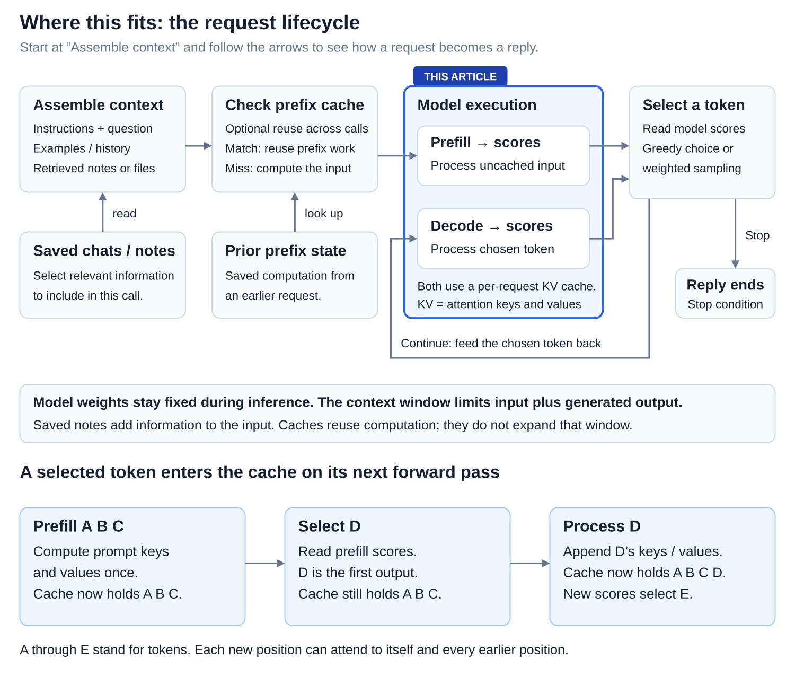
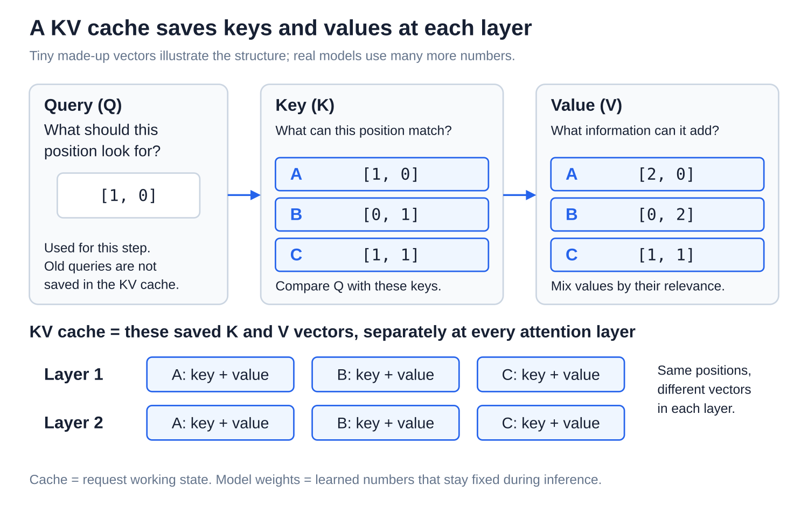
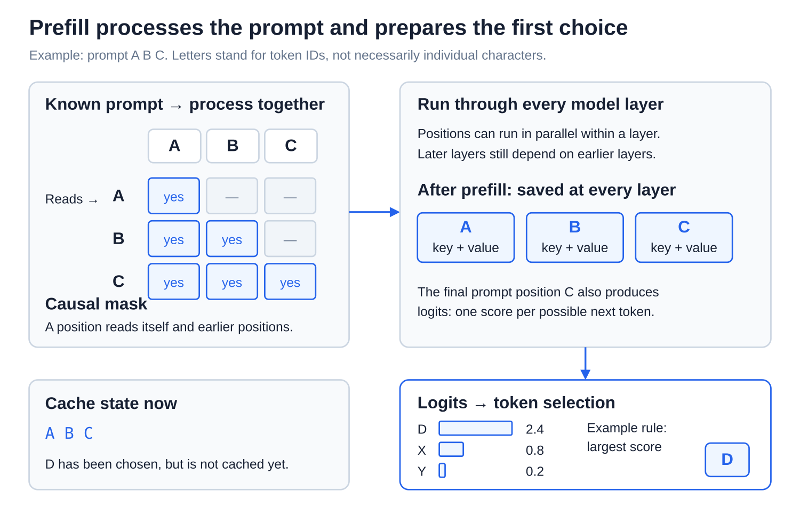
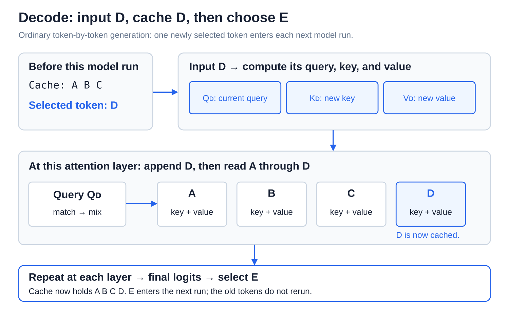
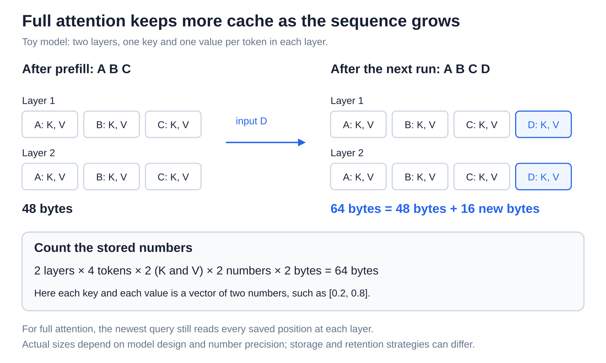
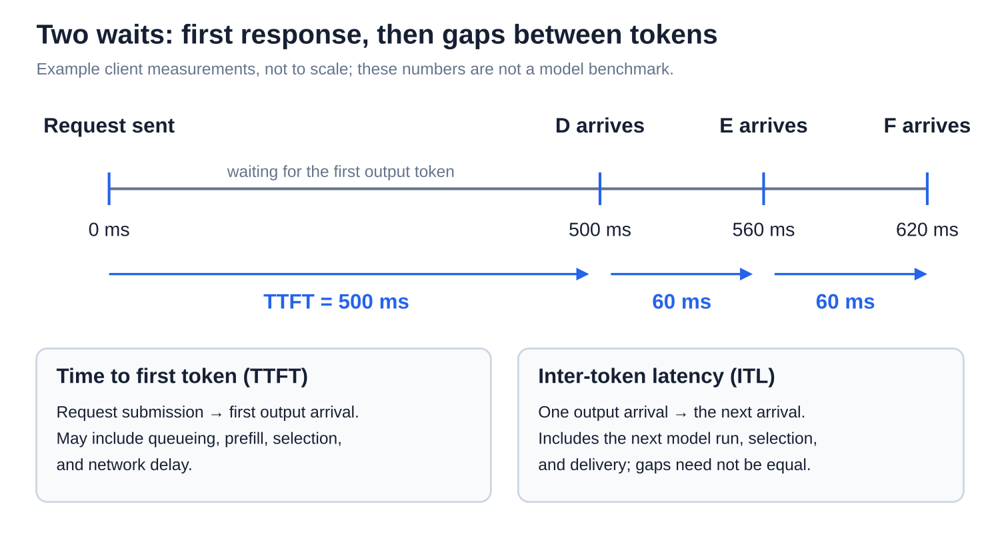

# Inference. Prefill and KV cache

[Back to Artificial Intelligence](../Readme.md#content)

**Prefill is the model’s first pass through a prompt. It produces the scores used to choose the first output token. A key–value (KV) cache saves work from that pass so the model can continue the reply one token at a time.**

Suppose the prompt is “The cat sat” and the reply begins “on the mat.” For this example, treat each word as one **token**, a piece of text the model processes. The diagrams call the prompt tokens `A B C` and the first three output tokens `D E F`. Follow when each token is chosen and when its numbers enter the cache.

1. [Where does prefill fit in a reply?](#1-where-does-prefill-fit-in-a-reply)
2. [What does the KV cache remember?](#2-what-does-the-kv-cache-remember)
3. [How does prefill lead to the first output token?](#3-how-does-prefill-lead-to-the-first-output-token)
4. [How does the model produce the next token?](#4-how-does-the-model-produce-the-next-token)
5. [How much memory does the cache use?](#5-how-much-memory-does-the-cache-use)
6. [Why is the first wait different from the gaps that follow?](#6-why-is-the-first-wait-different-from-the-gaps-that-follow)

## 1. Where does prefill fit in a reply?

The application first assembles the **prompt**, the input for this reply. Assume it starts with an empty cache. In the diagram, follow the arrow from **Model execution** to **Select a token**, then follow the return arrow.

1. **Process the prompt.** The model reads `A B C` and scores possible continuations of “The cat sat.”
2. **Choose a token.** A **decoding strategy** is the rule for choosing a token from the scores. Here it chooses `D`, “on.” The application can now return that token to the user.
3. **Continue the reply.** If generation continues, the application feeds `D` back into the model. The model reuses saved work for `A B C` and scores what might follow “The cat sat on.”

The **decoding phase** begins when the model processes `D`. The same decoding strategy can choose the first token from the prefill scores and each later token from the scores of the decoding phase. For a worked example of how it chooses, see [Inference. From logits to text with decoding and sampling](../Inference.%20From%20logits%20to%20text%20with%20decoding%20and%20sampling/Readme.md).

## 2. What does the KV cache remember?

**Attention** is how a token position draws information from other positions. At each attention layer, the model computes three lists of numbers, called **vectors**. Read the top of the diagram from left to right.

- A **query (Q)** describes what information the current position is looking for.
- A **key (K)** is what the query compares against to decide how much attention to give a position.
- A **value (V)** carries the information from that position. The model mixes the values according to how strongly their keys match the query.

The lower rows show what the model keeps. Each attention layer saves its own keys and values for each processed position. A new position brings its own query, so it can use the saved keys and values without needing the old queries.

These numbers can be reused because the model uses **causal attention**. Each position can read itself and earlier positions. Adding “on” after “The cat sat” therefore leaves the earlier positions’ keys and values valid. The cache is working memory for the sequence. The model’s learned weights stay fixed during ordinary generation. For an example of how a query weights different values, see [Internals. Attention](../Internals.%20Attention/Readme.md).

## 3. How does prefill lead to the first output token?

All three prompt tokens are known before the first model run. Read the rows of the triangular grid to see which positions each token can use.

1. **Process the known tokens.** Each layer can process the three known positions in parallel. A **causal mask** limits what each can read. `A` can read only `A`, `B` can read `A B`, and `C` can read `A B C`. The next layer still needs the preceding layer’s results.
2. **Save the prompt’s keys and values.** After prefill, each attention layer has cache entries for `A B C`.
3. **Choose the first output.** Generation uses the **logits** at the last prompt position, `C`. These are scores for the possible next tokens. The diagram shows `D = 2.4`, `X = 0.8`, and `Y = 0.2`. In this example, the rule picks the highest score, so the first output is `D`.

At this instant the user can already receive “on,” while the cache still ends at “sat.” The model computes the keys and values for `D` when it processes `D` as input.

## 4. How does the model produce the next token?

Start at the top of the diagram with `A B C` in the cache and `D` ready to enter the model. The attention is still causal. It is also **full attention**, so the new position can read its entire past as well as itself. A sliding window would limit how far back it can read.

1. **Pass in `D`.** At each attention layer, the model computes a new query, key, and value for `D` and adds its key and value to that layer’s cache.
2. **Read the earlier context.** The query for `D` compares against the keys for `A B C D` and mixes their values. The model gets to use the whole phrase while running only the new token through the layers.
3. **Choose `E`.** The decoding strategy uses the final scores at `D` to pick `E`, “the.” The cache now covers `A B C D`. If the reply continues, `E` is the next input.

Caching saves the work of recomputing the earlier tokens. Each new position still has to read the saved information, and each run still depends on the token chosen in the previous one.

## 5. How much memory does the cache use?

Follow one token down the two layer rows in the diagram. Each layer stores a key and a value for it. In this tiny model, each of those vectors holds two numbers, and each number takes two bytes.

One processed token therefore adds `2 layers × 2 vectors × 2 numbers × 2 bytes = 16 bytes` of cache data. The three prompt tokens need **48 bytes**. Choosing `D` leaves that total at 48. Processing `D` brings the total to **64 bytes**.

Llama 2 7B has 32 layers. For each token in each layer, the keys hold 4,096 numbers across all attention heads, and the values hold another 4,096. At 16-bit precision each number takes 2 bytes, so one token needs `32 × 2 × 4,096 × 2 = 524,288 bytes`, or **512 KiB**. One 4,096-token sequence therefore needs `4,096 × 512 KiB = 2 GiB` (about 2.15 GB) of KV cache. With full attention, doubling the sequence length doubles the cache data, so a fixed memory budget leaves room for fewer requests at once.

Real systems may reserve memory ahead of time, so the amount allocated can stay flat while the cache fills. Some layers use a **sliding window**, keeping only recent positions once the window is full.

## 6. Why is the first wait different from the gaps that follow?

Imagine watching a reply stream onto your screen, one token at a time. The timeline starts when the client sends the request. Read the arrival times above the ticks, then subtract them to find the waits.

- **Time to first token (TTFT)** runs from sending the request to receiving the first output. Here the request starts at `0 ms` and `D` arrives at `500 ms`, so TTFT is **500 ms**. With an empty cache, the model must process the whole prompt to produce the scores used to choose `D`. A longer prompt generally makes that first wait longer. Queueing, token selection, and network delivery can also contribute.
- **Inter-token latency (ITL)** measures the time between output tokens, often averaged over a reply. Here `E` arrives at `560 ms` and `F` at `620 ms`. Each gap is **60 ms**. To produce `E`, the model runs just `D` through its layers, reusing the cache for `A B C`. With full attention, each new token has more cached positions to read as the sequence grows, so later gaps can lengthen.

To see how engineers use these timings to understand a slow reply, revisit [Inference. What happens when a model answers](../Inference.%20What%20happens%20when%20a%20model%20answers/Readme.md#4-what-do-inference-engineers-measure). A server can shorten the first wait when two prompts have the same beginning, as explained in [Inference. Prompt caching across requests](../Inference.%20Prompt%20caching%20across%20requests/Readme.md).

## Check your understanding

1. After prefill, a rule picks the highest-scoring token, `D`. The model then processes `D` to score the next token. Which part illustrates a decoding strategy, and which part begins the decoding phase?

   

   
Answer

   **Picking the highest-scoring token is the decoding strategy. Processing `D` begins the decoding phase.** The same strategy can select a token from the results of either prefill or a later run.

   

2. When a new token arrives, which earlier vectors can its attention layer reuse, and why are they still valid?

   

   
Answer

   **It can reuse that layer’s saved keys and values.** Causal attention kept the earlier positions from depending on the new token. The new position supplies its own query.

   

3. Prefill processed `A B C`, and the decoding strategy just chose `D`. Is `D` already in the KV cache?

   

   
Answer

   **No.** The cache holds keys and values for `A B C`. The scores at `C` were enough to choose `D`. Its keys and values will be computed when `D` goes through the model.

   

4. Why can prefill process `A B C` together within a layer, while ordinary decoding cannot process `D` and `E` together?

   

   
Answer

   **All three prompt tokens are known before prefill begins.** The causal mask limits which positions each can read. During decoding, the model must process `D` to produce the scores used to choose `E`. Only then can `E` enter the model.

   

5. The model has processed `D` and selected `E`. If generation continues, which token goes through the layers next, and which positions can its query read?

   

   
Answer

   **Only `E` goes through the layers as new input.** At each layer, its query can use the cached keys and values for `A B C D` plus the new key and value for `E` itself.

   

6. The example cache holds `A B C D` in 64 bytes. How many bytes of key and value data will it hold after it processes `E`?

   

   
Answer

   **80 bytes.** Each of the two layers adds a key and a value for `E`. That is 16 more bytes in total, so `64 + 16 = 80`.

   

7. On another request sent at `0 ms`, the first three tokens arrive at `500 ms`, `560 ms`, and `650 ms`. What is the time to first token, and what are the two inter-token gaps?

   

   
Answer

   **The first-token wait is 500 ms. The gaps are 60 ms and 90 ms.** Subtract the request time for the first wait. For each later arrival, subtract the previous token’s arrival time.

   

# Sources

- [Hugging Face, *How caching works*](https://huggingface.co/docs/transformers/en/cache_explanation)
- [NVIDIA, *Mastering LLM Techniques: Inference Optimization*](https://developer.nvidia.com/blog/mastering-llm-techniques-inference-optimization/)
- [Hugging Face, *Cache strategies*](https://huggingface.co/docs/transformers/en/kv_cache)
- [NVIDIA, *LLM Inference Benchmarking: Fundamental Concepts*](https://developer.nvidia.com/blog/llm-benchmarking-fundamental-concepts/)
- [vLLM, *Automatic Prefix Caching*](https://docs.vllm.ai/en/stable/features/automatic_prefix_caching/)
