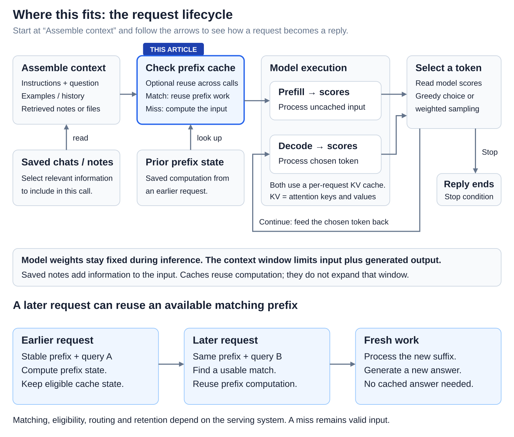
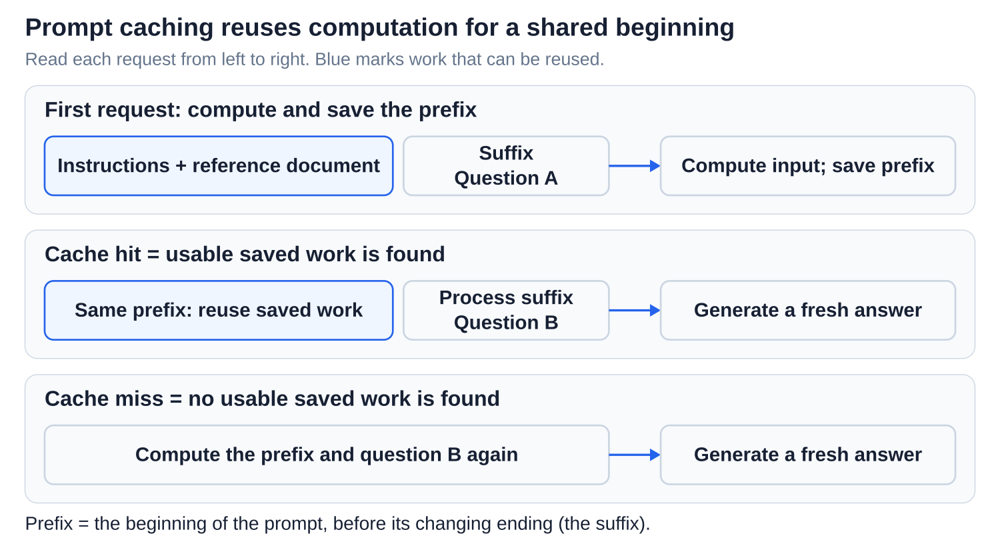
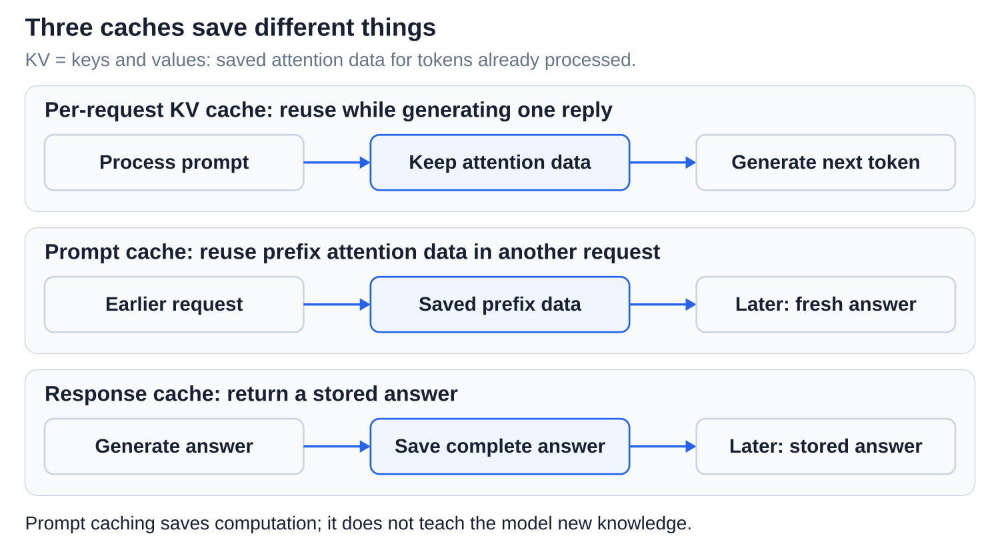
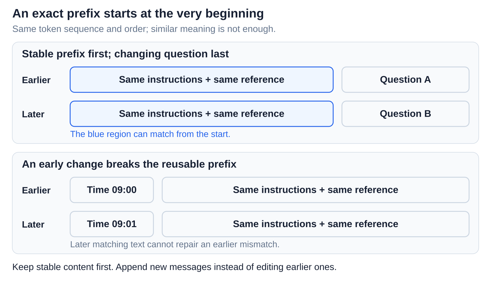
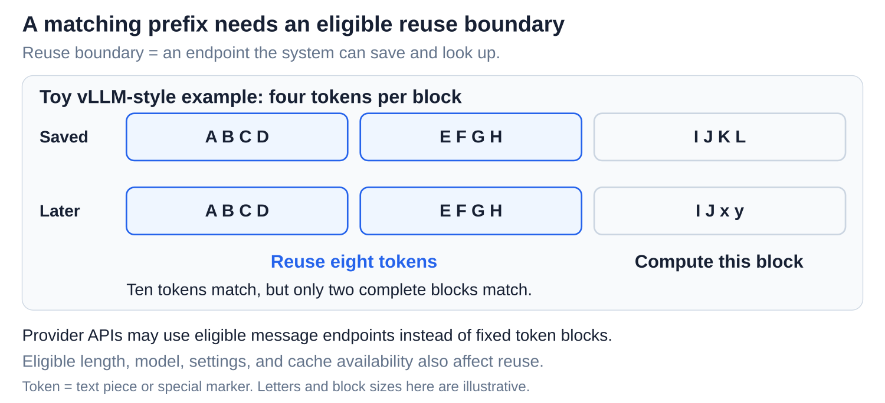
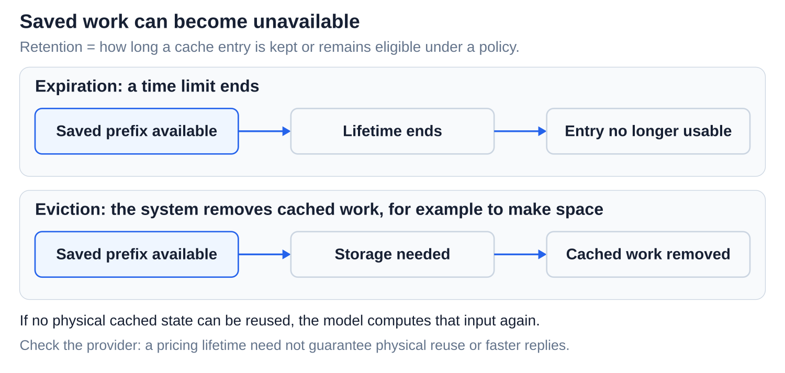
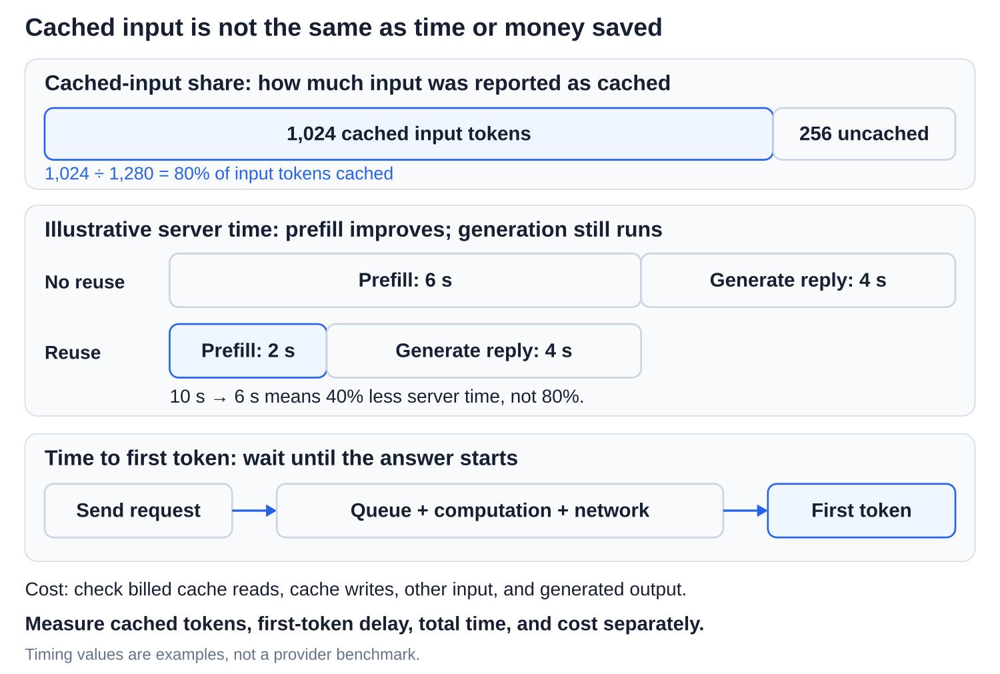

# Inference. Prompt caching across requests

[Back to Artificial Intelligence](../Readme.md#content)

**Prompt caching lets a model reuse work it already did on the beginning of an earlier request. It still reads the new question and generates an answer for it.**

Imagine a museum app that sends the same visitor guide with every question. One visitor asks, “When does the museum open?” Another asks, “Where are the lockers?” The app sends the guide both times. To see what the second visitor might gain, follow the guide, the questions, and the time each request takes.

1. [What work can two requests share?](#1-what-work-can-two-requests-share)
2. [What happens on a cache hit or miss?](#2-what-happens-on-a-cache-hit-or-miss)
3. [What do the three caches store?](#3-what-do-the-three-caches-store)
4. [Why does the order of the prompt matter?](#4-why-does-the-order-of-the-prompt-matter)
5. [How much of a match can the system reuse?](#5-how-much-of-a-match-can-the-system-reuse)
6. [Why can a matching prompt miss later?](#6-why-can-a-matching-prompt-miss-later)
7. [How do you measure what caching saved?](#7-how-do-you-measure-what-caching-saved)
8. [Check your understanding](#8-check-your-understanding)

## 1. What work can two requests share?

A **prompt** is the input the app sends to the model. Here it contains an instruction (“Answer using the visitor guide”), the guide itself, and one visitor’s question. The model processes this input in small units called **tokens**. A token can represent a word, part of a word, or punctuation.

Before it can answer, the model processes the input tokens. This stage is called **prefill**. A **cache** keeps results of earlier work so the system can use them again. On the map, find “Check prefix cache” between “Assemble context” and “Model execution.” This is where the system can find work already done on the instruction and guide.

The question about lockers still needs processing. Once the input is ready, the model writes the answer one token at a time. Follow one reply from its first token to its last in [Inference. Prefill and KV cache](../Inference.%20Prefill%20and%20KV%20cache/Readme.md).

## 2. What happens on a cache hit or miss?

The **prefix** is a sequence of tokens starting at the beginning of the prompt. The **suffix** is everything after that prefix. In the diagram, the instruction and reference document form the shared prefix. Question A and question B are two different suffixes.

1. **First request.** With an empty cache, the model processes the instruction, guide, and opening-time question. The system can save the work on the shared beginning while the model goes on to answer.
2. **Second request, cache hit.** The system finds usable saved work for that beginning. The model uses it, processes the lockers question, and generates a reply about lockers.
3. **Second request, cache miss.** If the system finds no usable prefix, the model processes the whole prompt. The visitor can still get an answer because the app included the guide again.

## 3. What do the three caches store?

While reading, the model computes numbers called **keys and values (KV)** for each token. Later tokens use those numbers to draw on earlier ones through a calculation called **attention**. The diagram shows when those numbers help and when an application can reuse a finished answer.

| Cache | What it saves | When it helps |
| --- | --- | --- |
| Per-request KV cache | Keys and values for tokens the model has already processed in this request | While writing the lockers reply, each new token can use the earlier tokens’ keys and values. |
| Prompt cache | Keys and values for a reusable prompt prefix | A later visitor’s request begins with the same instruction and guide. The model can use that work to answer a different question. |
| Response cache | A complete answer | If the app receives a request for which the saved opening-time answer is still valid, it can return that answer directly. |

Even if two visitors ask exactly the same question, a prompt-cache hit still runs generation, so their answers can differ. All three caches leave the model’s learned parameters, or **weights**, unchanged.

## 4. Why does the order of the prompt matter?

A prefix matches when its tokens are identical, in order, from the start. Each token’s keys and values can depend on the tokens before it. A small change near the beginning can therefore affect the saved work for an entire guide that follows. Even a rewrite with the same meaning can change the tokens.

Compare the two layouts. If a changing timestamp comes before the guide, the match stops at the first differing token in the time. The system cannot skip over that difference and resume using the old guide’s keys and values. Put the fixed instruction and guide first, then add the timestamp and question. That order gives both requests a long identical beginning. Keep other shared input, such as tool descriptions and images, consistent too, and use the same model.

## 5. How much of a match can the system reuse?

A system may save work only at particular stopping points. For example, vLLM, a program for serving models, can group tokens into fixed-size **blocks** and reuse complete matching blocks. In this small example, each letter stands for one token and each block holds four.

Read each row from the left. Both start with `A B C D` and `E F G H`. In the third block, `I J K L` becomes `I J x y`. **Ten tokens match, but only eight fill complete matching blocks.** The model processes the third block again, including `I` and `J`. Four is the block size for this example. A hosted service can use other rules, such as a minimum prefix length and eligible message endings.

## 6. Why can a matching prompt miss later?

Saved work takes space. **Expiration** means an entry reaches its time limit. **Eviction** means the system removes an entry, for example to make room for another one. Follow the two paths in the diagram. Either can leave the model with work to repeat when the next museum visitor asks a question.

Each service decides which prefixes qualify for a cached read and how long they stay eligible.

- **OpenAI.** For GPT-5.6 and later, a prefix needs at least 1,024 visible input tokens. The service can choose eligible stopping points automatically, or the app can mark one explicitly. The default minimum lifetime for cached-read pricing is 30 minutes. The Responses API also offers 12 hours. A qualifying request can receive the cached-read price even if the service has to recompute the prefix.
- **Claude.** On the Messages API, the app enables caching with `cache_control`. If the prefix is shorter than the model’s minimum, Claude processes it normally and skips caching without raising an error. The default lifetime is five minutes, with a one-hour option at a higher cache-write price.

## 7. How do you measure what caching saved?

Start with the three measurements in the diagram. Each answers a different question about the visitors’ wait or the app’s bill.

1. **How much input was reported as cached?** Of 1,280 input tokens, 1,024 were cached and 256 were uncached. The cached share is 1,024 ÷ 1,280 = **80%**. All 1,280 still occupy space in the model’s **context window**, the token capacity of the request.

   - In the **OpenAI Responses API**, divide `usage.input_tokens_details.cached_tokens` by `usage.input_tokens`, which counts all input tokens.
   - In the **Claude Messages API**, the `usage` object counts cache reads (`cache_read_input_tokens`), new cache writes (`cache_creation_input_tokens`), and remaining input (`input_tokens`) separately. Divide the read count by the sum of all three. If both cache counts are zero, the request neither read nor wrote a cache entry. A prefix below the model’s minimum is one possible reason.

2. **How much sooner did the visitor get an answer?** In the example, prefill falls from 6 seconds to 2. Generating the reply takes 4 seconds both times. Total server time falls from 10 seconds to 6, a **40% reduction**. To measure when the visitor *starts* seeing a reply, track **time to first token** from sending the request to receiving the first output token. That wait also includes time spent in the queue and on the network.
3. **How much did the request cost?** Check the usage record and the model’s prices for writing to the cache, reading from it, processing other input, and generating output. The cached share alone tells you neither the time saved nor the bill.

The museum app sent the full guide on both calls. For how an app selects what to send, see [Inference. In-context learning, context windows, and memory](../Inference.%20In-context%20learning%2C%20context%20windows%2C%20and%20memory/Readme.md).

## 8. Check your understanding

1. The first visitor asked about opening time. The second asks about lockers. If the system saved the work on the instruction and guide, what can the model reuse, and what work does it still do?

   

   
Answer

   It can reuse the prefill work on the shared instruction and guide. It still processes the lockers question and generates a reply to that visitor.

   

2. The cache is empty when the lockers question arrives. Can the model still answer using the guide?

   

   
Answer

   Yes. The app sent the guide with the question. On a miss, the model processes the whole prompt before generating the reply.

   

3. The app returns a saved opening-time reply without asking the model to generate any tokens. Which cache made that possible?

   

   
Answer

   A response cache. It stores the finished reply. A prompt cache would save work on the input, and the model would still need to generate the reply.

   

4. The app must send a changing timestamp with every question. Where should it put the timestamp so the guide can be reused, and why?

   

   
Answer

   Put the timestamp after the fixed instruction and guide. If the time changes before the guide, the matching prefix ends at the first changed token, even when the guide has exactly the same wording.

   

5. A cache holds three blocks of four tokens each. A new prompt matches the first eleven tokens, but the twelfth changes. How many tokens can the model skip processing?

   

   
Answer

   Eight tokens. The first two blocks match in full. The changed twelfth token makes the third block ineligible, so the model processes all four tokens in that block again.

   

6. The museum sends exactly the same prompt later that afternoon. What two things could have happened to the saved work in the meantime?

   

   
Answer

   The entry could have expired when its time limit ended, or the system could have evicted it to make space. In either case, the model may need to process the input again.

   

7. A request reports 80% cached input. Its server time falls from 10 seconds to 6. Did it use 80% less server time? How much did it save?

   

   
Answer

   No. It saved 4 of the original 10 seconds, or 40%. The 80% counts input tokens. The server still spent time processing the remaining input and generating the answer.

   

# Sources

- [OpenAI guide to prompt caching, eligible prefixes, pricing, and retention](https://developers.openai.com/api/docs/guides/prompt-caching)
- [Claude guide to prompt caching, minimum lengths, and lifetimes](https://platform.claude.com/docs/en/build-with-claude/prompt-caching)
- [vLLM guide to automatic prefix caching and its performance limits](https://docs.vllm.ai/en/stable/features/automatic_prefix_caching/)
- [vLLM design for caching and evicting prefix blocks](https://docs.vllm.ai/en/stable/design/prefix_caching/)
- [Cloudflare guide to caching complete model responses](https://developers.cloudflare.com/ai-gateway/features/caching/)
- [NVIDIA guide to measuring inference latency and time to first token](https://developer.nvidia.com/blog/llm-benchmarking-fundamental-concepts/)
