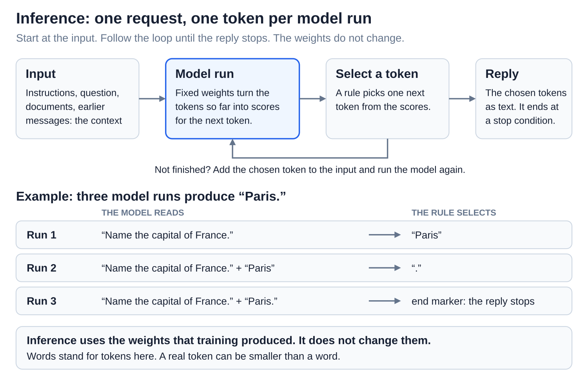
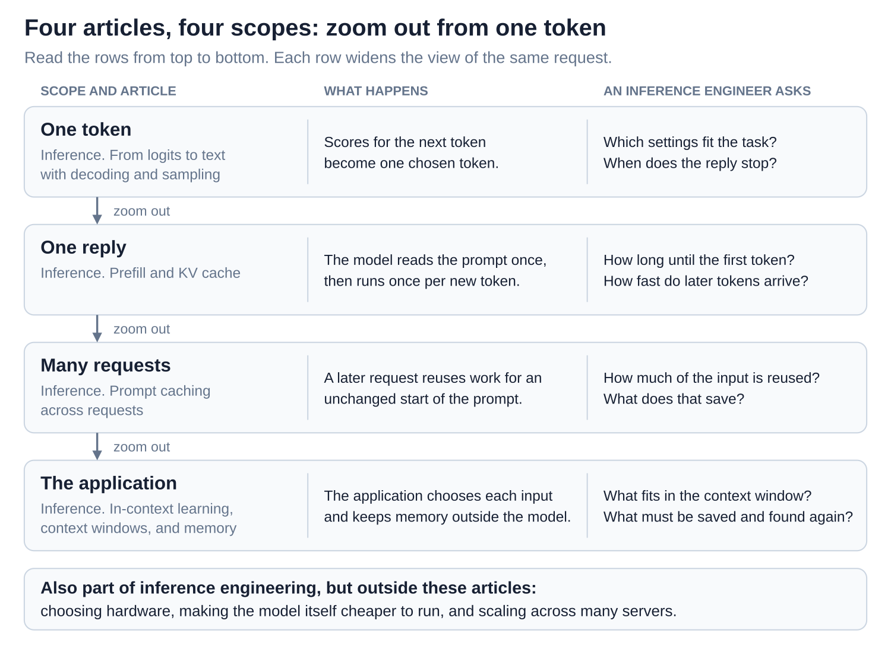

# Inference. What happens when a model answers

[Back to Artificial Intelligence](../Readme.md#content)

**Inference means using a trained model to produce an output.**

When you ask “Name the capital of France,” a language model scores possible continuations. A rule chooses one **token** (a piece of text, such as a word, part of a word, or punctuation). The choice becomes part of the input for the next prediction. Throughout the reply, the model uses the same **weights**, the numbers it learned during training.

1. [How does the model build a reply?](#1-how-does-the-model-build-a-reply)
2. [How does a follow-up question get its context?](#2-how-does-a-follow-up-question-get-its-context)
3. [Four ways to look at the same request](#3-four-ways-to-look-at-the-same-request)
4. [What do inference engineers measure?](#4-what-do-inference-engineers-measure)
5. [Check your understanding](#5-check-your-understanding)

## 1. How does the model build a reply?

The **prompt** is the input the application supplies. Suppose it contains just “Name the capital of France.” Follow the top row of the diagram from the prompt to the reply. The arrow back to “Model run” shows how the same model can produce a reply of several tokens.

The three rows at the bottom show one possible reply. For this example, count `Paris` as one token and the period as another.

1. The model processes the prompt in a calculation called a **forward pass**. Generation uses the scores at the last prompt position. There is one score for each token in the model’s **vocabulary**, the set of tokens it can use. Suppose the rule chooses `Paris`.
2. The sequence now ends with `Paris`. The model scores what could follow that longer sequence, and the rule chooses a period. The visible reply now reads “Paris.”
3. On the next pass, the rule selects an **end marker**, a special token that tells the application to stop. The user sees “Paris.” The end marker stays out of the displayed text. Generation can also stop when it reaches a configured output length.

## 2. How does a follow-up question get its context?

Suppose you now ask, “Which river runs through that city?” The words “that city” make sense if the model has access to the earlier exchange about Paris. The **context** is the information available to the model for this prediction. The application can include the previous question and answer alongside your new question.

A chat application can also save a short note such as “The city we’re discussing is Paris” and bring it into a later request. Saving the note and making it available are two separate actions. If the new request contains only “Which river runs through that city?”, those words alone do not identify a city. The earlier reply changed the conversation while the model’s weights stayed fixed. For an example of how training changes a weight, see [Training. Training vs. Inference](../Training.%20Training%20vs.%20Inference/Readme.md).

## 3. Four ways to look at the same request

Read the rows from top to bottom. The first asks about one token, and the last asks what information the application supplies. The list below applies each row to the conversation about Paris.

1. **One token.** Why did the rule choose `Paris`? The raw scores are called **logits**. The rule for choosing from those scores is called a **decoding strategy**. It can pick the highest-scoring token or sample from the probabilities derived from the scores. Compare the two strategies in [Inference. From logits to text with decoding and sampling](../Inference.%20From%20logits%20to%20text%20with%20decoding%20and%20sampling/Readme.md).
2. **One reply.** How much work must the model repeat to choose the period after `Paris`? Processing the prompt is called **prefill**. Its scores let the rule choose the first token. During the **decoding phase**, the model processes each newly chosen token to score the next one. A **key–value (KV) cache** holds results for earlier tokens. See what the model saves and reads in [Inference. Prefill and KV cache](../Inference.%20Prefill%20and%20KV%20cache/Readme.md).
3. **Many requests.** Suppose two questions begin with the same long travel guide. On a service that supports **prompt caching**, the second request can reuse work for the identical opening tokens if the results are still cached. The model still generates a reply to the second question. Follow a cache hit and a miss in [Inference. Prompt caching across requests](../Inference.%20Prompt%20caching%20across%20requests/Readme.md).
4. **The application.** How does “that city” acquire a meaning in the follow-up? The application chooses which messages, documents, or saved notes to include. They share the available space with the generated reply. The **context window** is the limit on how many tokens fit. Trace a saved note into a later request in [Inference. In-context learning, context windows, and memory](../Inference.%20In-context%20learning%2C%20context%20windows%2C%20and%20memory/Readme.md).

## 4. What do inference engineers measure?

**Inference engineering** is the work of serving a trained model quickly, reliably, and at an affordable cost. Imagine that you send a question and the reply appears a little at a time. Two different waits affect how fast it feels.

1. **Time to first token (TTFT)** measures the wait from sending the request until the first output token arrives. That wait can include time in a queue and time spent processing the prompt.
2. **Time between tokens**, also called **inter-token latency (ITL)**, measures the gaps between successive output tokens. If the first token arrives after two seconds and later tokens arrive every 50 milliseconds, TTFT is two seconds and the average gap is 50 milliseconds.

Engineers also measure how much computing time and memory a request uses, how many requests the service can finish per second, and how often requests fail under load. A cache illustrates the trade-off. Keeping earlier calculations in memory costs space, but it can save computing time. When many users send requests at once, engineers can also spread the work across more machines.

## 5. Check your understanding

1. The rule has just chosen `Paris`. What does the model use to score the next token, and why does the period appear in the reply while the end marker does not?

   

   
Answer

   It uses the original prompt together with `Paris`. The period is an ordinary text token, so the application displays it. The end marker tells the application to stop.

   

2. The application saved “The city we’re discussing is Paris.” Is saving the note enough for the model to know what “that city” means in a new request?

   

   
Answer

   No. The application must make the city available in the new context, for example by including the note or the earlier exchange. Answering the first question did not change the model’s weights.

   

3. Two questions start with the same long travel guide but end differently. What can the service reuse across those requests? What can it reuse as it generates one reply?

   

   
Answer

   Across requests, a prompt cache can reuse calculations for the matching opening tokens. The model still processes the new question and generates its own reply. Within that reply, a KV cache lets each new token use results already computed for earlier tokens.

   

4. At busy times, users wait longer for the first token, but later tokens arrive at their usual pace. Which timing changed, and what would you check first?

   

   
Answer

   Time to first token increased. Check how long requests wait in the queue and how long their prompts take to process. The gaps between later tokens stayed the same.

   

# Sources

- [Meta — The Llama 3 generation loop, next-token selection, and stopping conditions](https://github.com/meta-llama/llama3/blob/main/llama/generation.py#L160-L205)
- [Hugging Face — How chat messages become model input](https://huggingface.co/docs/transformers/en/chat_templating)
- [LangChain — Storing and recalling information across conversations](https://docs.langchain.com/oss/python/langchain/long-term-memory)
- [Hugging Face — How the key–value cache works](https://huggingface.co/docs/transformers/en/cache_explanation)
- [vLLM — Reusing a prompt prefix across requests](https://docs.vllm.ai/en/stable/features/automatic_prefix_caching/)
- [NVIDIA — Context length, time to first token, and other inference measurements](https://developer.nvidia.com/blog/llm-benchmarking-fundamental-concepts/)
- [Baseten — Inference engineering, from a single model to a service](https://www.baseten.co/inference-engineering/book/00-inference/)
