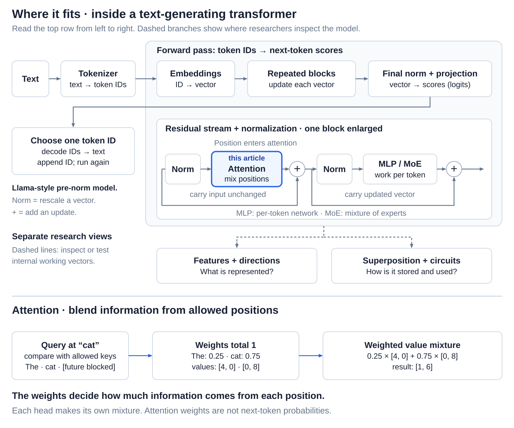
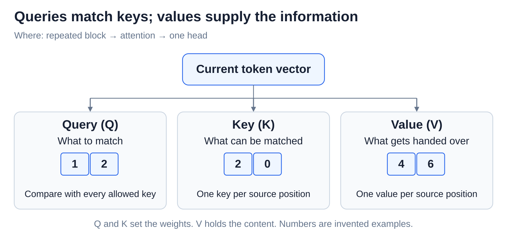
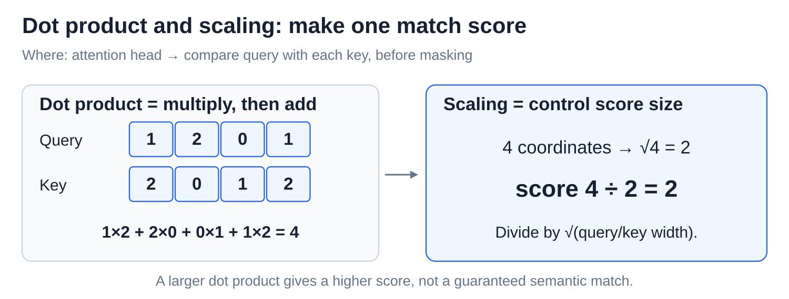
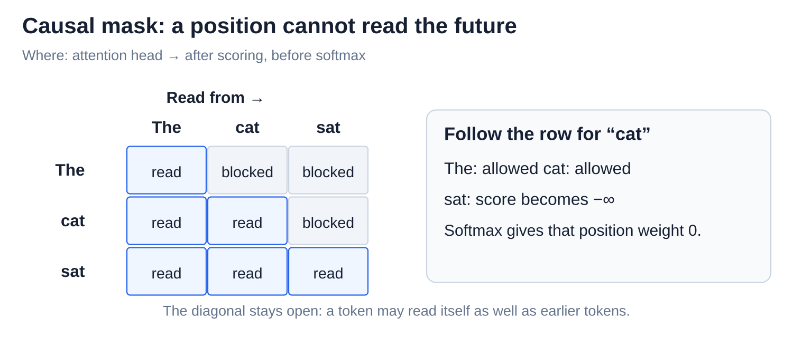
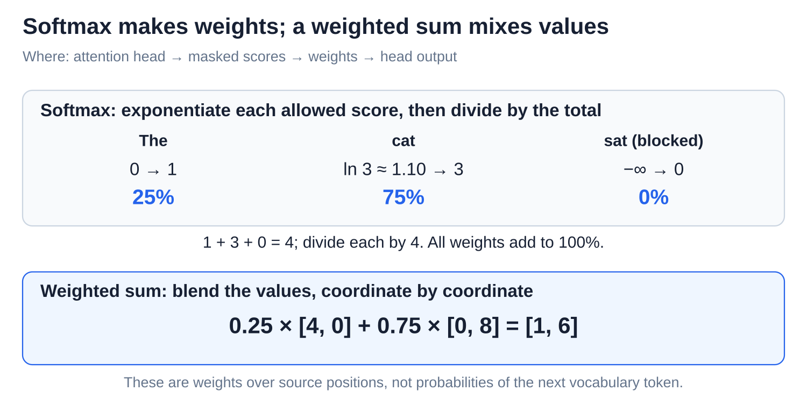
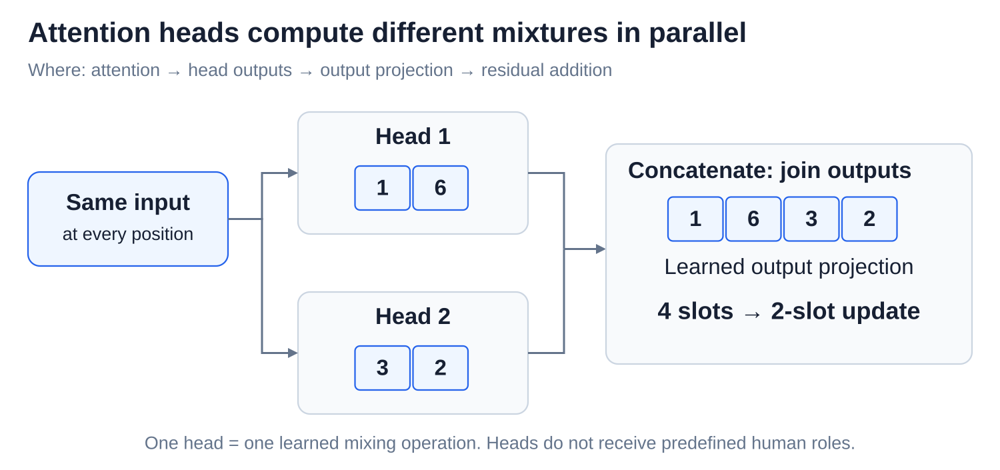

# Internals. Attention

[Back to Artificial Intelligence](../Readme.md#content)

**Attention lets the model build a new mixture of information for each position in a sequence.**

Take “The cat sat” and suppose each word is one **token**, a piece of text the model processes as a unit. Follow the middle position, `cat`, to see which positions it can draw on, how much each contributes, and how the mixture updates its vector.

1. [What does attention change?](#1-what-does-attention-change)
2. [What do queries, keys, and values do?](#2-what-do-queries-keys-and-values-do)
3. [How does a head score a match?](#3-how-does-a-head-score-a-match)
4. [Which positions can a token use?](#4-which-positions-can-a-token-use)
5. [How do scores become a mixture?](#5-how-do-scores-become-a-mixture)
6. [How do several heads update one position?](#6-how-do-several-heads-update-one-position)

## 1. What does attention change?

Inside a transformer, each position has a **vector**, a list of numbers that represents its token and the context gathered so far. A **block** is one of the repeated layers that update these vectors. In the upper diagram, follow the path through the box labeled **Attention**. This is where information from `The` can reach the vector at `cat`. Later in the block, a feed-forward network called a **multilayer perceptron (MLP)** works on each position separately, using the information already there.

The lower diagram previews the calculation. One **attention head** makes one mixture for `cat`. In this example, it takes 25% of the information offered by `The` and 75% of the information offered by `cat`. A position can contribute to its own update.

## 2. What do queries, keys, and values do?

A head uses three learned **projections**. Each projection makes a new vector by taking weighted sums of the numbers in the input vector. The head applies the same three projections at every position. To follow information from `The` to `cat`, keep track of whose vector is used.

1. The **query (Q)** at `cat` represents what that position is looking for.
2. The **key (K)** at `The` is compared with that query. The key at `cat` is another candidate for the same query.
3. The **value (V)** at `The` carries the numbers that `The` can contribute. Its share depends on how its key scored relative to the other allowed keys.

The diagram shows all three vectors for a single position using separate toy numbers. The model learns the projection weights during training. Those weights stay fixed when the model answers, while the queries, keys, values, and resulting attention weights depend on the input.

## 3. How does a head score a match?

A head gives each candidate key a **score** by comparing it with the query. Try the four-coordinate example in the diagram on its own.

1. **Multiply and add.** For query `[1, 2, 0, 1]` and key `[2, 0, 1, 2]`, multiply corresponding numbers and add the products. This **dot product** is `1×2 + 2×0 + 0×1 + 1×2 = 4`.
2. **Scale the result.** The query and key each have four coordinates. Divide by the square root of that width to get `4 ÷ √4 = 2`. With wider vectors, dot products can grow in magnitude. Scaling helps keep a modest advantage from turning into a near-total share of the mixture.

A score of 2 only becomes meaningful for mixing when compared with the other allowed scores for the same query. In Llama 3, position also affects the comparison. Before the dot product, the model rotates pairs of numbers in the query and key according to their positions, so the score can depend on how far apart the tokens are. See [Internals. Embeddings and position information](../Internals.%20Embeddings%20and%20position%20information/Readme.md).

## 4. Which positions can a token use?

When a model learns to predict the next token, the prediction at `cat` must depend only on the text through `cat`. A **causal mask** enforces this even when the model processes the whole training sequence at once.

Read the diagram one row at a time. The row names the position being updated and the columns name the positions it could draw from. In the `cat` row, both `The` and `cat` are allowed. The diagonal is open because each position can use itself. The mask gives the later position, `sat`, a score of negative infinity (`−∞`), which gives it zero weight. In the `sat` row, all three positions are available.

## 5. How do scores become a mixture?

Return to `The cat sat`. For this example, choose scores of `0` for `The` and `ln 3` for `cat`. The mask supplies `−∞` for `sat`.

1. **Turn scores into weights.** The **softmax** operation raises the number `e` (about 2.718) to each score and divides each result by the total. Raising `e` to zero gives 1. The score `ln 3` is chosen because raising `e` to that power gives 3. The masked position contributes zero. The total is 4, so the weights are `1/4`, `3/4`, and `0`.
2. **Mix the values.** Suppose `The` offers `[4, 0]` and `cat` offers `[0, 8]`. Multiply each vector by its weight, then add matching coordinates. The result is `[1, 0] + [0, 6] = [1, 6]`.

The 75% answers “How much weight does this head give the value at `cat`?” Predicting the next token is a later calculation over the model’s vocabulary.

## 6. How do several heads update one position?

**Multi-head attention** runs several heads in parallel on the same sequence of input vectors. Each position has its own vector. Different heads can learn different ways of matching and mixing at that position.

1. **Join the results.** At `cat`, keep the first head’s result of `[1, 6]` from section 5. Suppose a second head produces `[3, 2]`. Placing the two lists end to end gives `[1, 6, 3, 2]`. This is called **concatenation**.
2. **Make an update that fits.** The **attention output projection** combines those four numbers into an update with the same width as the position’s running vector. In the diagram that width is two. The block adds the update to the running vector at `cat`, so later parts of the model can use the combined information.

Each block has its own attention output projection for updating token vectors. After the last block, a separate **vocabulary output projection** produces one score per possible next token, as shown in [Internals. The transformer forward pass](../Internals.%20The%20transformer%20forward%20pass/Readme.md#5-score-the-possible-next-tokens).

Training determines what each head picks up. In a design called **grouped-query attention**, several query heads share keys and values. Their different queries can still give the same sources different weights.

## Check your understanding

1. Compare `The cat sat` with `A cat sat`. Inside the first block, which operation lets the change in the first word reach the vector at `cat`?

   

   
Answer

   Attention lets information travel from the first position to `cat`. The feed-forward network at `cat` can then process that information within its own vector.

   

2. When `cat` draws information from `The`, which two vectors are compared, and which vector supplies the numbers to mix?

   

   
Answer

   The query at `cat` is compared with the key at `The`. The value at `The` supplies the numbers that enter the mixture with the resulting weight.

   

3. A query and a key each have four coordinates. If their dot product is 6, what score goes forward to masking and softmax?

   

   
Answer

   The scaled score is 3. The width is four, so the divisor is `√4 = 2`, giving `6 ÷ 2 = 3`.

   

4. If the final word changes from `sat` to `ran`, can that change the vector at the earlier position `cat` in this causal model?

   

   
Answer

   No. The causal mask gives every later position zero weight in the `cat` row. This restriction holds in every block, so information from the changed word cannot reach `cat`.

   

5. Keep the weights at 25% for `The` and 75% for `cat`. If their values are now `[4, 0]` and `[0, 4]`, what does this head produce?

   

   
Answer

   The head produces `[1, 3]`. One quarter of `[4, 0]` is `[1, 0]`, and three quarters of `[0, 4]` is `[0, 3]`. Add the two vectors coordinate by coordinate.

   

6. Two heads at `cat` each return two numbers. How does the block use all four numbers to update a running vector that has only two coordinates?

   

   
Answer

   It joins the two head outputs into a four-coordinate vector. The learned attention output projection maps it to two coordinates, and the block adds that update to the running vector at `cat`.

   

# Sources

- [Vaswani et al., *Attention Is All You Need*, §§3.2–3.3](https://arxiv.org/html/1706.03762v7)
- [PyTorch documentation for scaled dot-product attention and causal masking](https://docs.pytorch.org/docs/2.15/generated/torch.nn.functional.scaled_dot_product_attention.html)
- [PyTorch documentation for softmax](https://docs.pytorch.org/docs/2.15/generated/torch.nn.Softmax.html)
- [Meta’s Llama 3 reference implementation of attention and residual updates](https://github.com/meta-llama/llama3/blob/main/llama/model.py)
- [Su et al., *RoFormer*, on rotary position embeddings](https://arxiv.org/abs/2104.09864)
- [Elhage et al., *A Mathematical Framework for Transformer Circuits*, on how heads move information](https://transformer-circuits.pub/2021/framework/index.html)
- [Ainslie et al., *GQA*, on sharing keys and values across query heads](https://arxiv.org/abs/2305.13245)
