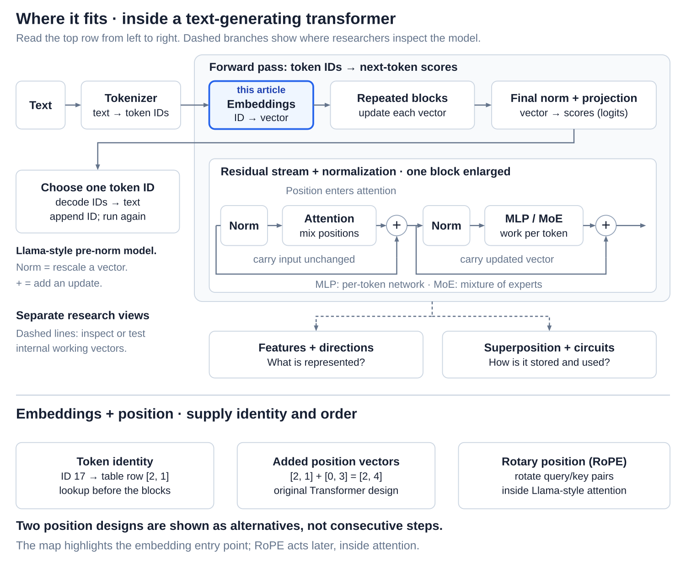
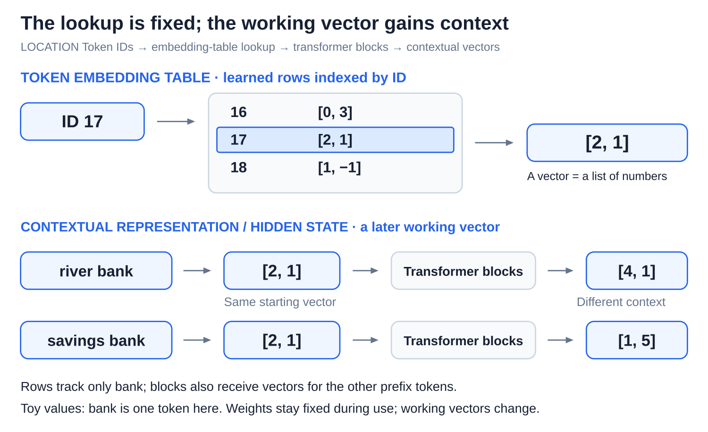
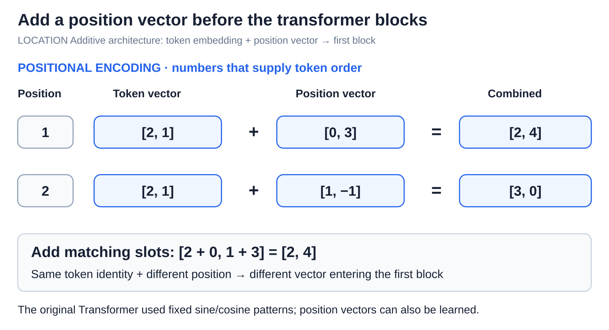
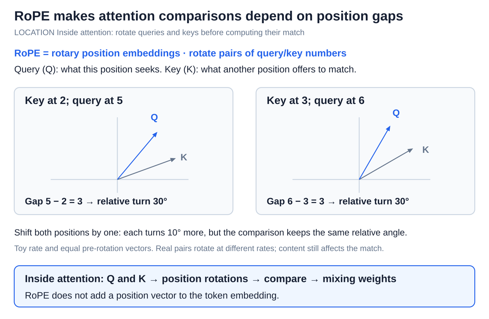
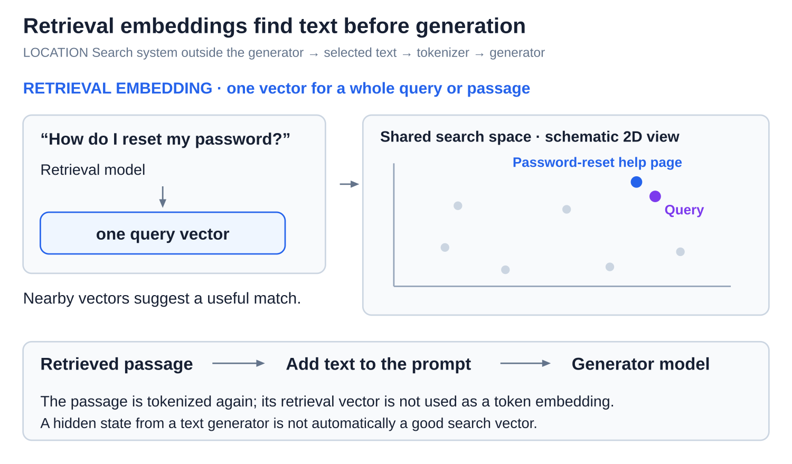

# Internals. Embeddings and position information

[Back to Artificial Intelligence](../Readme.md#content)

**A token embedding gives a language model a starting list of numbers for a piece of text. Position information lets the model use the order of those pieces.**

Consider the word `bank` in “river bank” and “savings bank.” Suppose the model reads `bank` as the same piece of text in both phrases. It starts with the same numbers both times. How, then, can it tell the two uses apart? Follow `bank` from the lookup table into the model, then see how another kind of embedding can find a whole passage.

1. [How a token ID selects a vector](#1-how-a-token-id-selects-a-vector)
2. [How context changes the vector for bank](#2-how-context-changes-the-vector-for-bank)
3. [How adding a position vector records order](#3-how-adding-a-position-vector-records-order)
4. [How rotary position embeddings encode a gap](#4-how-rotary-position-embeddings-encode-a-gap)
5. [How retrieval embeddings find a passage](#5-how-retrieval-embeddings-find-a-passage)

## 1. How a token ID selects a vector

A **tokenizer** splits text into **tokens**, pieces such as words or parts of words. It gives each piece an integer ID from its vocabulary. In the top row of the diagram, follow the arrows from **Tokenizer** to **Embeddings** to **Repeated blocks**.

Suppose `bank` is one token with ID `17`. The model uses `17` as a row number in its **embedding table**. In this example, row 17 holds `[2, 1]`. That ordered list of numbers is a **vector**. The row gives the model a vector it can calculate with wherever `bank` occurs. The ID stays `17` whether the token appears first or fifth in a sentence.

Training can change the numbers in the table. When the trained model answers a request, the table stays fixed. The **transformer blocks** are the layers that take the looked-up vectors and update them for this particular request.

## 2. How context changes the vector for bank

In both phrases below, `bank` is the second token. Read across each row in the lower half of the diagram. The token and its position stay the same. The earlier word changes.

1. In **river bank**, the lookup for `bank` gives `[2, 1]`. Inside a block, **attention** lets the vector at `bank` draw on information from `river`. A later vector for `bank` might be `[4, 1]`.
2. In **savings bank**, the lookup again gives `[2, 1]`. This time `savings` supplies a different clue, and the later vector might be `[1, 5]`.

That working vector at one token position is called a **hidden state**. Once it incorporates information from other tokens, it is a **contextual representation**. The model computes new hidden states as it passes through the layers. The numbers above are invented so you can follow what changed. Reading one coordinate on its own would not tell you “river” or “money.”

## 3. How adding a position vector records order

“Dog bites person” and “person bites dog” contain the same words, but swapping their positions changes who gets bitten. **Positional encoding** gives the model information about order. One design, used by the original Transformer, adds a vector for each token’s position before the first block. Compare the two rows below using the same starting vector for `bank`.

1. **At position 1**, the position vector is `[0, 3]`. Add matching entries to get `[2 + 0, 1 + 3] = [2, 4]`.
2. **At position 2**, the position vector is `[1, −1]`. The same token now enters the first block as `[2 + 1, 1 − 1] = [3, 0]`.

The table still holds `[2, 1]` for `bank`. Moving the token changes the position vector and therefore the sum passed to the block. The diagram uses small example numbers. The original Transformer calculated its position vectors using sine and cosine waves. Other models can learn position vectors during training.

## 4. How rotary position embeddings encode a gap

Llama 3 supplies position information inside attention. Each token position produces a **query** and a **key**. A query is a vector used to look for relevant information. A key is a vector that another position’s query can match against. The match helps determine how much information flows between the positions.

**Rotary position embeddings (RoPE)** rotate pairs of numbers in each query and key before attention compares them. Picture one such pair as an arrow on a page. In the diagram, both arrows start in the same direction and turn 10° for each position.

1. A key at position 2 turns 20°. A query at position 5 turns 50°. The angle between them is 30°, corresponding to a gap of three positions.
2. Move the key to position 3 and the query to position 6. Both arrows turn another 10°. The angle between them is still 30° because the gap is still three positions.

If you move just the query one position farther away, its arrow turns another 10° while the key stays still. That changes their alignment and can change their match score. In real RoPE, different pairs turn at different rates, and the original query and key also depend on the text. The two designs put order information in different places. The original Transformer adds it at the input. Llama 3 applies rotations when comparing queries and keys.

A separate rule, the **causal mask**, prevents a position in a text generator from reading future tokens. For example, position 5 can draw on position 2. Position 2 cannot look ahead to position 5. For how the mask gives future positions zero weight, see [Internals. Attention](../Internals.%20Attention/Readme.md#4-which-positions-can-a-token-use).

## 5. How retrieval embeddings find a passage

Imagine asking a help desk, “How do I reset my password?” A search system can encode the whole question as one **retrieval embedding** and compare it with vectors for help pages. In the diagram, each dot stands for a whole question or passage. Nearby dots indicate a likely match.

1. **Find a passage.** The search system compares the question’s vector with passage vectors in the same search space. A password-reset page can score well even if it uses different wording.
2. **Give the passage to the generator.** The application puts the selected passage’s **text** into the prompt. The language model splits that text into tokens and looks up a starting vector for each one, just as it did for `bank`. This use of search to supply material for an answer is called **retrieval-augmented generation (RAG)**. For a walkthrough from question to answer, see [RAG pipeline](../RAG%20pipeline/Readme.md).

For that comparison to work, use a model trained to represent questions and passages in the same search space, or two models trained to work together. A generator’s hidden state and a search vector can have the same number of entries and still represent different things.

## Check your understanding

1. Suppose `bank` has token ID `17` and is the fifth token in a sentence. Which number selects its embedding-table row? What does the other number tell you?

   

   
Answer

   The model looks up row 17 because the ID identifies the token. Five describes where this occurrence sits in the sentence. Moving it changes its position while the same ID still selects the same row.

   

2. The model gives `bank` different hidden states in “river bank” and “savings bank.” What changed, given that the embedding table stayed fixed?

   

   
Answer

   In both phrases, the second token starts with the same lookup vector. Attention can bring information from the earlier word into that position. The model therefore has different information to work with when it computes the later hidden state.

   

3. In the additive design, a token’s lookup vector is `[2, 1]` and its position vector is `[3, 0]`. Which vector enters the first block, and which vector will the next lookup of that token return?

   

   
Answer

   The block receives the sum, `[5, 1]`. Adding the position vector does not write back to the embedding table, so the next lookup still returns `[2, 1]`.

   

4. In the 10° RoPE example, move the key from position 2 to 4 and the query from 5 to 7. What happens to their relative angle? Could the token at position 4 now read the token at position 7?

   

   
Answer

   Both arrows turn 20° more. The gap is still three positions, so the relative angle stays 30°. The causal mask still blocks position 4 from reading position 7. RoPE changes how positions are compared. The mask decides which comparisons are allowed.

   

5. A search system finds the password-reset page. What goes into the generator’s prompt, and where do the generator’s token vectors come from?

   

   
Answer

   The application puts the passage text in the prompt. Its retrieval vector helped select the passage. The generator tokenizes the text and uses its own embedding table to look up a vector for each token ID.

   

# Sources

- [PyTorch — Embedding table lookup](https://docs.pytorch.org/docs/2.15/generated/torch.nn.Embedding.html)
- [Ethayarajh — How Contextual Are Contextualized Word Representations?](https://arxiv.org/abs/1909.00512)
- [Vaswani et al. — Attention Is All You Need, architecture diagram and positional encoding in §3.5](https://arxiv.org/html/1706.03762v7)
- [Su et al. — RoFormer, rotary position embeddings in §3](https://arxiv.org/html/2104.09864v5)
- [Meta — Llama 3 token embeddings, attention, and RoPE](https://github.com/meta-llama/llama3/blob/main/llama/model.py)
- [Reimers and Gurevych — Sentence-BERT](https://arxiv.org/abs/1908.10084)
- [Sentence Transformers — Semantic search and search-space diagram](https://sbert.net/examples/sentence_transformer/applications/semantic-search/README.html)
- [Lewis et al. — Retrieval-Augmented Generation for Knowledge-Intensive NLP Tasks](https://arxiv.org/abs/2005.11401)
