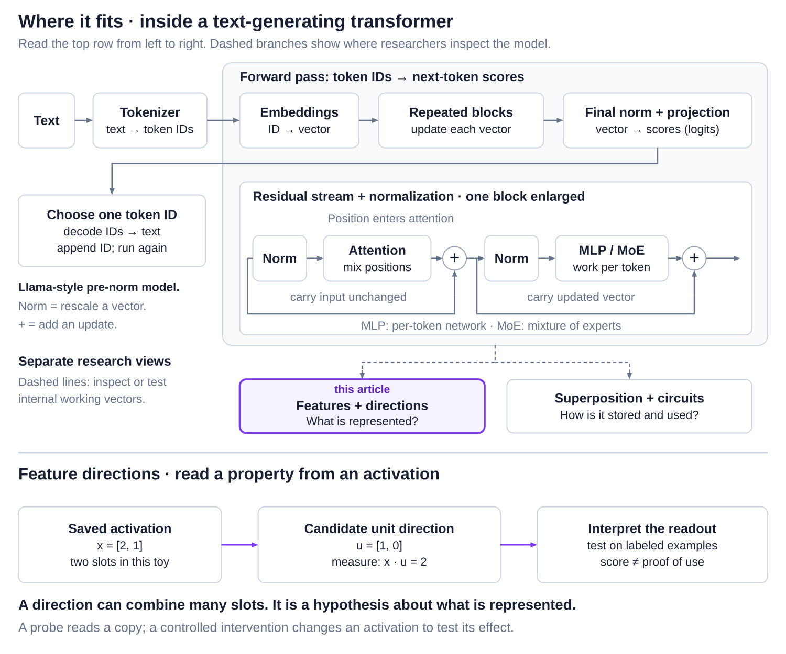
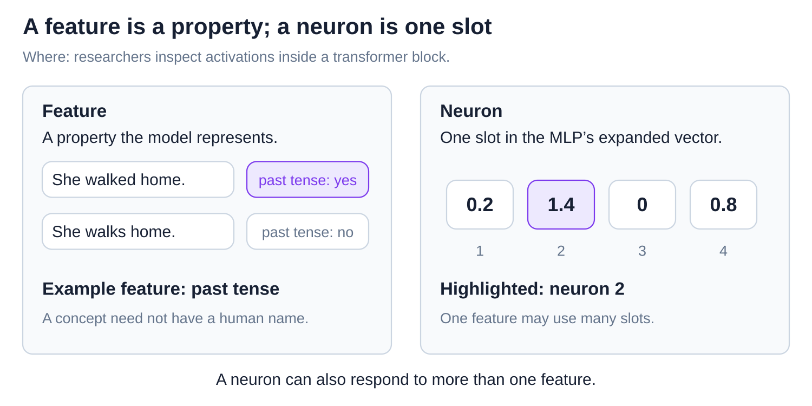
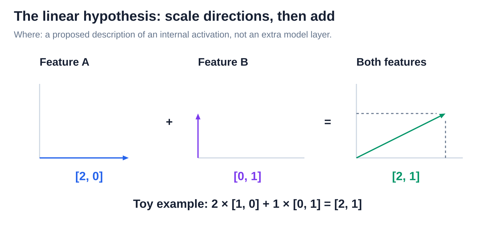
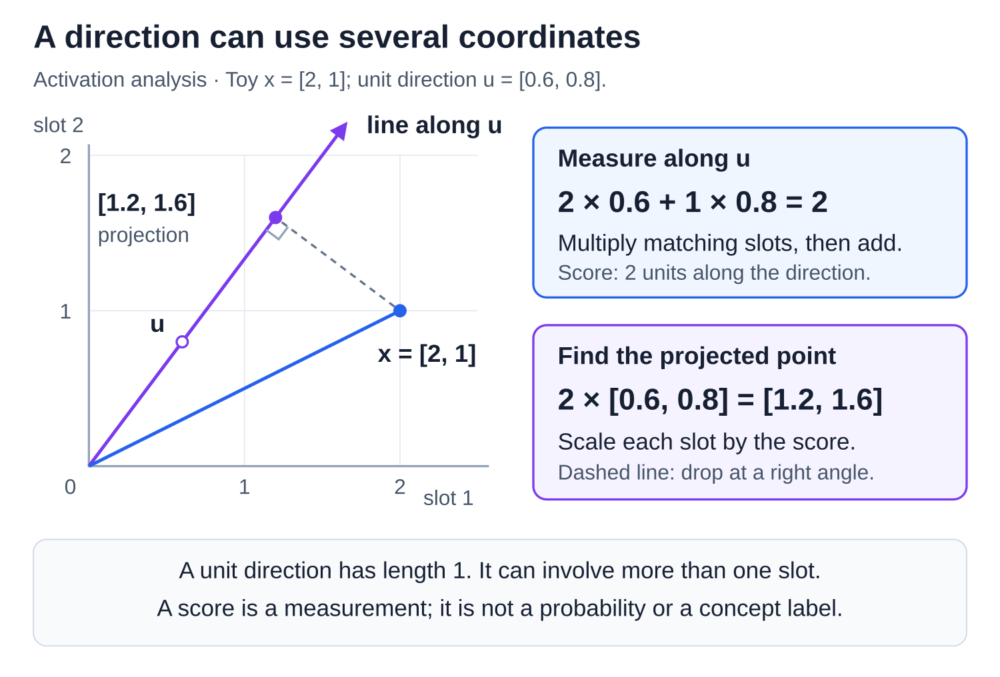
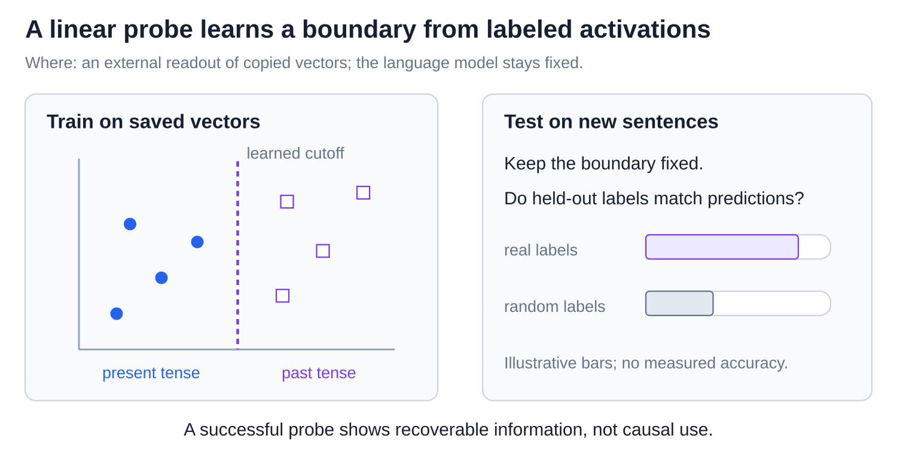
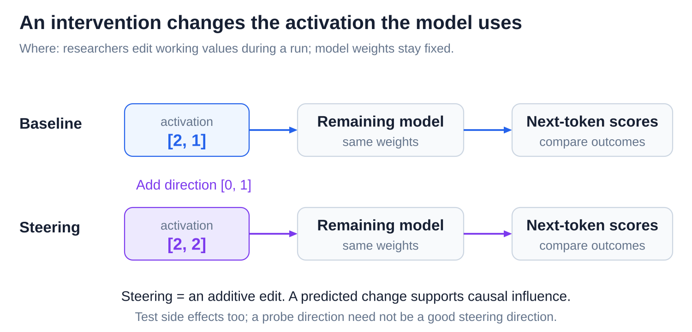

# Internals. Features and the linear representation hypothesis

[Back to Artificial Intelligence](../Readme.md#content)

**The linear representation hypothesis proposes that many features, such as past tense, have a direction in a model’s internal numbers.**

Picture those numbers as coordinates on a graph. If changing a verb from present to past tends to move the point in a similar direction across many sentences, that direction is a candidate for tense. Can we read tense from those numbers? Would changing them affect the model’s prediction?

1. [Where do the numbers come from?](#1-where-do-the-numbers-come-from)
2. [How does a feature differ from a neuron?](#2-how-does-a-feature-differ-from-a-neuron)
3. [How can directions represent two features at once?](#3-how-can-directions-represent-two-features-at-once)
4. [How do you measure along a direction?](#4-how-do-you-measure-along-a-direction)
5. [How can a probe test for past tense?](#5-how-can-a-probe-test-for-past-tense)
6. [How can an intervention test influence?](#6-how-can-an-intervention-test-influence)
7. [How far does the evidence reach?](#7-how-far-does-the-evidence-reach)

## 1. Where do the numbers come from?

As a language model reads a sequence of **tokens** (pieces of text), each layer computes working numbers called **activations**. At a chosen layer and token position, a researcher can save those numbers as a **vector**, an ordered list such as `[2, 1]`. The model’s learned **weights** stay fixed as it processes different sentences. Its activations can change with each sentence.

In the diagram, the solid path leads to scores for the next token. Follow the dashed branch to see where a researcher can copy a vector for analysis. The bottom panel previews a simple measurement that reads the first coordinate of `[2, 1]`, giving 2. Taking this measurement leaves the model’s prediction untouched. Studying what these internal calculations represent and how they contribute to a prediction is called **interpretability**.

## 2. How does a feature differ from a neuron?

A **feature** is a property the model represents. In “She walked home,” the verb is in the past tense. In “She walks home,” it is in the present tense. These sentences give us examples with and without the property we want to study.

A **neuron** is a computational unit. In the diagram’s feed-forward network, also called a multilayer perceptron (MLP), each hidden neuron contributes one number to a vector at a token position. In the right panel, neuron 2 has activation `1.4`. That number alone cannot tell us what makes it respond. A pattern spread across several neurons can carry one feature, and one neuron can respond to several properties. [Internals. Superposition and mechanistic interpretability](../Internals.%20Superposition%20and%20mechanistic%20interpretability/Readme.md) explores how feature directions can overlap.

## 3. How can directions represent two features at once?

Imagine two features, A and B, on a graph. In this toy example A contributes along the horizontal direction `[1, 0]` and B along the vertical direction `[0, 1]`. Read the three panels from left to right.

1. Give A a strength of 2. Its contribution is `2 × [1, 0] = [2, 0]`, two units to the right.
2. Give B a strength of 1. Its contribution is `1 × [0, 1] = [0, 1]`, one unit up.
3. Add matching coordinates. The combined activation is `[2, 0] + [0, 1] = [2, 1]`. Increasing B would move the point farther up while keeping A’s contribution the same.

Scaling and adding contributions is what **linear** means in this picture. The axes make the example easy to draw. A real candidate direction can run diagonally across many coordinates, and the model can use nonlinear calculations to determine which features are active.

## 4. How do you measure along a direction?

Keep the activation `x = [2, 1]` and choose a diagonal direction `u = [0.6, 0.8]`. This is a **unit direction**, an arrow of length 1. Imagine dropping a perpendicular from the tip of `x` to the line through `u`. The diagram shows two ways to describe where it lands.

1. **How far along the line?** Multiply corresponding coordinates and add them. This **dot product** gives a single score, `x · u = 2 × 0.6 + 1 × 0.8 = 2`. The sign tells you which way to go from zero along the line. A positive score means travel in the direction of `u`.
2. **Which point on the graph?** Multiply the direction by the score. The **projected vector** is `2 × [0.6, 0.8] = [1.2, 1.6]`, the solid purple point. The hollow point marks the tip of the unit arrow.

The horizontal direction in section 1 and this diagonal direction happen to give the same score for this input. A score of 2 is a distance along the chosen direction. If two feature directions overlap, activity in one can affect the score measured along the other. Assigning a meaning such as “past tense” takes evidence from more than one input.

## 5. How can a probe test for past tense?

A **linear probe** is a small model that a researcher trains to predict a label from saved activations. For the tense example, collect sentences labeled *past* or *present* and copy the activation at the same layer and corresponding token position in each, such as the final token of the verb.

1. **Train the probe.** Using some of the sentences, learn a direction and a cutoff. The probe scores each vector along that direction and predicts a tense according to which side of the cutoff the score falls on. Only the probe is trained.
2. **Test on held-out sentences.** Freeze the probe and compare its predictions with labels on sentences it never trained on. Include unfamiliar verbs to check whether it can generalize beyond particular words.
3. **Check other explanations.** Give each verb a randomly assigned label as a control. If a probe can also predict these arbitrary labels on new sentences containing familiar verbs, it may be recognizing the words. The bars illustrate probe accuracy on real tense labels and on randomly assigned labels. A separate comparison uses activations from an untrained model to test what language-model training contributed.

If the probe predicts tense reliably on new examples, the activations carry information the probe can read. Whether the language model itself uses that information for its next prediction is a separate question.

## 6. How can an intervention test influence?

An **intervention** changes an activation *inside* the running model. One kind, **steering**, adds a chosen direction. Use the same input and model weights in two runs and compare the scores for the next token.

1. In the **baseline** run, the rest of the model receives the original `[2, 1]`.
2. In the **steering** run, add `[0, 1]` at the same place. The rest of the model now receives `[2, 2]`. These toy numbers show the edit. Whether that direction actually affects tense is something to test.

For example, after “She,” both “walked” and “walks” make sense. Predict in advance that the edit will raise the score for “walked” relative to “walks,” and test that prediction on several prompts and verbs. A consistent shift gives evidence that the edit influences those predictions. Also check whether unrelated words shift or the text becomes incoherent. Broad side effects weaken the case for a specific role in tense. A direction that works well for reading can work poorly for steering.

## 7. How far does the evidence reach?

In a study of **Llama 2 7B**, researchers compared the vectors the model uses to score possible output tokens. They looked at pairs of words that differ in a particular way, such as singular *album* and plural *albums*. For many properties tested, the differences between matched pairs lined up more closely with a common direction than differences between random pairs. This is evidence for an approximate pattern in those output vectors.

Other researchers found **circular patterns** for days of the week and months of the year in language models. Imagine placing Monday through Sunday in order along a line. Sunday ends up farthest from Monday, even though Monday comes next. Arranging the seven days around a ring keeps every day next to its successor, including Sunday and Monday. The shape to look for depends on the property, the model, and the task.

## Check your understanding

1. You run two sentences through the same model and copy the vector at the same layer and token position. Which numbers can differ between runs, and why?

   

   
Answer

   The activations can differ because the model computes them from each input. Both runs use the same learned weights, and copying a vector for inspection leaves the running calculation intact.

   

2. Neuron 2 has activation 1.4 when the model reads “She walked home.” Is that enough to call it a past-tense neuron?

   

   
Answer

   No. One example cannot tell you what caused the response. Compare past- and present-tense examples across different verbs and contexts. The signal might also be spread across several neurons.

   

3. Keep A’s strength at 2 along `[1, 0]` and raise B’s strength from 1 to 3 along `[0, 1]`. What is the combined vector now?

   

   
Answer

   The vector is `[2, 3]`. A still contributes `[2, 0]`, while B now contributes `[0, 3]`.

   

4. For `x = [2, 1]` and the unit direction `u = [0.6, 0.8]`, someone reports both `2` and `[1.2, 1.6]`. Which one is the score, and what does the other describe?

   

   
Answer

   The score is 2, the signed distance along the chosen direction. Multiplying the unit direction by 2 gives the projected vector `[1.2, 1.6]`, whose tip lies on that line.

   

5. A probe predicts tense accurately even on verbs it never saw during training. Does that show the language model uses tense to choose its next token?

   

   
Answer

   No. It shows that the probe can recover tense from the saved activations on those examples. The language model could still base its prediction on other information.

   

6. A steering edit makes past-tense continuations more likely, but it also makes unrelated continuations incoherent. What does that tell you about the edit?

   

   
Answer

   The edit affects the model’s output, but its effect appears broad. Compare the edited and baseline runs on more prompts and on unrelated predictions before attributing the change specifically to tense.

   

7. Why might a researcher plot days of the week on a ring even after finding a useful straight-line direction for singular versus plural words?

   

   
Answer

   Days repeat in a cycle. A ring keeps Sunday and Monday adjacent while preserving all the other neighboring pairs. Evidence for one direction in a singular–plural comparison leaves open what geometry best captures a different property.

   

# Sources

- [Meta, Llama 3 reference implementation of a transformer block](https://github.com/meta-llama/llama3/blob/main/llama/model.py)
- [Elhage et al., *Toy Models of Superposition* (visual reference for features and directions)](https://transformer-circuits.pub/2022/toy_model/index.html)
- [Park, Choe, and Veitch, *The Linear Representation Hypothesis and the Geometry of Large Language Models*](https://arxiv.org/html/2311.03658v2)
- [Belinkov, *Probing Classifiers: Promises, Shortcomings, and Advances*](https://aclanthology.org/2022.cl-1.7/)
- [Hewitt and Liang, *Designing and Interpreting Probes with Control Tasks*](https://arxiv.org/abs/1909.03368)
- [Elazar et al., *Amnesic Probing: Behavioral Explanation with Amnesic Counterfactuals*](https://arxiv.org/abs/2006.00995)
- [Marks and Tegmark, *The Geometry of Truth*](https://arxiv.org/abs/2310.06824)
- [Engels et al., *Not All Language Model Features Are One-Dimensionally Linear*](https://arxiv.org/abs/2405.14860)
