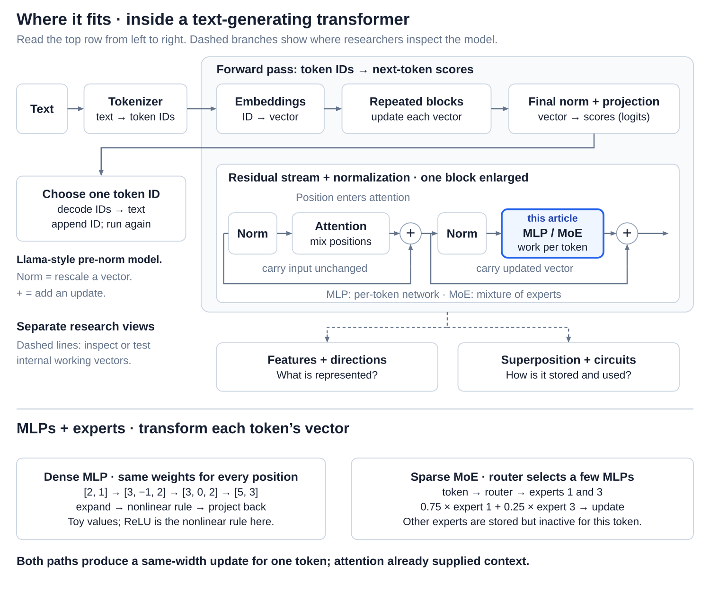
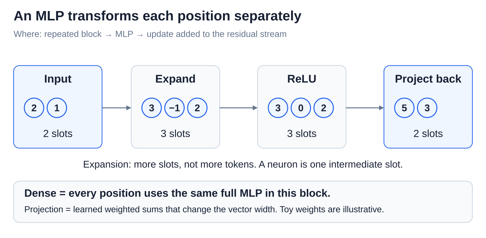
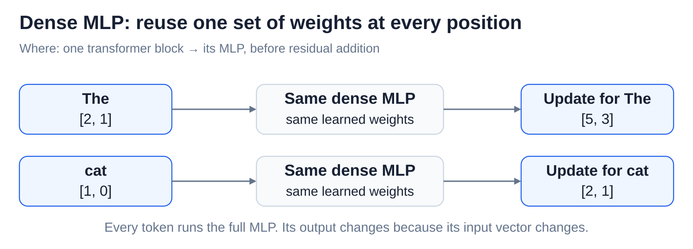
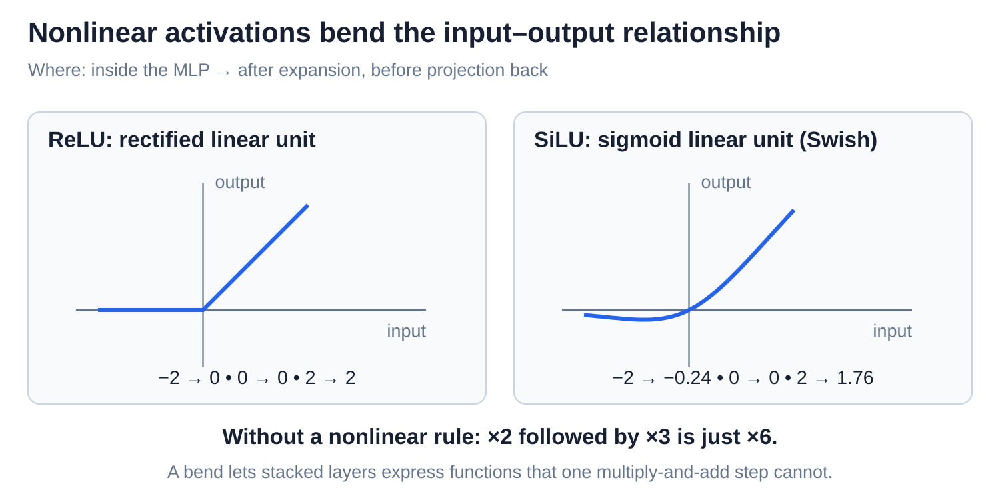
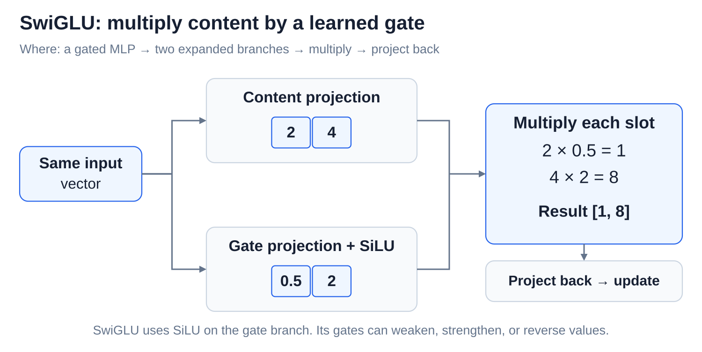
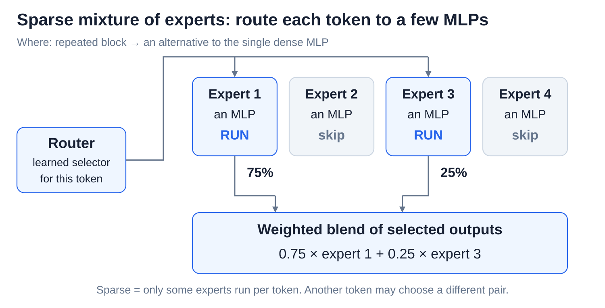
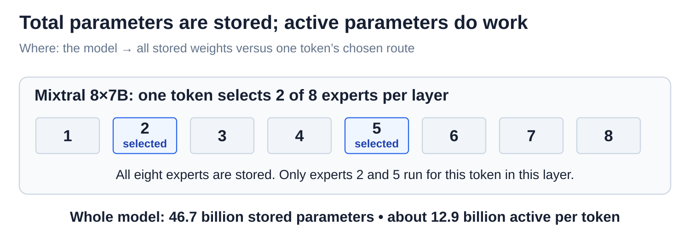

# Internals. MLPs and mixture of experts

[Back to Artificial Intelligence](../Readme.md#content)

**A multilayer perceptron (MLP) is a neural network. Inside a transformer block, its job is to turn the numbers at one token position into an update for that position.**

This article follows one small update from input to output. Then it shows how a **mixture of experts (MoE)** chooses which of several MLPs to run for each token.

1. [Where does the MLP get its input?](#1-where-does-the-mlp-get-its-input)
2. [How does one vector become an update?](#2-how-does-one-vector-become-an-update)
3. [Why do the same weights give different updates?](#3-why-do-the-same-weights-give-different-updates)
4. [Why put a nonlinear rule in the middle?](#4-why-put-a-nonlinear-rule-in-the-middle)
5. [How does a gate change the calculation?](#5-how-does-a-gate-change-the-calculation)
6. [How does a mixture of experts choose what to run?](#6-how-does-a-mixture-of-experts-choose-what-to-run)
7. [Why count both total and active parameters?](#7-why-count-both-total-and-active-parameters)
8. [Check your understanding](#8-check-your-understanding)

## 1. Where does the MLP get its input?

A **token** is a piece of text. The model keeps a **vector**, an ordered list of numbers, at each token position. In the block shown here, attention first gathers information from other allowed positions. By the time the MLP processes `bank`, the vector can already reflect whether the preceding word was `river` or `savings`.

Find the box labeled **MLP / MoE** in the enlarged block. The MLP is called a **feed-forward network** because information flows from its input through a hidden layer to its output. The input is a normalized (rescaled) version of the position’s running vector. The output is an update of the same width. The plus sign adds the update to the running vector, carrying earlier information forward while changing some of its numbers. For the calculation that brings context across positions, see [Internals. Attention](../Internals.%20Attention/Readme.md).

## 2. How does one vector become an update?

Follow the token `The` in “The cat.” Suppose its input vector is `[2, 1]`. A **projection** makes new coordinates by multiplying the inputs by weights and adding the results. Training learns those weights. Here is one small set of rules that produces the numbers in the diagram.

1. **Expand.** Call the input numbers `a` and `b`. Make three coordinates using `[a + b, b − a, a]`. With `a = 2` and `b = 1`, the result is `[3, −1, 2]`. Each intermediate coordinate is the value of one hidden **neuron**. We still have one token.
2. **Apply an activation.** An activation function transforms each intermediate value. Here the rule is the **rectified linear unit (ReLU)**, which keeps positive values and changes negative ones to zero. The three values become `[3, 0, 2]`.
3. **Project back.** Call those three values `p`, `q`, and `r`. Use `[p + r, p + q]` to get `[3 + 2, 3 + 0] = [5, 3]`. The MLP now has a two-number update that the block can add to this position’s running vector.

Expanding gives the MLP room to compute more combinations of its inputs. Each hidden neuron can respond to a different combination, and the final projection mixes those responses into an update that fits the running vector. In the original Transformer, each token went from 512 coordinates to 2,048 and back to 512.

## 3. Why do the same weights give different updates?

In a **dense** transformer MLP, every token position goes through the full network. Within one block, the projection weights are shared across positions. A different block can learn its own weights.

Take the two positions in “The cat.” The first row reuses section 2’s calculation for `The`, giving the update `[5, 3]`. For `cat`, start with `[1, 0]` and apply exactly the same rules. Expansion gives `[1, −1, 1]`, ReLU gives `[1, 0, 1]`, and the final projection gives `[2, 1]`. Each row uses only its own input numbers. That is why the two rows can be processed in parallel.

## 4. Why put a nonlinear rule in the middle?

Multiplying a number by 2 and then by 3 has the same effect as multiplying it once by 6. The same principle applies to projections. If both stages only take weighted sums, they can be combined into one projection. Adding a **nonlinear** rule in between lets the result change in ways a single weighted sum cannot express.

On each graph, choose an input on the horizontal axis and read its output on the vertical axis.

- **ReLU** has a sharp bend at zero. Its output is flat for negative inputs and follows the input for positive ones. It maps `−2`, `0`, and `2` to `0`, `0`, and `2`.
- **SiLU** stands for *sigmoid linear unit*, also called *Swish* here. It multiplies its input by a smooth factor between 0 and 1 that depends on the input. The same three inputs produce about `−0.24`, `0`, and `1.76`. A negative input can therefore carry a small negative value into the next calculation.

## 5. How does a gate change the calculation?

A **gate** is a multiplier computed from the input. Llama 3 uses a **Swish-gated linear unit (SwiGLU)** in its MLP. Two learned projections read the same token vector. One produces **content** values. The other passes its values through SiLU to produce one gate multiplier per content coordinate.

In this separate example, the content is `[2, 4]` and the multipliers **after SiLU** are `[0.5, 2]`. Multiply matching coordinates to get `[2 × 0.5, 4 × 2] = [1, 8]`. The first value is halved and the second is doubled. Although the smooth factor *inside* SiLU lies between 0 and 1, the *output* of SiLU can exceed 1 or be negative. A gate can therefore amplify a value or reverse its sign. A final projection turns the product into the update for this position.

## 6. How does a mixture of experts choose what to run?

In a **sparse mixture of experts (MoE)**, a block has several MLPs with different weights. Each MLP is an **expert**. A learned **router** scores the experts for the current token vector. Only the selected experts run for that position, which is what *sparse* means here.

Follow the arrows to the two experts marked **RUN**. Experts 1 and 3 each process the same token vector. The router assigns 75% to expert 1 and 25% to expert 3. Suppose their output vectors are `[4, 0]` and `[0, 8]`. The combined update is `[3, 0] + [0, 2] = [3, 2]`. The next token can use a different pair. A SwiGLU gate scales individual coordinates inside one MLP. A router chooses among entire MLPs and weights their outputs.

Does each expert specialize in a subject? Mixtral’s authors counted how often the router selected each expert for arXiv papers, biology abstracts, and philosophy texts. The selection rates were similar across all three. Here, *expert* names an MLP the router can choose.

## 7. Why count both total and active parameters?

A **parameter** is a number learned during training, such as a projection weight. **Total parameters** count the whole stored model. **Active parameters per token** count the parameters used on one token’s path through it, including shared components such as attention.

In **Mixtral 8×7B**, each layer has eight feed-forward experts and selects two for each token. In the diagram, experts **2 and 5** are marked **selected**. The “8×” counts the feed-forward networks in each layer. All eight share the same attention layer, so multiplying seven billion by eight would count shared weights repeatedly. Across the whole model, Mixtral has about **46.7 billion total parameters** and **12.9 billion active per token**. Dividing the total by four would also divide the shared components by four, even though each token still uses them.

The total helps explain how much weight data must be stored. The active count helps explain the computation for one token. Actual time also depends on work such as routing tokens and moving data between devices.

## 8. Check your understanding

1. In “river bank” and “savings bank,” the MLP processes the `bank` position on its own. How can the earlier word still affect its update?

   

   
Answer

   Attention can bring information from the earlier word into the vector at `bank`. The MLP therefore receives different input numbers in the two contexts and can produce different updates.

   

2. After ReLU, the example has three numbers, `[3, 0, 2]`. Why does the MLP project back to two, and what update does it produce?

   

   
Answer

   The update needs two coordinates so the block can add it to the two-coordinate running vector. The rule `[p + r, p + q]` gives `[3 + 2, 3 + 0] = [5, 3]`.

   

3. Suppose a third token enters the same dense MLP with input `[1, 0]`, exactly like `cat`. Will it receive the same MLP update in this example?

   

   
Answer

   Yes. The same input and the same weights give the same update, `[2, 1]`. The written token’s identity has no separate role in this calculation.

   

4. A hidden coordinate is `−2`. What would the next projection receive from that coordinate with ReLU? What would it receive with SiLU?

   

   
Answer

   ReLU passes on zero. SiLU passes on about `−0.24`, so that coordinate can still make a signed contribution to the next weighted sum.

   

5. A SwiGLU branch produces content `[6, 4]` and multipliers `[0.5, 2]` after SiLU. What reaches the final projection?

   

   
Answer

   The vector is `[3, 8]`. Multiply coordinate by coordinate. The first gate scales 6 by one half, and the second scales 4 by two.

   

6. The router selects experts 1 and 3. Would changing only expert 2’s weights affect this token’s update if the routing decision stays the same?

   

   
Answer

   No. Only the outputs from experts 1 and 3 enter this token’s weighted sum. Expert 2 may affect a different token if the router selects it there.

   

7. Mixtral uses two of eight experts at each layer. Why does one token use more than one quarter of the model’s total parameters?

   

   
Answer

   The one-quarter fraction applies to the expert weights. Each token also uses shared parameters, including attention and the routers. Those shared weights count in full toward the active total.

   

# Sources

- [Vaswani et al., *Attention Is All You Need*, §3.3 on position-wise feed-forward networks](https://arxiv.org/html/1706.03762v7)
- [PyTorch documentation for ReLU](https://docs.pytorch.org/docs/2.15/generated/torch.nn.ReLU.html) and [SiLU](https://docs.pytorch.org/docs/2.15/generated/torch.nn.SiLU.html)
- [Meta’s Llama 3 reference implementation of the feed-forward network and residual addition](https://github.com/meta-llama/llama3/blob/main/llama/model.py)
- [Shazeer, *GLU Variants Improve Transformer*, including the SwiGLU equation](https://arxiv.org/html/2002.05202v1)
- [Jiang et al., *Mixtral of Experts*, §§2 and 5 on expert routing and selection across topics](https://arxiv.org/html/2401.04088v1)
- [Mistral AI on Mixtral’s total and active parameter counts](https://mistral.ai/news/mixtral-of-experts/)
- [Fedus, Zoph, and Shazeer, *Switch Transformers*, on sparse computation and communication costs](https://arxiv.org/abs/2101.03961)
