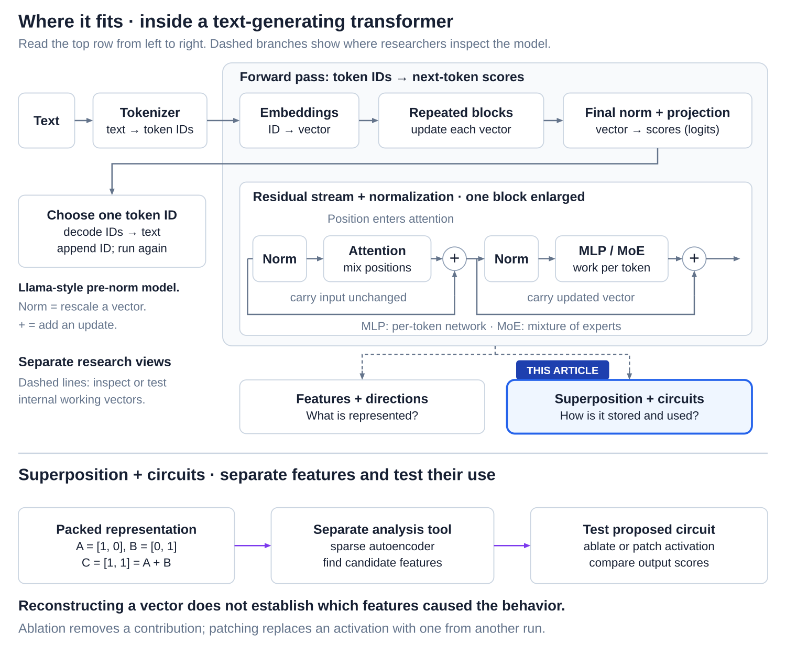
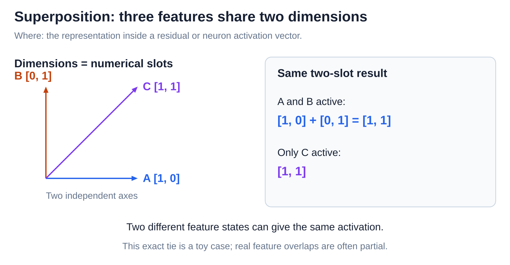
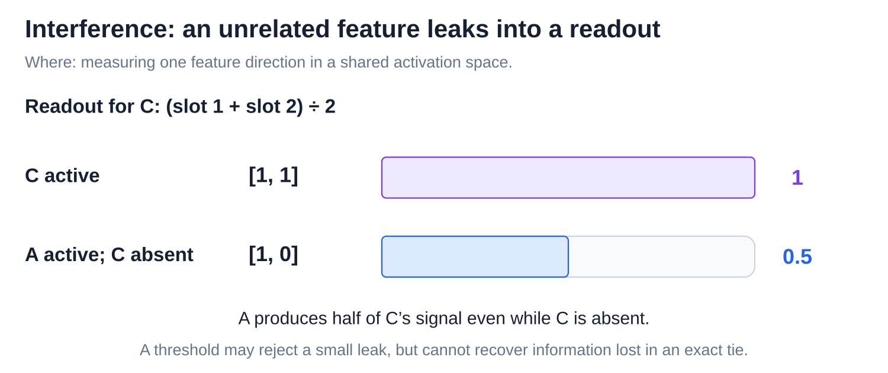
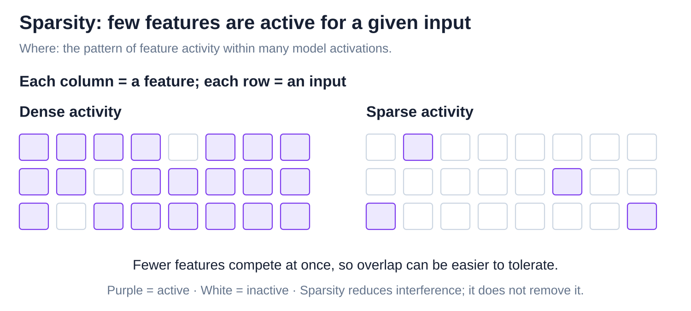
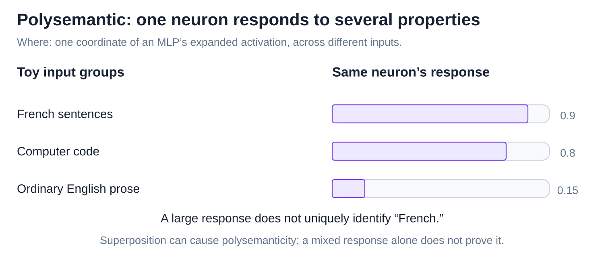
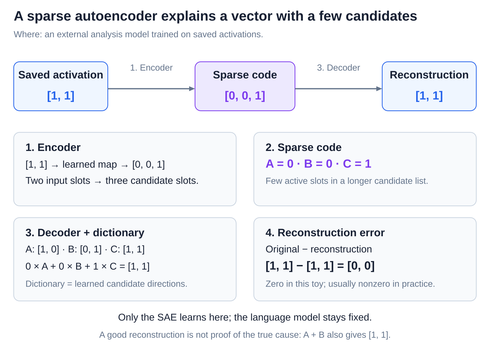
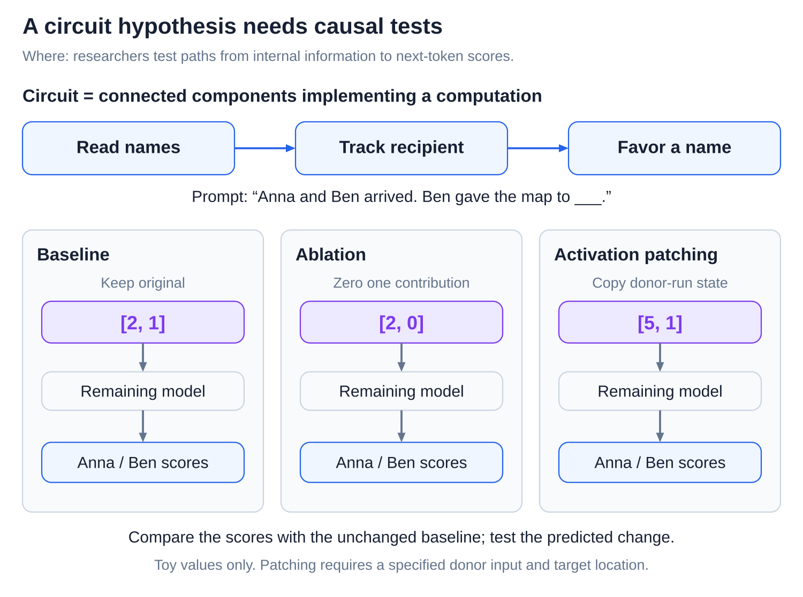

# Internals. Superposition and mechanistic interpretability

[Back to Artificial Intelligence](../Readme.md#content)

A model can use the same numbers to represent several properties of its input. When it represents more properties than it has numerical coordinates by letting their directions overlap, researchers call this **superposition**. **Mechanistic interpretability** asks how the model uses those internal signals to produce a particular answer.

A two-number example shows how different signals can look identical. A sentence about Anna and Ben shows how to test which signals influence a prediction.

1. [What researchers can observe inside a model](#1-what-researchers-can-observe-inside-a-model)
2. [How three features can share two dimensions](#2-how-three-features-can-share-two-dimensions)
3. [How one feature can affect another feature’s score](#3-how-one-feature-can-affect-another-features-score)
4. [Why sparsity makes sharing easier](#4-why-sparsity-makes-sharing-easier)
5. [What one neuron can tell us](#5-what-one-neuron-can-tell-us)
6. [How a sparse autoencoder finds candidate features](#6-how-a-sparse-autoencoder-finds-candidate-features)
7. [How to test whether a circuit affects an answer](#7-how-to-test-whether-a-circuit-affects-an-answer)
8. [Check your understanding](#8-check-your-understanding)

## 1. What researchers can observe inside a model

Consider “Anna and Ben arrived. Ben gave the map to ___.” A language model assigns scores to possible next pieces of text, called **tokens**. A higher score for “Anna” than for “Ben” tells us which name the model favors. How did it reach that preference?

Researchers can record **activations**, the numbers the model computes as it processes the prompt. At one position in one layer, a list of those numbers is an **activation vector**. A **feature** is a property the model represents. For example, we might ask whether a vector carries information about which name appeared twice. We can record the numbers directly. Figuring out what they mean and how the model uses them takes an experiment.

In the map, follow the top row from text to scores. The dashed branches show where a researcher can inspect or change a vector during an experiment.

## 2. How three features can share two dimensions

Imagine a vector with two numbers. Each number is a **coordinate**, so the vector has two **dimensions**. Start at `[0, 0]`. In this toy model, switching on a feature adds a particular change to the vector. The arrow for that change shows the feature’s **direction**.

1. Feature A adds `[1, 0]`, one unit to the right.
2. Feature B adds `[0, 1]`, one unit up.
3. Feature C adds `[1, 1]`, one unit both right and up.

The model can distinguish A, B, and C when each appears alone. The ambiguity appears when A and B occur together. Adding their contributions gives `[1, 1]`, exactly the same pair as C alone. In real models the overlap can be partial. An exact tie makes the cost of sharing easy to see.

A single feature can also use several coordinates, as shown in [Internals. Features and the linear representation hypothesis](../Internals.%20Features%20and%20the%20linear%20representation%20hypothesis/Readme.md). What makes this example *superposition* is that three feature directions share a space with only two dimensions.

## 3. How one feature can affect another feature’s score

Suppose we want one number that estimates the strength of C. A rule that turns a vector into a measurement is called a **readout**. Our toy readout averages the two coordinates. Both rows in the diagram use that same rule.

With C alone, the readout gives `(1 + 1) ÷ 2 = 1`. With A alone, it gives `(1 + 0) ÷ 2 = 0.5`. C is absent in the second case, yet A moves the first coordinate in a direction the readout counts toward C. That effect is **interference**.

If we report C only for scores above `0.75`, we can reject the signal from A alone. But A and B together still score `1`. Any rule looking only at those two coordinates must give the same answer for identical vectors.

## 4. Why sparsity makes sharing easier

Feature activity is **sparse** when only a few of the possible features are active on any one input. In the grids, each row is one input and each column is one feature. A shaded square marks an active feature. In the first row, seven of the eight features are active in the dense example and only one is active in the sparse example.

Return to A, B, and C. If A and B rarely occur together, their exact collision with C is rare too. This helps explain why sharing dimensions can be worthwhile in toy models. Many features can be represented across a whole dataset while only a few compete on a typical input. On the occasional input where A and B do occur together, the ambiguity is still there.

## 5. What one neuron can tell us

At a given position, a **neuron** in a model’s feed-forward layer produces one activation value. Researchers can look at inputs that give this neuron a high value and ask what they have in common. A neuron that responds to several seemingly unrelated properties is called **polysemantic**.

The bars show the **same neuron** on three groups of toy inputs. It responds strongly to French sentences (`0.9`) and to computer code (`0.8`), and weakly to ordinary English prose (`0.15`). Seeing only the French examples could tempt us to label it “French.” The code examples show why a high value alone would be an unreliable language detector.

Superposition is one possible explanation. Several feature directions could each contribute to this neuron’s value. Another possibility is that the two groups share a property we have overlooked. The bars alone cannot tell us which explanation holds.

## 6. How a sparse autoencoder finds candidate features

A **sparse autoencoder (SAE)** is a separate model that learns to rebuild saved activation vectors using a few contributions at a time. The language model stays fixed while the SAE learns. Follow the top row of the diagram from the original vector to its reconstruction.

1. The **encoder** takes the saved vector `[1, 1]` and assigns a strength to each candidate feature. Its **sparse code**, `[0, 0, 1]`, is wider than the input. It has three slots for two input coordinates, and only C is active.
2. The **decoder** has a learned collection of directions called a **dictionary**. It multiplies each direction by its strength and adds the results. With strength 1 for C and 0 for A and B, it rebuilds `[1, 1]`.
3. **Reconstruction error** measures what the SAE missed. Here the original and rebuilt vectors match exactly. During training, the aim is to keep the error small while using few active features.

A wider code lets the SAE choose among many directions while using only a few for each input. Gao and colleagues trained an SAE with 16 million candidate feature slots on activations from GPT-4.

Even zero error leaves a question open. In our toy model, A and B together would have produced the same saved vector as C alone. On real data, an SAE can also miss features or combine several patterns in one candidate. Researchers still have to test what a candidate represents and whether it affects behavior.

## 7. How to test whether a circuit affects an answer

A **circuit** is a set of connected model components that performs a particular computation. Return to “Anna and Ben arrived. Ben gave the map to ___.” Suppose we think a component carries information about the likely recipient. We can test that idea by changing its activation and observing whether the model’s preference between Anna and Ben shifts as predicted.

1. **Establish a baseline.** Run the original prompt and record the score for Anna minus the score for Ben. A positive difference favors Anna. The pairs in brackets in the diagram are internal activations. The name scores are measured *after* the rest of the model runs.
2. **Remove a contribution.** An **ablation** removes information at a chosen location, for example by setting a component’s output to zero. If it helped favor Anna, we predict a smaller score difference than in the baseline.
3. **Replace a contribution.** For **activation patching**, take a value from a second run, called the *donor*. Change the donor sentence to “Anna and Ben arrived. **Anna** gave the map to ___,” where Ben is the likely recipient. Copy the candidate component’s output at the final prompt position from the donor into the same location in the original run. If it carries recipient information, we predict a shift toward Ben.

As a **sanity check**, copy the original value back into place. The scores should match the baseline. For a **negative control**, use a donor that changes only “map” to “book” and patch the same component at the same position. Ben still gives the gift, so Anna is still the likely recipient. If the component specifically tracks the recipient, the difference between the name scores should stay close to the baseline.

A shift toward Ben that is larger than the control shift supports the hypothesis on these prompts. Other components may compensate for an ablation, and an edit may disturb more than one feature. Testing more prompts and locations helps narrow the explanation.

Wang and colleagues used related experiments to identify a circuit in GPT-2 small that helps predict the recipient in sentences of this kind. Ameisen and colleagues tested a different prediction about Michael Jordan’s sport. Suppressing a group of features associated with his name changed the model’s score for “basketball.”

## 8. Check your understanding

1. A model scores “Anna” above “Ben.” What can you record inside the model to investigate that preference, and what would still need testing?

   

   
Answer

   **Record its activation vectors as it processes the prompt.** You can check whether their values track which name repeats. To learn whether the model uses that information to favor Anna, test what happens when you change it.

   

2. In the two-dimensional example, you observe `[1, 1]`. Can you tell from that vector alone whether C was active?

   

   
Answer

   **No.** C alone gives `[1, 1]`, and A plus B gives exactly the same vector. The two coordinates contain no way to distinguish the cases.

   

3. Only B is active, giving `[0, 1]`. What does the readout for C report, and why?

   

   
Answer

   **It reports `0.5`.** The readout averages the coordinates, so the second coordinate contributes even though B is the only active feature. This is interference.

   

4. Suppose A and B now occur together on almost every input. What happens to the advantage that sparsity gave this toy representation?

   

   
Answer

   **The A-plus-B collision with C becomes common.** Sharing space was easier to tolerate when those two features rarely occurred together. The same ambiguity now affects many inputs.

   

5. A neuron responds strongly to French sentences. You then find equally strong responses to code. Can you use a high response alone to identify French?

   

   
Answer

   **No.** Either kind of input can give a high value. Several features could contribute to the neuron, or both groups could share a property you have yet to identify.

   

6. An SAE selects only C and reconstructs `[1, 1]` with zero error. What has it established, and what is still uncertain?

   

   
Answer

   **C alone can rebuild the saved vector.** That establishes an accurate reconstruction. Whether C caused the original activation is still uncertain because A and B together fit the same numbers.

   

7. You patch the same component twice. One donor changes the giver from Ben to Anna. The other changes the gift from a map to a book. Which result would support a role in tracking the recipient?

   

   
Answer

   **Changing the giver should shift the scores toward Ben, while changing the gift alone should have little effect on the score difference.** Ben can still score below Anna after the patch. What matters is how far the difference moved from the original baseline.

   

# Sources

- [Meta, Llama 3 reference implementation of the transformer](https://github.com/meta-llama/llama3/blob/main/llama/model.py)
- [Elhage et al., Toy Models of Superposition](https://transformer-circuits.pub/2022/toy_model/index.html)
- [Cunningham et al., Sparse Autoencoders Find Highly Interpretable Features in Language Models](https://arxiv.org/abs/2309.08600)
- [Gao et al., Scaling and Evaluating Sparse Autoencoders](https://arxiv.org/html/2406.04093v1)
- [Wang et al., Interpretability in the Wild — A Circuit for Indirect Object Identification in GPT-2 small](https://arxiv.org/html/2211.00593v1)
- [Ameisen et al., Circuit Tracing — Revealing Computational Graphs in Language Models](https://transformer-circuits.pub/2025/attribution-graphs/methods.html)
