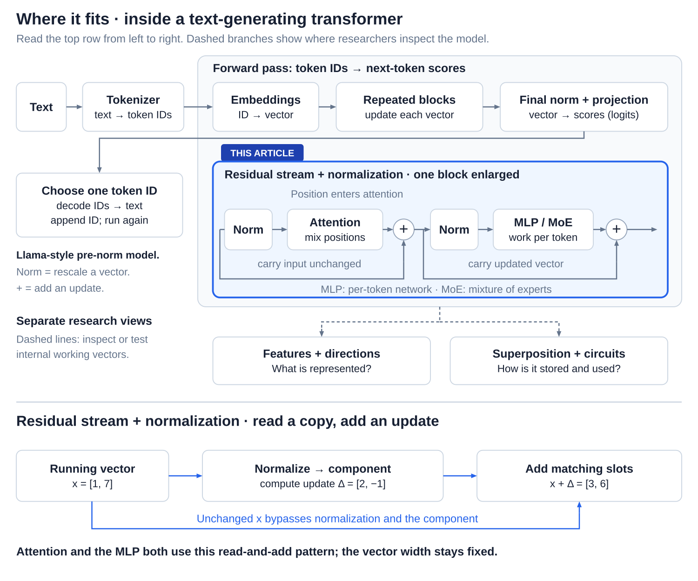
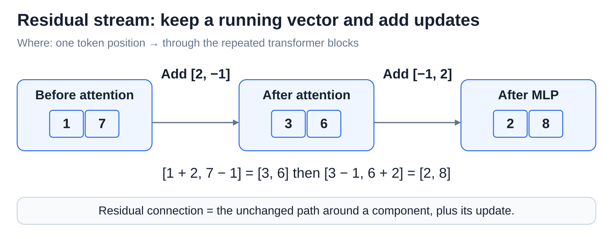
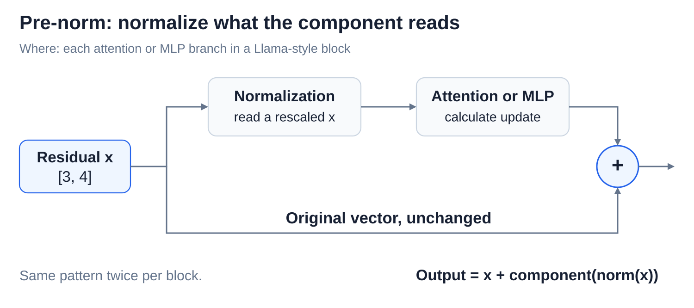
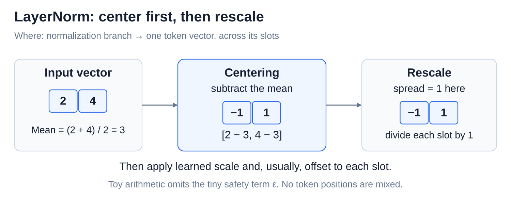
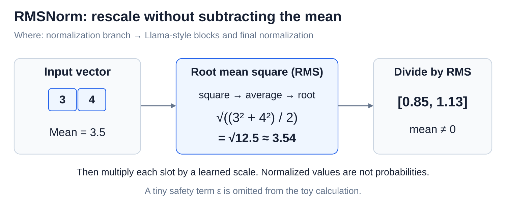

# Internals. The residual stream and normalization

[Back to Artificial Intelligence](../Readme.md#content)

**The residual stream carries one running vector, or list of numbers, for each token position.**

A transformer updates those vectors as it processes the text. In the Llama-style model used here, each part of a block reads a normalized version of the current vector, computes an update, and adds the update to the vector it started with.

1. [What travels through a transformer block?](#1-what-travels-through-a-transformer-block)
2. [How does an update change the running vector?](#2-how-does-an-update-change-the-running-vector)
3. [Which vector gets normalized in a pre-norm block?](#3-which-vector-gets-normalized-in-a-pre-norm-block)
4. [How does LayerNorm center and rescale a vector?](#4-how-does-layernorm-center-and-rescale-a-vector)
5. [How does RMSNorm measure size?](#5-how-does-rmsnorm-measure-size)

## 1. What travels through a transformer block?

Suppose “The cat” is split into two **tokens**, the pieces of text the model processes. Each position starts with an **embedding**, a list of numbers looked up for that token. In the top row of the diagram, follow those vectors from “Embeddings” into “Repeated blocks.” A **block** is a group of operations the model applies to the vectors.

Follow the two plus signs in the enlarged block. **Attention** can bring information from earlier positions into the current one. At `cat`, for instance, it can use information from `The`. The first plus sign adds attention’s update to the vector at `cat`. A **multilayer perceptron (MLP)**, a neural network that works on each position separately, reads the updated information and produces the second update. There are still two positions when the block finishes. Each passes its own vector to the next block.

## 2. How does an update change the running vector?

A **residual connection** gives the incoming vector a direct path around a component to an addition. Each entry in a vector is called a **coordinate**. The component supplies one change per coordinate. At the plus sign, add the first change to the first coordinate, the second to the second, and so on.

Follow just the `cat` position in this two-coordinate example. The updates are given so you can trace the additions by hand.

1. **Attention update.** Start with `[1, 7]` and add `[2, −1]`. The result is `[1 + 2, 7 − 1] = [3, 6]`.
2. **MLP update.** Start with that result, `[3, 6]`, and add `[−1, 2]`. The vector passed to the next block is `[2, 8]`.

The width stays at two coordinates even though the values change. An update can even cancel an earlier contribution. The residual stream carries the current result forward without keeping a permanent record of earlier values. The direct path lets a component learn just the change it needs to make, which can help deep networks train. When the trained model processes a prompt, these working vectors change while the model’s **weights**, the numbers learned during training, stay fixed.

## 3. Which vector gets normalized in a pre-norm block?

**Normalization** adjusts the scale of a vector’s coordinates so a component gets input on a more consistent scale. **Pre-norm** describes where that happens. In the diagram, start at `x = [3, 4]` and follow both paths to the plus sign.

1. **Upper path.** Normalize the input. Attention or the MLP uses that version to calculate an update.
2. **Lower path.** Carry the original `[3, 4]` directly to the addition. If the upper path produces `[1, −2]`, the sum is `[3, 4] + [1, −2] = [4, 2]`.

The block uses this pattern twice. Attention starts from the block’s input. The MLP starts from the sum *after* attention and gets its own normalized input.

The original Transformer applied LayerNorm **after** each addition, so the next component received a normalized sum. Llama uses pre-norm to help keep training stable. Inside each block, only the input to attention or the MLP is rescaled. The direct path carries the original vector to the plus sign. After the last block, Llama applies a final normalization before converting the vectors into scores for possible next tokens.

## 4. How does LayerNorm center and rescale a vector?

**Layer normalization (LayerNorm)** first subtracts the mean, or average, of one token’s coordinates. This is called **centering**. Then it divides the centered values by their **standard deviation**, a measure of how far the original values spread around their mean. Follow the input `[2, 4]` across the diagram.

1. **Find the mean.** `(2 + 4) ÷ 2 = 3`.
2. **Subtract it from each coordinate.** The centered vector is `[2 − 3, 4 − 3] = [−1, 1]`. One entry is below the mean and the other is equally far above it.
3. **Rescale.** Square the centered values, average the squares, and take the square root. Here that gives `√((1 + 1) ÷ 2) = 1`. Dividing by 1 leaves `[−1, 1]`.

The arithmetic in this and the next section omits a small positive number called **epsilon**. Implementations add it inside the square root to keep the division defined even when the divisor would otherwise be zero. After normalization, LayerNorm typically applies a learned multiplier and offset to each coordinate. The centered values average to zero, but the final output after those adjustments can have a different mean.

## 5. How does RMSNorm measure size?

**Root mean square normalization (RMSNorm)** measures size directly from the original coordinates. The name gives the calculation in reverse order. Square the values, take their mean, then take the square root. Llama uses this method on its normalization branches and after the last block.

1. **Measure the size of `[3, 4]`.** The squares are 9 and 16. Their mean is 12.5, and its square root is about 3.54.
2. **Divide both coordinates by that size.** This gives `3 ÷ 3.54 ≈ 0.85` and `4 ÷ 3.54 ≈ 1.13`. Both coordinates are still positive because RMSNorm skips the centering step. It then multiplies each coordinate by its learned scale.

Skipping the centering step saves work. In their experiments, Zhang and Sennrich found that models using RMSNorm achieved similar task results to those using LayerNorm and took 7% to 64% less time to run, depending on the model and implementation.

Compare the methods on **the same input**, before learned adjustments. For `[3, 4]`, LayerNorm first subtracts 3.5, giving `[−0.5, 0.5]`, then divides by 0.5 to give `[−1, 1]`. RMSNorm divides the original pair by its RMS and gives approximately `[0.85, 1.13]`. Both calculations use only the coordinates of this one token position. These values are working numbers for the next calculation. Next-token probabilities come later, after the model produces vocabulary scores.

## Check your understanding

1. If “The cat” occupies two token positions, how many running vectors leave a block? Which component can bring information from `The` into the vector at `cat`?

   

   
Answer

   Two vectors leave the block, one per position. Attention at `cat` can use information from `The`. The MLP then processes each position’s updated vector separately.

   

2. Suppose attention leaves a position at `[3, 6]` and the MLP supplies the update `[−3, 2]`. What vector goes to the next block?

   

   
Answer

   `[0, 8]`. Add matching coordinates. The first becomes `3 − 3 = 0` and the second becomes `6 + 2 = 8`. The update cancels the first value and the vector still has two coordinates.

   

3. A pre-norm branch reads a normalized version of `[3, 4]` and returns an update of `[0, 0]`. Does the plus sign output the normalized vector?

   

   
Answer

   No. It outputs `[3, 4]`. The direct path carries that original vector to the plus sign, and adding a zero update leaves both coordinates unchanged.

   

4. LayerNorm receives `[4, 8]`. Ignoring epsilon and the learned adjustments, what do you get after centering and after rescaling?

   

   
Answer

   Centering gives `[−2, 2]` because the mean is 6. The standard deviation is 2, so dividing both centered coordinates by 2 gives `[−1, 1]`.

   

5. For `[3, 4]`, which method leaves both coordinates positive before any learned adjustments? What explains the difference?

   

   
Answer

   RMSNorm. It divides 3 and 4 by the same positive size, so both stay positive. LayerNorm first subtracts their mean of 3.5, which makes the first coordinate negative and the second positive.

   

# Sources

- [Elhage et al. — The residual stream as a communication channel](https://transformer-circuits.pub/2021/framework/index.html)
- [Vaswani et al. — Normalization after residual addition in the original Transformer, §3.1](https://arxiv.org/html/1706.03762v7#S3.SS1)
- [Touvron et al. — Pre-normalization for training stability in LLaMA, §2.2](https://arxiv.org/html/2302.13971v1#S2.SS2)
- [Meta — Llama 3 RMSNorm, transformer blocks, and final normalization](https://github.com/meta-llama/llama3/blob/main/llama/model.py)
- [He et al. — Deep Residual Learning for Image Recognition](https://arxiv.org/abs/1512.03385)
- [PyTorch — LayerNorm formula and learned parameters](https://docs.pytorch.org/docs/2.15/generated/torch.nn.LayerNorm.html)
- [PyTorch — RMSNorm formula and learned scale](https://docs.pytorch.org/docs/2.15/generated/torch.nn.RMSNorm.html)
- [Zhang and Sennrich — Root Mean Square Layer Normalization](https://arxiv.org/abs/1910.07467)
