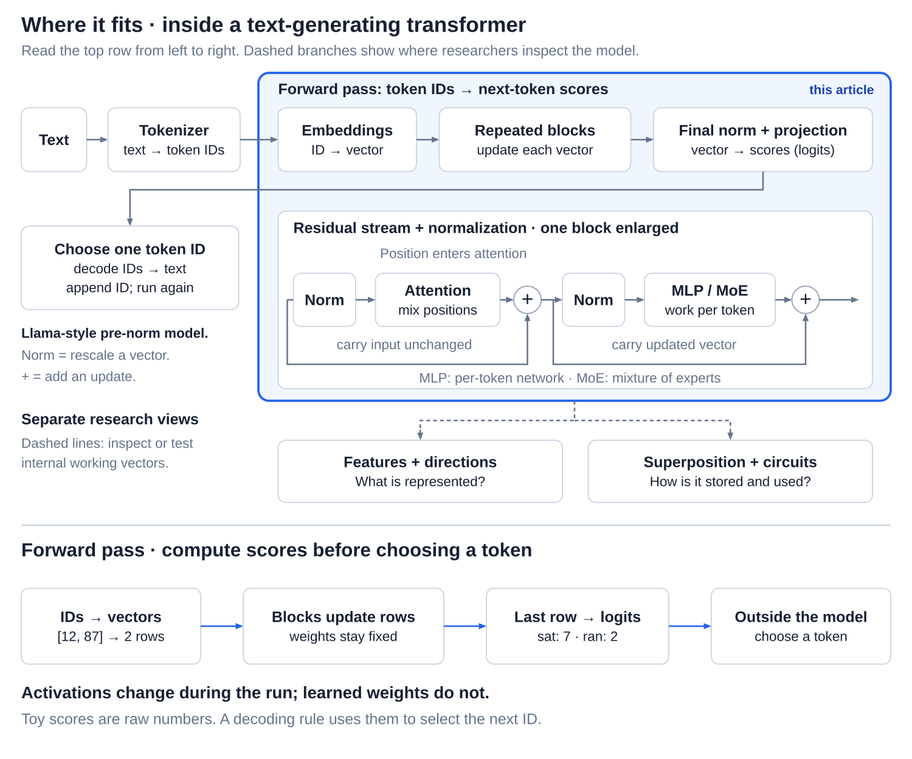
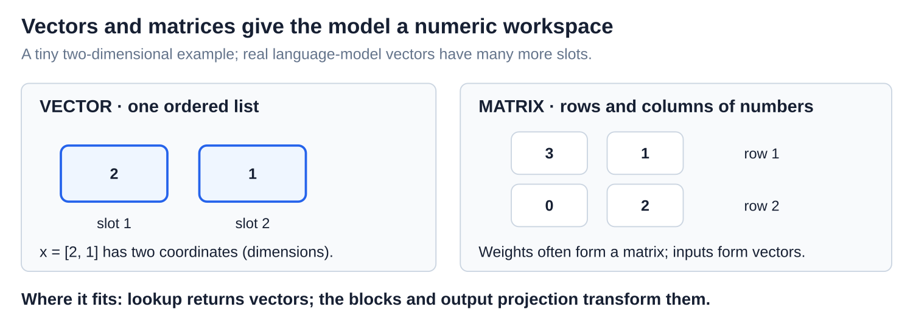
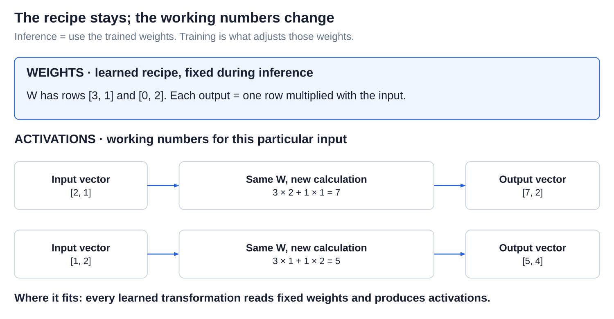
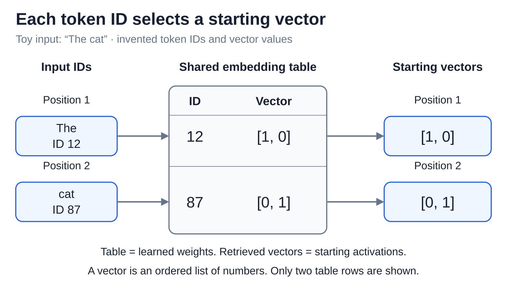
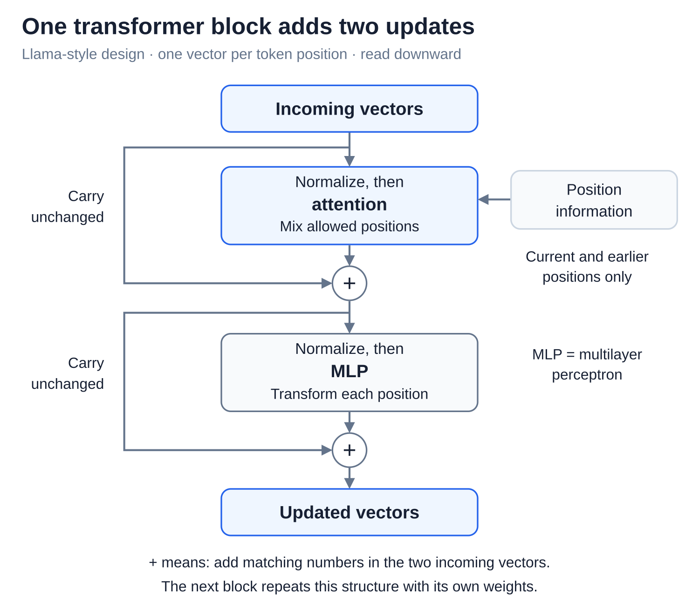
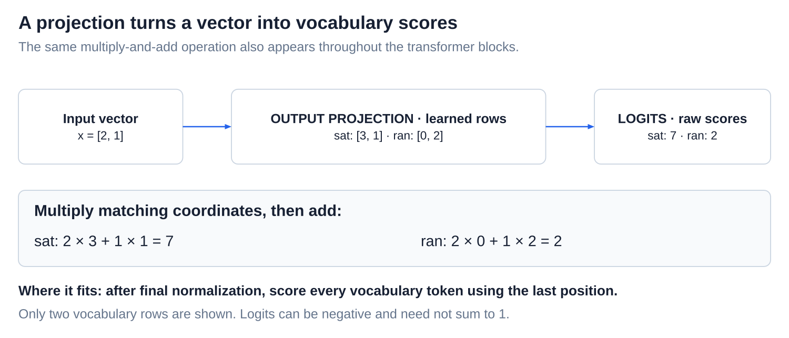
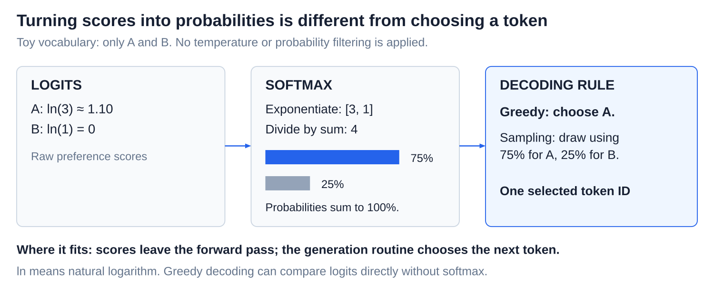

# Internals. The transformer forward pass

[Back to Artificial Intelligence](../Readme.md#content)

**A forward pass is the calculation a model runs on its input. To continue “The cat,” a text-generating transformer computes a score for each token that could come next. A separate rule uses those scores to choose one token.**

A **token** is a piece of text, such as a word, part of a word, or punctuation. Follow the two tokens in “The cat” through a small example of a Llama-style model. You can do the arithmetic with two numbers per token and see why the final scores depend on both words.

1. [What goes into one forward pass?](#1-what-goes-into-one-forward-pass)
2. [Which numbers stay fixed?](#2-which-numbers-stay-fixed)
3. [Look up a vector for each token](#3-look-up-a-vector-for-each-token)
4. [Update each position using context](#4-update-each-position-using-context)
5. [Score the possible next tokens](#5-score-the-possible-next-tokens)
6. [How does decoding choose the next token?](#6-how-does-decoding-choose-the-next-token)
7. [Check your understanding](#7-check-your-understanding)

## 1. What goes into one forward pass?

A **tokenizer** breaks the prompt into tokens and looks up each token’s ID, an integer in its **vocabulary**. Suppose “The cat” becomes the two IDs `[12, 87]`. These are the inputs to the model. In the top row of the map, follow them from **Embeddings** through **Repeated blocks** to **Final norm + projection**, where the scores leave the model.

The model looks up a list of numbers for each ID and updates those lists using the words seen so far. It can produce one score per vocabulary entry at every input position. Generation uses the scores at the last position to choose the next token. A high score for `sat` there means the model favors it as a continuation of “The cat.” The box labeled “Choose one token ID” sits outside the forward pass because choosing what to append is a separate operation.

## 2. Which numbers stay fixed?

A **vector** is an ordered list of numbers. In `[2, 1]`, the first number is 2 and the second is 1. Each entry is a **coordinate**. A **matrix** is a table of numbers. The matrix on the right has two rows, `[3, 1]` and `[0, 2]`.

When the model uses a learned matrix, the numbers in its rows are **weights**. Training sets these numbers. Using the trained model to generate text is called **inference**. During inference, the weights stay fixed. The numbers computed for the particular input are called **activations**. Read across each row of the next diagram to see what changes with the input.

1. For input `[2, 1]`, multiply matching coordinates of the first matrix row and the input, then add the products. That gives `3 × 2 + 1 × 1 = 7`. The second row gives `0 × 2 + 2 × 1 = 2`. Together the outputs are `[7, 2]`.
2. For input `[1, 2]`, the same rows give `3 × 1 + 1 × 2 = 5` and `0 × 1 + 2 × 2 = 4`. The output changes to `[5, 4]` while the matrix stays the same.

## 3. Look up a vector for each token

Read left to right. Each token ID selects a row from the model’s **embedding table**, which stores a learned starting vector for every vocabulary entry.

1. At the first position, `The` has ID `12`. Row 12 supplies `[1, 0]`.
2. At the second position, `cat` has ID `87`. Row 87 supplies `[0, 1]`.

The model now has two working vectors, one per position. Every occurrence of ID `87` starts from the same row. The next step is where the vector for `cat` can pick up information from `The`. These IDs and vectors are invented for the example. For scale, the original LLaMA 7B uses 4,096 coordinates per token.

## 4. Update each position using context

A **transformer block** takes one vector per position and returns an updated vector at each position. Read down to the two `+` signs. Before each update, **normalization** rescales the working numbers that go into that calculation.

1. **Attention mixes information across positions.** At `cat`, the model can draw on both `The` and `cat`. At `The`, it can use only `The`. This rule that blocks information from future positions is called the **causal mask**. Llama-style attention also uses position information to account for where the tokens occur. The first `+` adds the attention update to the incoming vector at each position.
2. **A neural network transforms each position’s vector.** Called a **multilayer perceptron (MLP)**, it operates separately at each position. At `cat`, it can now work with information that attention gathered from `The`. The second `+` adds the MLP’s update to the vector that came out of the first addition.

The side arrows carry the current vector straight to each addition. For example, if a position carries `[2, 1]` and an update is `[0, 3]`, the sum is `[2, 4]`. The vectors carried forward and updated this way form the **residual stream**. Each successive block repeats the same operations with its own weights. After the final block, there is still one vector per position.

## 5. Score the possible next tokens

To predict what comes after “The cat,” use the vector at `cat`, the last position. It can carry information from the entire prompt. Suppose that after the blocks and a final normalization this vector is `[2, 1]`. The diagram starts with that value so we can work out the scores by hand.

The model’s final **output projection** is a learned matrix with one row per vocabulary token. This example reuses the two toy rows from section 2. Apply the same multiply-and-add operation to each row.

1. The row for `sat` is `[3, 1]`, so its score is `2 × 3 + 1 × 1 = 7`.
2. The row for `ran` is `[0, 2]`, so its score is `2 × 0 + 1 × 2 = 2`.

These raw scores are called **logits**. They can be negative and need not add up to one. Here `sat` outranks `ran`. The other vocabulary rows also get scores, so these two rows alone cannot tell us which token ranks first overall. A high logit can favor a fluent continuation even when the resulting statement is false.

## 6. How does decoding choose the next token?

The scores are ready. A **decoding rule** now chooses the next token. The diagram uses a fresh example with just two possible tokens, A and B, so we can account for the entire probability distribution.

**Softmax** turns logits into probabilities. It raises the number `e` (about 2.718) to the power of each logit, then divides each result by the sum. In the diagram, A’s logit is `ln(3)`, the exponent that makes `e` raised to that power equal 3. B’s logit is zero, giving 1. Their sum is 4, so A gets `3/4 = 75%` and B gets `1/4 = 25%`.

1. **Greedy decoding** chooses A because it has the highest score. It can compare the logits directly since softmax preserves their order.
2. **Sampling** draws a token using the probabilities. In this example B can be selected even though A has the higher score.

Back in “The cat,” suppose decoding selects `sat`. Its ID is appended, and the model can now score what comes after “The cat sat.” Generation repeats until it meets a stopping condition, such as selecting an end-of-sequence token. For how the choice of decoding rule affects a reply, see [Inference. From logits to text with decoding and sampling](../Inference.%20From%20logits%20to%20text%20with%20decoding%20and%20sampling/Readme.md).

A **key–value (KV) cache** stores numbers that attention has already computed. When the model processes `sat`, it can reuse the stored keys and values for `The` and `cat`. Follow one token through this process in [Inference. Prefill and KV cache](../Inference.%20Prefill%20and%20KV%20cache/Readme.md).

## 7. Check your understanding

1. The model has finished a forward pass on “The cat,” but the application has not selected anything yet. What is available at the last position, and what still has to happen?

   

   
Answer

   There is one next-token score for every token in the vocabulary. A decoding rule still has to choose an ID before the application can append it to the prompt.

   

2. One run produces `[7, 2]` and another produces `[5, 4]` using the same matrix. What changed between runs, and what stayed fixed?

   

   
Answer

   The input changed from `[2, 1]` to `[1, 2]`, giving different activations. The learned rows `[3, 1]` and `[0, 2]` stayed fixed. Running a forward pass uses the weights without training them.

   

3. If ID `87` occurs twice in a prompt, what does each position receive during embedding lookup? What can make those vectors differ later?

   

   
Answer

   Both positions receive row 87, which is `[0, 1]` in this example. They remain separate positions. The blocks can later update them differently because each occurs at a different position and can draw on a different prefix.

   

4. Replace “The cat” with “The dog.” Can this change the first position’s vector inside a block? Which part of the block lets the second position use information from the first?

   

   
Answer

   No. The first position still sees only `The`. The causal mask prevents it from seeing the changed second token. Attention at the second position can use the first position’s information, and the MLP then works on that updated vector.

   

5. Suppose a third candidate, `slept`, has output row `[2, 2]`. With the final vector `[2, 1]`, what is its logit, and where does it rank among the three candidates?

   

   
Answer

   Its logit is `2 × 2 + 1 × 2 = 6`. It ranks below `sat` (7) and above `ran` (2). The value 6 is a score on the same scale as the other logits.

   

6. In the two-token example, B has a 25% probability. Which decoding rule could choose B, and how does that choice affect the next forward pass?

   

   
Answer

   Sampling can draw B. Greedy decoding would choose A because it ranks higher. If B is drawn and generation continues, B’s ID becomes the latest token, so the next pass scores continuations that follow B.

   

# Sources

- [Touvron et al. — LLaMA architecture and model sizes, §2.2 and Table 2](https://arxiv.org/html/2302.13971v1)
- [Meta — Llama 3 transformer blocks and forward pass](https://github.com/meta-llama/llama3/blob/main/llama/model.py)
- [Meta — How Llama 3 uses the last position’s scores to generate the next token](https://github.com/meta-llama/llama3/blob/a0940f9cf7065d45bb6675660f80d305c041a754/llama/generation.py#L179-L185)
- [Elhage et al. — A Mathematical Framework for Transformer Circuits, residual streams and attention](https://transformer-circuits.pub/2021/framework/index.html)
- [Vaswani et al. — Attention Is All You Need, transformer architecture and attention figures](https://arxiv.org/abs/1706.03762)
- [PyTorch — Embedding](https://docs.pytorch.org/docs/2.15/generated/torch.nn.Embedding.html), [Linear](https://docs.pytorch.org/docs/2.15/generated/torch.nn.Linear.html), and [Softmax](https://docs.pytorch.org/docs/2.15/generated/torch.nn.Softmax.html)
- [Hugging Face — Generation strategies](https://huggingface.co/docs/transformers/en/generation_strategies)
- [Hugging Face — How key–value caching works](https://huggingface.co/docs/transformers/en/cache_explanation)
