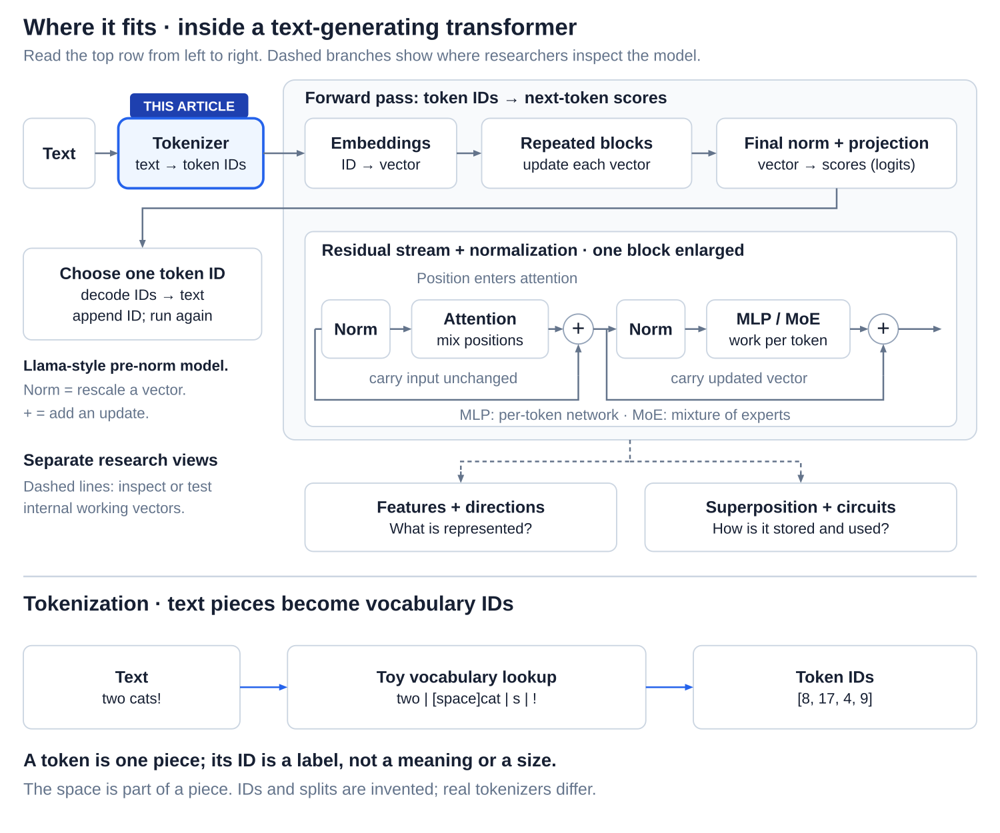
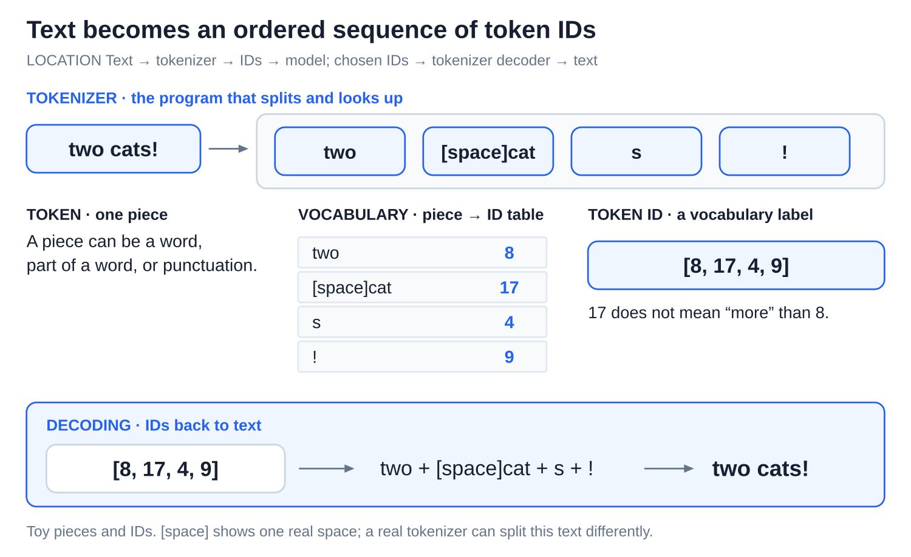
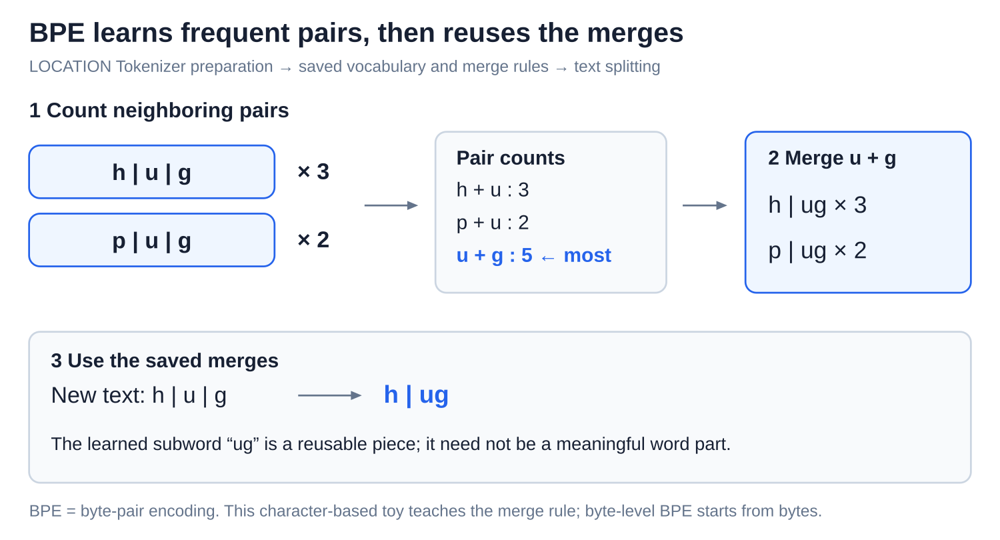
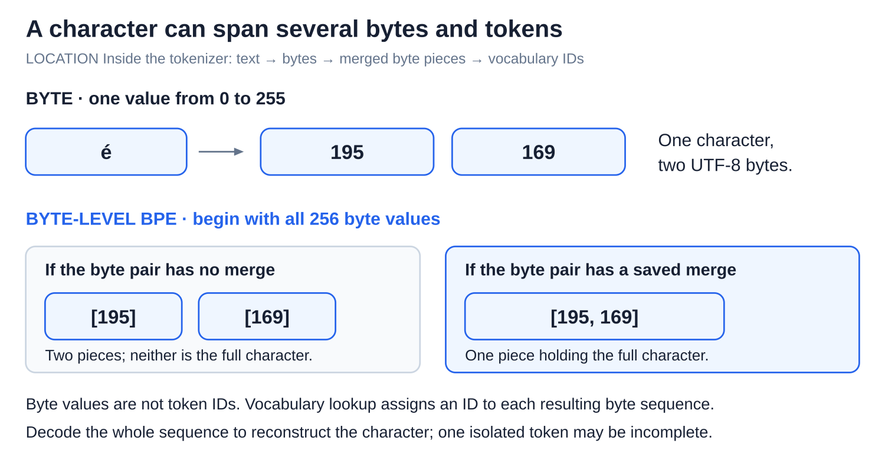
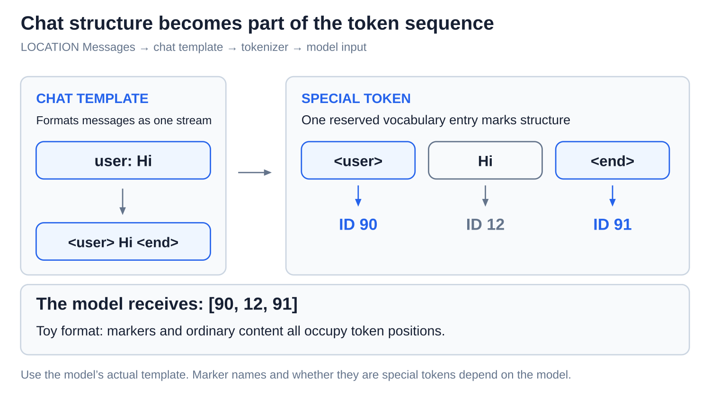
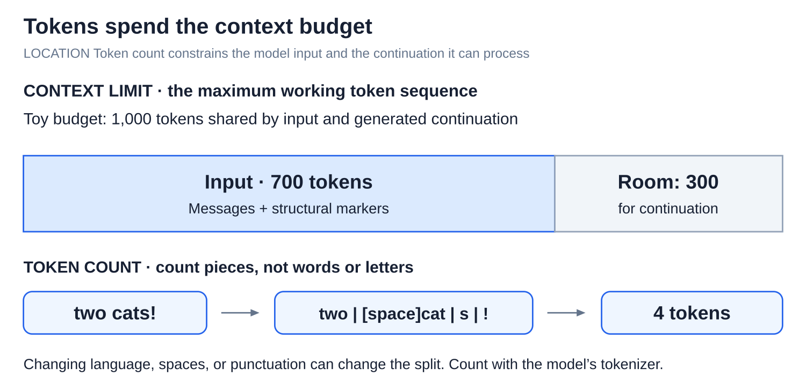

# Internals. Tokens and tokenization

[Back to Artificial Intelligence](../Readme.md#content)

**Tokenization** turns text into the ordered list of numbers a language model takes as input. The program that does this is a **tokenizer**. It breaks the text into pieces called **tokens** and looks up a numerical identifier, or **token ID**, for each piece.

Take `two cats!`. You see two words and an exclamation mark. A tokenizer might use four pieces, including one that holds both the space and the letters `cat`. Follow those four pieces into the model, then see how tokenizers learn pieces and why counting them matters.

1. [Where tokenization fits in a model response](#1-where-tokenization-fits-in-a-model-response)
2. [How pieces become IDs and turn back into text](#2-how-pieces-become-ids-and-turn-back-into-text)
3. [How byte-pair encoding learns a reusable piece](#3-how-byte-pair-encoding-learns-a-reusable-piece)
4. [Why one character can span two tokens](#4-why-one-character-can-span-two-tokens)
5. [How a chat marks who said what](#5-how-a-chat-marks-who-said-what)
6. [How to count tokens and leave room for a reply](#6-how-to-count-tokens-and-leave-room-for-a-reply)

## 1. Where tokenization fits in a model response

Follow the top row of the map from **Text** through **Tokenizer** to **Embeddings**. The tokenizer supplies one ID for each input piece. The model uses each ID to look up an **embedding**, a learned list of numbers that serves as the starting representation for that token.

The model then computes scores for possible next tokens. The generation software uses the scores to choose an ID and appends it to the sequence so the model can predict the next one. To display the reply, the tokenizer’s **decoder** turns the generated IDs back into text. For how the model computes those scores, see [Internals. The transformer forward pass](../Internals.%20The%20transformer%20forward%20pass/Readme.md).

## 2. How pieces become IDs and turn back into text

A **vocabulary** is the tokenizer’s table of pieces and their IDs. In the diagram, the four pieces and their numbers are invented so you can do the lookup yourself. The label `[space]` stands for one actual space.

1. **Split the input.** Our tokenizer divides `two cats!` into `two`, `[space]cat`, `s`, and `!`. The space belongs to the second piece.
2. **Look up the IDs.** The table gives 8, 17, 4, and 9, in that order. The result is `[8, 17, 4, 9]`. ID 17 identifies a row in this vocabulary. Its value says nothing about how important the piece is.
3. **Decode the sequence.** Look up the pieces for those four IDs and join them in order. The space at the start of the second piece puts the gap back into `two cats!`. Some tokenizers change the text before splitting it, for example by lowercasing it. In that case, decoding cannot recover the original capitalization from the IDs alone.

For a real example, the default GPT-2 tokenizer encodes `"Hello world"` as `[15496, 995]`. Add just one leading space, as in `" Hello world"`, and the result is `[18435, 995]`. The quotation marks show the text boundaries. Both inputs use two tokens, but the first ID changes.

## 3. How byte-pair encoding learns a reusable piece

**Byte-pair encoding (BPE)** builds a vocabulary by repeatedly merging frequent neighboring pieces in training text. To see one round, start with letters and count pairs *within* each word. In the diagram’s small training set, `hug` appears three times and `pug` appears twice.

1. **Count the pairs.** The pair `h + u` occurs three times and `p + u` occurs twice. Both words contain `u + g`, so that pair occurs five times.
2. **Save the most frequent merge.** Merge `u + g` into `ug` and add it to the vocabulary. Now `hug` consists of `h` and `ug`, and `pug` consists of `p` and `ug`. Later rounds can join these into longer pieces.
3. **Use the saved rules on new input.** If this is the only saved merge, every new occurrence of the word `hug` splits into `h` and `ug`. The tokenizer uses the rules it learned during training. Sending it a new message leaves those rules in place.

The piece `ug` is a **subword**, a reusable part of a word. Its repeated spelling is enough for BPE to learn it, even though it has no separate meaning in these words.

## 4. Why one character can span two tokens

The previous example started from letters. **Byte-level BPE** starts from bytes. A **byte** can hold any whole number from 0 to 255. **UTF-8** (8-bit Unicode Transformation Format) is a standard for writing text as a sequence of bytes. For example, the single character `é` shown here has two UTF-8 bytes, 195 followed by 169.

Compare the two possible ways to encode that character on its own. With no merge for those bytes, the tokenizer needs two tokens. If it has learned a merge for the pair, one token can hold both bytes. **195 and 169 are byte values**. The vocabulary assigns an ID to each resulting piece.

Starting with all 256 byte values lets the tokenizer represent unfamiliar text by falling back to smaller pieces. To recover `é` in the two-token case, decode the sequence together. Neither byte on its own forms that character.

## 5. How a chat marks who said what

A chat application knows which message came from the user and which came from the assistant. A **chat template** puts those roles and message boundaries into the sequence the model receives. A template can use a **special token**, a vocabulary entry reserved for a purpose such as marking the end of a message.

In the invented format above, a user sends `Hi`. The template adds a user marker before the content and an end marker after it. The resulting IDs are `[90, 12, 91]`. Only ID 12 represents the greeting, but all three IDs occupy positions in the input. Real models use their own templates. A role label may take several tokens.

To start a reply, some templates append a marker for the assistant’s turn after the last user message. In Hugging Face Transformers, `add_generation_prompt=True` asks the template to add that marker when the model uses one. Its tokens count as input because the model receives them before it generates its first reply token.

## 6. How to count tokens and leave room for a reply

The **context window** limits how many token positions a model can work with at once. In the diagram’s example, the input and the generated continuation share a 1,000-token allowance. The formatted input uses 700 tokens, including message markers, so at most 300 remain for the reply. A separate output limit could lower that number further.

To plan a request, format the messages with the model’s chat template and count the IDs with its tokenizer. Translations of the same sentence can take different numbers of tokens. Even a small change in spacing or punctuation can change the split.

If the formatted input alone exceeds the window, a service can reject the request. An application can make room before sending it by leaving out older messages or replacing them with a summary. For a worked example of how much space a summary frees, see [Inference. In-context learning, context windows, and memory](../Inference.%20In-context%20learning,%20context%20windows,%20and%20memory/Readme.md#7-how-does-a-summary-make-room).

Counting letters is a different task. In our toy example, the letters `c`, `a`, and `t` all sit inside the single `[space]cat` token. To spell the word or count its letters, you have to look *inside* the piece. Counting token positions tells you how much context the text occupies.

## Check your understanding

1. The tokenizer has finished encoding a prompt. What does it pass to the model, and what does the model look up first?

   

   
Answer

   **It passes an ordered sequence of token IDs.** The model uses each ID to look up that token’s embedding before it computes scores for the next token.

   

2. Our toy tokenizer gives `two cats!` the IDs `[8, 17, 4, 9]`. Must another model’s tokenizer give the same IDs for the same text?

   

   
Answer

   **No.** Another tokenizer can split the text differently or assign different IDs to the same pieces. Use the vocabulary paired with the model to interpret the numbers.

   

3. The training text contains three copies of `hug` and two of `pug`. Which pair does BPE merge first, and how would it split `pug` using only that rule?

   

   
Answer

   **It merges `u + g`, then splits `pug` into `p` and `ug`.** That pair appears five times, once in every word. By comparison, `h + u` appears three times and `p + u` appears twice.

   

4. A byte-level tokenizer represents the single character `é` with two tokens. Can you decode each token on its own and expect a complete character from each?

   

   
Answer

   **No.** In this example each token holds one of the character’s two UTF-8 bytes. Decoding them together in order recovers `é`.

   

5. The toy chat uses three input positions for a user message containing just `Hi`. What occupies them? If a template adds one more token to mark the assistant’s turn, does it count as input or output?

   

   
Answer

   The user marker, the greeting, and the end marker produce `[90, 12, 91]`. The extra assistant marker would occupy a fourth **input** position. It tells the model whose reply comes next.

   

6. A model has a shared 1,000-token window. Your formatted prompt uses 700 tokens, then you add 50 more input tokens. How much room remains for the reply?

   

   
Answer

   **At most 250 tokens.** The input now uses 750 of the 1,000 positions. The model may finish earlier or have a lower output limit.

   

# Sources

- [Hugging Face, Tokenizer vocabulary, IDs, and decoding](https://huggingface.co/docs/transformers/main_classes/tokenizer)
- [Hugging Face, GPT-2 tokenizer and leading spaces](https://huggingface.co/docs/transformers/model_doc/gpt2)
- [Hugging Face, Tokenizer components and normalization](https://huggingface.co/docs/tokenizers/components)
- [Hugging Face, Byte-pair encoding training and tokenization](https://huggingface.co/learn/llm-course/en/chapter6/5)
- [Hugging Face, Subword and byte-level tokenization algorithms](https://huggingface.co/docs/transformers/tokenizer_summary)
- [Unicode Consortium, UTF-8 and byte encodings](https://www.unicode.org/faq/utf_bom.html)
- [Hugging Face, Chat templates and control tokens](https://huggingface.co/docs/transformers/chat_templating)
- [Petrov et al., Language Model Tokenizers Introduce Unfairness Between Languages](https://arxiv.org/abs/2305.15425)
- [Hugging Face, Text generation and output length](https://huggingface.co/docs/transformers/llm_tutorial)
- [Anthropic, Context windows, compaction, and oversized input](https://platform.claude.com/docs/en/build-with-claude/context-windows)
- [Meta, Llama 3 reference implementation of the transformer](https://github.com/meta-llama/llama3/blob/main/llama/model.py)
