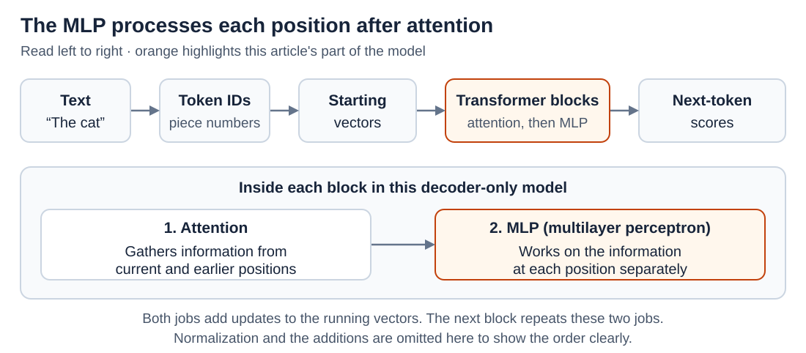
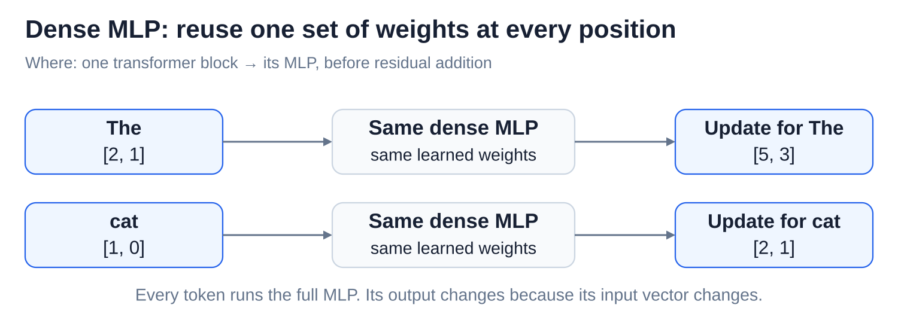
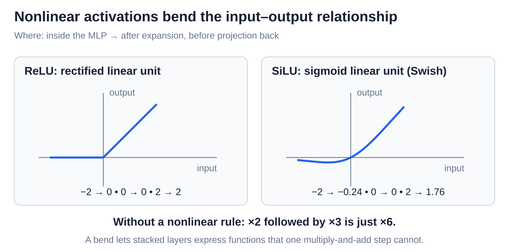
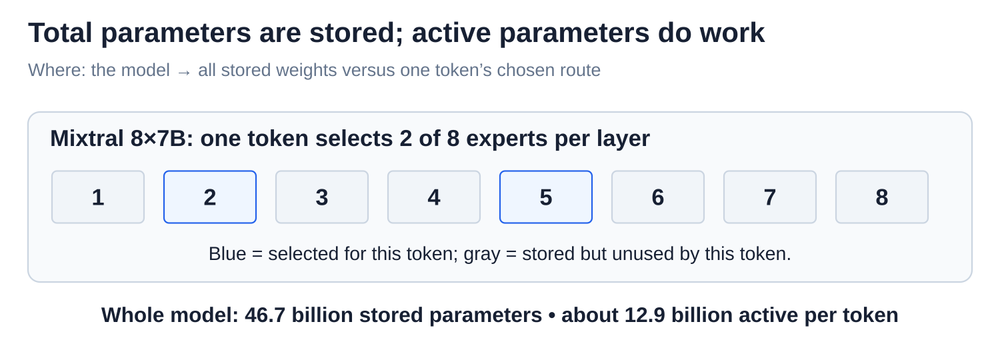

# MLPs, nonlinearities, and mixture of experts

[Back to Artificial Intelligence](../Readme.md#content)

**An MLP (multilayer perceptron) is the part of each transformer block that processes one token's vector on its own, after attention has gathered information from other tokens. A mixture of experts keeps several MLPs and lets each token use only a few of them.**

## Where this fits

Each token, a piece of text, has a vector: a list of numbers. Attention supplies context from other positions. The MLP transforms that vector and adds its result to the token's running information.

The upper map highlights this per-token computation. The lower panel compares a dense MLP with a few selected experts. [Attention](../Attention/Readme.md) covers how context reaches each position.

## What an MLP does

An MLP first **expands** each token vector into more slots, applies a nonlinear rule, then **projects back** to the original vector width. A **projection** uses learned weighted sums to make new coordinates. A **neuron** is one intermediate slot. Follow the circles; expansion adds slots, not tokens:

The invented example goes from 2 slots to 3 and back to 2. In a **dense** MLP, every token uses the same full computation within that block; different blocks have different weights. Each row below reuses those weights independently:

## Nonlinearity, ReLU, and SiLU

A **nonlinear activation** bends the input–output rule. **ReLU (rectified linear unit)** keeps positive numbers and replaces negative ones with zero. **SiLU (sigmoid linear unit)**, also called Swish, bends smoothly and can preserve small negative values. Each gets its own graph:

Why add the bend? Without it, multiplying by two and then three is just multiplying by six. More generally, stacked linear transformations collapse into one. A nonlinear rule lets depth express new kinds of functions.

## Gates and SwiGLU

A **gate** multiplies each content coordinate by a calculated control value. **SwiGLU** is a gated MLP design that uses SiLU on its gate branch. Two learned projections read the same input, then their outputs are multiplied coordinate by coordinate:

The example gate `[0.5, 2]` changes content `[2, 4]` to `[1, 8]`: one slot is halved and another doubled. These are illustrative values after SiLU. Gates are not restricted to on/off or to the range 0–1. The product is projected back to form the MLP update.

## Experts, routing, and a sparse mixture

A **sparse mixture of experts (MoE)** offers several MLPs, called **experts**, while a learned **router** chooses a few for each token. “Sparse” means only a subset runs. Follow the selected paths; the gray experts do no work for this token:

The example selects experts 1 and 3, with blend weights 75% and 25%. Another token may choose differently. An expert is an internal neural network, not a separate chatbot with an assigned specialty.

## Active versus total parameters

**Total parameters** count all stored weights. **Active parameters** count those used for one token. The diagram separates stored experts from the selected subset:

Mixtral 8×7B selects two of eight experts per layer: about 46.7 billion parameters are stored and 12.9 billion are active per token, including shared components. All experts still require storage; routing adds overhead, so memory and elapsed time do not shrink in the same proportion.

# Sources

- [Google: position-wise MLPs, §3.3](https://arxiv.org/html/1706.03762v7)
- [PyTorch: ReLU](https://docs.pytorch.org/docs/2.15/generated/torch.nn.ReLU.html) and [SiLU](https://docs.pytorch.org/docs/2.15/generated/torch.nn.SiLU.html)
- [Meta: Llama 3 gated feedforward implementation](https://github.com/meta-llama/llama3/blob/main/llama/model.py)
- [Google: GLU variants and SwiGLU equations](https://arxiv.org/html/2002.05202v1)
- [Mistral: expert-routing diagram, Figure 1](https://arxiv.org/html/2401.04088v1)
- [Mistral: total and active parameters](https://mistral.ai/news/mixtral-of-experts/)
- [Switch Transformers: sparse computation costs](https://arxiv.org/abs/2101.03961)
