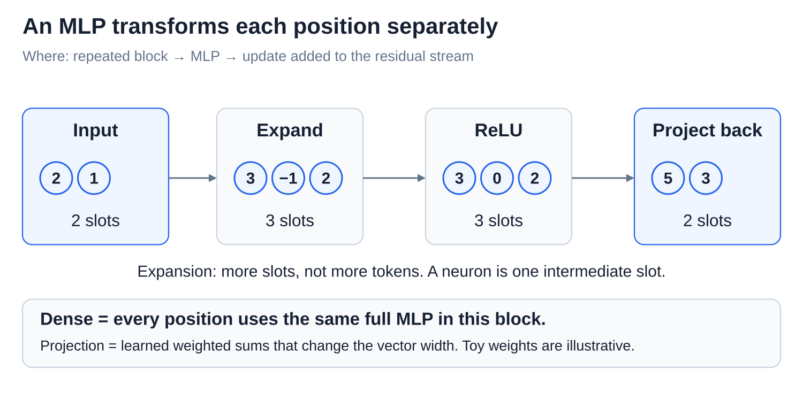
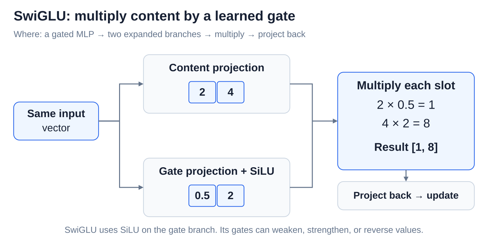
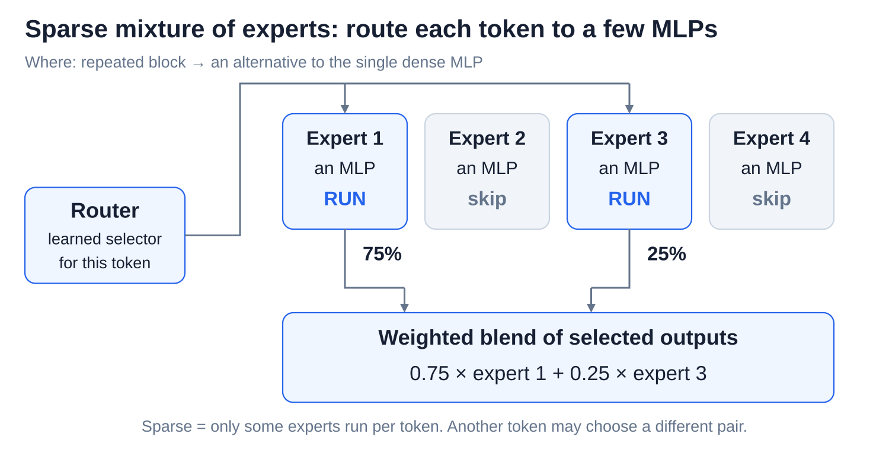

# MLPs, nonlinearities, and mixture of experts

[Back to Artificial Intelligence](../Readme.md#content)

**An MLP (multilayer perceptron) transforms the numbers at one token position. A sparse mixture of experts chooses which MLPs do that work.** We will unpack a small MLP, explain nonlinearities and gates, then follow expert routing.

## What an MLP does

A **vector** is an ordered list of numbers; each slot is a **coordinate**. Attention mixes information from different token positions. An MLP mixes coordinates within one position's vector. Its input already contains context gathered by attention.

In a **dense** transformer block, every position uses the same MLP weights. Different blocks have their own weights. In our pre-norm baseline, the MLP reads a normalized vector and produces an update that is added to the original residual vector.

An MLP typically expands the vector, applies a nonlinear rule, then projects it back to the residual width. **Expansion means more number slots, not more tokens.** A **projection** calculates new numbers using learned multipliers and sums, sometimes with added offsets.

## A small MLP with ReLU

This simplified example uses **ReLU (rectified linear unit)**: keep positive numbers and zero; replace negative numbers with zero. All numbers and projection recipes here are invented for teaching.

Start with `[2, −1]`. Our expansion copies those two numbers and adds their sum as a third: `2 + (−1) = 1`. That gives `[2, −1, 1]`.

ReLU gives `[2, 0, 1]`. Our final projection adds the first and third slots, then subtracts the third from the second: `2 + 1 = 3` and `0 − 1 = −1`. The update is **`[3, −1]`**, back to two slots.

Why include a **nonlinearity**? A chain containing only multiply-and-add projections can collapse into one such projection. For example, doubling and then tripling is just multiplying by six. ReLU changes its rule at zero, allowing behavior that one fixed multiply-and-add recipe cannot express. Adding depth can then build more complex transformations.

## Gated MLPs: scale individual coordinates

Llama-style models use **SwiGLU**, a gated linear unit with the smooth Swish activation. Swish is also called **SiLU (sigmoid linear unit)**. Unlike ReLU's sharp corner at zero, SiLU changes smoothly.

Two learned projections read the same input. One produces content numbers; the other passes through SiLU to produce **gate values**. Multiply matching coordinates, then project back to the residual width.

For two example coordinates, content `[2, 4]` and gate values `[0.5, 2]` give `[1, 8]`: half of 2 is 1; twice 4 is 8. These gate values are after SiLU. Gates can reduce or amplify values; they are not limited to 0 and 1. Both multiplied branches depend on the input, so their product is nonlinear.

## Sparse mixture of experts: choose the MLPs

A **sparse mixture of experts (MoE)** replaces an MLP with a collection of expert MLPs and a learned **router**. The router scores experts for the current token and selects a few. Each selected expert processes the same input vector; their outputs are combined using routing weights.

Our toy router selects two of four experts. Their outputs are `[4, 0]` and `[0, 4]`, with weights `0.75` and `0.25` that sum to 1 in this example. Take three quarters of the first output and one quarter of the second, then add matching slots: `[3, 0] + [0, 1] = [3, 1]`.

Other tokens can select different experts. These experts are neural networks, not separate chat agents with assigned jobs. Routing chooses networks; the gates inside a gated MLP scale coordinates.

## Total parameters versus active parameters

**Parameters** are learned numbers. Suppose each of four experts has 10 million parameters:

- **Total expert parameters:** `4 × 10 million = 40 million`.
- **Active expert parameters per token:** selecting two uses `2 × 10 million = 20 million`.

This counts only experts; the router and other model components add parameters too. A batch of tokens may collectively use all four experts. All expert weights still need storage, and routing and moving data add overhead. Fewer active parameters do not guarantee a proportional reduction in memory or response time.

# Sources

- [Transformer: position-wise MLPs](https://arxiv.org/html/1706.03762v7)
- [PyTorch: ReLU](https://docs.pytorch.org/docs/2.15/generated/torch.nn.ReLU.html) and [SiLU](https://docs.pytorch.org/docs/2.15/generated/torch.nn.SiLU.html)
- [LLaMA: pre-norm and SwiGLU](https://arxiv.org/html/2302.13971v1)
- [GLU variants: gated MLP equations](https://arxiv.org/html/2002.05202v1)
- [Mixtral: routing, active parameters, and memory](https://arxiv.org/html/2401.04088v1)
- [Switch Transformers: sparse computation and communication costs](https://arxiv.org/abs/2101.03961)
