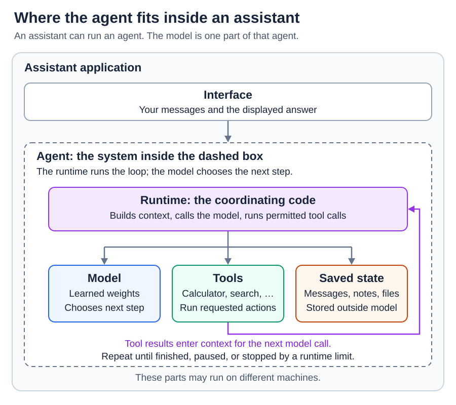
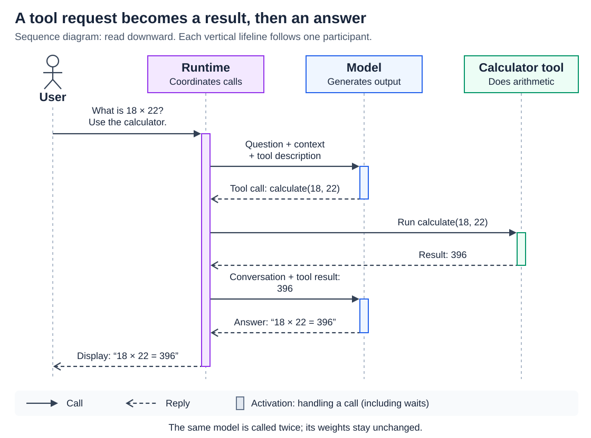

# Model, assistant, and agent: the system map

[Back to Artificial Intelligence](../Readme.md#content)

**The model generates responses.**

**The assistant is the application you interact with.**

**An agent uses a model to choose actions, inspect their results, and continue toward a goal.**

Start with these roles, then follow a small tool-assisted calculation.

## Three names, different roles

Here, **assistant** means the user-facing application. The terms overlap: an assistant can run an agent, and an agent can work without a chat window.

| Term | What it does | Example |
| --- | --- | --- |
| **Model** | Uses learned numerical parameters, called **weights**, and the supplied input to generate output. | Produces an answer or requests a calculator call. |
| **Assistant** | Receives your request and presents the system's response. Its application connects the model to instructions, conversation history, and available tools. | A chat application that can answer questions and use a calculator. |
| **Agent** | Lets the model choose what to do next, within limits set by the application, using feedback from earlier actions. | A coding agent that edits a file, runs tests, and uses a failure to decide its next edit. |

A **workflow** follows a path specified in code. An agent can choose its next action as the task develops. Both can use models and tools.

## What surrounds the model?

The **runtime** is the application code that coordinates the work. It prepares **context**: the input available to the model for this call, such as instructions, messages, tool descriptions, and relevant results. Running the model on that input is **inference**.

A **tool** is a callable capability, such as a calculator, file reader, or search service. A **tool call** is the model's request to use one. The runtime checks and dispatches that request; the tool performs the operation and returns a result.

In this map, the outer box groups the assistant's responsibilities. The model is one component. Arrows show which parts the runtime coordinates.

## A small example: who does the calculation?

Suppose you ask: **“What is 18 × 22? Use the calculator.”** Read the diagram from top to bottom. Each arrow is a message between components; time moves downward.

The model requests the calculation. The calculator returns `396`. The runtime supplies that result to the model, which generates the final answer for the assistant to display. The same model is called again with updated context; a new model is not trained for the second call.

This example shows one tool round trip. A longer agent task can repeat the action-and-feedback loop, choose another tool, ask you for information, or finish. The runtime can also stop the run when it reaches a time, cost, or action limit.

## Where does information live?

“The AI remembers” can refer to different things:

| Place | What it holds | What changes during ordinary use? |
| --- | --- | --- |
| **Model weights** | Patterns learned during training. | Normally stay fixed during inference. |
| **Current context** | Information supplied for this model call. | Can gain tool results or lose older material when the application shortens it. |
| **Saved state outside the model** | Stored messages, notes, files, or database records. | Can be read or changed by application code and permitted tools. Relevant information must enter context for the model to use it. |

Saving a note and learning new weights are different operations. A later reply can improve because its context contains better evidence, even though the weights are unchanged.

## Check your understanding

If a coding assistant says “the tests passed,” ask what supports that statement. A model-generated sentence is a claim; a matching test-tool result is evidence. The runtime must connect the result to the right request, and the answer must reflect it accurately.

When inspecting any AI application, locate four things: **the model, the context it receives, the code that runs tools, and the place that stores state.** Then ask who chooses the next action.

# Sources

- [Brown et al.: Language Models are Few-Shot Learners](https://arxiv.org/abs/2005.14165)
- [Anthropic: Building effective agents](https://www.anthropic.com/research/building-effective-agents)
- [OpenAI: Function calling](https://developers.openai.com/api/docs/guides/function-calling)
- [Anthropic: Effective context engineering for AI agents](https://www.anthropic.com/research/effective-context-engineering-for-ai-agents)
