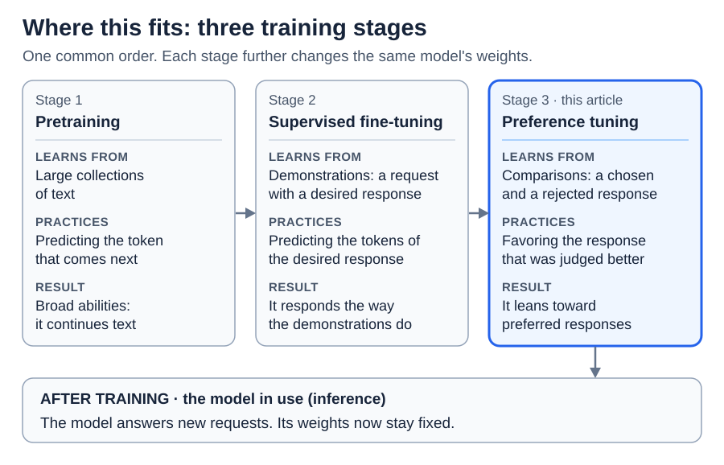
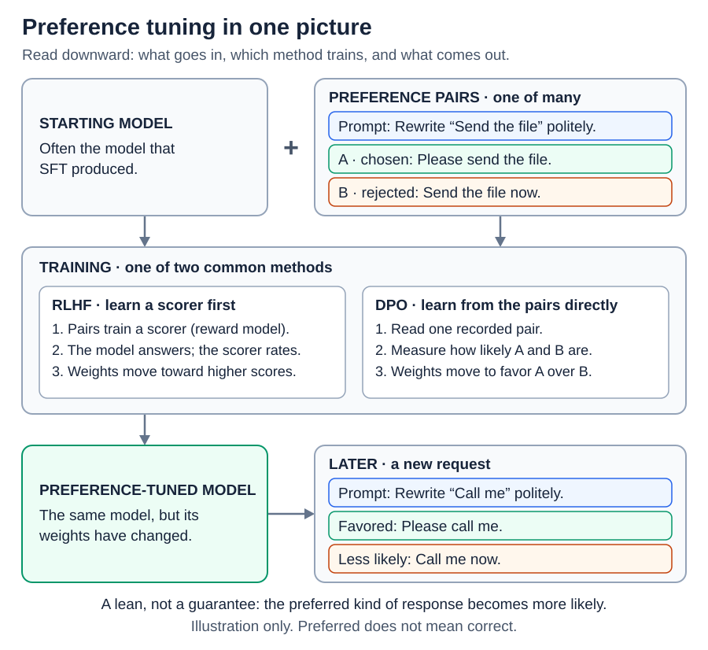
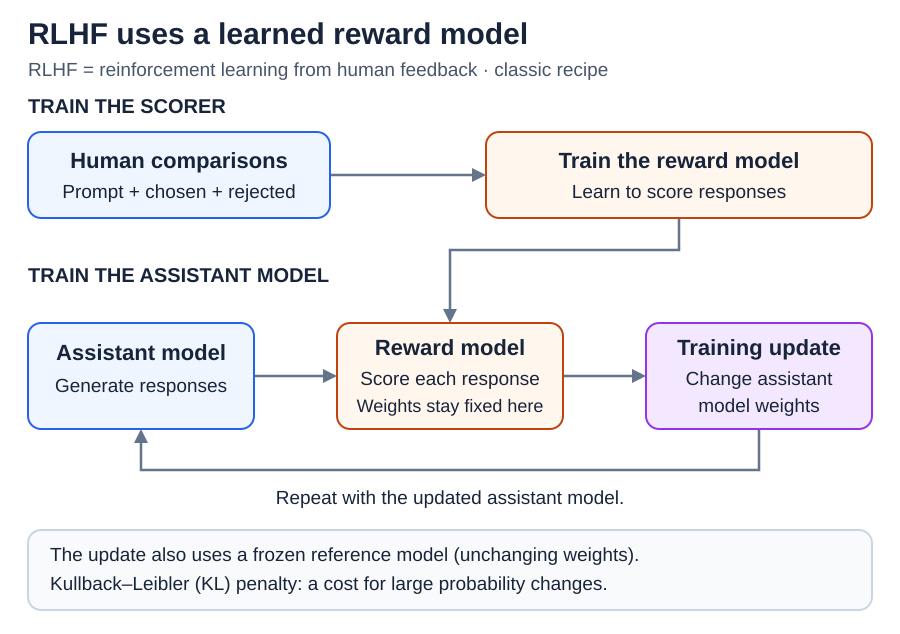
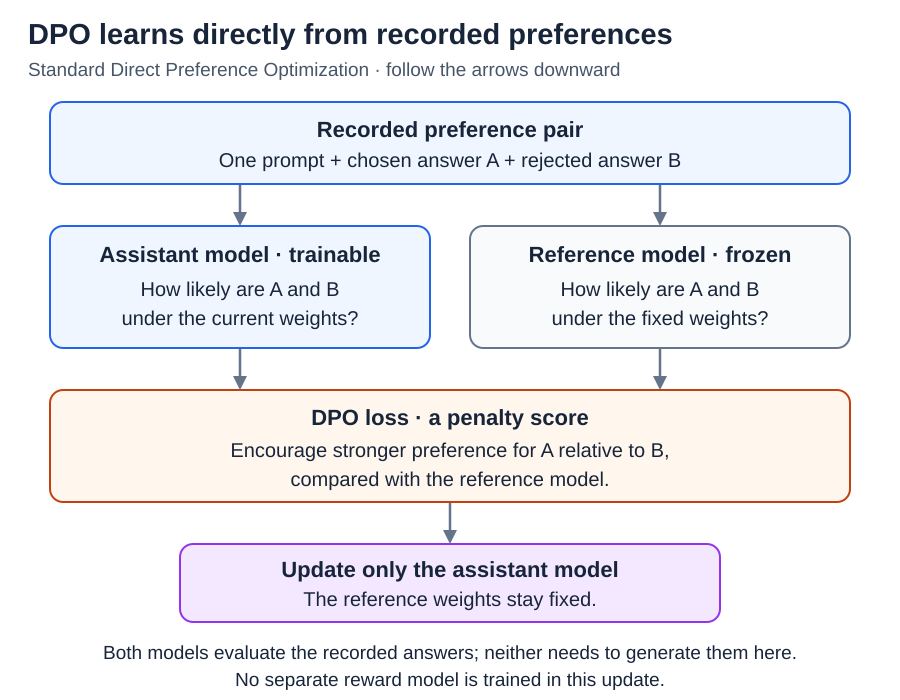

# Training: Preference tuning - RLHF and DPO

[Back to Artificial Intelligence](../Readme.md#content)

**Preference tuning further trains a model on judgments about which of two responses is better. It changes the model's learned numerical settings, or weights, so that it favors the kind of response people preferred.**

**Reinforcement learning from human feedback (RLHF)** and **Direct Preference Optimization (DPO)** are two ways to do this. Start with where this stage sits, then see the whole process, then zoom in on each method.

## Where this fits

[Supervised fine-tuning](../Supervised%20fine-tuning/Readme.md) (SFT) teaches a model to respond like a demonstration. But a demonstration shows only one good response. A comparison adds what it cannot: which of two responses is better.

Read the three stages from left to right. The stage marked “this article” is preference tuning. Compare the rows: the stages differ in what they learn from and what they practice. This order is common, not mandatory.

## The whole process in one picture

A **preference pair** records one prompt with two responses: the **chosen** one and the **rejected** one.

Read downward. A starting model and the pairs go in. Training uses one of two methods, RLHF or DPO. What comes out is the same model with changed weights. The “LATER” box shows the effect: for a new request, the preferred kind of response becomes more likely. That is a lean, not a guarantee.

“Chosen” means preferred in this comparison. It does not mean perfect, and “rejected” does not mean false. The judgment depends on the request and the rating rules, and people can disagree.

## RLHF: learn a scorer, then improve the model

RLHF guides learning through rewards. The classic recipe uses a separate **reward model**: a model that reads a prompt and a response and outputs a score.

Read the two labeled rows. In “TRAIN THE SCORER,” comparisons teach the reward model to score preferred responses higher. In “TRAIN THE ASSISTANT MODEL,” the model generates responses, the scorer rates them, and an update moves the weights toward higher scores. **Proximal Policy Optimization (PPO)** is one algorithm for these updates. People supply the comparisons; the reward model rates the newly generated responses.

The recipe also penalizes moving too far from a **reference model**, a frozen copy of the starting model: its weights do not update. This **Kullback–Leibler (KL) penalty** says: seek better scores, but pay a cost for large changes.

## DPO: learn directly from the pairs

DPO skips the scorer. Standard DPO needs neither a separate reward model nor newly generated responses.

Follow the arrows downward. The trainable model and a frozen reference model each measure how likely the recorded responses A and B are. The **loss**, a penalty score, pushes the trainable model to favor A over B more strongly than the reference does. Only the trainable model changes.

The comparison is relative. A need not become more likely; B can become less likely instead. And DPO uses both responses: discarding B and doing SFT on A is a different objective.

## Preference is not proof of truth

A reward score is a learned rating, not a probability of truth: a score of `8` does not mean “80% correct.” People and learned scorers can prefer convincing wording, or agreement with the user, over a correct answer.

**Reward overoptimization** means pushing a learned score so hard that real quality gets worse: the model finds weaknesses in the scorer. DPO removes the scorer, not the mistakes and biases in the preference data.

Check the trained model on requests kept out of training, for correctness and task success as well as preference. After training, inference uses fixed weights: no human judge or reward model rates each answer.

## Check your understanding

If response A wins a comparison, must it be factually correct? **No.** The label says only that A was preferred to B; both could contain mistakes.

Does RLHF need a person to rate every response during training? **No.** People supply comparisons; the reward model scores the rest.

# Sources

- [Ouyang et al.: RLHF in InstructGPT, §§3 and 5](https://arxiv.org/html/2203.02155v1)
- [Rafailov et al.: Direct Preference Optimization, §§3–4](https://arxiv.org/html/2305.18290v3)
- [Hugging Face: DPO data and training objective](https://huggingface.co/docs/trl/dpo_trainer)
- [Gao et al.: Reward model overoptimization](https://arxiv.org/abs/2210.10760)
- [Sharma et al.: Preference judgments and sycophancy](https://arxiv.org/abs/2310.13548)
