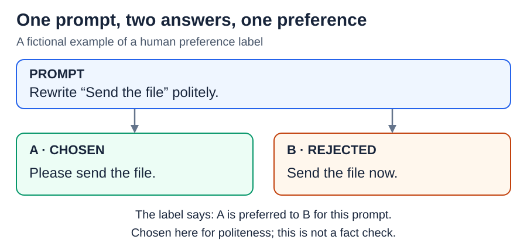
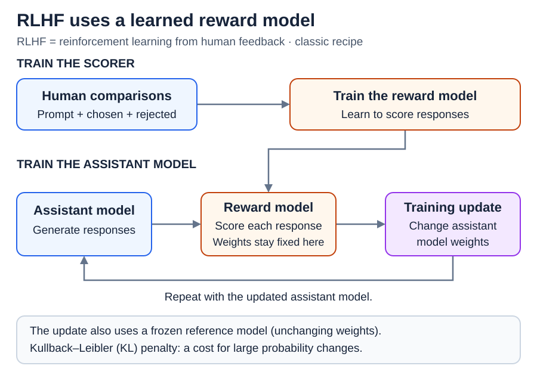
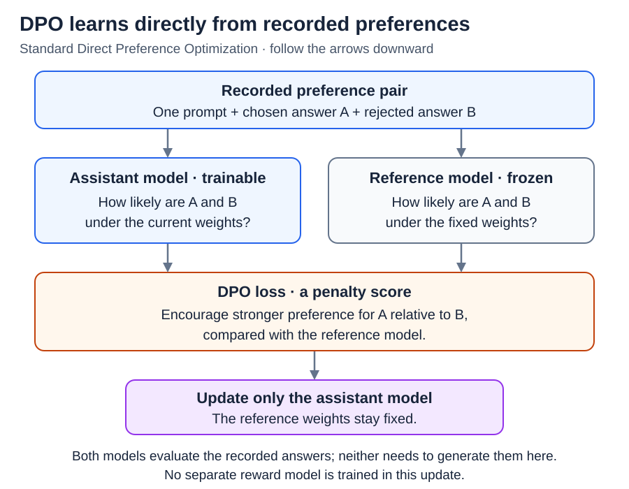

# Preference tuning: RLHF and DPO

[Back to Artificial Intelligence](../Readme.md#content)

**Preference tuning changes a model's learned numerical settings, or weights, using judgments about which responses are better.**

**Reinforcement learning from human feedback (RLHF)** and **Direct Preference Optimization (DPO)** are two ways to use these judgments.

Start with one comparison, then follow how each method turns comparisons into training.

## A preference compares answers to the same request

**Supervised fine-tuning (SFT)** teaches from a desired response. Preference tuning often follows SFT. Preference data instead records a prompt, a **chosen** response, and a **rejected** response.

Here, a person prefers A because it better follows the request for polite wording.

“Chosen” means preferred in this comparison. It does not mean perfect, and “rejected” does not necessarily mean false. The judgment depends on the request and the evaluation rules. Different people can disagree.

## RLHF: learn a scorer, then improve the assistant

**Reinforcement learning from human feedback (RLHF)** uses human judgments to guide learning through rewards. Here we use the classic recipe with a separate **reward model**: a model that reads a prompt and response and outputs a numerical score.

First, comparisons train that scorer to give preferred responses higher scores. Then the assistant model generates responses, the scorer rates them, and a reinforcement-learning algorithm adjusts its weights to seek higher rewards. The diagram separates training the scorer from using it.

**Proximal Policy Optimization (PPO)** is one algorithm used for these updates; RLHF does not require that particular algorithm. The assistant model being trained is also called the **policy**: the model that decides which tokens to generate.

The classic recipe also penalizes moving too far from a **reference model**, a frozen copy of the starting assistant model. This **Kullback–Leibler (KL) penalty** measures changes in the model's chances of producing responses. Think: “seek better scores, but keep a cost on large changes.” Frozen means its weights do not update.

Humans provide training comparisons; they do not need to rate every newly generated training response. The reward model supplies those scores.

## DPO: learn directly from the paired responses

**Direct Preference Optimization (DPO)** updates the assistant model using the chosen and rejected responses directly. Standard DPO needs neither a separately trained reward model nor fresh answer generation during each update.

It reads the recorded pair and measures how likely each response is under the trainable model and a frozen reference model. Its **loss**, or penalty score, encourages the trainable model to favor the chosen response more strongly relative to the rejected one, compared with the reference.

The diagram shows which model changes and which stays fixed. Both evaluate the same recorded answers.

For intuition, suppose the reference makes A and B equally likely. Making A twice as likely as B moves in the preferred direction. This compares A with B; it does not promise that A's own probability always increases. B could become less likely instead.

DPO still uses both answers. Simply discarding B and doing ordinary SFT on A is a different objective.

## Preference is not proof of truth

A reward score is a learned rating, not a probability that an answer is true. For example, a score of `8` does not mean “80% correct.” People and learned scorers can prefer convincing wording or agreement with the user over a correct answer.

**Reward overoptimization** means pushing a learned score so hard that actual answer quality gets worse: the model finds weaknesses in the scorer. Removing the separate scorer with DPO does not remove mistakes or biases in the preference data.

Evaluate on requests kept out of training, checking correctness and task success as well as preference. Better training scores alone are not enough.

Both methods change weights during training. Ordinary inference uses the resulting model with fixed weights; neither method requires a human judge or reward model to produce every answer.

## Check your understanding

If answer A wins a preference comparison, must it be factually correct? **No.** The label says A was preferred to B under that judgment; both could contain mistakes.

# Sources

- [Ouyang et al.: RLHF in InstructGPT, §§3 and 5](https://arxiv.org/html/2203.02155v1)
- [Rafailov et al.: Direct Preference Optimization, §§3–4](https://arxiv.org/html/2305.18290v3)
- [Hugging Face: DPO data and training objective](https://huggingface.co/docs/trl/dpo_trainer)
- [Gao et al.: Reward model overoptimization](https://arxiv.org/abs/2210.10760)
- [Sharma et al.: Preference judgments and sycophancy](https://arxiv.org/abs/2310.13548)
