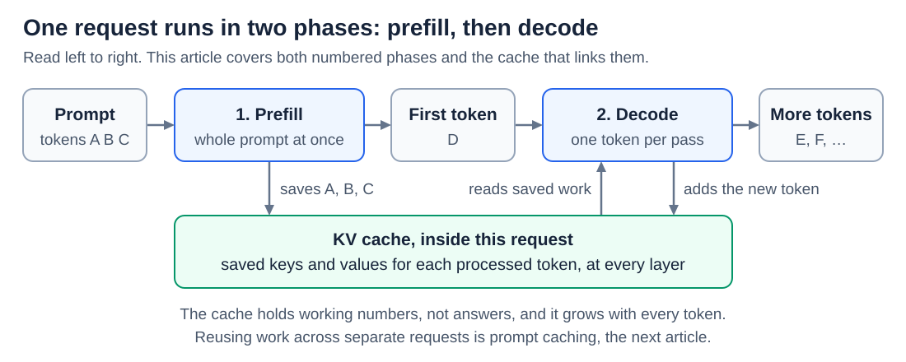
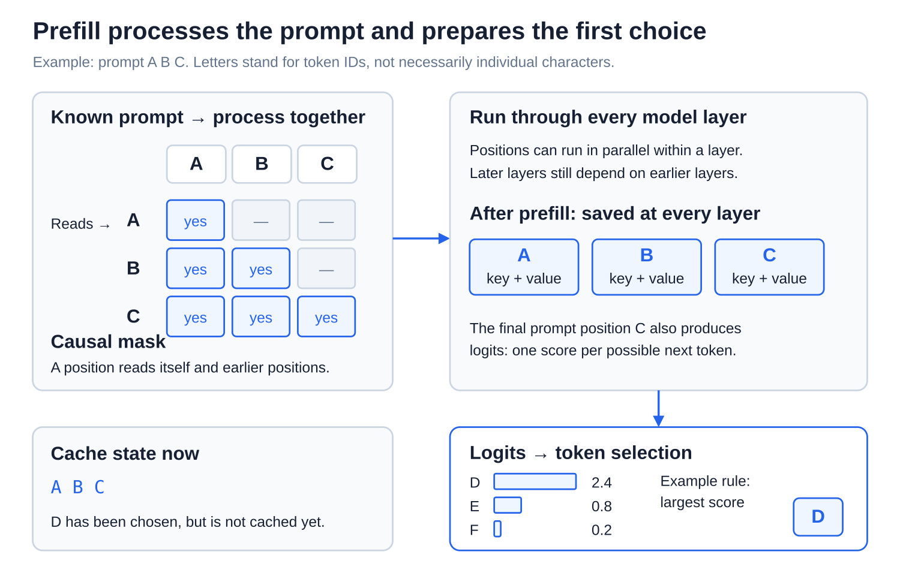
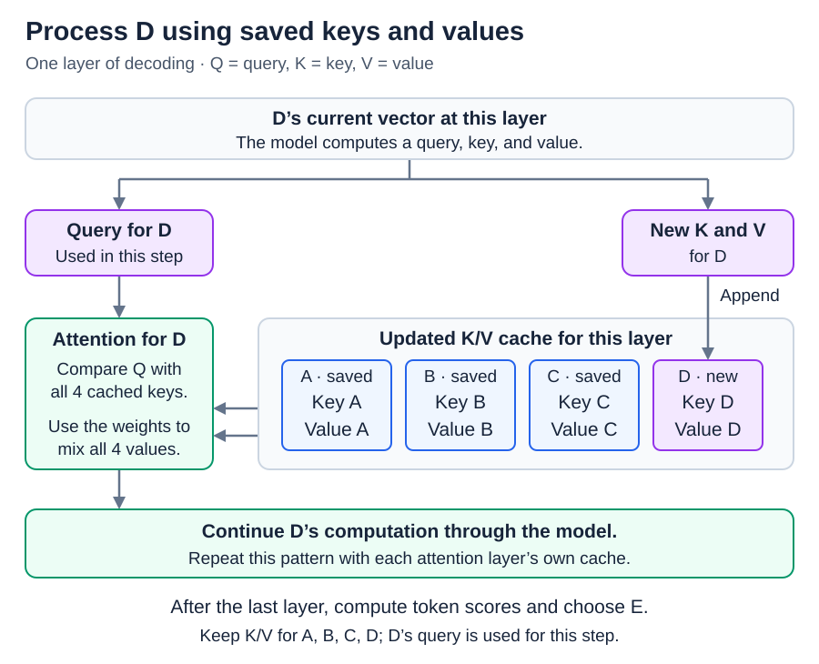

# Inference: Prefill, decoding, and the KV cache

[Back to Artificial Intelligence](../Readme.md#content)

**A model answers a prompt in two phases. Prefill reads the whole prompt at once; decoding then writes the reply one token at a time. The key-value (KV) cache saves work from earlier tokens, so each new token does not repeat it.**

## Where this fits

[The transformer forward pass](../The%20transformer%20forward%20pass/Readme.md) described one run of the model. A real request needs many runs, and they fall into two phases:

Read the top row from left to right. One request starts with a prompt, here the tokens `A B C`. **Prefill** runs the whole prompt through the model and produces the first new token, `D`. **Decoding** then runs the model once per new token, using a choosing rule from [From logits to text: decoding and sampling](../Decoding%20and%20sampling/Readme.md). The box below both phases is the KV cache: prefill fills it, and each decoding step reads it and adds the new token.

## What the cache holds

In [Attention: queries, keys, values, and heads](../Attention/Readme.md), every position makes a query, a key, and a value. A new token's query is compared with the keys of all earlier tokens, and their values are blended. In a model that writes left to right, earlier tokens never look at later ones, so their keys and values never change once they are computed.

The **KV cache** stores those keys and values, separately for each attention layer, so they need not be recomputed for every new token. Old queries are not kept, because only the newest token's query does the comparing. It holds working numbers for this request, not a finished answer, and it does not change the model's weights.

## Step 1 — Prefill the prompt

Read the diagram from top to bottom. The whole prompt `A B C` is processed together, layer by layer, while the causal mask still keeps each token from reading later ones. Two things come out. Every layer's cache now holds keys and values for `A`, `B`, and `C`, and the last position, `C`, produces the scores that choose `D`. The bottom box notes that `D` is chosen but not yet in the cache.

## Step 2 — Decode with saved work

To get the next token, only `D` goes through the model. At each layer, `D` computes its own query, key, and value. Its key and value are added to the cache, and its query is compared with all four saved keys, `A` to `D`. After the last layer, the scores choose `E`, and the cycle repeats.

Each step needs the token chosen in the step before, so decoding is one step after another. The cache does not change that; it removes the repeated work for the earlier tokens.

## The cache grows with every token

The cache holds an entry for every token at every layer, so it grows as the text gets longer and with every request served at the same time. The amounts are real: NVIDIA estimates about 2 GB of cache for one 4,096-token sequence in Llama 2 7B, beside about 14 GB for the model's weights. Serving systems therefore manage cache memory carefully, for example by keeping only recent tokens in some layers or storing the numbers with less precision.

The cache also does not make long text free. Each new token's query still has to read every saved key and value.

## Why the first token takes longer

Two waits describe how fast a reply feels:

- **Time to first token (TTFT):** from sending the request until the first output token arrives. It includes prefill, so a long prompt usually means a longer wait, plus any time spent queueing or on the network.
- **Inter-token latency:** the time between later tokens. Each decoding step is usually limited by how fast the model's weights and the cache can be read from memory.

This is why a reply can pause before it starts and then stream at a steady pace. Reusing work across separate requests is a different technique, covered in [Prompt caching across requests](../Prompt%20caching%20across%20requests/Readme.md).

# Sources

- [Hugging Face: how caching works](https://huggingface.co/docs/transformers/en/cache_explanation)
- [NVIDIA: prefill, decoding, and cache memory](https://developer.nvidia.com/blog/mastering-llm-techniques-inference-optimization/)
- [Meta: Llama 3 attention and layer computations](https://github.com/meta-llama/llama3/blob/main/llama/model.py)
- [Hugging Face: cache strategies and trade-offs](https://huggingface.co/docs/transformers/en/kv_cache)
- [NVIDIA: first-token and inter-token latency](https://developer.nvidia.com/blog/llm-benchmarking-fundamental-concepts/)
