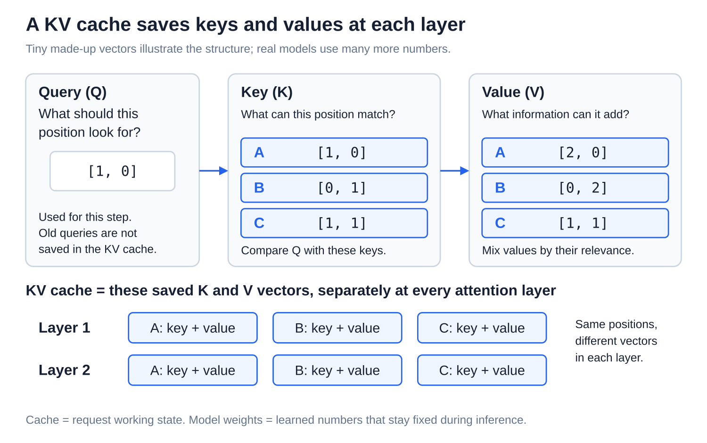
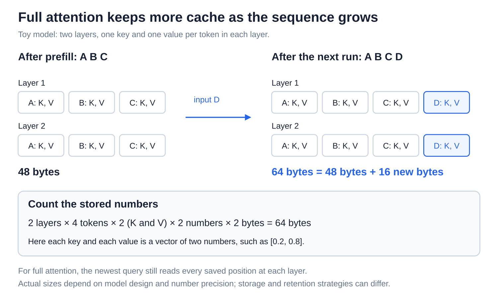
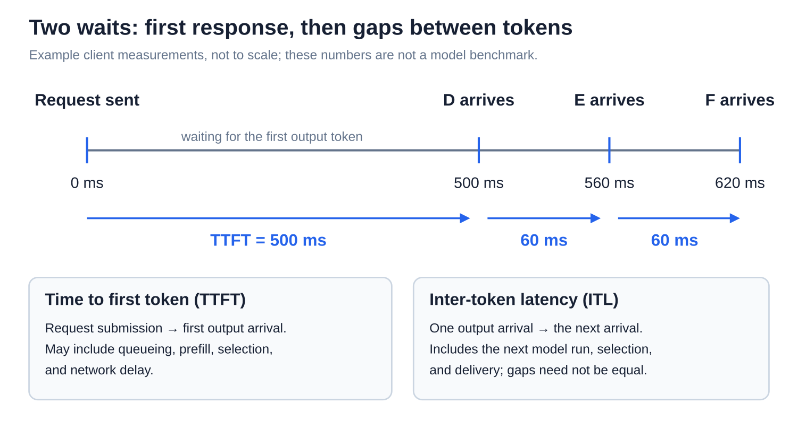

# Inference: Prefill, decoding, and the KV cache

[Back to Artificial Intelligence](../Readme.md#content)

**Prefill processes the prompt; decoding repeatedly processes newly selected tokens. A key-value (KV) cache saves earlier tokens’ keys and values so those tokens need not run through the model again.** This article follows ordinary token-by-token generation with full attention.

## Where this fits

The shared map highlights **model execution**. Follow the arrows from context assembly through model computation and token selection. The lower example shows when each token’s keys and values enter the cache.

## What the cache holds

A **token** is a text piece or special marker represented by an ID. **Attention** mixes information from positions using vectors, which are lists of numbers. A **query (Q)** describes what a position looks for; a **key (K)** describes what another position can match; a **value (V)** supplies its information. Query–key matches determine how values are mixed.

Read the three panels, then the rows beneath them. The **KV cache** saves keys and values separately for every attention layer. Old queries are not needed for the next token's attention. The cache holds this request's working results, not a finished answer or learned model weights.

In **causal attention**, a position reads only itself and earlier positions. With the same model, preceding context, and position assignments, adding later tokens does not change those earlier keys and values. The next diagram makes that rule visible. [Attention](../Attention/Readme.md) explains the matching calculation in more depth.

## Step 1 — Prefill the prompt

**Prefill** processes the known prompt `A B C`, layer by layer. Positions can run in parallel within a layer, while the triangular **causal mask** blocks reads of future positions. Letters here stand for token IDs.

Every layer caches keys and values for `A B C`. The final prompt position produces **logits**, one score per possible next token. A separate selection rule chooses `D`. **Choosing D does not cache D:** it has not entered a model run yet.

## Step 2 — Decode with saved work

The **decoding phase** processes the newly selected token `D`. At each layer, compute its Q, K, and V; append its K and V to that layer's cache; then let its query read the keys and values for `A B C D`. After all layers, new logits select `E`, which enters the following run.

Model decoding here means repeated model execution. A *decoding strategy* can instead mean the rule for selecting tokens from scores. Each ordinary step depends on the previous choice; caching removes repeated work for old tokens, not this dependency.

## Cache size and remaining work

**Full attention** means each new position can read every available earlier position, as well as itself. Its cache keeps growing as processed tokens accumulate.

Follow the two layer rows: processing `D` adds its key and value at both layers. The tiny example grows from 48 to 64 bytes. Real sizes also depend on model design, number precision, and how many sequences are served. Each new query still reads the saved keys and values.

This is the full-attention baseline. Some models retain only recent positions in particular layers; some systems reserve cache memory in advance. Logical cache contents and physically allocated memory therefore need not grow identically.

## First-token wait and later gaps

**Time to first token (TTFT)** is the wait from submitting a request to receiving its first output token. **Inter-token latency (ITL)** is the gap between subsequent output-token arrivals.

Read the event ticks: first `D`, then `E`, then `F`. TTFT can include queueing, prefill, selection, and network delay. Later gaps include the next model run and delivery; they need not be equal. [Prompt caching across requests](../Prompt%20caching%20across%20requests/Readme.md) explains how a later request can reuse prompt work.

# Sources

- [Hugging Face: how KV caching works](https://huggingface.co/docs/transformers/en/cache_explanation)
- [NVIDIA: inference phases and KV-cache illustration](https://developer.nvidia.com/blog/mastering-llm-techniques-inference-optimization/)
- [Hugging Face: cache strategies](https://huggingface.co/docs/transformers/en/kv_cache)
- [NVIDIA: latency definitions and timeline illustration](https://developer.nvidia.com/blog/llm-benchmarking-fundamental-concepts/)
