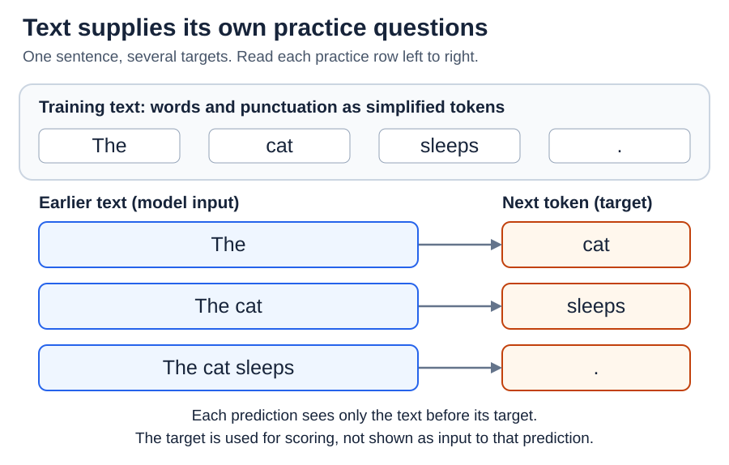
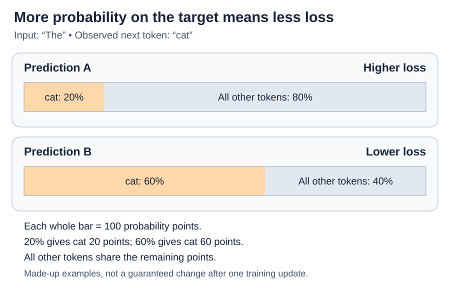

# Training: Pretraining - learning from next-token prediction

[Back to Artificial Intelligence](../Readme.md#content)

**Pretraining develops a model's broad starting abilities from large datasets. In next-token pretraining, the exercise is: “Given the text so far, what comes next?”** The text supplies the answers. Start with that exercise, then see how its score helps change the model.

## The text supplies its own answers

A **token** is a piece of text the model processes: a word, part of a word, or punctuation. A **target** is the token that actually comes next in a training example.

Imagine the sentence `The cat sleeps.` For this illustration, treat each word and the full stop as one token. The same sentence supplies several practice questions. Each row below shows the earlier text available to a prediction and the target used to score it.

The prediction cannot look ahead at its target or later tokens. A **causal mask** enforces this rule inside the model. During training, the earlier text comes from the recorded example, not from the model's own guesses.

This is **self-supervised learning**: the data provides the targets, so a person does not need to label every prediction. People still choose and prepare the data.

## How a prediction gets scored

The model assigns probabilities to possible next tokens. Think of sharing **100 probability points** among all the choices. Giving `cat` **20%** means giving it 20 of those points; all the other tokens together receive 80.

A **loss** is a penalty score. The usual next-token loss, called **cross-entropy**, gives a smaller penalty when the model assigns more probability to the observed target. Compare these two made-up predictions for the same example; they are not a promised before-and-after training result.

The target `cat` gets 60 points in B instead of 20 in A, so B has the lower loss. Training scores the target's probability; it need not first pick a word and mark it simply right or wrong.

Losses from many predictions are combined. **Backpropagation** calculates how changes to the model's numerical settings, its **weights**, would affect that loss. An **optimizer** adjusts the weights to try to reduce it. Repeating this across many examples is the learning process.

## Why this can teach more than sentence completion

Predicting text can benefit from patterns in grammar, facts, relationships, and code. For example, predicting a character's next action may depend on earlier events in a story. These patterns can help on other tasks: pretrained models have demonstrated abilities such as translation, question answering, and some arithmetic.

**Generalization** means using learned patterns on new examples. **Memorization** means retaining particular training passages, sometimes well enough to reproduce them. Both can occur. To check generalization, evaluate on examples kept out of training and check for copied or near-duplicate material across the two sets.

The objective is to predict the recorded continuation. That continuation may be a fact, a mistake, fiction, or an opinion. A likely continuation is therefore not a guarantee of truth.

## The training material matters

- **Mixture:** the amounts of different languages, books, code, and other material influence what the model gets to practice. Qwen3, for example, increased the share of science, mathematics, and code in a later pretraining stage.
- **Quality:** filtering and selecting useful material matter alongside quantity.
- **Repetition:** removing duplicate passages can reduce memorized output and make evaluation more trustworthy.

**Continued pretraining** resumes training an existing model on more text, often from a particular subject area. It updates weights; adding a document to a chat only gives the model more input for that conversation.

Pretraining supplies a foundation. Later training can make the model better at following requests and acting as an assistant; that is the next article's topic.

## Check your understanding

In `The cat sleeps.`, why is `cat` the target after `The`? **Because it is what this example contains**, not because every sentence starting with `The` must continue with `cat`.

# Sources

- [Hugging Face: Causal language modeling](https://huggingface.co/docs/transformers/tasks/language_modeling)
- [PyTorch: CrossEntropyLoss](https://docs.pytorch.org/docs/2.15/generated/torch.nn.CrossEntropyLoss.html)
- [Brown et al.: Language Models are Few-Shot Learners](https://arxiv.org/abs/2005.14165)
- [Qwen3 Technical Report, §3](https://arxiv.org/html/2505.09388v1)
- [Lee et al.: Training-data deduplication](https://arxiv.org/abs/2107.06499)
- [Gururangan et al.: Don't Stop Pretraining](https://arxiv.org/abs/2004.10964)
- [Ouyang et al.: InstructGPT](https://arxiv.org/abs/2203.02155)
