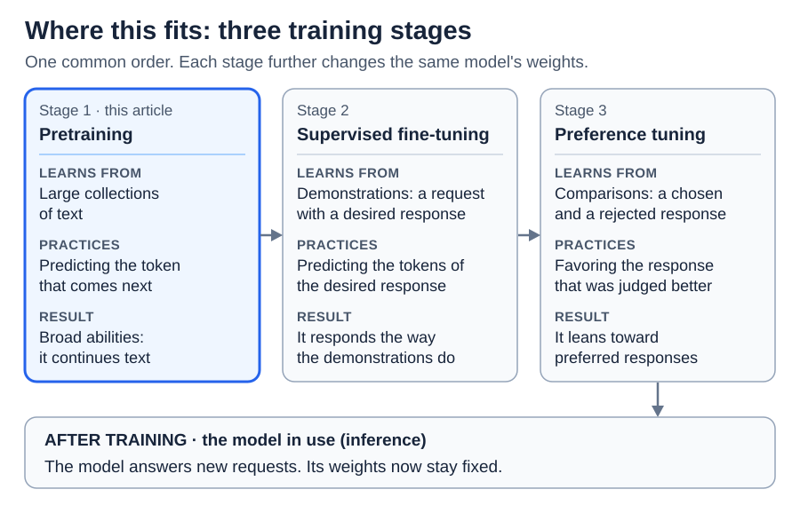
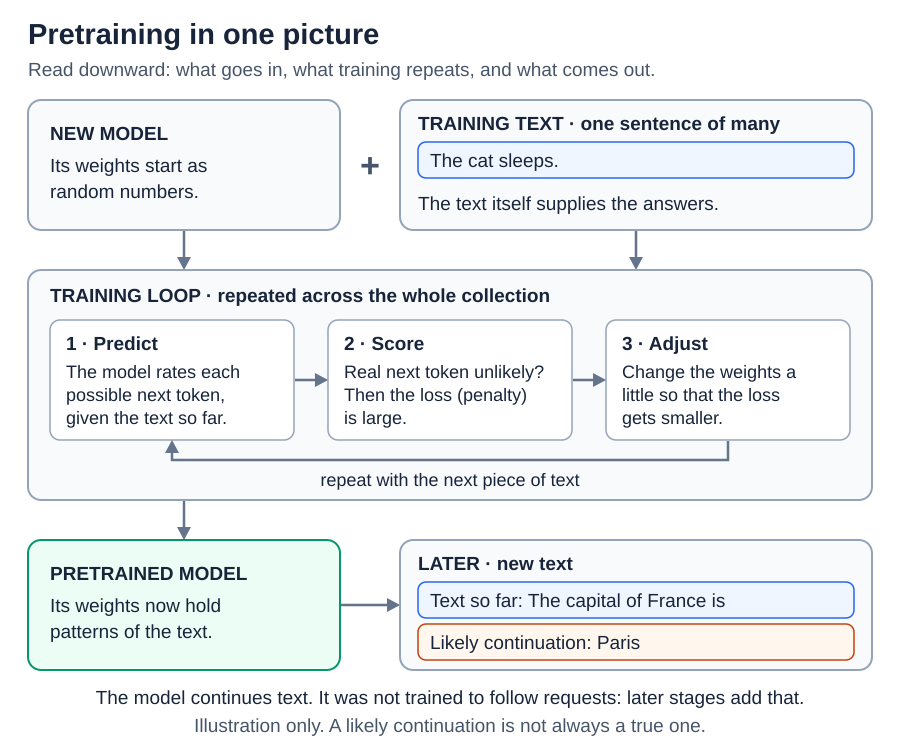
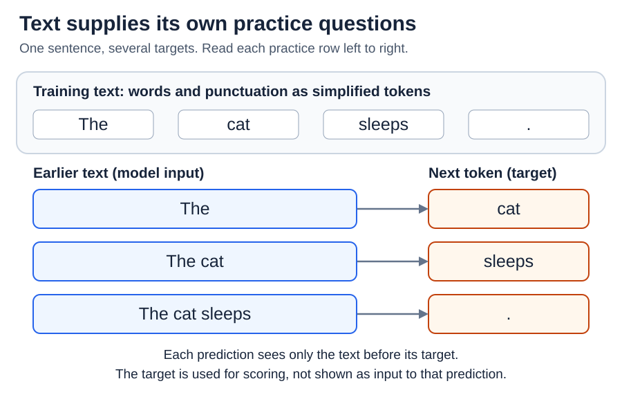
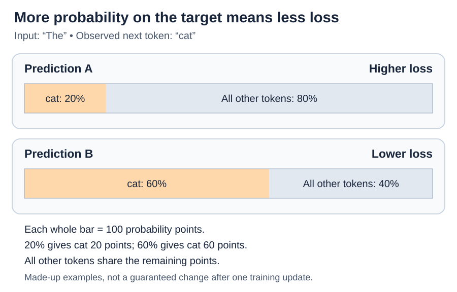

# Training: Pretraining - learning from next-token prediction

[Back to Artificial Intelligence](../Readme.md#content)

**Pretraining develops a model's broad starting abilities from large datasets. In next-token pretraining, the exercise is: “Given the text so far, what comes next?”**

See where this stage sits, then the whole process, then the targets and the score.

## Where this fits

[Training vs. Inference](../Training%20vs.%20inference/Readme.md) showed training on one weight: predict, score, adjust. Pretraining is the first and largest run of that loop on a language model. Every later stage starts from its weights.

Read the three stages from left to right. The stage marked “this article” is pretraining. Compare the rows: the stages differ in what they learn from and what they practice.

## The whole process in one picture

A **token** is a piece of text the model processes: a word, part of a word, or punctuation.

Read downward. A new model, whose weights start as random numbers, and a large collection of text go in. The training loop predicts, scores, and adjusts, again and again. What comes out is a pretrained model: its weights now hold patterns of the text. The “LATER” box shows the result and its limit. The model continues text, but it was not trained to follow requests.

## Zoom in: the text supplies its own answers

A **target** is the token that actually comes next in a training example. Each row shows the earlier text a prediction can use and the target that scores it.

The prediction cannot look ahead at its target or later tokens; a **causal mask** enforces this inside the model. This is **self-supervised learning**: the data provides the targets, so a person does not need to label every prediction. People still choose and prepare the data.

## Zoom in: how a prediction gets scored

The model shares **100 probability points** among all possible next tokens. A **loss** is a penalty score. The usual next-token loss, **cross-entropy**, is smaller when the model gives more probability to the observed target. Compare two made-up predictions for the same example.

The target `cat` gets 60 points in B instead of 20 in A, so B has the lower loss. Training scores the target's probability; it does not first pick a word and mark it right or wrong. **Backpropagation** and an **optimizer** then adjust the weights to reduce the loss.

## Why this teaches more than sentence completion

Predicting text can benefit from patterns in grammar, facts, relationships, and code. Those patterns help on other tasks: pretrained models have shown translation, question answering, and some arithmetic.

**Generalization** means using learned patterns on new examples. **Memorization** means retaining particular training passages, sometimes word for word. Both can occur. To check generalization, evaluate on examples kept out of training.

The objective is to predict the recorded continuation, which may be a fact, a mistake, fiction, or an opinion. A likely continuation is therefore not a guarantee of truth.

## The training material matters

- **Mixture:** the amounts of different languages, books, and code shape what the model practices. Qwen3, for example, increased the share of science, mathematics, and code in a later pretraining stage.
- **Quality:** filtering and selecting useful material matter alongside quantity.
- **Repetition:** removing duplicate passages can reduce memorized output and make evaluation more trustworthy.

**Continued pretraining** resumes training an existing model on more text, often from one subject area. It updates weights; adding a document to a chat only gives the model more input for that conversation.

## Check your understanding

In `The cat sleeps.`, why is `cat` the target after `The`? **Because it is what this example contains**, not because every sentence starting with `The` must continue with `cat`.

# Sources

- [Hugging Face: Causal language modeling](https://huggingface.co/docs/transformers/tasks/language_modeling)
- [Hugging Face LLM course: random starting weights](https://huggingface.co/learn/llm-course/chapter1/4)
- [PyTorch: CrossEntropyLoss](https://docs.pytorch.org/docs/2.15/generated/torch.nn.CrossEntropyLoss.html)
- [Brown et al.: Language Models are Few-Shot Learners](https://arxiv.org/abs/2005.14165)
- [Qwen3 Technical Report, §3](https://arxiv.org/html/2505.09388v1)
- [Lee et al.: Training-data deduplication](https://arxiv.org/abs/2107.06499)
- [Gururangan et al.: Don't Stop Pretraining](https://arxiv.org/abs/2004.10964)
- [Ouyang et al.: InstructGPT](https://arxiv.org/abs/2203.02155)
