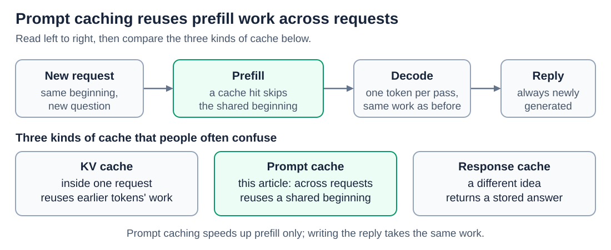
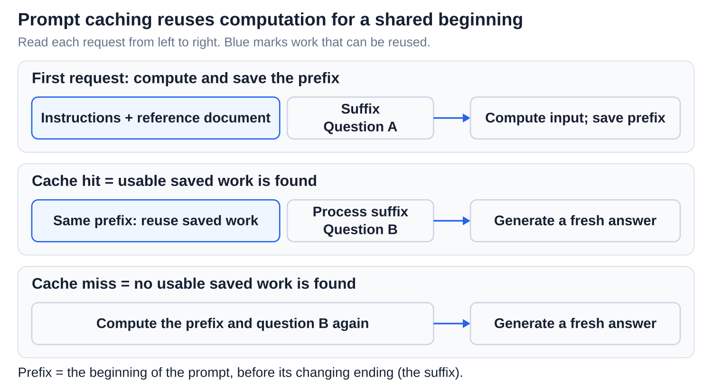
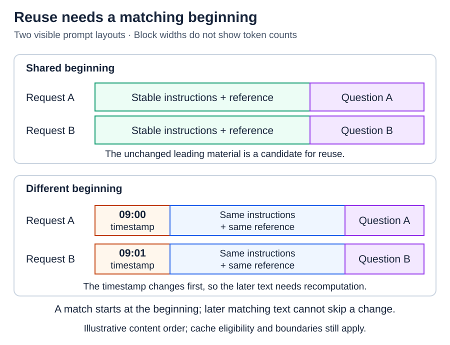

# Inference: Prompt caching across requests

[Back to Artificial Intelligence](../Readme.md#content)

**Prompt caching lets a later request reuse the prefill work for a prompt beginning that it shares with an earlier request. The model still reads the new part of the prompt and writes a fresh reply.**

## Where this fits

Every request runs prefill and then decoding, as [Prefill, decoding, and the KV cache](../Prefill%20and%20KV%20cache/Readme.md) explains. Without prompt caching, the KV cache is discarded when the request ends. Prompt caching keeps the work for a prompt's beginning, so the next request that starts the same way can skip that part of prefill:

Read the top row from left to right: only the prefill box changes, while decoding and the reply take the same work as before. The row below compares three kinds of cache that people often confuse: the KV cache inside one request, the prompt cache across requests, and a response cache that returns a stored answer.

## A cache hit, step by step

Picture asking several questions about one long document. The instructions and the document stay the same; only the question changes.

Read the diagram from top to bottom. The first request processes everything and saves the work for its beginning, the **prefix**. A later request starts with the identical prefix, so the service finds a match, a **cache hit**. It reuses the saved work, processes only the new question, and then generates a new answer. If no usable match exists, that is a **cache miss**, and the service computes the prefix again.

The diagram's bottom line warns about a common trap. Reusing 1,024 of 1,280 input tokens means that 80% of the input was cached, not that the request became 80% faster or cheaper. The reply still has to be written token by token, and prompt caching speeds up only the prefill phase.

## Why the beginning must match exactly

Matching works on the exact tokens from the very start of the prompt, not on similar meaning. Each token's saved work depends on everything before it, so one change near the start makes everything after it different, even text that looks identical.

The upper panel shows a good layout: stable instructions and reference material first, the changing question last, so both requests share their beginning. In the lower panel, a timestamp comes first and differs between the requests, so nothing after it can be reused.

The practical rule follows: put stable material first and changing material last, keep its wording and order the same, and add new messages to the end of a conversation instead of editing earlier ones.

## Provider rules, checked 2026-11-05

A hit also depends on the provider: the prefix must be long enough, use the same model and compatible settings, and still be stored. Two examples:

- **OpenAI, GPT-5.6 and later:** caching starts at 1,024 prompt tokens. Saved prefixes last at least 30 minutes by default, or 12 hours if you choose that in the Responses API. These lifetimes decide cache-read pricing; they do not promise reuse or lower latency.
- **Claude Messages API:** you turn caching on with `cache_control`. The minimum length depends on the model, and entries last 5 minutes by default, or 1 hour at extra cost.

Rules change, so check your model's documentation. Then measure cached-token counts, cost, and **time to first token**, the wait until the reply starts, before you assume a saving.

## What prompt caching is not

- It does not store answers: the reply is always generated fresh.
- It does not train the model or change its weights.
- It does not make replies repeatable: the same prompt can still produce a different reply.
- It does not shrink the input: cached tokens still count toward the model's context window, its limited input space.

# Sources

- [OpenAI: prompt caching, boundaries, lifetimes, and usage](https://developers.openai.com/api/docs/guides/prompt-caching)
- [Claude: prompt caching and model-specific limits](https://platform.claude.com/docs/en/build-with-claude/prompt-caching)
- [vLLM: automatic prefix caching and performance limits](https://docs.vllm.ai/en/latest/features/automatic_prefix_caching/)
- [vLLM: prefix matching and cache eviction](https://docs.vllm.ai/en/latest/design/prefix_caching/)
