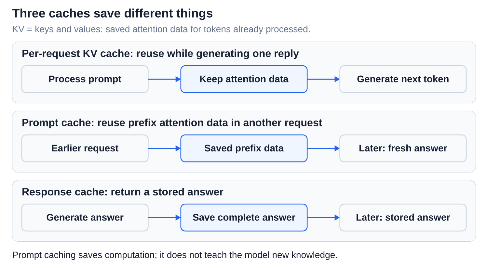
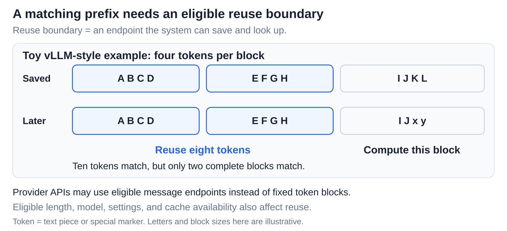
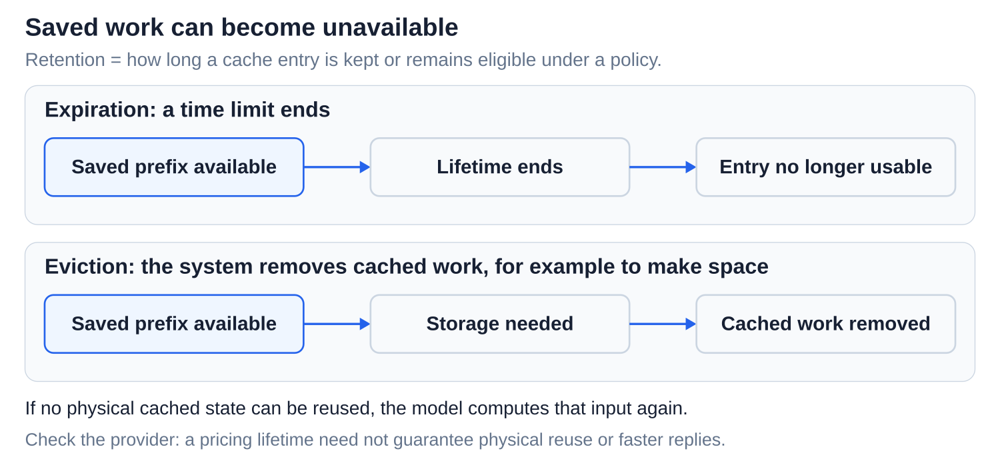
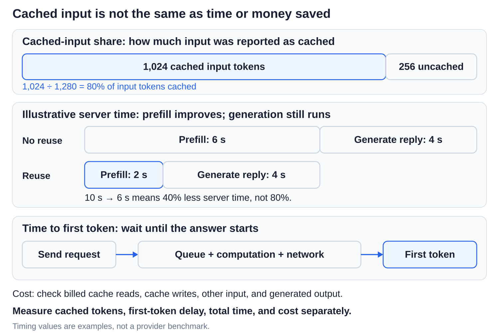

# Inference: Prompt caching across requests

[Back to Artificial Intelligence](../Readme.md#content)

**Prompt caching reuses computation for an unchanged beginning of a prompt across requests. The model still processes the new ending and generates a fresh answer.**

## Where this fits

The shared map highlights **prefix reuse across requests**. Follow the arrows from context assembly through model computation and token selection. The lower example separates reused prefix work from a new suffix and a fresh answer.

## Prefix, cache hit, and cache miss

A **token** is a text piece or special marker processed by the model. A **prefix** is the beginning of a prompt; its remaining ending is the **suffix**. For example, keep instructions and a reference document fixed, then ask different questions about it. A **cache hit** finds usable saved work. A **cache miss** computes that work again.

The saved work is attention data for already processed tokens: **keys and values (KV)**. Prompt caching reuses this data across requests. A per-request KV cache reuses it while writing one answer. A **response cache** instead returns a stored answer. None of these teaches the model new knowledge.

## Exact matching and a stable layout

An **exact prefix match** means the same tokens in the same order from the start. Each token's saved state depends on earlier tokens: matching text after an early change cannot repair the prefix. Similar meaning is insufficient.

Put stable instructions and documents first, changing questions last. Preserve wording and order; append messages instead of editing earlier ones. Tools, images, model choice, and relevant settings can also affect whether a prefix matches.

## Where reuse stops

A **reuse boundary** is an endpoint the system can save and look up. The longest identical text is not necessarily the amount reusable: systems have eligible endpoints and minimum lengths. In this vLLM example, ten tokens match, but only eight fill complete matching cache blocks.

## Retention, expiration, and eviction

**Retention** describes how long cached work is kept or remains eligible under a policy. **Expiration** follows a time limit; **eviction** removes work, for example to make space. A matching prefix may therefore miss. Provider pricing lifetimes and physical storage availability can differ.

Provider examples, checked **2026-11-06**:

- **OpenAI, GPT-5.6 and later:** a minimum of 1,024 visible input tokens; automatic caching or explicit eligible endpoints. The default minimum lifetime is 30 minutes; Responses also offers 12 hours. This lifetime governs cached-read pricing, without guaranteeing physical reuse or lower latency.
- **Claude Messages API:** opt in with `cache_control`. Minimum length depends on the model. The default lifetime is 5 minutes; a 1-hour option has different write pricing.

## Measure the benefit

**Cached-input share** is cached tokens divided by total input tokens. **Time to first token** is the wait until the answer starts. Neither predicts the whole request's time or cost: generating the answer still takes work, and prices distinguish cache reads, writes, and output.

Measure all of them. Cached tokens still occupy the prompt's available space, and a cache hit does not guarantee the same answer. For the computation within a request, see [Prefill, decoding, and the KV cache](../Prefill%20and%20KV%20cache/Readme.md).

# Sources

- [OpenAI: prompt caching, boundaries, lifetimes, and usage](https://developers.openai.com/api/docs/guides/prompt-caching)
- [Claude: prompt caching and model-specific limits](https://platform.claude.com/docs/en/build-with-claude/prompt-caching)
- [vLLM: automatic prefix caching and performance limits](https://docs.vllm.ai/en/latest/features/automatic_prefix_caching/)
- [vLLM: prefix-block diagrams and eviction](https://docs.vllm.ai/en/latest/design/prefix_caching/)
