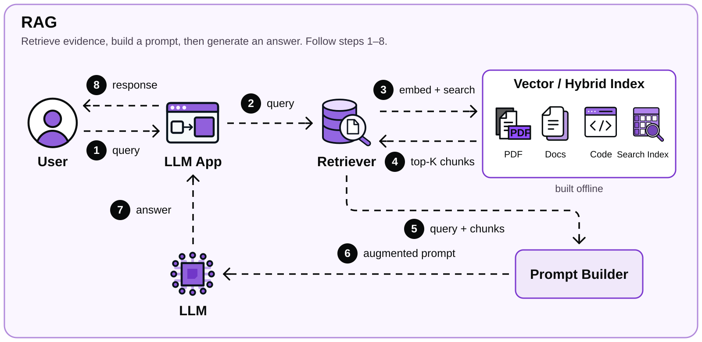
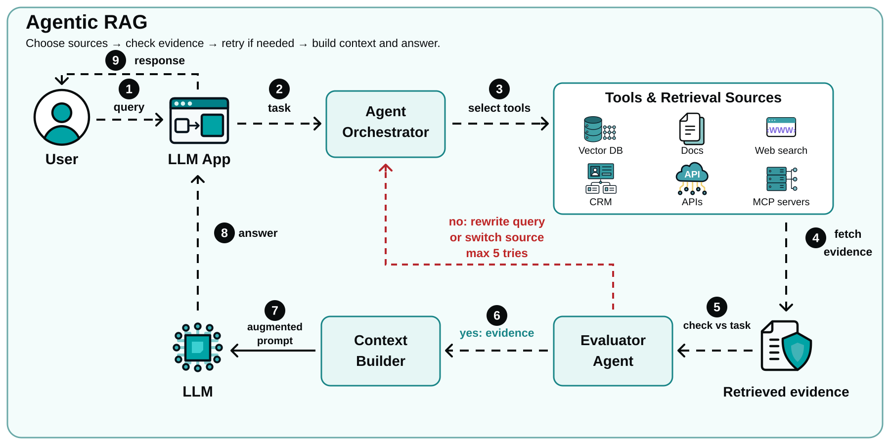

# RAG pipeline

[Back to Artificial Intelligence](../Readme.md#content)

**Retrieval-augmented generation (RAG) gives a large language model (LLM) external evidence to use when answering a question.** In the conventional pipeline, the application follows a predefined retrieval path. In agentic RAG, a model can choose retrieval tools, assess their results, and decide what to look up next.

1. [Components](#1-components)
2. [RAG](#2-rag)
3. [Agentic RAG](#3-agentic-rag)

## 1. Components

* A **query** is the user's question or a search request derived from it.
* A **chunk** is a passage taken from a document.
* An **embedding** is a numerical vector used to compare meaning.
* A **prompt** is the input supplied to a model.
* An **augmented prompt** adds retrieved evidence to the question and instructions.

### Shared components

| Component | What it does |
|---|---|
| **User** | Asks a question and receives the application's response. |
| **LLM App** | The application that accepts the question, coordinates the processing, and displays the answer. It connects the user interface to retrieval and model calls. |
| **LLM** | The large language model that generates an answer from the supplied prompt. It receives selected evidence; it does not automatically read every document or database available to the application. |

The **LLM App** and **LLM** are different roles: the application manages the request, while the model generates text. In the agentic diagram, the application also delegates retrieval decisions to the **Agent Orchestrator**.

### Components in the RAG diagram

| Component | What it does |
|---|---|
| **Retriever** | Searches for passages relevant to the query and returns candidate chunks. It is the search component, not the answer-writing model. |
| **Vector / Hybrid Index** | A searchable representation of the source material. Vector search compares embeddings; hybrid search combines vector and keyword search. The **PDF**, **Docs**, and **Code** icons represent source content prepared for retrieval. |
| **Prompt Builder** | Combines the original question, selected chunks, and instructions into the augmented prompt sent to the LLM. Source identifiers can be included so the answer can cite its evidence. |

**Built offline** means the index is prepared outside the individual question's retrieval flow. Documents are parsed, split into chunks, and indexed; vector search also needs embeddings. When content changes, the relevant indexed content must be updated. Query embeddings must be compatible with the document embeddings used by the index.

### Components in the agentic RAG diagram

| Component | What it does |
|---|---|
| **Agent Orchestrator** | Uses the task and information collected so far to choose a retrieval tool, formulate a query, or decide on another lookup. The application defines which tools it may use. |
| **Tools & Retrieval Sources** | The available ways to obtain information. The agent selects from these rather than always following the same search route. |
| **Retrieved evidence** | The passages, records, or other results returned by the chosen tools. These results still need to be checked for relevance and coverage of the task. |
| **Evaluator Agent** | Assesses whether the evidence is useful and sufficient for the task. In this diagram, it either sends evidence forward or returns control to the orchestrator for another retrieval attempt. |
| **Context Builder** | Organizes the accepted evidence, question, and instructions into the augmented prompt. It serves the same basic purpose as the conventional pipeline's Prompt Builder, but can combine results from different tools. |

The **Tools & Retrieval Sources** box contains six options:

- **Vector DB:** a vector database that supports similarity search over embedded content.
- **Docs:** documents that can be searched or read for relevant passages.
- **Web search:** a way to locate information on the web.
- **CRM:** a customer relationship management system containing customer and account records.
- **APIs:** application programming interfaces for obtaining information from other services, such as an order's delivery status.
- **MCP servers:** servers using the Model Context Protocol to expose tools and resources. MCP is an access protocol, not a separate kind of knowledge database.

The orchestrator and evaluator are **roles**, not a requirement to run different model products. This image illustrates one possible design; a system can implement both roles using the same underlying model.

## 2. RAG

1. **Query — User → LLM App.** The user submits a question. For example, “What is the return window?” The application receives the request and starts its configured RAG workflow.

2. **Query — LLM App → Retriever.** The application passes the question to the retriever. This changes the immediate task from writing an answer to finding the information needed to answer it.

3. **Embed + search — Retriever → Vector / Hybrid Index.** The retriever converts the search query into a compatible embedding and searches the prepared index. In a hybrid setup, it also uses keyword search. The system compares the query with indexed content to find relevant passages; it does not rebuild all document embeddings for every question.

4. **Top-K chunks — Vector / Hybrid Index → Retriever.** The index returns the highest-ranked `K` chunks, where `K` is the selected number of results. The retriever now has candidate passages and their associated source information. A high rank indicates a search match, not proof that a passage answers the question correctly.

5. **Query + chunks — Retriever → Prompt Builder.** The question and retrieved passages are passed to the prompt builder. Keeping the question alongside the evidence tells the next stage what the passages are supposed to help answer. An implementation can filter or rerank candidates before this handoff, although the image does not draw those operations separately.

6. **Augmented prompt — Prompt Builder → LLM.** The builder assembles instructions, the question, and selected evidence, then sends that context to the model. Instructions can ask it to cite supporting passages and say when evidence is missing. The retrieved material becomes available to the model through this prompt.

7. **Answer — LLM → LLM App.** The model generates an answer using the supplied context and returns it to the application. For the example question, it can summarize the return window stated in the retrieved policy. The application can check that any citations exist and support the claims before presenting the answer.

8. **Response — LLM App → User.** The application displays the result, including sources or limitations when appropriate. This completes the request. The diagram shows one retrieval pass; it has no evidence-check loop that automatically searches again.

## 3. Agentic RAG

1. **Query — User → LLM App.** The user submits a question. For example, “Can I return order A123, and what is the deadline?” The application receives a task that may need both policy documents and facts about the specific order.

2. **Task — LLM App → Agent Orchestrator.** The application passes the request and relevant context to the orchestrator. The orchestrator determines which information is needed to resolve the task, such as the return policy, delivery date, and any item-specific exceptions.

3. **Select tools — Agent Orchestrator → Tools & Retrieval Sources.** The agent chooses among its available tools and formulates their inputs. It might search documents for the policy and call an order API for the delivery date. The choice can depend on the question and earlier results; it does not have to call every tool in the box.

4. **Fetch evidence — Tools & Retrieval Sources → Retrieved evidence.** The selected tools execute and return information. Document search might return a policy passage, while an API returns an order record. The output is collected evidence with its source information, not yet the final answer.

5. **Check vs task — Retrieved evidence → Evaluator Agent.** The evaluator checks whether the results address the task and cover the facts needed to answer. A general return policy may be relevant but insufficient if the delivery date is missing. The decision is whether to proceed with the evidence or request another retrieval attempt; the evaluator can make mistakes.

6. **Yes: evidence — Evaluator Agent → Context Builder.** If the evaluator accepts the evidence, it passes that evidence forward for prompt construction. In the example, the system should have enough support to determine the applicable policy and deadline. If the evidence is insufficient, follow the red return arrow instead: the orchestrator can rewrite the query or switch sources, then repeat retrieval and evaluation. The image's **“max 5 tries”** is an example cap, not a requirement of agentic RAG. The application should enforce its chosen limit and define how attempts are counted. If the limit is reached, return the supported portion or explain what information is still missing; the image does not draw this fallback branch.

7. **Augmented prompt — Context Builder → LLM.** The builder combines the task, accepted evidence, source references, and answer instructions into the model's input. This is where policy text and order details can be brought together so the answer-writing model can use both.

8. **Answer — LLM → LLM App.** The model produces an answer from the assembled context and returns it to the application. It can explain the deadline and cite the supporting policy and order information. Successful evaluation does not guarantee a correct answer, so its claims and source support still need checking.

9. **Response — LLM App → User.** The application presents the answer and supporting information. If a source was unavailable or the evidence remained incomplete, the response should make that limitation clear rather than invent the missing fact.

# Sources

- [Microsoft: Design and develop a RAG solution](https://learn.microsoft.com/en-us/azure/architecture/ai-ml/guide/rag/rag-solution-design-and-evaluation-guide)

  Document preparation, retrieval, prompt construction, and the distinction between fixed and agentic retrieval.

- [LangChain: Retrieval architectures](https://docs.langchain.com/oss/python/langchain/retrieval)

  Retrieval components, tool-based retrieval, and different ways to control a RAG workflow.

- [LangGraph: Build a custom RAG agent](https://docs.langchain.com/oss/python/langgraph/agentic-rag)

  Model-selected retrieval, evidence grading, query rewriting, and conditional routing.

- [Anthropic: Building effective agents](https://www.anthropic.com/engineering/building-effective-agents)

  Model-directed tool use, evaluator roles, and stopping conditions.

- [Anthropic: Contextual Retrieval](https://www.anthropic.com/engineering/contextual-retrieval)

  Embeddings, keyword search, chunk context, and optional reranking.

- [Karpukhin et al.: Dense Passage Retrieval](https://arxiv.org/abs/2004.04906)

  Compatible question and passage embeddings for retrieval.

- [Gao et al.: Enabling Large Language Models to Generate Text with Citations](https://arxiv.org/abs/2305.14627)

  Checking whether citations support generated claims.

- [Model Context Protocol: Architecture](https://modelcontextprotocol.io/docs/learn/architecture)

  How MCP servers expose tools and resources.
