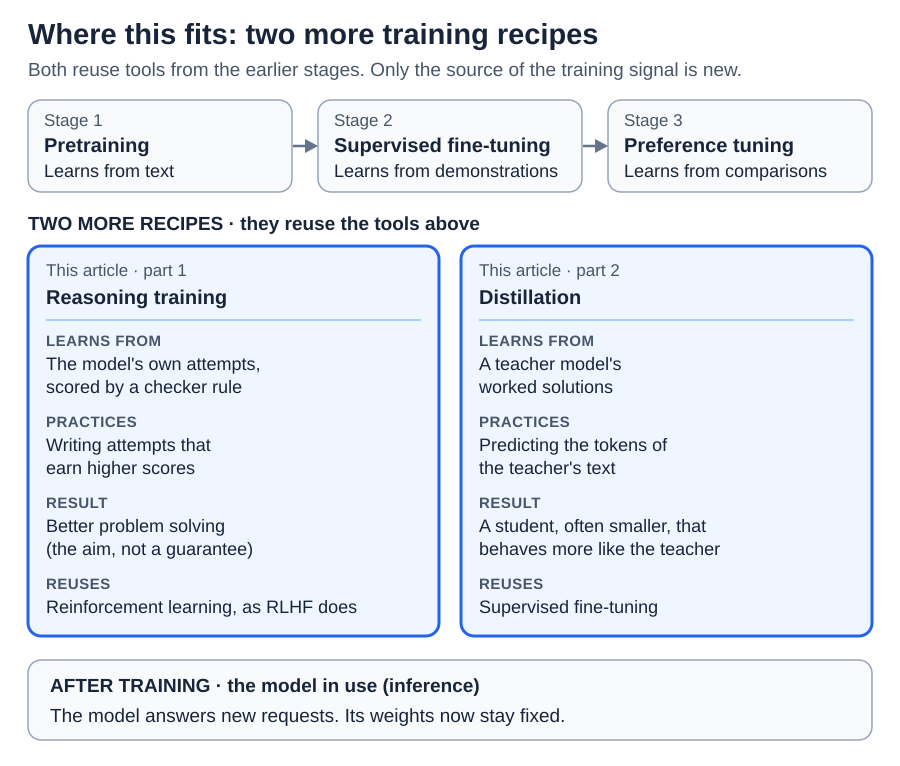
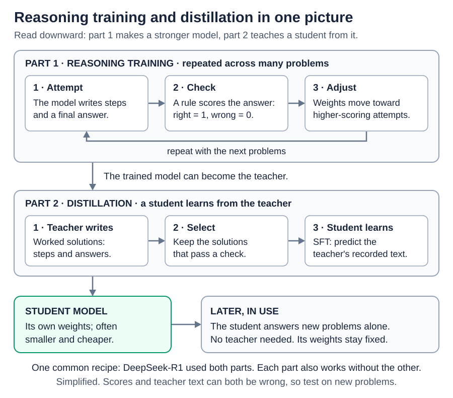
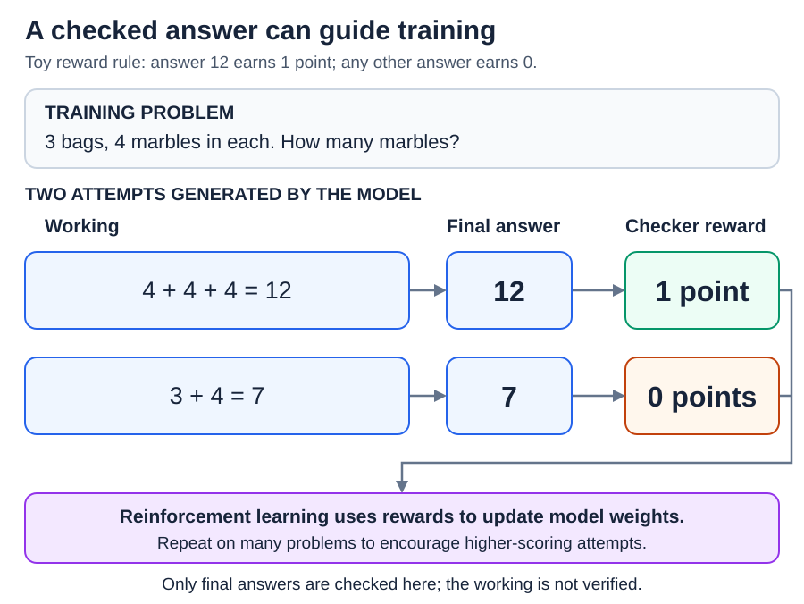

# Training: Reasoning training and distillation

[Back to Artificial Intelligence](../Readme.md#content)

**Reasoning training aims to improve problem solving by changing a model's learned numerical settings, or weights. Distillation trains a student model on a teacher model's outputs.**

Start with where these two recipes sit, then see both in one picture, then zoom in on each.

## Where this fits

Each earlier stage has its own source for the training signal: text, demonstrations, or comparisons. These two recipes reuse the same tools with a new source. Reasoning training uses **reinforcement learning (RL)**, as RLHF does in [Preference tuning - RLHF and DPO](../Preference%20tuning/Readme.md), but a rule supplies the score. Distillation uses [Supervised fine-tuning](../Supervised%20fine-tuning/Readme.md) (SFT), but a model writes the demonstrations.

Read the top row first: the three earlier stages. Then compare the two boxes marked “This article” row by row.

## Both recipes in one picture

A **reasoning trajectory** is one generated attempt: intermediate steps, often called a **chain of thought**, followed by a final answer.

Read downward. In part 1, the model attempts a problem, a rule checks the answer, and RL moves the weights toward higher-scoring attempts. In part 2, the trained model acts as a **teacher**: it writes worked solutions, selected ones become SFT examples, and a **student** learns to predict their **tokens**, meaning pieces of text. The student is often smaller, so it is cheaper to run. Later it answers without the teacher.

The two parts also work separately. DeepSeek-R1 used both: RL with rule-based math and code rewards, then SFT for its smaller distilled models.

## Zoom in: answers that can be checked

With **verifiable rewards**, a checker scores an attempt by a rule, such as matching a known math answer or running code tests. No person has to compare responses.

Consider three bags with four marbles each. In this toy setup, the checker gives **1 point** for the final answer `12` and **0 points** otherwise. These are training scores, not probabilities.

This is **outcome supervision**: feedback on the final result only. A lucky answer with faulty working still earns the point. **Process supervision** instead gives feedback on intermediate steps.

## Zoom in: what distillation transfers

Distillation teaches behavior through training; it does not copy the teacher's weights. Part 2 of the picture above is **output-based distillation**: the student learns from the teacher's text. Other forms match the teacher's probabilities: how it spreads chances among possible outputs.

A student is not guaranteed to match all of its teacher's abilities. Check it on problems kept out of training.

## Training versus extra thinking time

**Inference-time compute** means work spent producing an answer during use: generating more intermediate tokens, revising an attempt, or trying several solutions and selecting one.

| What happens? | Do model weights change? |
| --- | --- |
| RL training or student training | Yes: learning updates the model. |
| More computation during ordinary inference | No: the model does more work with the same weights. |

Training can make that extra work more useful. More time does not itself teach a lasting skill, and a longer response is not automatically a better solution.

## What the training signal misses

- **A check has limits.** Passing a few code tests does not prove a program works on every input. A final-answer check can miss incorrect working.
- **A teacher can be wrong.** Filtering examples helps, but checking only the final answer can preserve bad steps.
- **An explanation is not a complete record of internal computation.** Generated reasoning can omit influences on the answer or justify a mistaken conclusion.

## Check your understanding

1. A student learns from a teacher, then tries three answers at inference. When do its weights change?

   

   
Answer

   During training. The three attempts use fixed weights.

   

2. What scores each answer in the marble example?

   

   
Answer

   A rule gives one point for `12` and zero otherwise.

   

# Sources

- [DeepSeek-R1: RL rewards, training stages, and distillation](https://arxiv.org/html/2501.12948v1)
- [Hinton et al.: Knowledge distillation](https://arxiv.org/abs/1503.02531)
- [Hsieh et al.: Distilling Step-by-Step](https://arxiv.org/abs/2305.02301)
- [Lightman et al.: Outcome and process supervision](https://arxiv.org/abs/2305.20050)
- [Snell et al.: Inference-time computation](https://arxiv.org/html/2408.03314v1)
- [Turpin et al.: Unfaithful reasoning explanations](https://arxiv.org/abs/2305.04388)
