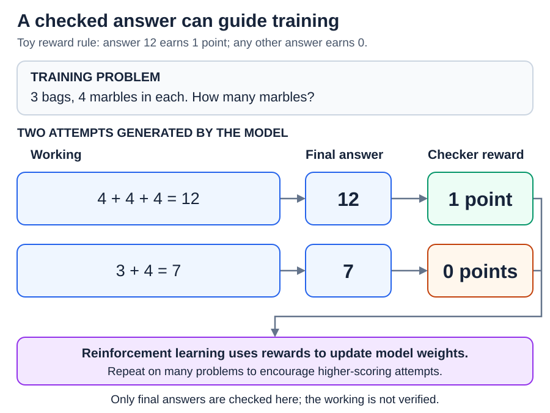
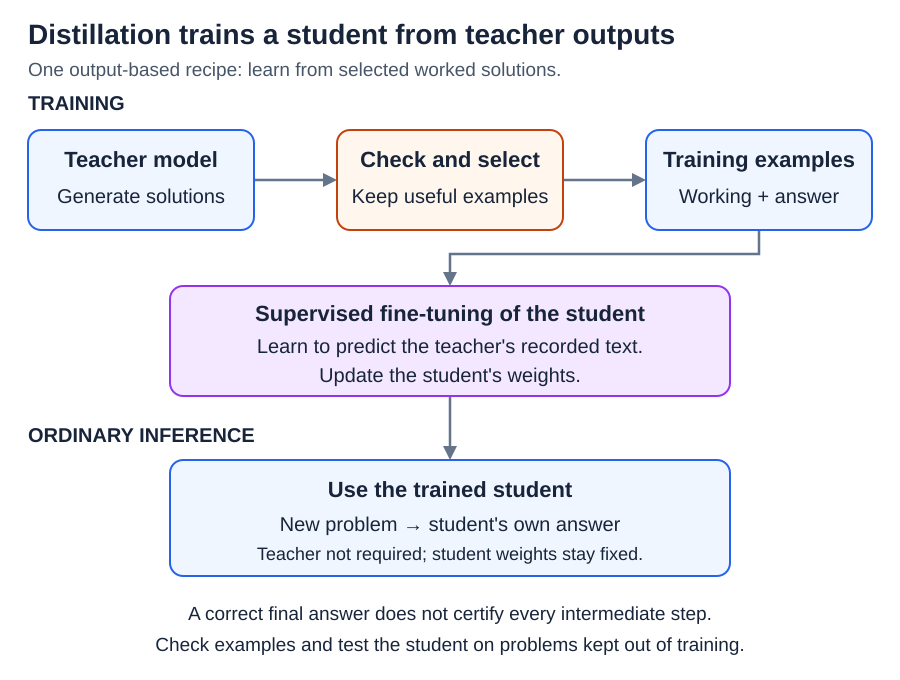

# Training: Reasoning training and distillation

[Back to Artificial Intelligence](../Readme.md#content)

**Reasoning training aims to improve problem solving by changing a model's learned numerical settings, or weights. Distillation trains a student model using a teacher model's outputs.**

See how rewards encourage useful attempts, how a teacher supplies examples, and how both differ from extra thinking time during use.

## What the model practices

Here, a **reasoning trajectory** is one generated attempt: intermediate steps followed by a final answer. The intermediate text is often called a **chain of thought**. It may include breaking a problem into parts, trying a method, or checking a result.

**Supervised fine-tuning (SFT)** can teach from worked solutions.

**Reinforcement learning (RL)** can encourage attempts that earn higher rewards. Recipes may combine these approaches.

## Learning from answers that can be checked

With **verifiable rewards**, a checker scores an attempt using a rule, such as matching a known math answer or running code tests. The checker applies the stated rule without needing a person to compare responses.

Consider three bags with four marbles each. Adding `4 + 4 + 4` gives `12`. In this toy setup, the checker gives **1 point** for the correct final answer and **0 points** otherwise. These are training scores, not probabilities.

The model generates attempts, the checker scores them, and RL uses those scores to update the model's weights. Repeating this across many problems can make higher-scoring approaches more likely.

This is **outcome supervision**: feedback on the final result. It does not verify each intermediate step. A lucky answer with faulty working can still earn the point. **Process supervision** instead gives feedback on intermediate steps.

For example, DeepSeek-R1 combined SFT and RL, including rule-based math and code rewards. Its smaller distilled models used SFT.

## Distillation: learn from a teacher

A **teacher** supplies training targets; a **student** learns from them. The student is often smaller so it can be cheaper to run. Distillation teaches behavior through training; it does not copy the teacher's weights.

Below, the teacher generates worked solutions. Selected solutions become SFT examples: the student practices predicting their next **tokens**, meaning pieces of text. Later, the student can answer without calling the teacher.

This is **output-based distillation**, using intermediate steps and final answers. Other forms match the teacher's probabilities: how it spreads chances among possible outputs.

The goal is useful behavior on new problems. A student is not guaranteed to match all of its teacher's abilities. Check performance on problems that were kept out of training.

## Training versus extra thinking time

**Inference-time compute** means work spent producing an answer during use. Extra work can mean generating more intermediate tokens, revising an attempt, or trying several solutions and selecting one.

| What happens? | Do model weights change? |
| --- | --- |
| RL training or student training | Yes: learning updates the model. |
| More computation during ordinary inference | No: the model does more work with the same weights. |

Training can make that extra work more useful. Giving a model more time does not itself teach it a new lasting skill, and a longer response is not automatically a better solution. Benefits depend on the task, model, and how the work is used.

## What the training signal misses

- **A check has limits.** Passing a few code tests does not prove a program works on every input. A final-answer check can miss incorrect working.
- **A teacher can be wrong.** Filtering examples helps, but checking only the final answer can preserve bad steps.
- **An explanation is not a complete record of internal computation.** Generated reasoning can omit influences on the answer or justify a mistaken conclusion.

## Check your understanding

A student studies teacher solutions, then tries three approaches to a new problem. When do its weights change? **During student training.** Trying more approaches at ordinary inference uses the learned weights without updating them.

# Sources

- [DeepSeek-R1: RL rewards, training stages, and distillation](https://arxiv.org/html/2501.12948v1)
- [Hinton et al.: Knowledge distillation](https://arxiv.org/abs/1503.02531)
- [Hsieh et al.: Distilling Step-by-Step](https://arxiv.org/abs/2305.02301)
- [Lightman et al.: Outcome and process supervision](https://arxiv.org/abs/2305.20050)
- [Snell et al.: Inference-time computation](https://arxiv.org/html/2408.03314v1)
- [Turpin et al.: Unfaithful reasoning explanations](https://arxiv.org/abs/2305.04388)
