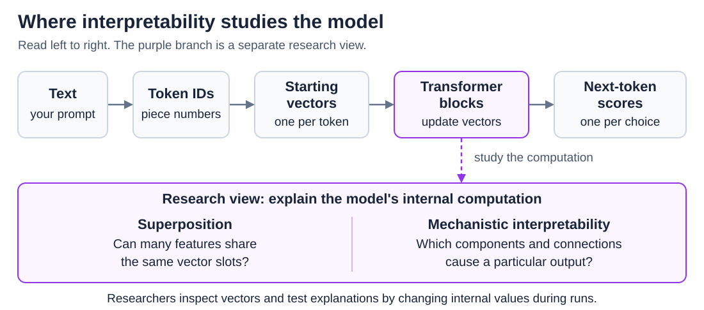
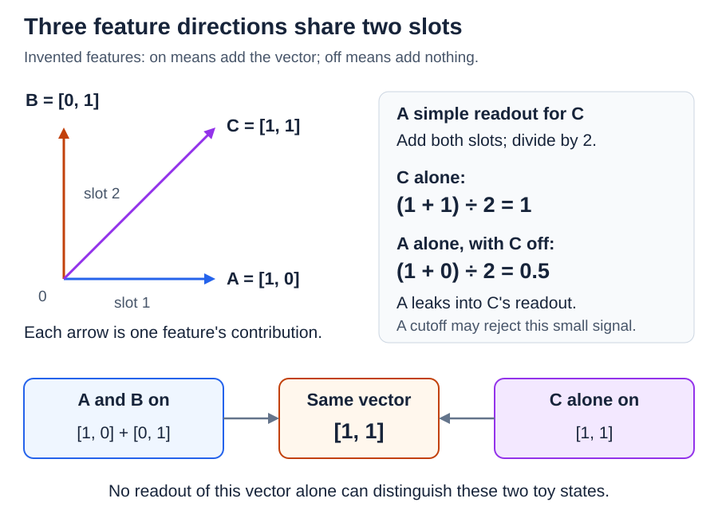
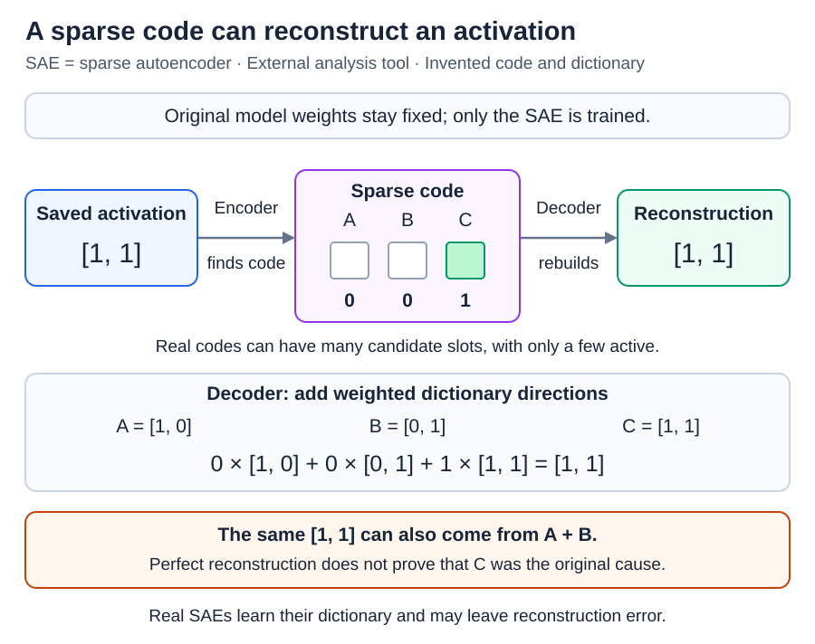
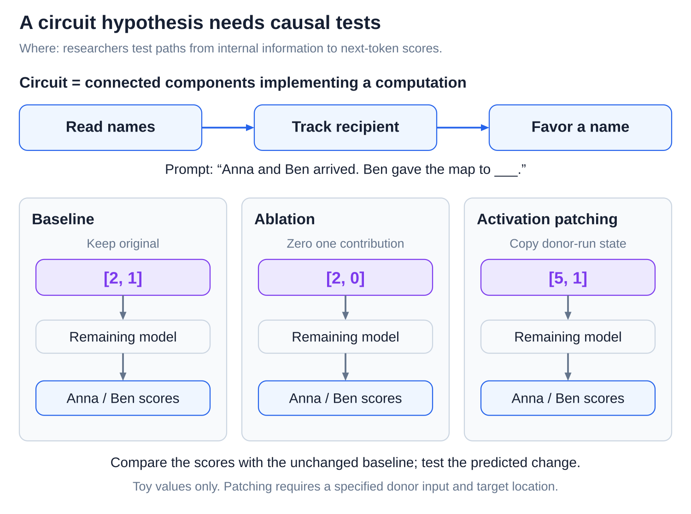

# Superposition and mechanistic interpretability

[Back to Artificial Intelligence](../Readme.md#content)

**Superposition is the idea that a model stores more features than its vectors have slots, by letting their directions overlap. Mechanistic interpretability is the effort to explain, step by step, how a model's internal computations produce its behavior.**

## Where this fits

[Features and the linear representation hypothesis](../Features%20and%20the%20linear%20representation%20hypothesis/Readme.md) described a **feature**, a property the model represents such as past tense, as a direction in the model's vectors. In that linear picture, features add their directions, scaled by how strongly they are active. This article asks what happens when there are more features than slots, how researchers untangle them, and how they test an explanation of a whole computation:

Read the model's route from left to right. The purple branch shows the two research questions explored here.

## More features than slots

A model's vector has a fixed number of slots, called **dimensions**, usually thousands. Yet a model may want to track far more things than that: names, topics, languages, grammar, and much more. The **superposition hypothesis** says that a model packs the extra features into the same space by giving them overlapping directions.

The diagram shows the smallest possible case. Three invented features, A, B, and C, share two slots. When a feature is on, it adds its own arrow: A points along slot 1, B along slot 2, and C diagonally between them. Each feature alone is easy to recognize. But the bottom row shows the catch: A and B together produce exactly the same vector as C alone, so nothing can tell those two situations apart from that vector by itself. Such an exact tie is special to this toy; real overlaps are usually partial.

## Interference, and why sparsity helps

Partial overlap causes **interference**: one feature leaks into the measurement meant for another. In the diagram's “simple readout for C,” feature A alone produces half of C's full signal, even though C is off. A cutoff can ignore such a small leak, but it cannot fix an exact tie.

Overlap is affordable when features are **sparse**, meaning that each one is rarely active. Most tokens are not about Martin Luther King or part of a sentence about music, so features like these seldom need to be read at the same time. Toy models show this trade-off clearly; it is not free, unlimited storage.

Superposition is one explanation for **polysemantic neurons**, neurons that respond to several unrelated things, but not the only possible cause. Likewise, a feature spread across several slots does not prove superposition by itself.

## Sparse autoencoders: listing the features

If features overlap, how can researchers find them? A **sparse autoencoder (SAE)** is a separate tool trained on a model's saved vectors, while the model itself stays unchanged.

Read the diagram from left to right. The **encoder** turns a saved vector into a long list of candidate feature slots with only a few switched on, called a **sparse code**. The **decoder** rebuilds the original vector by adding the directions of the active slots, taken from a learned collection called the **dictionary**. Training rewards an accurate rebuild that uses as few active slots as possible, and the SAE learns the dictionary itself; nobody supplies concept names.

The box “The same [1, 1] can also come from A + B” holds the main warning: the vector is rebuilt perfectly with C alone, but it could also have come from A plus B. A good rebuild does not prove that the SAE found the real cause. Real SAEs also leave some **reconstruction error**, and their candidate features can miss or blend real structure. A readable label on a slot is a hypothesis to test.

## From features to mechanisms

Features are like the model's vocabulary; mechanistic interpretability wants its sentences. A **circuit** is a set of internal components and connections that together carry out one computation.

The diagram uses the prompt “Anna and Ben arrived. Ben gave the map to ___,” where the right answer is Anna. To test a proposed circuit, researchers compare three runs: a **baseline** that changes nothing, an **ablation** that switches off a suspected contribution, and **activation patching**, which swaps in a vector from a different run. If the explanation is right, the scores for “Anna” and “Ben” change in the predicted way.

These tests show cause and effect, not just that something lights up near the answer. They still need care: backup pathways can hide an ablation's effect, and a clumsy edit can break unrelated computations. Researchers have traced and tested a circuit for this name task in GPT-2 small. That is real progress on one behavior, not a full account of the model.

# Sources

- [Toy Models of Superposition](https://transformer-circuits.pub/2022/toy_model/index.html)
- [Sparse Autoencoders Find Highly Interpretable Features](https://arxiv.org/abs/2309.08600)
- [Scaling and Evaluating Sparse Autoencoders](https://arxiv.org/html/2406.04093v1)
- [Interpretability in the Wild: circuits and causal tests](https://arxiv.org/html/2211.00593v1)
- [Circuit Tracing: methods and limitations](https://transformer-circuits.pub/2025/attribution-graphs/methods.html)
